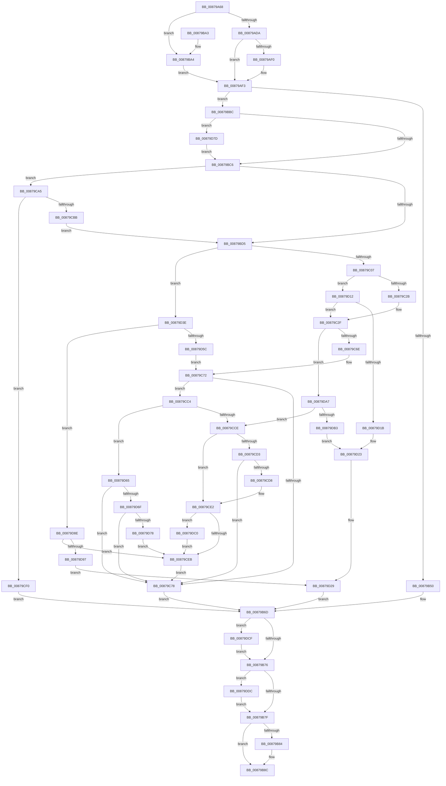

# CmpOpenHiveFiles

- RVA: `0x00879A68`–`0x00879DE9` (길이 `897` bytes)
- VA: `0x0000000140879A68`
- 실행 섹션: `PAGE`
- PDB 이름 있음: `예`; PDB Function 태그: `아니요`
- unwind 정보 RVA: `0x0006CD68`
- 디코드: `234`개 명령, `897/897` bytes 표시
- 미해석 바이트: `0` (있으면 어셈블리에 `.byte`로 보존)

> 이 문서는 커널 이미지의 기계어와 PDB 기호를 분석해 생성했습니다. 4번과 5번은 함수 원형과 자료형을 바이너리 사용 방식에서 추정한 C 해석이며 원본 소스 복구 결과는 아닙니다.

## 1. Dependencies

- 직접 호출 지점: **13**; 고유 호출 대상: **5**
- 직접 호출자로 확인된 함수: **2**
- RIP 상대 이미지 참조: **0**

### Outgoing calls
- `0x00879B44` → [CmpOpenHiveFile](CmpOpenHiveFile_function_0087A71C.md) (function, `0x0087A71C`)
- `0x00879B64` → [SetFailureLocation](../../text/46/SetFailureLocation_function_0046EF54.md) (function, `0x0046EF54`)
- `0x00879B87` → [CmSiFreeMemory](../../text/47/CmSiFreeMemory_function_00475D80.md) (function, `0x00475D80`)
- `0x00879C1C` → [CmpOpenHiveFile](CmpOpenHiveFile_function_0087A71C.md) (function, `0x0087A71C`)
- `0x00879C61` → [CmpOpenHiveFile](CmpOpenHiveFile_function_0087A71C.md) (function, `0x0087A71C`)
- `0x00879CAC` → [CmpQueryFileSecurityDescriptor](CmpQueryFileSecurityDescriptor_function_0087B318.md) (function, `0x0087B318`)
- `0x00879CDB` → [ZwClose](../../text/6A/ZwClose_function_006AD2B0.md) (function, `0x006AD2B0`)
- `0x00879D04` → [SetFailureLocation](../../text/46/SetFailureLocation_function_0046EF54.md) (function, `0x0046EF54`)
- `0x00879D34` → [SetFailureLocation](../../text/46/SetFailureLocation_function_0046EF54.md) (function, `0x0046EF54`)
- `0x00879D53` → [CmpOpenHiveFile](CmpOpenHiveFile_function_0087A71C.md) (function, `0x0087A71C`)
- `0x00879DC3` → [ZwClose](../../text/6A/ZwClose_function_006AD2B0.md) (function, `0x006AD2B0`)
- `0x00879DD2` → [ZwClose](../../text/6A/ZwClose_function_006AD2B0.md) (function, `0x006AD2B0`)
- `0x00879DDF` → [ZwClose](../../text/6A/ZwClose_function_006AD2B0.md) (function, `0x006AD2B0`)

### Direct callers
- [CmpHiveCachePopulateHiveEntryThread](../7F/CmpHiveCachePopulateHiveEntryThread_function_007F5FD0.md) at `0x007F60C8`
- [CmpInitHiveFromFile](CmpInitHiveFromFile_function_008794D4.md) at `0x00879691`

### Static image references
- 디코드된 RIP-relative 메모리 참조가 없습니다.

## 2. Other-region calls and transfers

- 다른 실행 섹션으로 향하는 call: **8**
  - `0x00879B64` → [SetFailureLocation](../../text/46/SetFailureLocation_function_0046EF54.md) (`PAGE` → `.text`)
  - `0x00879B87` → [CmSiFreeMemory](../../text/47/CmSiFreeMemory_function_00475D80.md) (`PAGE` → `.text`)
  - `0x00879CDB` → [ZwClose](../../text/6A/ZwClose_function_006AD2B0.md) (`PAGE` → `.text`)
  - `0x00879D04` → [SetFailureLocation](../../text/46/SetFailureLocation_function_0046EF54.md) (`PAGE` → `.text`)
  - `0x00879D34` → [SetFailureLocation](../../text/46/SetFailureLocation_function_0046EF54.md) (`PAGE` → `.text`)
  - `0x00879DC3` → [ZwClose](../../text/6A/ZwClose_function_006AD2B0.md) (`PAGE` → `.text`)
  - `0x00879DD2` → [ZwClose](../../text/6A/ZwClose_function_006AD2B0.md) (`PAGE` → `.text`)
  - `0x00879DDF` → [ZwClose](../../text/6A/ZwClose_function_006AD2B0.md) (`PAGE` → `.text`)
- 별도 외부 분기/꼬리 이동을 확인하지 못했습니다.

## 3. Assembly (complete function range)

```asm
00879A68  48 8B C4                        mov rax, rsp
00879A6B  4C 89 48 20                     mov qword ptr [rax + 0x20], r9
00879A6F  44 89 40 18                     mov dword ptr [rax + 0x18], r8d
00879A73  48 89 48 08                     mov qword ptr [rax + 8], rcx
00879A77  55                              push rbp
00879A78  53                              push rbx
00879A79  56                              push rsi
00879A7A  57                              push rdi
00879A7B  41 54                           push r12
00879A7D  41 55                           push r13
00879A7F  41 56                           push r14
00879A81  41 57                           push r15
00879A83  48 8D 68 B9                     lea rbp, [rax - 0x47]
00879A87  48 81 EC 98 00 00 00            sub rsp, 0x98
00879A8E  45 33 E4                        xor r12d, r12d
00879A91  C6 45 57 01                     mov byte ptr [rbp + 0x57], 1
00879A95  4C 8B D1                        mov r10, rcx
00879A98  44 89 65 C7                     mov dword ptr [rbp - 0x39], r12d
00879A9C  41 8B C8                        mov ecx, r8d
00879A9F  44 89 65 CB                     mov dword ptr [rbp - 0x35], r12d
00879AA3  C1 E9 13                        shr ecx, 0x13
00879AA6  8B C2                           mov eax, edx
00879AA8  83 E1 40                        and ecx, 0x40
00879AAB  44 89 65 DB                     mov dword ptr [rbp - 0x25], r12d
00879AAF  25 00 80 00 00                  and eax, 0x8000
00879AB4  44 88 65 BF                     mov byte ptr [rbp - 0x41], r12b
00879AB8  41 8B DC                        mov ebx, r12d
00879ABB  89 45 D7                        mov dword ptr [rbp - 0x29], eax
00879ABE  4C 89 65 DF                     mov qword ptr [rbp - 0x21], r12
00879AC2  41 8B FC                        mov edi, r12d
00879AC5  48 89 5D CF                     mov qword ptr [rbp - 0x31], rbx
00879AC9  45 8B EC                        mov r13d, r12d
00879ACC  4C 89 65 EF                     mov qword ptr [rbp - 0x11], r12
00879AD0  4C 89 65 E7                     mov qword ptr [rbp - 0x19], r12
00879AD4  0F 85 CA 00 00 00               jne 0x140879ba4
00879ADA  48 8B 45 6F                     mov rax, qword ptr [rbp + 0x6f]
00879ADE  8B D1                           mov edx, ecx
00879AE0  83 CA 02                        or edx, 2
00879AE3  41 0F BA E0 1E                  bt r8d, 0x1e
00879AE8  0F 43 D1                        cmovae edx, ecx
00879AEB  44 38 20                        cmp byte ptr [rax], r12b
00879AEE  74 03                           je 0x140879af3
00879AF0  83 CA 01                        or edx, 1
00879AF3  48 8B 85 87 00 00 00            mov rax, qword ptr [rbp + 0x87]
00879AFA  4C 8D 4D C7                     lea r9, [rbp - 0x39]
00879AFE  48 8B B5 8F 00 00 00            mov rsi, qword ptr [rbp + 0x8f]
00879B05  44 8B FA                        mov r15d, edx
00879B08  48 89 74 24 48                  mov qword ptr [rsp + 0x48], rsi
00879B0D  41 0F BA EF 08                  bts r15d, 8
00879B12  4C 89 64 24 40                  mov qword ptr [rsp + 0x40], r12
00879B17  41 F6 C0 10                     test r8b, 0x10
00879B1B  4C 89 64 24 38                  mov qword ptr [rsp + 0x38], r12
00879B20  4C 8D 45 DF                     lea r8, [rbp - 0x21]
00879B24  48 89 44 24 30                  mov qword ptr [rsp + 0x30], rax
00879B29  44 0F 44 FA                     cmove r15d, edx
00879B2D  48 8B 45 7F                     mov rax, qword ptr [rbp + 0x7f]
00879B31  33 D2                           xor edx, edx
00879B33  48 89 44 24 28                  mov qword ptr [rsp + 0x28], rax
00879B38  49 8B CA                        mov rcx, r10
00879B3B  44 89 7D C3                     mov dword ptr [rbp - 0x3d], r15d
00879B3F  44 89 7C 24 20                  mov dword ptr [rsp + 0x20], r15d
00879B44  E8 D3 0B 00 00                  call 0x14087a71c
00879B49  44 8B F0                        mov r14d, eax
00879B4C  85 C0                           test eax, eax
00879B4E  79 6C                           jns 0x140879bbc
00879B50  33 D2                           xor edx, edx
00879B52  C7 44 24 20 10 00 00 00         mov dword ptr [rsp + 0x20], 0x10
00879B5A  44 8B C8                        mov r9d, eax
00879B5D  48 8B CE                        mov rcx, rsi
00879B60  44 8D 42 2D                     lea r8d, [rdx + 0x2d]
00879B64  E8 EB 53 BF FF                  call 0x14046ef54
00879B69  4C 8B 65 DF                     mov r12, qword ptr [rbp - 0x21]
00879B6D  4D 85 E4                        test r12, r12
00879B70  0F 85 59 02 00 00               jne 0x140879dcf
00879B76  48 85 DB                        test rbx, rbx
00879B79  0F 85 5D 02 00 00               jne 0x140879ddc
00879B7F  4D 85 ED                        test r13, r13
00879B82  74 08                           je 0x140879b8c
00879B84  49 8B CD                        mov rcx, r13
00879B87  E8 F4 C1 BF FF                  call 0x140475d80
00879B8C  41 8B C6                        mov eax, r14d
00879B8F  48 81 C4 98 00 00 00            add rsp, 0x98
00879B96  41 5F                           pop r15
00879B98  41 5E                           pop r14
00879B9A  41 5D                           pop r13
00879B9C  41 5C                           pop r12
00879B9E  5F                              pop rdi
00879B9F  5E                              pop rsi
00879BA0  5B                              pop rbx
00879BA1  5D                              pop rbp
00879BA2  C3                              ret
00879BA3  CC                              int3
00879BA4  81 E2 00 00 04 00               and edx, 0x40000
00879BAA  44 88 65 57                     mov byte ptr [rbp + 0x57], r12b
00879BAE  0F BA EA 10                     bts edx, 0x10
00879BB2  C1 EA 0B                        shr edx, 0xb
00879BB5  0B D1                           or edx, ecx
00879BB7  E9 37 FF FF FF                  jmp 0x140879af3
00879BBC  83 7D C7 02                     cmp dword ptr [rbp - 0x39], 2
00879BC0  0F 84 B7 01 00 00               je 0x140879d7d
00879BC6  4C 8B 65 DF                     mov r12, qword ptr [rbp - 0x21]
00879BCA  33 C0                           xor eax, eax
00879BCC  39 45 D7                        cmp dword ptr [rbp - 0x29], eax
00879BCF  0F 84 D0 00 00 00               je 0x140879ca5
00879BD5  F7 45 5F 00 00 00 10            test dword ptr [rbp + 0x5f], 0x10000000
00879BDC  4C 8D 4D CB                     lea r9, [rbp - 0x35]
00879BE0  48 89 74 24 48                  mov qword ptr [rsp + 0x48], rsi
00879BE5  4C 8D 45 CF                     lea r8, [rbp - 0x31]
00879BE9  48 89 44 24 40                  mov qword ptr [rsp + 0x40], rax
00879BEE  4C 89 6C 24 38                  mov qword ptr [rsp + 0x38], r13
00879BF3  48 89 44 24 30                  mov qword ptr [rsp + 0x30], rax
00879BF8  48 8B 45 7F                     mov rax, qword ptr [rbp + 0x7f]
00879BFC  48 89 44 24 28                  mov qword ptr [rsp + 0x28], rax
00879C01  0F 85 37 01 00 00               jne 0x140879d3e
00879C07  8B 7D C3                        mov edi, dword ptr [rbp - 0x3d]
00879C0A  41 BF 02 00 00 00               mov r15d, 2
00879C10  48 8B 4D 4F                     mov rcx, qword ptr [rbp + 0x4f]
00879C14  89 7C 24 20                     mov dword ptr [rsp + 0x20], edi
00879C18  41 8D 57 02                     lea edx, [r15 + 2]
00879C1C  E8 FB 0A 00 00                  call 0x14087a71c
00879C21  33 C9                           xor ecx, ecx
00879C23  85 C0                           test eax, eax
00879C25  0F 88 E7 00 00 00               js 0x140879d12
00879C2B  48 8B 5D CF                     mov rbx, qword ptr [rbp - 0x31]
00879C2F  48 8B 45 7F                     mov rax, qword ptr [rbp + 0x7f]
00879C33  4C 8D 4D DB                     lea r9, [rbp - 0x25]
00879C37  48 89 74 24 48                  mov qword ptr [rsp + 0x48], rsi
00879C3C  4C 8D 45 EF                     lea r8, [rbp - 0x11]
00879C40  48 89 4C 24 40                  mov qword ptr [rsp + 0x40], rcx
00879C45  BA 05 00 00 00                  mov edx, 5
00879C4A  4C 89 6C 24 38                  mov qword ptr [rsp + 0x38], r13
00879C4F  48 89 4C 24 30                  mov qword ptr [rsp + 0x30], rcx
00879C54  48 8B 4D 4F                     mov rcx, qword ptr [rbp + 0x4f]
00879C58  48 89 44 24 28                  mov qword ptr [rsp + 0x28], rax
00879C5D  89 7C 24 20                     mov dword ptr [rsp + 0x20], edi
00879C61  E8 B6 0A 00 00                  call 0x14087a71c
00879C66  85 C0                           test eax, eax
00879C68  0F 88 39 01 00 00               js 0x140879da7
00879C6E  48 8B 7D EF                     mov rdi, qword ptr [rbp - 0x11]
00879C72  80 7D 57 00                     cmp byte ptr [rbp + 0x57], 0
00879C76  74 4C                           je 0x140879cc4
00879C78  48 8B 45 77                     mov rax, qword ptr [rbp + 0x77]
00879C7C  48 8B 4D 6F                     mov rcx, qword ptr [rbp + 0x6f]
00879C80  4C 89 20                        mov qword ptr [rax], r12
00879C83  45 33 E4                        xor r12d, r12d
00879C86  48 89 58 08                     mov qword ptr [rax + 8], rbx
00879C8A  33 DB                           xor ebx, ebx
00879C8C  48 21 58 18                     and qword ptr [rax + 0x18], rbx
00879C90  48 89 78 10                     mov qword ptr [rax + 0x10], rdi
00879C94  8A 45 BF                        mov al, byte ptr [rbp - 0x41]
00879C97  88 01                           mov byte ptr [rcx], al
00879C99  48 8B 45 67                     mov rax, qword ptr [rbp + 0x67]
00879C9D  44 89 38                        mov dword ptr [rax], r15d
00879CA0  E9 C8 FE FF FF                  jmp 0x140879b6d
00879CA5  48 8D 55 E7                     lea rdx, [rbp - 0x19]
00879CA9  49 8B CC                        mov rcx, r12
00879CAC  E8 67 16 00 00                  call 0x14087b318
00879CB1  44 8B F0                        mov r14d, eax
00879CB4  33 C0                           xor eax, eax
00879CB6  45 85 F6                        test r14d, r14d
00879CB9  78 35                           js 0x140879cf0
00879CBB  4C 8B 6D E7                     mov r13, qword ptr [rbp - 0x19]
00879CBF  E9 11 FF FF FF                  jmp 0x140879bd5
00879CC4  41 83 FF 02                     cmp r15d, 2
00879CC8  0F 85 97 00 00 00               jne 0x140879d65
00879CCE  48 85 DB                        test rbx, rbx
00879CD1  74 0F                           je 0x140879ce2
00879CD3  48 85 FF                        test rdi, rdi
00879CD6  75 A0                           jne 0x140879c78
00879CD8  48 8B CB                        mov rcx, rbx
00879CDB  E8 D0 35 E3 FF                  call 0x1406ad2b0
00879CE0  33 DB                           xor ebx, ebx
00879CE2  48 85 FF                        test rdi, rdi
00879CE5  0F 85 D5 00 00 00               jne 0x140879dc0
00879CEB  45 33 FF                        xor r15d, r15d
00879CEE  EB 88                           jmp 0x140879c78
00879CF0  33 D2                           xor edx, edx
00879CF2  C7 44 24 20 20 00 00 00         mov dword ptr [rsp + 0x20], 0x20
00879CFA  45 8B CE                        mov r9d, r14d
00879CFD  48 8B CE                        mov rcx, rsi
00879D00  44 8D 42 2D                     lea r8d, [rdx + 0x2d]
00879D04  E8 4B 52 BF FF                  call 0x14046ef54
00879D09  4C 8B 6D E7                     mov r13, qword ptr [rbp - 0x19]
00879D0D  E9 5B FE FF FF                  jmp 0x140879b6d
00879D12  38 4D 57                        cmp byte ptr [rbp + 0x57], cl
00879D15  0F 84 14 FF FF FF               je 0x140879c2f
00879D1B  C7 44 24 20 40 00 00 00         mov dword ptr [rsp + 0x20], 0x40
00879D23  41 B8 1C 00 00 00               mov r8d, 0x1c
00879D29  33 D2                           xor edx, edx
00879D2B  44 8B C8                        mov r9d, eax
00879D2E  48 8B CE                        mov rcx, rsi
00879D31  44 8B F0                        mov r14d, eax
00879D34  E8 1B 52 BF FF                  call 0x14046ef54
00879D39  E9 2F FE FF FF                  jmp 0x140879b6d
00879D3E  8B 45 C3                        mov eax, dword ptr [rbp - 0x3d]
00879D41  B9 01 00 00 00                  mov ecx, 1
00879D46  44 8B F9                        mov r15d, ecx
00879D49  89 44 24 20                     mov dword ptr [rsp + 0x20], eax
00879D4D  8B D1                           mov edx, ecx
00879D4F  48 8B 4D 4F                     mov rcx, qword ptr [rbp + 0x4f]
00879D53  E8 C4 09 00 00                  call 0x14087a71c
00879D58  85 C0                           test eax, eax
00879D5A  78 32                           js 0x140879d8e
00879D5C  48 8B 5D CF                     mov rbx, qword ptr [rbp - 0x31]
00879D60  E9 0D FF FF FF                  jmp 0x140879c72
00879D65  41 83 FF 01                     cmp r15d, 1
00879D69  0F 85 09 FF FF FF               jne 0x140879c78
00879D6F  48 85 DB                        test rbx, rbx
00879D72  0F 85 00 FF FF FF               jne 0x140879c78
00879D78  E9 6E FF FF FF                  jmp 0x140879ceb
00879D7D  41 83 CF 10                     or r15d, 0x10
00879D81  C6 45 BF 01                     mov byte ptr [rbp - 0x41], 1
00879D85  44 89 7D C3                     mov dword ptr [rbp - 0x3d], r15d
00879D89  E9 38 FE FF FF                  jmp 0x140879bc6
00879D8E  38 5D 57                        cmp byte ptr [rbp + 0x57], bl
00879D91  0F 84 54 FF FF FF               je 0x140879ceb
00879D97  C7 44 24 20 30 00 00 00         mov dword ptr [rsp + 0x20], 0x30
00879D9F  41 B8 2D 00 00 00               mov r8d, 0x2d
00879DA5  EB 82                           jmp 0x140879d29
00879DA7  33 FF                           xor edi, edi
00879DA9  40 38 7D 57                     cmp byte ptr [rbp + 0x57], dil
00879DAD  0F 84 1B FF FF FF               je 0x140879cce
00879DB3  C7 44 24 20 50 00 00 00         mov dword ptr [rsp + 0x20], 0x50
00879DBB  E9 63 FF FF FF                  jmp 0x140879d23
00879DC0  48 8B CF                        mov rcx, rdi
00879DC3  E8 E8 34 E3 FF                  call 0x1406ad2b0
00879DC8  33 FF                           xor edi, edi
00879DCA  E9 1C FF FF FF                  jmp 0x140879ceb
00879DCF  49 8B CC                        mov rcx, r12
00879DD2  E8 D9 34 E3 FF                  call 0x1406ad2b0
00879DD7  E9 9A FD FF FF                  jmp 0x140879b76
00879DDC  48 8B CB                        mov rcx, rbx
00879DDF  E8 CC 34 E3 FF                  call 0x1406ad2b0
00879DE4  E9 96 FD FF FF                  jmp 0x140879b7f
```

## 4. C-style interpretation (structured pseudocode)

```c
__int64 __fastcall CmpOpenHiveFiles(__int64 a1, int a2, int a3, __int64 a4)
{
    __int64 result;
    __int64 v_r12;
    __int64 v_r15;
    __int64 v_rbx;
    __int64 v_rdi;
    __int64 v_rsp;
    unsigned __int64 v_stack_m90;
    unsigned __int64 v_stack_m98;
    unsigned __int64 v_stack_mA0;
    unsigned __int64 v_stack_mA8;
    unsigned __int64 v_stack_mB0;
    unsigned int v_stack_mB8;
    unsigned int v_stack_p20;
    unsigned __int64 v_stack_p28;
    unsigned __int64 v_stack_p30;
    unsigned __int64 v_stack_p38;
    unsigned __int64 v_stack_p40;
    unsigned __int64 v_stack_p48;

    *(unsigned __int64 *)(v_rsp + 32) = a4;
    *(unsigned int *)(v_rsp + 24) = a3;
    *(unsigned __int64 *)(v_rsp + 8) = a1;
    v_rsp = (v_rsp) - (152);
    v_r12 = 0;
    *(unsigned __int8 *)(v_rsp - 71 + 87) = 1;
    *(unsigned int *)(v_rsp - 71 - 57) = 0;
    *(unsigned int *)(v_rsp - 71 - 53) = 0;
    a1 = (unsigned int)(((unsigned int)(a3)) >> (19));
    a1 = (unsigned int)((a1) & (64));
    *(unsigned int *)(v_rsp - 71 - 37) = 0;
    result = (unsigned int)(((unsigned int)(a2)) & (0x8000ULL));
    *(unsigned __int8 *)(v_rsp - 71 - 65) = 0;
    *(unsigned int *)(v_rsp - 71 - 41) = (unsigned int)(result);
    *(unsigned __int64 *)(v_rsp - 71 - 33) = 0;
    *(unsigned __int64 *)(v_rsp - 71 - 49) = 0;
    *(unsigned __int64 *)(v_rsp - 71 - 17) = 0;
    *(unsigned __int64 *)(v_rsp - 71 - 25) = 0;
    if (condition_is_not_equal) goto loc_00879BA4;
    a2 = (unsigned int)(((unsigned int)((unsigned int)(a1))) | (2));
    if (condition_is_above_or_equal) { a2 = (unsigned int)(a1); }
    if ((*(unsigned __int8 *)(*(unsigned __int64 *)(v_rsp - 71 + 111))) != 0) {
        a2 = (unsigned int)((a2) | (1));
    }
    v_stack_m90 = *(unsigned __int64 *)(v_rsp - 71 + 143);
    v_stack_m98 = 0;
    v_stack_mA0 = 0;
    v_stack_mA8 = *(unsigned __int64 *)(v_rsp - 71 + 135);
    v_r15 = (unsigned int)(a2);
    if ((((unsigned __int8)(a3)) & (16)) == 0) { v_r15 = a2; }
    a2 = 0;
    v_stack_mB0 = *(unsigned __int64 *)(v_rsp - 71 + 127);
    *(unsigned int *)(v_rsp - 71 - 61) = (unsigned int)(v_r15);
    v_stack_mB8 = (unsigned int)(v_r15);
    result = CmpOpenHiveFile(a1, a2, v_rsp - 71 - 33, v_rsp - 71 - 57);
    if (!sign_flag) goto loc_00879BBC;
    a2 = 0;
    v_stack_mB8 = 16;
    result = SetFailureLocation(*(unsigned __int64 *)(v_rsp - 71 + 143), a2, a2 + 45, (unsigned int)((unsigned int)(result)));
loc_00879B6D:
    if (*(unsigned __int64 *)(v_rsp - 71 - 33) != 0) goto loc_00879DCF;
loc_00879B76:
    if (0 != 0) goto loc_00879DDC;
loc_00879B7F:
    if (0 != 0) {
        a1 = 0;
        result = CmSiFreeMemory(a1, a2, a2 + 45, (unsigned int)((unsigned int)(result)));
    }
    v_rsp = (v_rsp) + (152);
    return (unsigned int)((unsigned int)((unsigned int)((unsigned int)(result))));
loc_00879BA4:
    a2 = (unsigned int)((a2) & (0x40000ULL));
    *(unsigned __int8 *)(v_rsp - 71 + 87) = (unsigned __int8)(*(unsigned __int64 *)(v_rsp - 71 - 33));
    a2 = (unsigned int)((a2) >> (11));
    a2 = (unsigned int)((a2) | ((unsigned int)(a1)));
    goto loc_00879AF3;
loc_00879BBC:
    if ((*(unsigned int *)(v_rsp - 71 - 57)) == 2) goto loc_00879D7D;
loc_00879BC6:
    result = 0;
    if ((*(unsigned int *)(v_rsp - 71 - 41)) == 0) goto loc_00879CA5;
loc_00879BD5:
    v_stack_p48 = *(unsigned __int64 *)(v_rsp - 71 + 143);
    v_stack_p40 = 0;
    v_stack_p38 = 0;
    v_stack_p30 = 0;
    v_stack_p28 = *(unsigned __int64 *)(v_rsp - 71 + 127);
    if (((*(unsigned int *)(v_rsp - 71 + 95)) & (0x10000000ULL)) != 0) goto loc_00879D3E;
    v_stack_p20 = (unsigned int)((unsigned int)(*(unsigned int *)(v_rsp - 71 - 61)));
    result = CmpOpenHiveFile(*(unsigned __int64 *)(v_rsp - 71 + 79), 2 + 2, v_rsp - 71 - 49, v_rsp - 71 - 53);
    a1 = 0;
    if (sign_flag) goto loc_00879D12;
loc_00879C2F:
    v_stack_p48 = *(unsigned __int64 *)(v_rsp - 71 + 143);
    v_stack_p40 = 0;
    v_stack_p38 = 0;
    v_stack_p30 = 0;
    v_stack_p28 = *(unsigned __int64 *)(v_rsp - 71 + 127);
    v_stack_p20 = (unsigned int)((unsigned int)(*(unsigned int *)(v_rsp - 71 - 61)));
    result = CmpOpenHiveFile(*(unsigned __int64 *)(v_rsp - 71 + 79), 5, v_rsp - 71 - 17, v_rsp - 71 - 37);
    if (sign_flag) goto loc_00879DA7;
loc_00879C72:
    if ((*(unsigned __int8 *)(v_rsp - 71 + 87)) == 0) goto loc_00879CC4;
loc_00879C78:
    *(unsigned __int64 *)(*(unsigned __int64 *)(v_rsp - 71 + 119)) = *(unsigned __int64 *)(v_rsp - 71 - 33);
    v_r12 = 0;
    *(unsigned __int64 *)(*(unsigned __int64 *)(v_rsp - 71 + 119) + 8) = *(unsigned __int64 *)(v_rsp - 71 - 49);
    v_rbx = 0;
    *(unsigned __int64 *)(*(unsigned __int64 *)(v_rsp - 71 + 119) + 16) = *(unsigned __int64 *)(v_rsp - 71 - 17);
    *(unsigned __int8 *)(*(unsigned __int64 *)(v_rsp - 71 + 111)) = (unsigned __int8)(*(unsigned __int8 *)(v_rsp - 71 - 65));
    *(unsigned int *)(*(unsigned __int64 *)(v_rsp - 71 + 103)) = 2;
    goto loc_00879B6D;
loc_00879CA5:
    result = CmpQueryFileSecurityDescriptor(0, v_rsp - 71 - 25, v_rsp - 71 - 17, v_rsp - 71 - 37);
    result = 0;
    if (sign_flag) goto loc_00879CF0;
    goto loc_00879BD5;
loc_00879CC4:
    if (2 != 2) goto loc_00879D65;
loc_00879CCE:
    if (0 == 0) goto loc_00879CE2;
    if (*(unsigned __int64 *)(v_rsp - 71 - 17) != 0) goto loc_00879C78;
    result = ZwClose(0, v_rsp - 71 - 25, v_rsp - 71 - 17, v_rsp - 71 - 37);
    v_rbx = 0;
loc_00879CE2:
    if (*(unsigned __int64 *)(v_rsp - 71 - 17) != 0) goto loc_00879DC0;
loc_00879CEB:
    v_r15 = 0;
    goto loc_00879C78;
loc_00879CF0:
    a2 = 0;
    v_stack_p20 = 32;
    result = SetFailureLocation(*(unsigned __int64 *)(v_rsp - 71 + 143), a2, a2 + 45, (unsigned int)((unsigned int)((unsigned int)((unsigned int)(result)))));
    goto loc_00879B6D;
loc_00879D12:
    if ((*(unsigned __int8 *)(v_rsp - 71 + 87)) == ((unsigned __int8)(*(unsigned __int64 *)(v_rsp - 71 + 143)))) goto loc_00879C2F;
    v_stack_p20 = 64;
loc_00879D23:
loc_00879D29:
    a2 = 0;
    result = SetFailureLocation(*(unsigned __int64 *)(v_rsp - 71 + 143), a2, 28, (unsigned int)((unsigned int)(result)));
    goto loc_00879B6D;
loc_00879D3E:
    v_stack_p20 = (unsigned int)((unsigned int)(*(unsigned int *)(v_rsp - 71 - 61)));
    result = CmpOpenHiveFile(*(unsigned __int64 *)(v_rsp - 71 + 79), 1, 28, (unsigned int)((unsigned int)(result)));
    if (sign_flag) goto loc_00879D8E;
    goto loc_00879C72;
loc_00879D65:
    if (1 != 1) goto loc_00879C78;
    if (*(unsigned __int64 *)(v_rsp - 71 - 49) != 0) goto loc_00879C78;
    goto loc_00879CEB;
loc_00879D7D:
    v_r15 = (unsigned int)((1) | (16));
    *(unsigned __int8 *)(v_rsp - 71 - 65) = 1;
    *(unsigned int *)(v_rsp - 71 - 61) = (unsigned int)(v_r15);
    goto loc_00879BC6;
loc_00879D8E:
    if ((*(unsigned __int8 *)(v_rsp - 71 + 87)) == ((unsigned __int8)(*(unsigned __int64 *)(v_rsp - 71 - 49)))) goto loc_00879CEB;
    v_stack_p20 = 48;
    goto loc_00879D29;
loc_00879DA7:
    v_rdi = 0;
    if ((*(unsigned __int8 *)(v_rsp - 71 + 87)) == 0) goto loc_00879CCE;
    v_stack_p20 = 80;
    goto loc_00879D23;
loc_00879DC0:
    result = ZwClose(0, 1, 45, (unsigned int)((unsigned int)(result)));
    v_rdi = 0;
    goto loc_00879CEB;
loc_00879DCF:
    result = ZwClose(0, 1, 45, (unsigned int)((unsigned int)(result)));
    goto loc_00879B76;
loc_00879DDC:
    result = ZwClose(*(unsigned __int64 *)(v_rsp - 71 - 49), 1, 45, (unsigned int)((unsigned int)(result)));
    goto loc_00879B7F;
}
```

## 5. (Beta) C Style

```c
int64_t CmpOpenHiveFiles(int64_t Arg1, int32_t Arg2, int32_t Arg3, int64_t Arg4)
{
    int64_t result;
    int64_t local_r12;
    int64_t local_r15;
    int64_t local_rbx;
    int64_t local_rdi;
    int64_t local_rsp;
    uint64_t v_stack_m90;
    uint64_t v_stack_m98;
    uint64_t v_stack_mA0;
    uint64_t v_stack_mA8;
    uint64_t v_stack_mB0;
    uint32_t v_stack_mB8;
    uint32_t v_stack_p20;
    uint64_t v_stack_p28;
    uint64_t v_stack_p30;
    uint64_t v_stack_p38;
    uint64_t v_stack_p40;
    uint64_t v_stack_p48;

    *(uint64_t *)(local_rsp + 0x20) = Arg4;
    *(uint32_t *)(local_rsp + 0x18) = Arg3;
    *(uint64_t *)(local_rsp + 0x8) = Arg1;
    local_rsp = (local_rsp) - (152);
    local_r12 = 0;
    *(uint8_t *)(local_rsp - 0x47 + 0x57) = 1;
    *(uint32_t *)(local_rsp - 0x47 - 0x39) = 0;
    *(uint32_t *)(local_rsp - 0x47 - 0x35) = 0;
    Arg1 = (uint32_t)(((uint32_t)(Arg3)) >> (19));
    Arg1 = (uint32_t)((Arg1) & (64));
    *(uint32_t *)(local_rsp - 0x47 - 0x25) = 0;
    result = (uint32_t)(((uint32_t)(Arg2)) & (0x8000ULL));
    *(uint8_t *)(local_rsp - 0x47 - 0x41) = 0;
    *(uint32_t *)(local_rsp - 0x47 - 0x29) = (uint32_t)(result);
    *(uint64_t *)(local_rsp - 0x47 - 0x21) = 0;
    *(uint64_t *)(local_rsp - 0x47 - 0x31) = 0;
    *(uint64_t *)(local_rsp - 0x47 - 0x11) = 0;
    *(uint64_t *)(local_rsp - 0x47 - 0x19) = 0;
    if (condition_is_not_equal) goto loc_00879BA4;
    Arg2 = (uint32_t)(((uint32_t)((uint32_t)(Arg1))) | (2));
    if (condition_is_above_or_equal) { Arg2 = (uint32_t)(Arg1); }
    if ((*(uint8_t *)(*(uint64_t *)(local_rsp - 0x47 + 0x6F))) != 0) {
        Arg2 = (uint32_t)((Arg2) | (1));
    }
    v_stack_m90 = *(uint64_t *)(local_rsp - 0x47 + 0x8F);
    v_stack_m98 = 0;
    v_stack_mA0 = 0;
    v_stack_mA8 = *(uint64_t *)(local_rsp - 0x47 + 0x87);
    local_r15 = (uint32_t)(Arg2);
    if ((((uint8_t)(Arg3)) & (16)) == 0) { local_r15 = Arg2; }
    Arg2 = 0;
    v_stack_mB0 = *(uint64_t *)(local_rsp - 0x47 + 0x7F);
    *(uint32_t *)(local_rsp - 0x47 - 0x3D) = (uint32_t)(local_r15);
    v_stack_mB8 = (uint32_t)(local_r15);
    result = CmpOpenHiveFile(Arg1, Arg2, local_rsp - 71 - 33, local_rsp - 71 - 57);
    if (!sign_flag) goto loc_00879BBC;
    Arg2 = 0;
    v_stack_mB8 = 16;
    result = SetFailureLocation(*(uint64_t *)(local_rsp - 0x47 + 0x8F), Arg2, Arg2 + 45, (uint32_t)((uint32_t)(result)));
loc_00879B6D:
    if (*(uint64_t *)(local_rsp - 0x47 - 0x21) != 0) goto loc_00879DCF;
loc_00879B76:
    if (0 != 0) goto loc_00879DDC;
loc_00879B7F:
    if (0 != 0) {
        Arg1 = 0;
        result = CmSiFreeMemory(Arg1, Arg2, Arg2 + 45, (uint32_t)((uint32_t)(result)));
    }
    local_rsp = (local_rsp) + (152);
    return (uint32_t)((uint32_t)((uint32_t)((uint32_t)(result))));
loc_00879BA4:
    Arg2 = (uint32_t)((Arg2) & (0x40000ULL));
    *(uint8_t *)(local_rsp - 0x47 + 0x57) = (uint8_t)(*(uint64_t *)(local_rsp - 0x47 - 0x21));
    Arg2 = (uint32_t)((Arg2) >> (11));
    Arg2 = (uint32_t)((Arg2) | ((uint32_t)(Arg1)));
    goto loc_00879AF3;
loc_00879BBC:
    if ((*(uint32_t *)(local_rsp - 0x47 - 0x39)) == 2) goto loc_00879D7D;
loc_00879BC6:
    result = 0;
    if ((*(uint32_t *)(local_rsp - 0x47 - 0x29)) == 0) goto loc_00879CA5;
loc_00879BD5:
    v_stack_p48 = *(uint64_t *)(local_rsp - 0x47 + 0x8F);
    v_stack_p40 = 0;
    v_stack_p38 = 0;
    v_stack_p30 = 0;
    v_stack_p28 = *(uint64_t *)(local_rsp - 0x47 + 0x7F);
    if (((*(uint32_t *)(local_rsp - 0x47 + 0x5F)) & (0x10000000ULL)) != 0) goto loc_00879D3E;
    v_stack_p20 = (uint32_t)((uint32_t)(*(uint32_t *)(local_rsp - 0x47 - 0x3D)));
    result = CmpOpenHiveFile(*(uint64_t *)(local_rsp - 0x47 + 0x4F), 2 + 2, local_rsp - 71 - 49, local_rsp - 71 - 53);
    Arg1 = 0;
    if (sign_flag) goto loc_00879D12;
loc_00879C2F:
    v_stack_p48 = *(uint64_t *)(local_rsp - 0x47 + 0x8F);
    v_stack_p40 = 0;
    v_stack_p38 = 0;
    v_stack_p30 = 0;
    v_stack_p28 = *(uint64_t *)(local_rsp - 0x47 + 0x7F);
    v_stack_p20 = (uint32_t)((uint32_t)(*(uint32_t *)(local_rsp - 0x47 - 0x3D)));
    result = CmpOpenHiveFile(*(uint64_t *)(local_rsp - 0x47 + 0x4F), 5, local_rsp - 71 - 17, local_rsp - 71 - 37);
    if (sign_flag) goto loc_00879DA7;
loc_00879C72:
    if ((*(uint8_t *)(local_rsp - 0x47 + 0x57)) == 0) goto loc_00879CC4;
loc_00879C78:
    *(uint64_t *)(*(uint64_t *)(local_rsp - 0x47 + 0x77)) = *(uint64_t *)(local_rsp - 0x47 - 0x21);
    local_r12 = 0;
    *(uint64_t *)(*(uint64_t *)(local_rsp - 0x47 + 0x77) + 0x8) = *(uint64_t *)(local_rsp - 0x47 - 0x31);
    local_rbx = 0;
    *(uint64_t *)(*(uint64_t *)(local_rsp - 0x47 + 0x77) + 0x10) = *(uint64_t *)(local_rsp - 0x47 - 0x11);
    *(uint8_t *)(*(uint64_t *)(local_rsp - 0x47 + 0x6F)) = (uint8_t)(*(uint8_t *)(local_rsp - 0x47 - 0x41));
    *(uint32_t *)(*(uint64_t *)(local_rsp - 0x47 + 0x67)) = 2;
    goto loc_00879B6D;
loc_00879CA5:
    result = CmpQueryFileSecurityDescriptor(0, local_rsp - 71 - 25, local_rsp - 71 - 17, local_rsp - 71 - 37);
    result = 0;
    if (sign_flag) goto loc_00879CF0;
    goto loc_00879BD5;
loc_00879CC4:
    if (2 != 2) goto loc_00879D65;
loc_00879CCE:
    if (0 == 0) goto loc_00879CE2;
    if (*(uint64_t *)(local_rsp - 0x47 - 0x11) != 0) goto loc_00879C78;
    result = ZwClose(0, local_rsp - 71 - 25, local_rsp - 71 - 17, local_rsp - 71 - 37);
    local_rbx = 0;
loc_00879CE2:
    if (*(uint64_t *)(local_rsp - 0x47 - 0x11) != 0) goto loc_00879DC0;
loc_00879CEB:
    local_r15 = 0;
    goto loc_00879C78;
loc_00879CF0:
    Arg2 = 0;
    v_stack_p20 = 32;
    result = SetFailureLocation(*(uint64_t *)(local_rsp - 0x47 + 0x8F), Arg2, Arg2 + 45, (uint32_t)((uint32_t)((uint32_t)((uint32_t)(result)))));
    goto loc_00879B6D;
loc_00879D12:
    if ((*(uint8_t *)(local_rsp - 0x47 + 0x57)) == ((uint8_t)(*(uint64_t *)(local_rsp - 0x47 + 0x8F)))) goto loc_00879C2F;
    v_stack_p20 = 64;
loc_00879D23:
loc_00879D29:
    Arg2 = 0;
    result = SetFailureLocation(*(uint64_t *)(local_rsp - 0x47 + 0x8F), Arg2, 28, (uint32_t)((uint32_t)(result)));
    goto loc_00879B6D;
loc_00879D3E:
    v_stack_p20 = (uint32_t)((uint32_t)(*(uint32_t *)(local_rsp - 0x47 - 0x3D)));
    result = CmpOpenHiveFile(*(uint64_t *)(local_rsp - 0x47 + 0x4F), 1, 28, (uint32_t)((uint32_t)(result)));
    if (sign_flag) goto loc_00879D8E;
    goto loc_00879C72;
loc_00879D65:
    if (1 != 1) goto loc_00879C78;
    if (*(uint64_t *)(local_rsp - 0x47 - 0x31) != 0) goto loc_00879C78;
    goto loc_00879CEB;
loc_00879D7D:
    local_r15 = (uint32_t)((1) | (16));
    *(uint8_t *)(local_rsp - 0x47 - 0x41) = 1;
    *(uint32_t *)(local_rsp - 0x47 - 0x3D) = (uint32_t)(local_r15);
    goto loc_00879BC6;
loc_00879D8E:
    if ((*(uint8_t *)(local_rsp - 0x47 + 0x57)) == ((uint8_t)(*(uint64_t *)(local_rsp - 0x47 - 0x31)))) goto loc_00879CEB;
    v_stack_p20 = 48;
    goto loc_00879D29;
loc_00879DA7:
    local_rdi = 0;
    if ((*(uint8_t *)(local_rsp - 0x47 + 0x57)) == 0) goto loc_00879CCE;
    v_stack_p20 = 80;
    goto loc_00879D23;
loc_00879DC0:
    result = ZwClose(0, 1, 45, (uint32_t)((uint32_t)(result)));
    local_rdi = 0;
    goto loc_00879CEB;
loc_00879DCF:
    result = ZwClose(0, 1, 45, (uint32_t)((uint32_t)(result)));
    goto loc_00879B76;
loc_00879DDC:
    result = ZwClose(*(uint64_t *)(local_rsp - 0x47 - 0x31), 1, 45, (uint32_t)((uint32_t)(result)));
    goto loc_00879B7F;
}
```

## 6. Execution-region graph

[열기: 2D/3D 그래프와 함수 탐색 컨트롤 패널](../../../control-panel.html?section=page&rva=0x00879A68&view=graph)

- 2D 그래프는 위에서 아래로 흐르고, 3D 그래프는 빈 공간을 드래그해 회전합니다. Shift+드래그는 이동, 휠은 확대·축소, 함수 노드 선택은 대상 보고서 이동입니다.

### Static fallback


