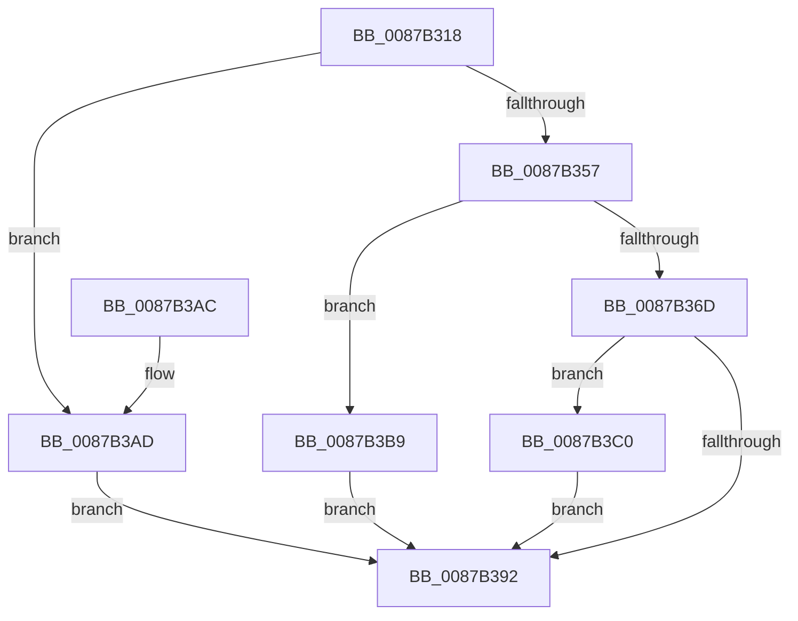

# CmpQueryFileSecurityDescriptor

- RVA: `0x0087B318`–`0x0087B3CC` (길이 `180` bytes)
- VA: `0x000000014087B318`
- 실행 섹션: `PAGE`
- PDB 이름 있음: `예`; PDB Function 태그: `아니요`
- unwind 정보 RVA: `0x0006CE48`
- 디코드: `54`개 명령, `180/180` bytes 표시
- 미해석 바이트: `0` (있으면 어셈블리에 `.byte`로 보존)

> 이 문서는 커널 이미지의 기계어와 PDB 기호를 분석해 생성했습니다. 4번과 5번은 함수 원형과 자료형을 바이너리 사용 방식에서 추정한 C 해석이며 원본 소스 복구 결과는 아닙니다.

## 1. Dependencies

- 직접 호출 지점: **4**; 고유 호출 대상: **3**
- 직접 호출자로 확인된 함수: **5**
- RIP 상대 이미지 참조: **0**

### Outgoing calls
- `0x0087B349` → [ZwQuerySecurityObject](../../text/6A/ZwQuerySecurityObject_function_006AFDF0.md) (function, `0x006AFDF0`)
- `0x0087B360` → [CmSiAllocateMemory](../../text/49/CmSiAllocateMemory_function_00490C18.md) (function, `0x00490C18`)
- `0x0087B387` → [ZwQuerySecurityObject](../../text/6A/ZwQuerySecurityObject_function_006AFDF0.md) (function, `0x006AFDF0`)
- `0x0087B3C3` → [CmSiFreeMemory](../../text/47/CmSiFreeMemory_function_00475D80.md) (function, `0x00475D80`)

### Direct callers
- [CmpStartRMLog](../7F/CmpStartRMLog_function_007F0AFC.md) at `0x007F0CD6`
- [CmpOpenHiveFiles](CmpOpenHiveFiles_function_00879A68.md) at `0x00879CAC`
- [CmpOpenHiveFile](CmpOpenHiveFile_function_0087A71C.md) at `0x0087AABA`
- [CmpLogHiveFileInaccessible](CmpLogHiveFileInaccessible_function_0087AEAC.md) at `0x0087B0E4`
- [CmpInitCmRM](CmpInitCmRM_function_0087C700.md) at `0x0087CAC9`

### Static image references
- 디코드된 RIP-relative 메모리 참조가 없습니다.

## 2. Other-region calls and transfers

- 다른 실행 섹션으로 향하는 call: **4**
  - `0x0087B349` → [ZwQuerySecurityObject](../../text/6A/ZwQuerySecurityObject_function_006AFDF0.md) (`PAGE` → `.text`)
  - `0x0087B360` → [CmSiAllocateMemory](../../text/49/CmSiAllocateMemory_function_00490C18.md) (`PAGE` → `.text`)
  - `0x0087B387` → [ZwQuerySecurityObject](../../text/6A/ZwQuerySecurityObject_function_006AFDF0.md) (`PAGE` → `.text`)
  - `0x0087B3C3` → [CmSiFreeMemory](../../text/47/CmSiFreeMemory_function_00475D80.md) (`PAGE` → `.text`)
- 별도 외부 분기/꼬리 이동을 확인하지 못했습니다.

## 3. Assembly (complete function range)

```asm
0087B318  48 8B C4                        mov rax, rsp
0087B31B  48 89 58 08                     mov qword ptr [rax + 8], rbx
0087B31F  48 89 68 18                     mov qword ptr [rax + 0x18], rbp
0087B323  48 89 70 20                     mov qword ptr [rax + 0x20], rsi
0087B327  57                              push rdi
0087B328  48 83 EC 30                     sub rsp, 0x30
0087B32C  33 FF                           xor edi, edi
0087B32E  48 8B F2                        mov rsi, rdx
0087B331  21 78 10                        and dword ptr [rax + 0x10], edi
0087B334  48 8D 40 10                     lea rax, [rax + 0x10]
0087B338  45 33 C9                        xor r9d, r9d
0087B33B  48 89 44 24 20                  mov qword ptr [rsp + 0x20], rax
0087B340  45 33 C0                        xor r8d, r8d
0087B343  48 8B E9                        mov rbp, rcx
0087B346  8D 57 04                        lea edx, [rdi + 4]
0087B349  E8 A2 4A E3 FF                  call 0x1406afdf0
0087B34E  8B D8                           mov ebx, eax
0087B350  3D 23 00 00 C0                  cmp eax, 0xc0000023
0087B355  75 56                           jne 0x14087b3ad
0087B357  8B 4C 24 48                     mov ecx, dword ptr [rsp + 0x48]
0087B35B  BA 43 4D 73 64                  mov edx, 0x64734d43
0087B360  E8 B3 58 C1 FF                  call 0x140490c18
0087B365  48 8B F8                        mov rdi, rax
0087B368  48 85 C0                        test rax, rax
0087B36B  74 4C                           je 0x14087b3b9
0087B36D  44 8B 4C 24 48                  mov r9d, dword ptr [rsp + 0x48]
0087B372  48 8D 44 24 48                  lea rax, [rsp + 0x48]
0087B377  4C 8B C7                        mov r8, rdi
0087B37A  48 89 44 24 20                  mov qword ptr [rsp + 0x20], rax
0087B37F  BA 04 00 00 00                  mov edx, 4
0087B384  48 8B CD                        mov rcx, rbp
0087B387  E8 64 4A E3 FF                  call 0x1406afdf0
0087B38C  8B D8                           mov ebx, eax
0087B38E  85 C0                           test eax, eax
0087B390  78 2E                           js 0x14087b3c0
0087B392  48 8B 6C 24 50                  mov rbp, qword ptr [rsp + 0x50]
0087B397  8B C3                           mov eax, ebx
0087B399  48 8B 5C 24 40                  mov rbx, qword ptr [rsp + 0x40]
0087B39E  48 89 3E                        mov qword ptr [rsi], rdi
0087B3A1  48 8B 74 24 58                  mov rsi, qword ptr [rsp + 0x58]
0087B3A6  48 83 C4 30                     add rsp, 0x30
0087B3AA  5F                              pop rdi
0087B3AB  C3                              ret
0087B3AC  CC                              int3
0087B3AD  85 DB                           test ebx, ebx
0087B3AF  B8 01 00 00 C0                  mov eax, 0xc0000001
0087B3B4  0F 44 D8                        cmove ebx, eax
0087B3B7  EB D9                           jmp 0x14087b392
0087B3B9  BB 9A 00 00 C0                  mov ebx, 0xc000009a
0087B3BE  EB D2                           jmp 0x14087b392
0087B3C0  48 8B CF                        mov rcx, rdi
0087B3C3  E8 B8 A9 BF FF                  call 0x140475d80
0087B3C8  33 FF                           xor edi, edi
0087B3CA  EB C6                           jmp 0x14087b392
```

## 4. C-style interpretation (structured pseudocode)

```c
__int64 __fastcall CmpQueryFileSecurityDescriptor(__int64 a1, __int64 a2, int a3, int a4)
{
    __int64 result;
    __int64 v_rbx;
    __int64 v_rdi;
    __int64 v_rsp;
    unsigned __int64 v_stack_m18;
    unsigned int v_stack_p10;
    unsigned __int64 v_stack_p18;
    unsigned __int64 v_stack_p20;
    unsigned __int64 v_stack_p8;

    *(unsigned __int64 *)(v_rsp + 8) = v_rbx;
    *(unsigned __int64 *)(v_rsp + 24) = v_rbp;
    *(unsigned __int64 *)(v_rsp + 32) = v_rsi;
    v_rsp = (v_rsp) - (48);
    v_rdi = 0;
    a4 = 0;
    v_stack_m18 = v_rsp + 16;
    a3 = 0;
    result = ZwQuerySecurityObject(a1, v_rdi + 4, a3, a4);
    if (((unsigned int)(result)) != 0xC0000023ULL) goto loc_0087B3AD;
    result = CmSiAllocateMemory((unsigned int)(v_stack_p10), (unsigned int)(0x64734D43ULL), a3, a4);
    if (result == 0) goto loc_0087B3B9;
    v_stack_m18 = v_stack_p10;
    result = ZwQuerySecurityObject(a1, 4, result, (unsigned int)(v_stack_p10));
    if (sign_flag) goto loc_0087B3C0;
loc_0087B392:
    *(unsigned __int64 *)(a2) = result;
    v_rsp = (v_rsp) + (48);
    return (unsigned int)((unsigned int)((unsigned int)((unsigned int)(result))));
loc_0087B3AD:
    v_rbx = v_stack_p8;
    if ((unsigned int)(v_stack_p8) == 0) { v_rbx = (unsigned int)((unsigned int)(0xC0000001ULL)); }
    goto loc_0087B392;
loc_0087B3B9:
    goto loc_0087B392;
loc_0087B3C0:
    result = CmSiFreeMemory(result, 4, result, (unsigned int)(v_stack_p10));
    v_rdi = 0;
    goto loc_0087B392;
}
```

## 5. (Beta) C Style

```c
int64_t CmpQueryFileSecurityDescriptor(int64_t Arg1, void *Arg2, int32_t Arg3, int32_t Arg4)
{
    uint8_t *arg2 = (uint8_t *)Arg2;

    int64_t result;
    int64_t local_rbx;
    int64_t local_rdi;
    int64_t local_rsp;
    uint64_t v_stack_m18;
    uint32_t v_stack_p10;
    uint64_t v_stack_p18;
    uint64_t v_stack_p20;
    uint64_t v_stack_p8;

    *(uint64_t *)(local_rsp + 0x8) = local_rbx;
    *(uint64_t *)(local_rsp + 0x18) = local_rbp;
    *(uint64_t *)(local_rsp + 0x20) = local_rsi;
    local_rsp = (local_rsp) - (48);
    local_rdi = 0;
    Arg4 = 0;
    v_stack_m18 = local_rsp + 16;
    Arg3 = 0;
    result = ZwQuerySecurityObject(Arg1, local_rdi + 4, Arg3, Arg4);
    if (((uint32_t)(result)) != 0xC0000023ULL) goto loc_0087B3AD;
    result = CmSiAllocateMemory((uint32_t)(v_stack_p10), (uint32_t)(0x64734D43ULL), Arg3, Arg4);
    if (result == 0) goto loc_0087B3B9;
    v_stack_m18 = v_stack_p10;
    result = ZwQuerySecurityObject(Arg1, 4, result, (uint32_t)(v_stack_p10));
    if (sign_flag) goto loc_0087B3C0;
loc_0087B392:
    *(uint64_t *)(arg2) = result;
    local_rsp = (local_rsp) + (48);
    return (uint32_t)((uint32_t)((uint32_t)((uint32_t)(result))));
loc_0087B3AD:
    local_rbx = v_stack_p8;
    if ((uint32_t)(v_stack_p8) == 0) { local_rbx = (uint32_t)((uint32_t)(0xC0000001ULL)); }
    goto loc_0087B392;
loc_0087B3B9:
    goto loc_0087B392;
loc_0087B3C0:
    result = CmSiFreeMemory(result, 4, result, (uint32_t)(v_stack_p10));
    local_rdi = 0;
    goto loc_0087B392;
}
```

### 관측된 메모리 오프셋

구조체 형식이 확인되지 않은 접근은 인자 기준의 오프셋으로만 기록했습니다.

| 기준 인자 | 오프셋 표현 | 폭 (bit) | 접근 |
|---|---:|---:|---|
| `Arg2` | `+ 0x0` | `64` | `W` |

## 6. Execution-region graph

[열기: 2D/3D 그래프와 함수 탐색 컨트롤 패널](../../../control-panel.html?section=page&rva=0x0087B318&view=graph)

- 2D 그래프는 위에서 아래로 흐르고, 3D 그래프는 빈 공간을 드래그해 회전합니다. Shift+드래그는 이동, 휠은 확대·축소, 함수 노드 선택은 대상 보고서 이동입니다.

### Static fallback


