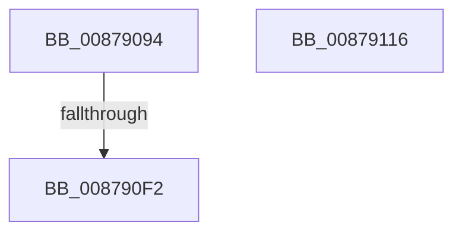

# CmpQueryHiveRedirectionFileList

- RVA: `0x00879094`–`0x00879117` (길이 `131` bytes)
- VA: `0x0000000140879094`
- 실행 섹션: `PAGE`
- PDB 이름 있음: `예`; PDB Function 태그: `예`
- unwind 정보 RVA: `0x0006CCC8`
- 디코드: `30`개 명령, `131/131` bytes 표시
- 미해석 바이트: `0` (있으면 어셈블리에 `.byte`로 보존)

> 이 문서는 커널 이미지의 기계어와 PDB 기호를 분석해 생성했습니다. 4번과 5번은 함수 원형과 자료형을 바이너리 사용 방식에서 추정한 C 해석이며 원본 소스 복구 결과는 아닙니다.

## 1. Dependencies

- 직접 호출 지점: **1**; 고유 호출 대상: **1**
- 직접 호출자로 확인된 함수: **3**
- RIP 상대 이미지 참조: **2**

### Outgoing calls
- `0x008790FC` → [_security_check_cookie](../../text/6A/_security_check_cookie_function_006AC640.md) (function, `0x006AC640`)

### Direct callers
- [CmpMountPreloadedHives](../7D/CmpMountPreloadedHives_function_007DBE18.md) at `0x007DBF7A`
- [CmLoadKey](CmLoadKey_function_008787CC.md) at `0x008788CF`
- [CmpMachineHiveListInitialize](../AD/CmpMachineHiveListInitialize_function_00AD4B98.md) at `0x00AD4C68`

### Static image references
- `0x008790AE` → RVA `0x00E0A740` (`.data`; read)
- `0x008790CC` → RVA `0x00EEFB6C` (`.data`; read)

## 2. Other-region calls and transfers

- 다른 실행 섹션으로 향하는 call: **1**
  - `0x008790FC` → [_security_check_cookie](../../text/6A/_security_check_cookie_function_006AC640.md) (`PAGE` → `.text`)
- call이 아닌 외부 분기/꼬리 이동: **1**
  - `0x008790EC` → [sub_00B17EE2](../B1/Unknown_function_00B17EE2.md) (`tail-transfer`)

## 3. Assembly (complete function range)

```asm
00879094  48 89 5C 24 18                  mov qword ptr [rsp + 0x18], rbx
00879099  48 89 7C 24 20                  mov qword ptr [rsp + 0x20], rdi
0087909E  55                              push rbp
0087909F  48 8D AC 24 60 FE FF FF         lea rbp, [rsp - 0x1a0]
008790A7  48 81 EC A0 02 00 00            sub rsp, 0x2a0
008790AE  48 8B 05 8B 16 59 00            mov rax, qword ptr [rip + 0x59168b]
008790B5  48 33 C4                        xor rax, rsp
008790B8  48 89 85 90 01 00 00            mov qword ptr [rbp + 0x190], rax
008790BF  33 C0                           xor eax, eax
008790C1  0F 57 C0                        xorps xmm0, xmm0
008790C4  48 21 44 24 48                  and qword ptr [rsp + 0x48], rax
008790C9  48 8B DA                        mov rbx, rdx
008790CC  39 05 9A 6A 67 00               cmp dword ptr [rip + 0x676a9a], eax
008790D2  48 8B F9                        mov rdi, rcx
008790D5  0F 11 45 80                     movups xmmword ptr [rbp - 0x80], xmm0
008790D9  48 89 44 24 70                  mov qword ptr [rsp + 0x70], rax
008790DE  0F 11 44 24 50                  movups xmmword ptr [rsp + 0x50], xmm0
008790E3  89 44 24 78                     mov dword ptr [rsp + 0x78], eax
008790E7  0F 11 44 24 60                  movups xmmword ptr [rsp + 0x60], xmm0
008790EC  0F 85 F0 ED 29 00               jne 0x140b17ee2
008790F2  48 8B 8D 90 01 00 00            mov rcx, qword ptr [rbp + 0x190]
008790F9  48 33 CC                        xor rcx, rsp
008790FC  E8 3F 35 E3 FF                  call 0x1406ac640
00879101  4C 8D 9C 24 A0 02 00 00         lea r11, [rsp + 0x2a0]
00879109  49 8B 5B 20                     mov rbx, qword ptr [r11 + 0x20]
0087910D  49 8B 7B 28                     mov rdi, qword ptr [r11 + 0x28]
00879111  49 8B E3                        mov rsp, r11
00879114  5D                              pop rbp
00879115  C3                              ret
00879116  CC                              int3
```

## 4. C-style interpretation (structured pseudocode)

```c
__int64 __fastcall CmpQueryHiveRedirectionFileList(__int64 a1, __int64 a2)
{
    __int64 result;
    __int64 v_rsp;
    unsigned __int64 v_stack_m18;
    unsigned __int64 v_stack_m1A8;
    unsigned __int64 v_stack_m228;
    unsigned int v_stack_m230;
    unsigned __int64 v_stack_m238;
    unsigned __int64 v_stack_m248;
    unsigned __int64 v_stack_m258;
    unsigned __int64 v_stack_m260;
    unsigned __int64 v_stack_m8;
    unsigned __int64 v_stack_p18;
    unsigned __int64 v_stack_p20;

    v_stack_p18 = v_rbx;
    v_stack_p20 = v_rdi;
    v_rsp = (v_rsp) - (672);
    result = (*(unsigned __int64 *)(v_rip + 5838475)) ^ (v_rsp);
    v_stack_m18 = result;
    result = 0;
    v_stack_m228 = v_xmm0;
    v_stack_m238 = 0;
    v_stack_m258 = v_xmm0;
    v_stack_m230 = 0;
    v_stack_m248 = v_xmm0;
    a1 = (v_stack_m18) ^ (v_rsp);
    result = _security_check_cookie(a1, a2, a3, a4);
    return result;
}
```

## 5. (Beta) C Style

```c
int64_t CmpQueryHiveRedirectionFileList(int64_t Arg1, int64_t Arg2)
{
    int64_t result;
    int64_t local_rsp;
    uint64_t v_stack_m18;
    uint64_t v_stack_m1A8;
    uint64_t v_stack_m228;
    uint32_t v_stack_m230;
    uint64_t v_stack_m238;
    uint64_t v_stack_m248;
    uint64_t v_stack_m258;
    uint64_t v_stack_m260;
    uint64_t v_stack_m8;
    uint64_t v_stack_p18;
    uint64_t v_stack_p20;

    v_stack_p18 = local_rbx;
    v_stack_p20 = local_rdi;
    local_rsp = (local_rsp) - (672);
    result = (*(uint64_t *)(v_rip + 0x59168B)) ^ (local_rsp);
    v_stack_m18 = result;
    result = 0;
    v_stack_m228 = v_xmm0;
    v_stack_m238 = 0;
    v_stack_m258 = v_xmm0;
    v_stack_m230 = 0;
    v_stack_m248 = v_xmm0;
    Arg1 = (v_stack_m18) ^ (local_rsp);
    result = _security_check_cookie(Arg1, Arg2, a3, a4);
    return result;
}
```

## 6. Execution-region graph

[열기: 2D/3D 그래프와 함수 탐색 컨트롤 패널](../../../control-panel.html?section=page&rva=0x00879094&view=graph)

- 2D 그래프는 위에서 아래로 흐르고, 3D 그래프는 빈 공간을 드래그해 회전합니다. Shift+드래그는 이동, 휠은 확대·축소, 함수 노드 선택은 대상 보고서 이동입니다.

### Static fallback


