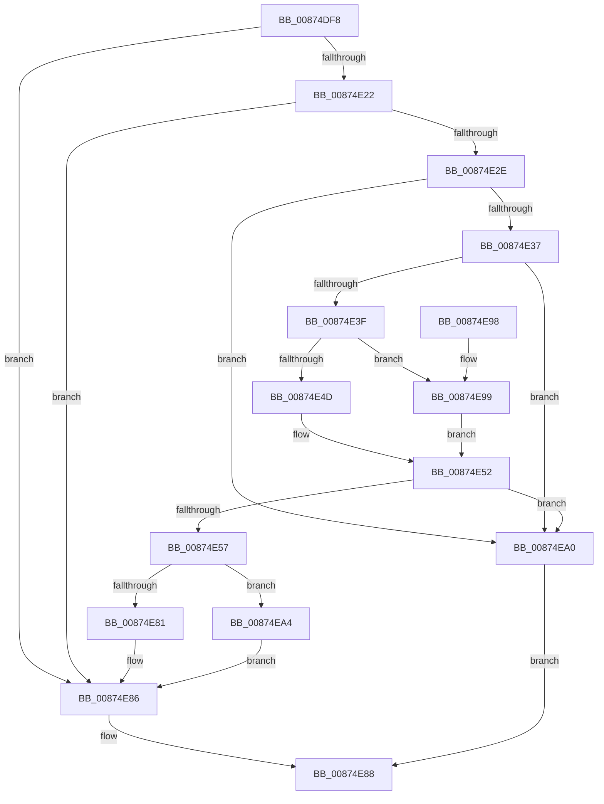

# CmpRebuildKcbCache

- RVA: `0x00874DF8`–`0x00874EAB` (길이 `179` bytes)
- VA: `0x0000000140874DF8`
- 실행 섹션: `PAGE`
- PDB 이름 있음: `예`; PDB Function 태그: `아니요`
- unwind 정보 RVA: `0x0006C930`
- 디코드: `52`개 명령, `179/179` bytes 표시
- 미해석 바이트: `0` (있으면 어셈블리에 `.byte`로 보존)

> 이 문서는 커널 이미지의 기계어와 PDB 기호를 분석해 생성했습니다. 4번과 5번은 함수 원형과 자료형을 바이너리 사용 방식에서 추정한 C 해석이며 원본 소스 복구 결과는 아닙니다.

## 1. Dependencies

- 직접 호출 지점: **5**; 고유 호출 대상: **5**
- 직접 호출자로 확인된 함수: **6**
- RIP 상대 이미지 참조: **0**

### Outgoing calls
- `0x00874E4D` → [HvpGetCellFlat](../85/HvpGetCellFlat_function_00854C60.md) (function, `0x00854C60`)
- `0x00874E6A` → [CmpRebuildKcbCacheFromNode](../84/CmpRebuildKcbCacheFromNode_function_0084C5A8.md) (function, `0x0084C5A8`)
- `0x00874E81` → [HvpReleaseCellPaged](../85/HvpReleaseCellPaged_function_00855F40.md) (function, `0x00855F40`)
- `0x00874E99` → [HvpGetCellPaged](../85/HvpGetCellPaged_function_00854CB0.md) (function, `0x00854CB0`)
- `0x00874EA4` → [HvpReleaseCellFlat](../85/HvpReleaseCellFlat_function_0085CC20.md) (function, `0x0085CC20`)

### Direct callers
- [CmpSaveBootControlSet](../7D/CmpSaveBootControlSet_function_007DC744.md) at `0x007DCB25`
- [CmpRefreshHive](../7D/CmpRefreshHive_function_007DEAD0.md) at `0x007DEEF4`
- [CmpCloneHwProfile](../7E/CmpCloneHwProfile_function_007E303C.md) at `0x007E3765`
- [CmpSyncKcbCacheForHive](../7E/CmpSyncKcbCacheForHive_function_007EBD50.md) at `0x007EBD94`
- [CmpCommitDiscardReplacePost](../86/CmpCommitDiscardReplacePost_function_008624D4.md) at `0x008626C2`
- [CmpTransMgrFreeVolatileData](CmpTransMgrFreeVolatileData_function_00874BDC.md) at `0x00874CA0`

### Static image references
- 디코드된 RIP-relative 메모리 참조가 없습니다.

## 2. Other-region calls and transfers

- 다른 실행 섹션으로 향하는 call: **0**
- 별도 외부 분기/꼬리 이동을 확인하지 못했습니다.

## 3. Assembly (complete function range)

```asm
00874DF8  48 8B C4                        mov rax, rsp
00874DFB  48 89 58 10                     mov qword ptr [rax + 0x10], rbx
00874DFF  48 89 70 18                     mov qword ptr [rax + 0x18], rsi
00874E03  57                              push rdi
00874E04  48 83 EC 20                     sub rsp, 0x20
00874E08  41 83 C8 FF                     or r8d, 0xffffffff
00874E0C  33 F6                           xor esi, esi
00874E0E  44 89 40 08                     mov dword ptr [rax + 8], r8d
00874E12  48 8B FA                        mov rdi, rdx
00874E15  89 70 0C                        mov dword ptr [rax + 0xc], esi
00874E18  48 8B D9                        mov rbx, rcx
00874E1B  8B 41 08                        mov eax, dword ptr [rcx + 8]
00874E1E  A8 10                           test al, 0x10
00874E20  75 64                           jne 0x140874e86
00874E22  F7 81 B8 00 00 00 00 00 40 00   test dword ptr [rcx + 0xb8], 0x400000
00874E2C  75 58                           jne 0x140874e86
00874E2E  48 8B 49 20                     mov rcx, qword ptr [rcx + 0x20]
00874E32  48 85 C9                        test rcx, rcx
00874E35  74 69                           je 0x140874ea0
00874E37  8B 53 28                        mov edx, dword ptr [rbx + 0x28]
00874E3A  41 3B D0                        cmp edx, r8d
00874E3D  74 61                           je 0x140874ea0
00874E3F  F6 81 8C 00 00 00 01            test byte ptr [rcx + 0x8c], 1
00874E46  4C 8D 44 24 30                  lea r8, [rsp + 0x30]
00874E4B  74 4C                           je 0x140874e99
00874E4D  E8 0E FE FD FF                  call 0x140854c60
00874E52  48 85 C0                        test rax, rax
00874E55  74 49                           je 0x140874ea0
00874E57  48 FF 83 30 01 00 00            inc qword ptr [rbx + 0x130]
00874E5E  41 B1 01                        mov r9b, 1
00874E61  4C 8B C7                        mov r8, rdi
00874E64  48 8B D0                        mov rdx, rax
00874E67  48 8B CB                        mov rcx, rbx
00874E6A  E8 39 77 FD FF                  call 0x14084c5a8
00874E6F  48 8B 4B 20                     mov rcx, qword ptr [rbx + 0x20]
00874E73  48 8D 54 24 30                  lea rdx, [rsp + 0x30]
00874E78  F6 81 8C 00 00 00 01            test byte ptr [rcx + 0x8c], 1
00874E7F  75 23                           jne 0x140874ea4
00874E81  E8 BA 10 FE FF                  call 0x140855f40
00874E86  B0 01                           mov al, 1
00874E88  48 8B 5C 24 38                  mov rbx, qword ptr [rsp + 0x38]
00874E8D  48 8B 74 24 40                  mov rsi, qword ptr [rsp + 0x40]
00874E92  48 83 C4 20                     add rsp, 0x20
00874E96  5F                              pop rdi
00874E97  C3                              ret
00874E98  CC                              int3
00874E99  E8 12 FE FD FF                  call 0x140854cb0
00874E9E  EB B2                           jmp 0x140874e52
00874EA0  32 C0                           xor al, al
00874EA2  EB E4                           jmp 0x140874e88
00874EA4  E8 77 7D FE FF                  call 0x14085cc20
00874EA9  EB DB                           jmp 0x140874e86
```

## 4. C-style interpretation (structured pseudocode)

```c
__int64 __fastcall CmpRebuildKcbCache(__int64 a1, __int64 a2, int a3)
{
    __int64 result;
    __int64 v_rsi;
    __int64 v_rsp;
    unsigned __int64 v_stack_p10;
    unsigned __int64 v_stack_p18;
    unsigned __int64 v_stack_p8;

    *(unsigned __int64 *)(v_rsp + 16) = v_rbx;
    *(unsigned __int64 *)(v_rsp + 24) = v_rsi;
    v_rsp = (v_rsp) - (32);
    a3 = (unsigned int)((a3) | (0xFFFFFFFFULL));
    v_rsi = 0;
    *(unsigned int *)(v_rsp + 8) = a3;
    *(unsigned int *)(v_rsp + 12) = 0;
    if ((((unsigned __int8)((unsigned int)(*(unsigned int *)(a1 + 8)))) & (16)) != 0) goto loc_00874E86;
    if (((*(unsigned int *)(a1 + 184)) & (0x400000ULL)) != 0) goto loc_00874E86;
    if (*(unsigned __int64 *)(a1 + 32) == 0) goto loc_00874EA0;
    if (((unsigned int)((unsigned int)(*(unsigned int *)(a1 + 40)))) == a3) goto loc_00874EA0;
    if (((*(unsigned __int8 *)(*(unsigned __int64 *)(a1 + 32) + 140)) & (1)) == 0) goto loc_00874E99;
    result = HvpGetCellFlat(*(unsigned __int64 *)(a1 + 32), (unsigned int)(*(unsigned int *)(a1 + 40)), v_stack_p8, a4);
loc_00874E52:
    if (result == 0) goto loc_00874EA0;
    result = CmpRebuildKcbCacheFromNode(a1, result, a2, 1);
    if (((*(unsigned __int8 *)(*(unsigned __int64 *)(a1 + 32) + 140)) & (1)) != 0) goto loc_00874EA4;
    result = HvpReleaseCellPaged(*(unsigned __int64 *)(a1 + 32), v_stack_p8, a2, 1);
loc_00874E86:
loc_00874E88:
    v_rsp = (v_rsp) + (32);
    return 1;
loc_00874E99:
    result = HvpGetCellPaged(*(unsigned __int64 *)(a1 + 32), v_stack_p8, a2, 1);
    goto loc_00874E52;
loc_00874EA0:
    result = 0;
    goto loc_00874E88;
loc_00874EA4:
    result = HvpReleaseCellFlat(*(unsigned __int64 *)(a1 + 32), v_stack_p8, a2, 1);
    goto loc_00874E86;
}
```

## 5. (Beta) C Style

```c
int64_t CmpRebuildKcbCache(void *Arg1, int64_t Arg2, int32_t Arg3)
{
    uint8_t *arg1 = (uint8_t *)Arg1;

    int64_t result;
    int64_t local_rsi;
    int64_t local_rsp;
    uint64_t v_stack_p10;
    uint64_t v_stack_p18;
    uint64_t v_stack_p8;

    *(uint64_t *)(local_rsp + 0x10) = local_rbx;
    *(uint64_t *)(local_rsp + 0x18) = local_rsi;
    local_rsp = (local_rsp) - (32);
    Arg3 = (uint32_t)((Arg3) | (0xFFFFFFFFULL));
    local_rsi = 0;
    *(uint32_t *)(local_rsp + 0x8) = Arg3;
    *(uint32_t *)(local_rsp + 0xC) = 0;
    if ((((uint8_t)((uint32_t)(*(uint32_t *)(arg1 + 0x8)))) & (16)) != 0) goto loc_00874E86;
    if (((*(uint32_t *)(arg1 + 0xB8)) & (0x400000ULL)) != 0) goto loc_00874E86;
    if (*(uint64_t *)(arg1 + 0x20) == 0) goto loc_00874EA0;
    if (((uint32_t)((uint32_t)(*(uint32_t *)(arg1 + 0x28)))) == Arg3) goto loc_00874EA0;
    if (((*(uint8_t *)(*(uint64_t *)(arg1 + 0x20) + 0x8C)) & (1)) == 0) goto loc_00874E99;
    result = HvpGetCellFlat(*(uint64_t *)(arg1 + 0x20), (uint32_t)(*(uint32_t *)(arg1 + 0x28)), v_stack_p8, a4);
loc_00874E52:
    if (result == 0) goto loc_00874EA0;
    result = CmpRebuildKcbCacheFromNode(Arg1, result, Arg2, 1);
    if (((*(uint8_t *)(*(uint64_t *)(arg1 + 0x20) + 0x8C)) & (1)) != 0) goto loc_00874EA4;
    result = HvpReleaseCellPaged(*(uint64_t *)(arg1 + 0x20), v_stack_p8, Arg2, 1);
loc_00874E86:
loc_00874E88:
    local_rsp = (local_rsp) + (32);
    return 1;
loc_00874E99:
    result = HvpGetCellPaged(*(uint64_t *)(arg1 + 0x20), v_stack_p8, Arg2, 1);
    goto loc_00874E52;
loc_00874EA0:
    result = 0;
    goto loc_00874E88;
loc_00874EA4:
    result = HvpReleaseCellFlat(*(uint64_t *)(arg1 + 0x20), v_stack_p8, Arg2, 1);
    goto loc_00874E86;
}
```

### 관측된 메모리 오프셋

구조체 형식이 확인되지 않은 접근은 인자 기준의 오프셋으로만 기록했습니다.

| 기준 인자 | 오프셋 표현 | 폭 (bit) | 접근 |
|---|---:|---:|---|
| `Arg1` | `+ 0x8` | `32` | `R` |
| `Arg1` | `+ 0x20` | `64` | `R` |
| `Arg1` | `+ 0x28` | `32` | `R` |
| `Arg1` | `+ 0xB8` | `32` | `R` |
| `Arg1` | `+ 0x130` | `64` | `R/W` |

## 6. Execution-region graph

[열기: 2D/3D 그래프와 함수 탐색 컨트롤 패널](../../../control-panel.html?section=page&rva=0x00874DF8&view=graph)

- 2D 그래프는 위에서 아래로 흐르고, 3D 그래프는 빈 공간을 드래그해 회전합니다. Shift+드래그는 이동, 휠은 확대·축소, 함수 노드 선택은 대상 보고서 이동입니다.

### Static fallback


