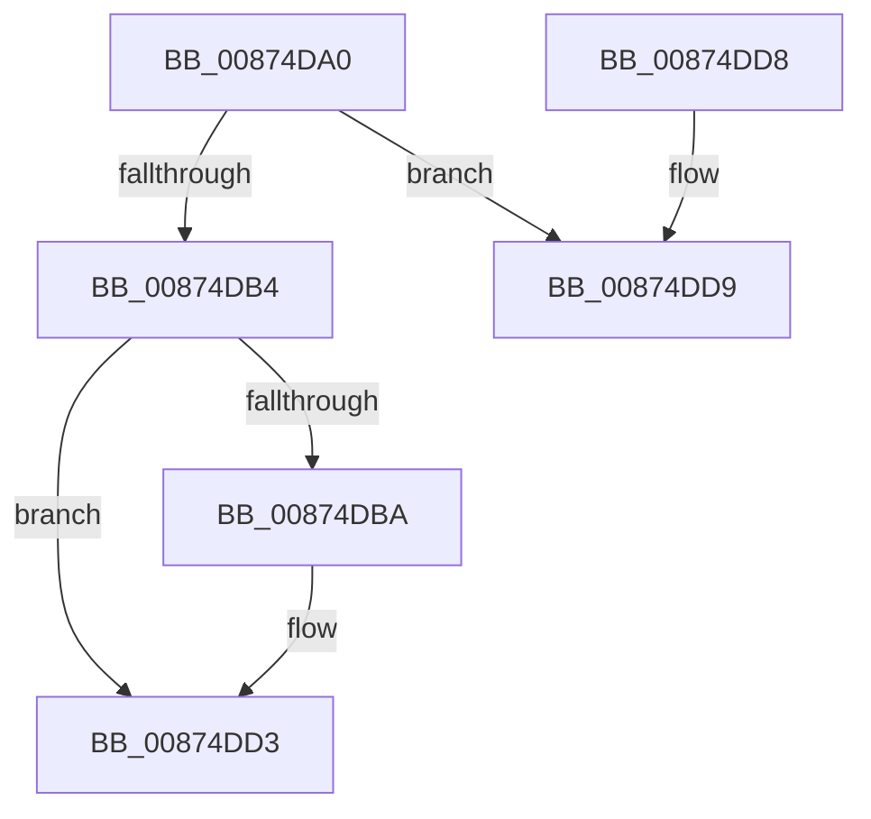

# CmpReferenceKeyControlBlockUnsafe

- RVA: `0x00874DA0`–`0x00874DF2` (길이 `82` bytes)
- VA: `0x0000000140874DA0`
- 실행 섹션: `PAGE`
- PDB 이름 있음: `예`; PDB Function 태그: `아니요`
- unwind 정보 RVA: `0x0006886C`
- 디코드: `26`개 명령, `82/82` bytes 표시
- 미해석 바이트: `0` (있으면 어셈블리에 `.byte`로 보존)

> 이 문서는 커널 이미지의 기계어와 PDB 기호를 분석해 생성했습니다. 4번과 5번은 함수 원형과 자료형을 바이너리 사용 방식에서 추정한 C 해석이며 원본 소스 복구 결과는 아닙니다.

## 1. Dependencies

- 직접 호출 지점: **2**; 고유 호출 대상: **1**
- 직접 호출자로 확인된 함수: **13**
- RIP 상대 이미지 참조: **0**

### Outgoing calls
- `0x00874DCD` → [KeBugCheckEx](../../text/4F/KeBugCheckEx_function_004FD660.md) (function, `0x004FD660`)
- `0x00874DEC` → [KeBugCheckEx](../../text/4F/KeBugCheckEx_function_004FD660.md) (function, `0x004FD660`)

### Direct callers
- [CmpLoadKeyCommon](../../text/46/CmpLoadKeyCommon_function_0046E9F8.md) at `0x0046EB3A`
- [CmpLoadKeyCommon](../../text/46/CmpLoadKeyCommon_function_0046E9F8.md) at `0x0046EDBA`
- [CmpCloneToUnbackedKcb](../7E/CmpCloneToUnbackedKcb_function_007EA9A8.md) at `0x007EAAD0`
- [CmpCreateGlobalKeyLockEntry](../7E/CmpCreateGlobalKeyLockEntry_function_007EDC88.md) at `0x007EDC95`
- [CmpCreateSiloKeyLockEntry](../7E/CmpCreateSiloKeyLockEntry_function_007EDCE4.md) at `0x007EDCF1`
- [sub_00857E06](../85/Unknown_function_00857E06.md) at `0x00857E4C`
- [CmpDoParseKey](../85/CmpDoParseKey_function_0085F750.md) at `0x0086097D`
- [CmpDoParseKey](../85/CmpDoParseKey_function_0085F750.md) at `0x0086177A`
- [CmpCommitDiscardReplacePost](../86/CmpCommitDiscardReplacePost_function_008624D4.md) at `0x008626CF`
- [CmpCommitDiscardReplacePost](../86/CmpCommitDiscardReplacePost_function_008624D4.md) at `0x008626F2`
- [CmpCommitDiscardReplacePost](../86/CmpCommitDiscardReplacePost_function_008624D4.md) at `0x0086272A`
- [CmpTransMgrFreeVolatileData](CmpTransMgrFreeVolatileData_function_00874BDC.md) at `0x00874CA8`
- [CmLoadAppKey](CmLoadAppKey_function_00876FFC.md) at `0x00877A61`
- [CmpLinkHiveToMaster](CmpLinkHiveToMaster_function_00877D6C.md) at `0x00877FF4`
- [CmpLinkHiveToMaster](CmpLinkHiveToMaster_function_00877D6C.md) at `0x00878048`
- [CmpEnumerateLayeredKey](../94/CmpEnumerateLayeredKey_function_00945E58.md) at `0x009460FB`
- [CmpKeyEnumStackCreateResumeContext](../94/CmpKeyEnumStackCreateResumeContext_function_00948050.md) at `0x009480EF`
- [CmpFreezeHive](../9A/CmpFreezeHive_function_009AE818.md) at `0x009AE831`

### Static image references
- 디코드된 RIP-relative 메모리 참조가 없습니다.

## 2. Other-region calls and transfers

- 다른 실행 섹션으로 향하는 call: **2**
  - `0x00874DCD` → [KeBugCheckEx](../../text/4F/KeBugCheckEx_function_004FD660.md) (`PAGE` → `.text`)
  - `0x00874DEC` → [KeBugCheckEx](../../text/4F/KeBugCheckEx_function_004FD660.md) (`PAGE` → `.text`)
- 별도 외부 분기/꼬리 이동을 확인하지 못했습니다.

## 3. Assembly (complete function range)

```asm
00874DA0  48 83 EC 38                     sub rsp, 0x38
00874DA4  B8 01 00 00 00                  mov eax, 1
00874DA9  F0 48 0F C1 01                  lock xadd qword ptr [rcx], rax
00874DAE  48 83 C0 01                     add rax, 1
00874DB2  74 25                           je 0x140874dd9
00874DB4  48 83 F8 01                     cmp rax, 1
00874DB8  75 19                           jne 0x140874dd3
00874DBA  33 C0                           xor eax, eax
00874DBC  45 33 C9                        xor r9d, r9d
00874DBF  45 33 C0                        xor r8d, r8d
00874DC2  48 89 44 24 20                  mov qword ptr [rsp + 0x20], rax
00874DC7  8D 50 15                        lea edx, [rax + 0x15]
00874DCA  8D 48 51                        lea ecx, [rax + 0x51]
00874DCD  E8 8E 88 C8 FF                  call 0x1404fd660
00874DD2  CC                              int3
00874DD3  48 83 C4 38                     add rsp, 0x38
00874DD7  C3                              ret
00874DD8  CC                              int3
00874DD9  33 C0                           xor eax, eax
00874DDB  4C 8B C1                        mov r8, rcx
00874DDE  45 33 C9                        xor r9d, r9d
00874DE1  48 89 44 24 20                  mov qword ptr [rsp + 0x20], rax
00874DE6  8D 50 24                        lea edx, [rax + 0x24]
00874DE9  8D 48 51                        lea ecx, [rax + 0x51]
00874DEC  E8 6F 88 C8 FF                  call 0x1404fd660
00874DF1  CC                              int3
```

## 4. C-style interpretation (structured pseudocode)

```c
__int64 __fastcall CmpReferenceKeyControlBlockUnsafe(__int64 a1, __int64 a2, int a3, int a4)
{
    __int64 result;
    __int64 v_rsp;
    unsigned __int64 v_stack_m18;
    unsigned __int64 v_stack_p20;

    v_rsp = (v_rsp) - (56);
    result = (1) + (1);
    if (condition_is_equal) goto loc_00874DD9;
    if (result == 1) {
        result = 0;
        a4 = 0;
        a3 = 0;
        v_stack_m18 = 0;
        a2 = result + 21;
        a1 = result + 81;
        result = KeBugCheckEx(a1, a2, a3, a4);
    }
    v_rsp = (v_rsp) + (56);
    return result;
loc_00874DD9:
    result = 0;
    a4 = 0;
    v_stack_p20 = 0;
    result = KeBugCheckEx(result + 81, result + 36, a1, a4);
    return result;
}
```

## 5. (Beta) C Style

```c
int64_t CmpReferenceKeyControlBlockUnsafe(void *Arg1, int64_t Arg2, int32_t Arg3, int32_t Arg4)
{
    uint8_t *arg1 = (uint8_t *)Arg1;

    int64_t result;
    int64_t local_rsp;
    uint64_t v_stack_m18;
    uint64_t v_stack_p20;

    local_rsp = (local_rsp) - (56);
    result = (1) + (1);
    if (condition_is_equal) goto loc_00874DD9;
    if (result == 1) {
        result = 0;
        Arg4 = 0;
        Arg3 = 0;
        v_stack_m18 = 0;
        Arg2 = result + 21;
        Arg1 = result + 81;
        result = KeBugCheckEx(Arg1, Arg2, Arg3, Arg4);
    }
    local_rsp = (local_rsp) + (56);
    return result;
loc_00874DD9:
    result = 0;
    Arg4 = 0;
    v_stack_p20 = 0;
    result = KeBugCheckEx(result + 81, result + 36, Arg1, Arg4);
    return result;
}
```

### 관측된 메모리 오프셋

구조체 형식이 확인되지 않은 접근은 인자 기준의 오프셋으로만 기록했습니다.

| 기준 인자 | 오프셋 표현 | 폭 (bit) | 접근 |
|---|---:|---:|---|
| `Arg1` | `+ 0x0` | `64` | `R/W` |

## 6. Execution-region graph

[열기: 2D/3D 그래프와 함수 탐색 컨트롤 패널](../../../control-panel.html?section=page&rva=0x00874DA0&view=graph)

- 2D 그래프는 위에서 아래로 흐르고, 3D 그래프는 빈 공간을 드래그해 회전합니다. Shift+드래그는 이동, 휠은 확대·축소, 함수 노드 선택은 대상 보고서 이동입니다.

### Static fallback


