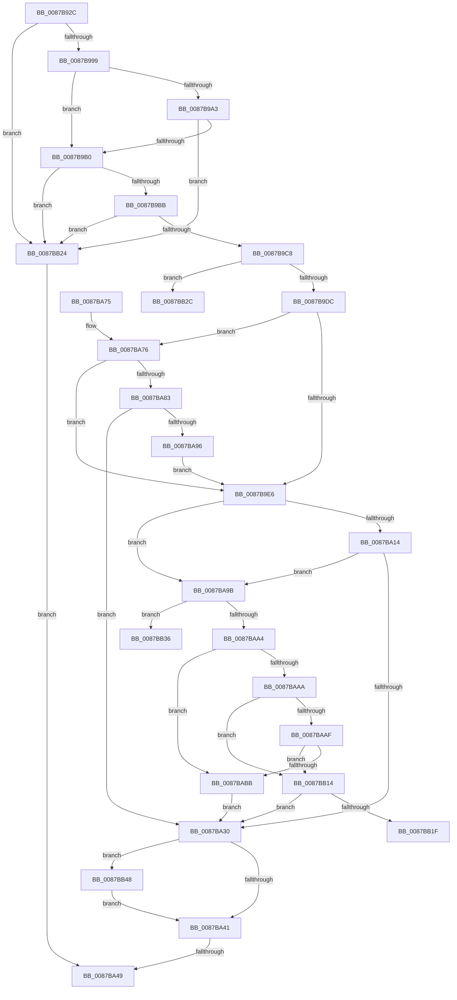

# CmpReorganizeHive

- RVA: `0x0087B92C`–`0x0087BB55` (길이 `553` bytes)
- VA: `0x000000014087B92C`
- 실행 섹션: `PAGE`
- PDB 이름 있음: `예`; PDB Function 태그: `예`
- unwind 정보 RVA: `0x0006CEB4`
- 디코드: `132`개 명령, `553/553` bytes 표시
- 미해석 바이트: `0` (있으면 어셈블리에 `.byte`로 보존)

> 이 문서는 커널 이미지의 기계어와 PDB 기호를 분석해 생성했습니다. 4번과 5번은 함수 원형과 자료형을 바이너리 사용 방식에서 추정한 C 해석이며 원본 소스 복구 결과는 아닙니다.

## 1. Dependencies

- 직접 호출 지점: **14**; 고유 호출 대상: **14**
- 직접 호출자로 확인된 함수: **1**
- RIP 상대 이미지 참조: **3**

### Outgoing calls
- `0x0087B9C8` → [CmpAcquireShutdownRundown](../../pagecmrc/BC/CmpAcquireShutdownRundown_function_00BC9400.md) (function, `0x00BC9400`)
- `0x0087B9EB` → [CmSiQuerySystemTime](../../text/4B/CmSiQuerySystemTime_function_004BD394.md) (function, `0x004BD394`)
- `0x0087BA33` → [CmpReleaseShutdownRundown](../../pagecmrc/BC/CmpReleaseShutdownRundown_function_00BC9880.md) (function, `0x00BC9880`)
- `0x0087BA55` → [_security_check_cookie](../../text/6A/_security_check_cookie_function_006AC640.md) (function, `0x006AC640`)
- `0x0087BA76` → [ExIsSoftBoot](../../text/4F/ExIsSoftBoot_function_004FAE60.md) (function, `0x004FAE60`)
- `0x0087BAC8` → [CmpClearKeyAccessBits](CmpClearKeyAccessBits_function_0087BB5C.md) (function, `0x0087BB5C`)
- `0x0087BACD` → [CmpLockRegistry](../../pagecmrc/BC/CmpLockRegistry_function_00BC9B34.md) (function, `0x00BC9B34`)
- `0x0087BAD5` → [HvLockHiveFlusherShared](../84/HvLockHiveFlusherShared_function_0084F95C.md) (function, `0x0084F95C`)
- `0x0087BADD` → [HvLockHiveWriter](../85/HvLockHiveWriter_function_00859894.md) (function, `0x00859894`)
- `0x0087BAE5` → [HvMarkBaseBlockDirty](HvMarkBaseBlockDirty_function_0087BD04.md) (function, `0x0087BD04`)
- `0x0087BAFD` → [HvUnlockHiveWriter](../85/HvUnlockHiveWriter_function_008598E4.md) (function, `0x008598E4`)
- `0x0087BB05` → [HvUnlockHiveFlusherShared](../84/HvUnlockHiveFlusherShared_function_00848738.md) (function, `0x00848738`)
- `0x0087BB0A` → [CmpUnlockRegistry](../../pagecmrc/BC/CmpUnlockRegistry_function_00BC9A84.md) (function, `0x00BC9A84`)
- `0x0087BB4B` → [CmSiFreeMemory](../../text/47/CmSiFreeMemory_function_00475D80.md) (function, `0x00475D80`)

### Direct callers
- [CmpCreateHive](CmpCreateHive_function_00879DF0.md) at `0x0087A1F6`

### Static image references
- `0x0087B94B` → RVA `0x00E0A740` (`.data`; read)
- `0x0087B9CD` → RVA `0x00E09F58` (`.data`; read)
- `0x0087BA14` → RVA `0x00E0ECAC` (`.data`; read)

## 2. Other-region calls and transfers

- 다른 실행 섹션으로 향하는 call: **8**
  - `0x0087B9C8` → [CmpAcquireShutdownRundown](../../pagecmrc/BC/CmpAcquireShutdownRundown_function_00BC9400.md) (`PAGE` → `PAGECMRC`)
  - `0x0087B9EB` → [CmSiQuerySystemTime](../../text/4B/CmSiQuerySystemTime_function_004BD394.md) (`PAGE` → `.text`)
  - `0x0087BA33` → [CmpReleaseShutdownRundown](../../pagecmrc/BC/CmpReleaseShutdownRundown_function_00BC9880.md) (`PAGE` → `PAGECMRC`)
  - `0x0087BA55` → [_security_check_cookie](../../text/6A/_security_check_cookie_function_006AC640.md) (`PAGE` → `.text`)
  - `0x0087BA76` → [ExIsSoftBoot](../../text/4F/ExIsSoftBoot_function_004FAE60.md) (`PAGE` → `.text`)
  - `0x0087BACD` → [CmpLockRegistry](../../pagecmrc/BC/CmpLockRegistry_function_00BC9B34.md) (`PAGE` → `PAGECMRC`)
  - `0x0087BB0A` → [CmpUnlockRegistry](../../pagecmrc/BC/CmpUnlockRegistry_function_00BC9A84.md) (`PAGE` → `PAGECMRC`)
  - `0x0087BB4B` → [CmSiFreeMemory](../../text/47/CmSiFreeMemory_function_00475D80.md) (`PAGE` → `.text`)
- call이 아닌 외부 분기/꼬리 이동: **4**
  - `0x0087BA43` → [sub_00B1845C + 0x525](../B1/Unknown_function_00B1845C.md) (`tail-transfer`)
  - `0x0087BB1F` → [sub_00B1845C + 0x25](../B1/Unknown_function_00B1845C.md) (`tail-transfer`)
  - `0x0087BB31` → [sub_00B1845C + 0x525](../B1/Unknown_function_00B1845C.md) (`tail-transfer`)
  - `0x0087BB43` → [sub_00B1845C](../B1/Unknown_function_00B1845C.md) (`tail-transfer`)

## 3. Assembly (complete function range)

```asm
0087B92C  48 89 5C 24 18                  mov qword ptr [rsp + 0x18], rbx
0087B931  55                              push rbp
0087B932  56                              push rsi
0087B933  57                              push rdi
0087B934  41 54                           push r12
0087B936  41 55                           push r13
0087B938  41 56                           push r14
0087B93A  41 57                           push r15
0087B93C  48 8D AC 24 40 FF FF FF         lea rbp, [rsp - 0xc0]
0087B944  48 81 EC C0 01 00 00            sub rsp, 0x1c0
0087B94B  48 8B 05 EE ED 58 00            mov rax, qword ptr [rip + 0x58edee]
0087B952  48 33 C4                        xor rax, rsp
0087B955  48 89 85 B0 00 00 00            mov qword ptr [rbp + 0xb0], rax
0087B95C  48 8B 41 40                     mov rax, qword ptr [rcx + 0x40]
0087B960  45 33 F6                        xor r14d, r14d
0087B963  48 8B F9                        mov rdi, rcx
0087B966  44 89 74 24 40                  mov dword ptr [rsp + 0x40], r14d
0087B96B  0F 57 C0                        xorps xmm0, xmm0
0087B96E  4C 89 74 24 50                  mov qword ptr [rsp + 0x50], r14
0087B973  41 8B D8                        mov ebx, r8d
0087B976  4C 89 74 24 48                  mov qword ptr [rsp + 0x48], r14
0087B97B  8B 88 90 00 00 00               mov ecx, dword ptr [rax + 0x90]
0087B981  41 8D 76 01                     lea esi, [r14 + 1]
0087B985  4C 8B E2                        mov r12, rdx
0087B988  45 8B EE                        mov r13d, r14d
0087B98B  0F 11 44 24 70                  movups xmmword ptr [rsp + 0x70], xmm0
0087B990  40 84 CE                        test sil, cl
0087B993  0F 85 8B 01 00 00               jne 0x14087bb24
0087B999  8B 87 A0 00 00 00               mov eax, dword ptr [rdi + 0xa0]
0087B99F  A8 10                           test al, 0x10
0087B9A1  75 0D                           jne 0x14087b9b0
0087B9A3  4C 39 B7 08 06 00 00            cmp qword ptr [rdi + 0x608], r14
0087B9AA  0F 84 74 01 00 00               je 0x14087bb24
0087B9B0  A9 01 80 00 00                  test eax, 0x8001
0087B9B5  0F 85 69 01 00 00               jne 0x14087bb24
0087B9BB  44 39 B7 A8 00 00 00            cmp dword ptr [rdi + 0xa8], r14d
0087B9C2  0F 84 5C 01 00 00               je 0x14087bb24
0087B9C8  E8 33 DA 34 00                  call 0x140bc9400
0087B9CD  4C 8D 3D 84 E5 58 00            lea r15, [rip + 0x58e584]
0087B9D4  84 C0                           test al, al
0087B9D6  0F 84 50 01 00 00               je 0x14087bb2c
0087B9DC  0F BA E3 16                     bt ebx, 0x16
0087B9E0  0F 82 90 00 00 00               jb 0x14087ba76
0087B9E6  48 8D 4C 24 50                  lea rcx, [rsp + 0x50]
0087B9EB  E8 A4 19 C4 FF                  call 0x1404bd394
0087B9F0  8B 54 24 50                     mov edx, dword ptr [rsp + 0x50]
0087B9F4  4C 8B 4F 40                     mov r9, qword ptr [rdi + 0x40]
0087B9F8  83 E2 FC                        and edx, 0xfffffffc
0087B9FB  89 54 24 50                     mov dword ptr [rsp + 0x50], edx
0087B9FF  48 8B 44 24 50                  mov rax, qword ptr [rsp + 0x50]
0087BA04  4D 8B 81 A8 00 00 00            mov r8, qword ptr [r9 + 0xa8]
0087BA0B  4C 3B C0                        cmp r8, rax
0087BA0E  0F 87 87 00 00 00               ja 0x14087ba9b
0087BA14  8B 0D 92 32 59 00               mov ecx, dword ptr [rip + 0x593292]
0087BA1A  49 BA 00 C0 69 2A C9 00 00 00   movabs r10, 0xc92a69c000
0087BA24  49 0F AF CA                     imul rcx, r10
0087BA28  49 2B C0                        sub rax, r8
0087BA2B  48 3B C1                        cmp rax, rcx
0087BA2E  73 6B                           jae 0x14087ba9b
0087BA30  41 8B DE                        mov ebx, r14d
0087BA33  E8 48 DE 34 00                  call 0x140bc9880
0087BA38  4D 85 ED                        test r13, r13
0087BA3B  0F 85 07 01 00 00               jne 0x14087bb48
0087BA41  85 DB                           test ebx, ebx
0087BA43  0F 88 38 CF 29 00               js 0x140b18981
0087BA49  8B C3                           mov eax, ebx
0087BA4B  48 8B 8D B0 00 00 00            mov rcx, qword ptr [rbp + 0xb0]
0087BA52  48 33 CC                        xor rcx, rsp
0087BA55  E8 E6 0B E3 FF                  call 0x1406ac640
0087BA5A  48 8B 9C 24 10 02 00 00         mov rbx, qword ptr [rsp + 0x210]
0087BA62  48 81 C4 C0 01 00 00            add rsp, 0x1c0
0087BA69  41 5F                           pop r15
0087BA6B  41 5E                           pop r14
0087BA6D  41 5D                           pop r13
0087BA6F  41 5C                           pop r12
0087BA71  5F                              pop rdi
0087BA72  5E                              pop rsi
0087BA73  5D                              pop rbp
0087BA74  C3                              ret
0087BA75  CC                              int3
0087BA76  E8 E5 F3 C7 FF                  call 0x1404fae60
0087BA7B  84 C0                           test al, al
0087BA7D  0F 84 63 FF FF FF               je 0x14087b9e6
0087BA83  48 8B 47 40                     mov rax, qword ptr [rdi + 0x40]
0087BA87  48 8B 88 A8 00 00 00            mov rcx, qword ptr [rax + 0xa8]
0087BA8E  48 2B CE                        sub rcx, rsi
0087BA91  48 3B CE                        cmp rcx, rsi
0087BA94  77 9A                           ja 0x14087ba30
0087BA96  E9 4B FF FF FF                  jmp 0x14087b9e6
0087BA9B  4D 85 E4                        test r12, r12
0087BA9E  0F 84 92 00 00 00               je 0x14087bb36
0087BAA4  49 83 F8 02                     cmp r8, 2
0087BAA8  74 11                           je 0x14087babb
0087BAAA  4C 3B C6                        cmp r8, rsi
0087BAAD  74 65                           je 0x14087bb14
0087BAAF  F7 87 10 10 00 00 00 04 00 00   test dword ptr [rdi + 0x1010], 0x400
0087BAB9  75 59                           jne 0x14087bb14
0087BABB  83 CA 02                        or edx, 2
0087BABE  48 8B CF                        mov rcx, rdi
0087BAC1  89 54 24 50                     mov dword ptr [rsp + 0x50], edx
0087BAC5  49 8B D4                        mov rdx, r12
0087BAC8  E8 8F 00 00 00                  call 0x14087bb5c
0087BACD  E8 62 E0 34 00                  call 0x140bc9b34
0087BAD2  48 8B CF                        mov rcx, rdi
0087BAD5  E8 82 3E FD FF                  call 0x14084f95c
0087BADA  48 8B CF                        mov rcx, rdi
0087BADD  E8 B2 DD FD FF                  call 0x140859894
0087BAE2  48 8B CF                        mov rcx, rdi
0087BAE5  E8 1A 02 00 00                  call 0x14087bd04
0087BAEA  48 8B 4F 40                     mov rcx, qword ptr [rdi + 0x40]
0087BAEE  48 8B 44 24 50                  mov rax, qword ptr [rsp + 0x50]
0087BAF3  48 89 81 A8 00 00 00            mov qword ptr [rcx + 0xa8], rax
0087BAFA  48 8B CF                        mov rcx, rdi
0087BAFD  E8 E2 DD FD FF                  call 0x1408598e4
0087BB02  48 8B CF                        mov rcx, rdi
0087BB05  E8 2E CC FC FF                  call 0x140848738
0087BB0A  E8 75 DF 34 00                  call 0x140bc9a84
0087BB0F  E9 1C FF FF FF                  jmp 0x14087ba30
0087BB14  41 83 79 24 FF                  cmp dword ptr [r9 + 0x24], -1
0087BB19  0F 84 11 FF FF FF               je 0x14087ba30
0087BB1F  E9 5D C9 29 00                  jmp 0x140b18481
0087BB24  41 8B DE                        mov ebx, r14d
0087BB27  E9 1D FF FF FF                  jmp 0x14087ba49
0087BB2C  BB 89 01 00 C0                  mov ebx, 0xc0000189
0087BB31  E9 4B CE 29 00                  jmp 0x140b18981
0087BB36  4D 8D 51 30                     lea r10, [r9 + 0x30]
0087BB3A  41 0F B7 CE                     movzx ecx, r14w
0087BB3E  4C 89 54 24 78                  mov qword ptr [rsp + 0x78], r10
0087BB43  E9 14 C9 29 00                  jmp 0x140b1845c
0087BB48  49 8B CD                        mov rcx, r13
0087BB4B  E8 30 A2 BF FF                  call 0x140475d80
0087BB50  E9 EC FE FF FF                  jmp 0x14087ba41
```

## 4. C-style interpretation (structured pseudocode)

```c
__int64 __fastcall CmpReorganizeHive(__int64 a1, __int64 a2, int a3)
{
    __int64 result;
    __int64 v_r14;
    __int64 v_rsp;
    unsigned __int64 v_stack_m188;
    unsigned __int64 v_stack_m1A8;
    unsigned __int64 v_stack_m1B0;
    unsigned int v_stack_m1B8;
    unsigned __int64 v_stack_m48;
    unsigned __int64 v_stack_mF8;
    unsigned __int64 v_stack_p18;
    unsigned int v_stack_p50;
    unsigned __int64 v_stack_p78;

    v_stack_p18 = v_rbx;
    v_rsp = (v_rsp) - (448);
    result = (*(unsigned __int64 *)(v_rip + 5828078)) ^ (v_rsp);
    v_stack_m48 = result;
    v_r14 = 0;
    v_stack_m1B8 = 0;
    v_stack_m1A8 = 0;
    v_stack_m1B0 = 0;
    v_stack_m188 = v_xmm0;
    if ((((unsigned __int8)(v_r14 + 1)) & ((unsigned __int8)((unsigned int)(*(unsigned int *)(*(unsigned __int64 *)(a1 + 64) + 144))))) != 0) goto loc_0087BB24;
    if ((((unsigned __int8)((unsigned int)(*(unsigned int *)(a1 + 160)))) & (16)) != 0) goto loc_0087B9B0;
    if ((*(unsigned __int64 *)(a1 + 1544)) == 0) goto loc_0087BB24;
loc_0087B9B0:
    if ((((unsigned int)((unsigned int)(*(unsigned int *)(a1 + 160)))) & (0x8001ULL)) != 0) goto loc_0087BB24;
    if ((*(unsigned int *)(a1 + 168)) == 0) goto loc_0087BB24;
    result = CmpAcquireShutdownRundown((unsigned int)(*(unsigned int *)(*(unsigned __int64 *)(a1 + 64) + 144)), a2, a3, a4);
    if ((unsigned __int8)(result) == 0) goto loc_0087BB2C;
    if (condition_is_below) goto loc_0087BA76;
loc_0087B9E6:
    result = CmSiQuerySystemTime(v_stack_m1A8, a2, a3, a4);
    a2 = (unsigned int)(((unsigned int)(v_stack_m1A8)) & (0xFFFFFFFCULL));
    v_stack_m1A8 = (unsigned int)(a2);
    if ((*(unsigned __int64 *)(*(unsigned __int64 *)(a1 + 64) + 168)) > v_stack_m1A8) goto loc_0087BA9B;
    a1 = ((unsigned int)(*(unsigned int *)(v_rip + 5845650))) * (v_r10);
    result = (v_stack_m1A8) - (*(unsigned __int64 *)(*(unsigned __int64 *)(a1 + 64) + 168));
    if (result >= a1) goto loc_0087BA9B;
loc_0087BA30:
    result = CmpReleaseShutdownRundown(a1, a2, *(unsigned __int64 *)(*(unsigned __int64 *)(a1 + 64) + 168), *(unsigned __int64 *)(a1 + 64));
    if (0 != 0) goto loc_0087BB48;
loc_0087BA41:
loc_0087BA49:
    a1 = (v_stack_m48) ^ (v_rsp);
    result = _security_check_cookie(a1, a2, *(unsigned __int64 *)(*(unsigned __int64 *)(a1 + 64) + 168), *(unsigned __int64 *)(a1 + 64));
    v_rsp = (v_rsp) + (448);
    return result;
loc_0087BA76:
    result = ExIsSoftBoot(a1, a2, *(unsigned __int64 *)(*(unsigned __int64 *)(a1 + 64) + 168), *(unsigned __int64 *)(a1 + 64));
    if ((unsigned __int8)(result) == 0) goto loc_0087B9E6;
    a1 = (*(unsigned __int64 *)(*(unsigned __int64 *)(a1 + 64) + 168)) - (v_r14 + 1);
    if (a1 > (v_r14 + 1)) goto loc_0087BA30;
    goto loc_0087B9E6;
loc_0087BA9B:
    if (a2 == 0) goto loc_0087BB36;
    if ((*(unsigned __int64 *)(*(unsigned __int64 *)(a1 + 64) + 168)) == 2) goto loc_0087BABB;
    if ((*(unsigned __int64 *)(*(unsigned __int64 *)(a1 + 64) + 168)) == (v_r14 + 1)) goto loc_0087BB14;
    if (((*(unsigned int *)(a1 + 4112)) & (0x400ULL)) != 0) goto loc_0087BB14;
loc_0087BABB:
    a2 = (unsigned int)((a2) | (2));
    v_stack_p50 = (unsigned int)(a2);
    result = CmpClearKeyAccessBits(a1, a2, *(unsigned __int64 *)(*(unsigned __int64 *)(a1 + 64) + 168), *(unsigned __int64 *)(a1 + 64));
    result = CmpLockRegistry(a1, a2, *(unsigned __int64 *)(*(unsigned __int64 *)(a1 + 64) + 168), *(unsigned __int64 *)(a1 + 64));
    result = HvLockHiveFlusherShared(a1, a2, *(unsigned __int64 *)(*(unsigned __int64 *)(a1 + 64) + 168), *(unsigned __int64 *)(a1 + 64));
    result = HvLockHiveWriter(a1, a2, *(unsigned __int64 *)(*(unsigned __int64 *)(a1 + 64) + 168), *(unsigned __int64 *)(a1 + 64));
    result = HvMarkBaseBlockDirty(a1, a2, *(unsigned __int64 *)(*(unsigned __int64 *)(a1 + 64) + 168), *(unsigned __int64 *)(a1 + 64));
    *(unsigned __int64 *)(*(unsigned __int64 *)(a1 + 64) + 168) = v_stack_p50;
    result = HvUnlockHiveWriter(a1, a2, *(unsigned __int64 *)(*(unsigned __int64 *)(a1 + 64) + 168), *(unsigned __int64 *)(a1 + 64));
    result = HvUnlockHiveFlusherShared(a1, a2, *(unsigned __int64 *)(*(unsigned __int64 *)(a1 + 64) + 168), *(unsigned __int64 *)(a1 + 64));
    result = CmpUnlockRegistry(a1, a2, *(unsigned __int64 *)(*(unsigned __int64 *)(a1 + 64) + 168), *(unsigned __int64 *)(a1 + 64));
    goto loc_0087BA30;
loc_0087BB14:
    if ((*(unsigned int *)(*(unsigned __int64 *)(a1 + 64) + 36)) == -1) goto loc_0087BA30;
loc_0087BB24:
    goto loc_0087BA49;
loc_0087BB2C:
loc_0087BB36:
    v_stack_p78 = *(unsigned __int64 *)(a1 + 64) + 48;
loc_0087BB48:
    result = CmSiFreeMemory(0, a2, *(unsigned __int64 *)(*(unsigned __int64 *)(a1 + 64) + 168), *(unsigned __int64 *)(a1 + 64));
    goto loc_0087BA41;
}
```

## 5. (Beta) C Style

```c
int64_t CmpReorganizeHive(void *Arg1, int64_t Arg2, int32_t Arg3)
{
    uint8_t *arg1 = (uint8_t *)Arg1;

    int64_t result;
    int64_t local_r14;
    int64_t local_rsp;
    uint64_t v_stack_m188;
    uint64_t v_stack_m1A8;
    uint64_t v_stack_m1B0;
    uint32_t v_stack_m1B8;
    uint64_t v_stack_m48;
    uint64_t v_stack_mF8;
    uint64_t v_stack_p18;
    uint32_t v_stack_p50;
    uint64_t v_stack_p78;

    v_stack_p18 = local_rbx;
    local_rsp = (local_rsp) - (448);
    result = (*(uint64_t *)(v_rip + 0x58EDEE)) ^ (local_rsp);
    v_stack_m48 = result;
    local_r14 = 0;
    v_stack_m1B8 = 0;
    v_stack_m1A8 = 0;
    v_stack_m1B0 = 0;
    v_stack_m188 = v_xmm0;
    if ((((uint8_t)(local_r14 + 1)) & ((uint8_t)((uint32_t)(*(uint32_t *)(*(uint64_t *)(arg1 + 0x40) + 0x90))))) != 0) goto loc_0087BB24;
    if ((((uint8_t)((uint32_t)(*(uint32_t *)(arg1 + 0xA0)))) & (16)) != 0) goto loc_0087B9B0;
    if ((*(uint64_t *)(arg1 + 0x608)) == 0) goto loc_0087BB24;
loc_0087B9B0:
    if ((((uint32_t)((uint32_t)(*(uint32_t *)(arg1 + 0xA0)))) & (0x8001ULL)) != 0) goto loc_0087BB24;
    if ((*(uint32_t *)(arg1 + 0xA8)) == 0) goto loc_0087BB24;
    result = CmpAcquireShutdownRundown((uint32_t)(*(uint32_t *)(*(uint64_t *)(arg1 + 0x40) + 0x90)), Arg2, Arg3, a4);
    if ((uint8_t)(result) == 0) goto loc_0087BB2C;
    if (condition_is_below) goto loc_0087BA76;
loc_0087B9E6:
    result = CmSiQuerySystemTime(v_stack_m1A8, Arg2, Arg3, a4);
    Arg2 = (uint32_t)(((uint32_t)(v_stack_m1A8)) & (0xFFFFFFFCULL));
    v_stack_m1A8 = (uint32_t)(Arg2);
    if ((*(uint64_t *)(*(uint64_t *)(arg1 + 0x40) + 0xA8)) > v_stack_m1A8) goto loc_0087BA9B;
    Arg1 = ((uint32_t)(*(uint32_t *)(v_rip + 0x593292))) * (local_r10);
    result = (v_stack_m1A8) - (*(uint64_t *)(*(uint64_t *)(arg1 + 0x40) + 0xA8));
    if (result >= Arg1) goto loc_0087BA9B;
loc_0087BA30:
    result = CmpReleaseShutdownRundown(Arg1, Arg2, *(uint64_t *)(*(uint64_t *)(arg1 + 0x40) + 0xA8), *(uint64_t *)(arg1 + 0x40));
    if (0 != 0) goto loc_0087BB48;
loc_0087BA41:
loc_0087BA49:
    Arg1 = (v_stack_m48) ^ (local_rsp);
    result = _security_check_cookie(Arg1, Arg2, *(uint64_t *)(*(uint64_t *)(arg1 + 0x40) + 0xA8), *(uint64_t *)(arg1 + 0x40));
    local_rsp = (local_rsp) + (448);
    return result;
loc_0087BA76:
    result = ExIsSoftBoot(Arg1, Arg2, *(uint64_t *)(*(uint64_t *)(arg1 + 0x40) + 0xA8), *(uint64_t *)(arg1 + 0x40));
    if ((uint8_t)(result) == 0) goto loc_0087B9E6;
    Arg1 = (*(uint64_t *)(*(uint64_t *)(arg1 + 0x40) + 0xA8)) - (local_r14 + 1);
    if (Arg1 > (local_r14 + 1)) goto loc_0087BA30;
    goto loc_0087B9E6;
loc_0087BA9B:
    if (Arg2 == 0) goto loc_0087BB36;
    if ((*(uint64_t *)(*(uint64_t *)(arg1 + 0x40) + 0xA8)) == 2) goto loc_0087BABB;
    if ((*(uint64_t *)(*(uint64_t *)(arg1 + 0x40) + 0xA8)) == (local_r14 + 1)) goto loc_0087BB14;
    if (((*(uint32_t *)(arg1 + 0x1010)) & (0x400ULL)) != 0) goto loc_0087BB14;
loc_0087BABB:
    Arg2 = (uint32_t)((Arg2) | (2));
    v_stack_p50 = (uint32_t)(Arg2);
    result = CmpClearKeyAccessBits(Arg1, Arg2, *(uint64_t *)(*(uint64_t *)(arg1 + 0x40) + 0xA8), *(uint64_t *)(arg1 + 0x40));
    result = CmpLockRegistry(Arg1, Arg2, *(uint64_t *)(*(uint64_t *)(arg1 + 0x40) + 0xA8), *(uint64_t *)(arg1 + 0x40));
    result = HvLockHiveFlusherShared(Arg1, Arg2, *(uint64_t *)(*(uint64_t *)(arg1 + 0x40) + 0xA8), *(uint64_t *)(arg1 + 0x40));
    result = HvLockHiveWriter(Arg1, Arg2, *(uint64_t *)(*(uint64_t *)(arg1 + 0x40) + 0xA8), *(uint64_t *)(arg1 + 0x40));
    result = HvMarkBaseBlockDirty(Arg1, Arg2, *(uint64_t *)(*(uint64_t *)(arg1 + 0x40) + 0xA8), *(uint64_t *)(arg1 + 0x40));
    *(uint64_t *)(*(uint64_t *)(arg1 + 0x40) + 0xA8) = v_stack_p50;
    result = HvUnlockHiveWriter(Arg1, Arg2, *(uint64_t *)(*(uint64_t *)(arg1 + 0x40) + 0xA8), *(uint64_t *)(arg1 + 0x40));
    result = HvUnlockHiveFlusherShared(Arg1, Arg2, *(uint64_t *)(*(uint64_t *)(arg1 + 0x40) + 0xA8), *(uint64_t *)(arg1 + 0x40));
    result = CmpUnlockRegistry(Arg1, Arg2, *(uint64_t *)(*(uint64_t *)(arg1 + 0x40) + 0xA8), *(uint64_t *)(arg1 + 0x40));
    goto loc_0087BA30;
loc_0087BB14:
    if ((*(uint32_t *)(*(uint64_t *)(arg1 + 0x40) + 0x24)) == -1) goto loc_0087BA30;
loc_0087BB24:
    goto loc_0087BA49;
loc_0087BB2C:
loc_0087BB36:
    v_stack_p78 = *(uint64_t *)(arg1 + 0x40) + 48;
loc_0087BB48:
    result = CmSiFreeMemory(0, Arg2, *(uint64_t *)(*(uint64_t *)(arg1 + 0x40) + 0xA8), *(uint64_t *)(arg1 + 0x40));
    goto loc_0087BA41;
}
```

### 관측된 메모리 오프셋

구조체 형식이 확인되지 않은 접근은 인자 기준의 오프셋으로만 기록했습니다.

| 기준 인자 | 오프셋 표현 | 폭 (bit) | 접근 |
|---|---:|---:|---|
| `Arg1` | `+ 0x40` | `64` | `R` |
| `Arg1` | `+ 0xA0` | `32` | `R` |
| `Arg1` | `+ 0xA8` | `32` | `R` |
| `Arg1` | `+ 0x608` | `64` | `R` |
| `Arg1` | `+ 0x1010` | `32` | `R` |

## 6. Execution-region graph

[열기: 2D/3D 그래프와 함수 탐색 컨트롤 패널](../../../control-panel.html?section=page&rva=0x0087B92C&view=graph)

- 2D 그래프는 위에서 아래로 흐르고, 3D 그래프는 빈 공간을 드래그해 회전합니다. Shift+드래그는 이동, 휠은 확대·축소, 함수 노드 선택은 대상 보고서 이동입니다.

### Static fallback


