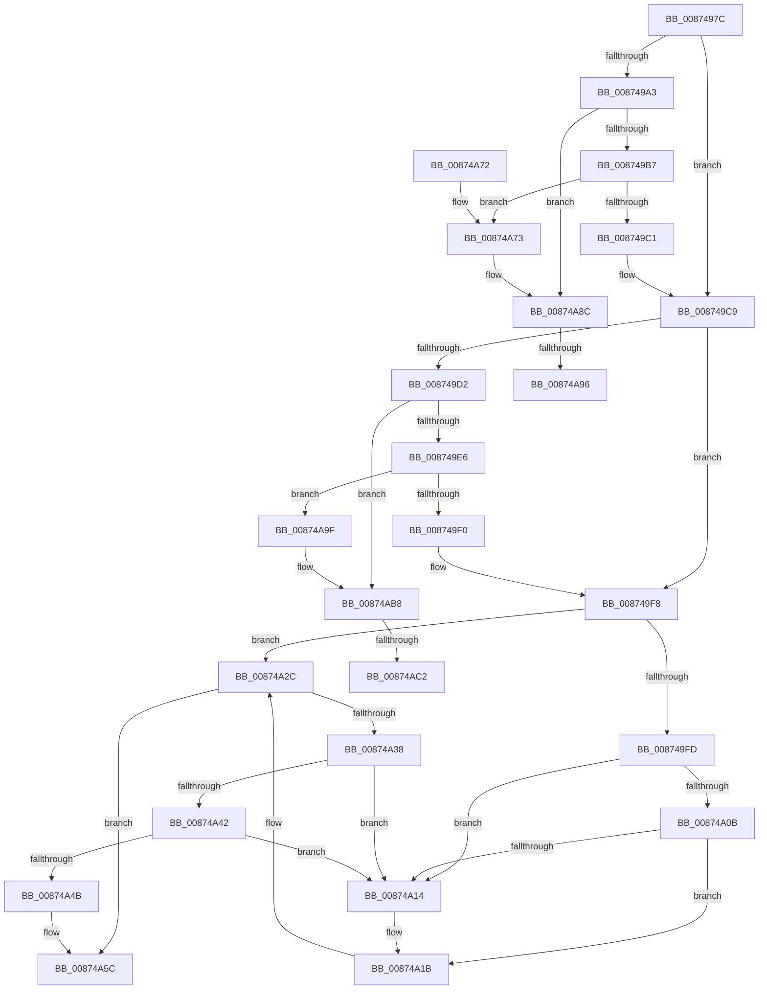

# CmpRundownUnitOfWork

- RVA: `0x0087497C`–`0x00874ACB` (길이 `335` bytes)
- VA: `0x000000014087497C`
- 실행 섹션: `PAGE`
- PDB 이름 있음: `예`; PDB Function 태그: `예`
- unwind 정보 RVA: `0x0006C8C0`
- 디코드: `91`개 명령, `335/335` bytes 표시
- 미해석 바이트: `0` (있으면 어셈블리에 `.byte`로 보존)

> 이 문서는 커널 이미지의 기계어와 PDB 기호를 분석해 생성했습니다. 4번과 5번은 함수 원형과 자료형을 바이너리 사용 방식에서 추정한 C 해석이며 원본 소스 복구 결과는 아닙니다.

## 1. Dependencies

- 직접 호출 지점: **5**; 고유 호출 대상: **4**
- 직접 호출자로 확인된 함수: **10**
- RIP 상대 이미지 참조: **0**

### Outgoing calls
- `0x008749FD` → [LOCK_TRANSACTION_LIST](LOCK_TRANSACTION_LIST_function_00874AD4.md) (function, `0x00874AD4`)
- `0x00874A22` → [UNLOCK_TRANSACTION_LIST](../A6/UNLOCK_TRANSACTION_LIST_function_00A61EB8.md) (function, `0x00A61EB8`)
- `0x00874A52` → [CmpDereferenceKeyControlBlockUnsafe](../99/CmpDereferenceKeyControlBlockUnsafe_function_0099F960.md) (function, `0x0099F960`)
- `0x00874A86` → [KeBugCheckEx](../../text/4F/KeBugCheckEx_function_004FD660.md) (function, `0x004FD660`)
- `0x00874AB2` → [KeBugCheckEx](../../text/4F/KeBugCheckEx_function_004FD660.md) (function, `0x004FD660`)

### Direct callers
- [CmSetLastWriteTimeKey](../84/CmSetLastWriteTimeKey_function_00843368.md) at `0x00843684`
- [CmSetValueKey](../84/CmSetValueKey_function_008457C0.md) at `0x008467AB`
- [CmDeleteValueKey](../84/CmDeleteValueKey_function_008476E8.md) at `0x00847F07`
- [CmDeleteKey](../84/CmDeleteKey_function_00848E5C.md) at `0x0084974F`
- [CmDeleteKey](../84/CmDeleteKey_function_00848E5C.md) at `0x00849766`
- [CmpTransMgrFreeVolatileData](CmpTransMgrFreeVolatileData_function_00874BDC.md) at `0x00874CB0`
- [CmpCreateChild](../94/CmpCreateChild_function_0094817C.md) at `0x0094911E`
- [CmpCreateChild](../94/CmpCreateChild_function_0094817C.md) at `0x00949138`
- [CmpSetKeySecurity](../94/CmpSetKeySecurity_function_0094A124.md) at `0x0094A70B`
- [CmpUndoDeleteKeyForTrans](../94/CmpUndoDeleteKeyForTrans_function_0094A728.md) at `0x0094ABFB`
- [sub_00B25F08](../B2/Unknown_function_00B25F08.md) at `0x00B25F10`
- [sub_00B2D804](../B2/Unknown_function_00B2D804.md) at `0x00B2D8EA`

### Static image references
- 디코드된 RIP-relative 메모리 참조가 없습니다.

## 2. Other-region calls and transfers

- 다른 실행 섹션으로 향하는 call: **2**
  - `0x00874A86` → [KeBugCheckEx](../../text/4F/KeBugCheckEx_function_004FD660.md) (`PAGE` → `.text`)
  - `0x00874AB2` → [KeBugCheckEx](../../text/4F/KeBugCheckEx_function_004FD660.md) (`PAGE` → `.text`)
- call이 아닌 외부 분기/꼬리 이동: **4**
  - `0x00874A90` → [sub_00B1776C + 0x10](../B1/Unknown_function_00B1776C.md) (`tail-transfer`)
  - `0x00874A9A` → [sub_00B1776C](../B1/Unknown_function_00B1776C.md) (`tail-transfer`)
  - `0x00874ABC` → [sub_00B1776C + 0x9A](../B1/Unknown_function_00B1776C.md) (`tail-transfer`)
  - `0x00874AC6` → [sub_00B1776C + 0x8A](../B1/Unknown_function_00B1776C.md) (`tail-transfer`)

## 3. Assembly (complete function range)

```asm
0087497C  48 89 5C 24 08                  mov qword ptr [rsp + 8], rbx
00874981  48 89 74 24 10                  mov qword ptr [rsp + 0x10], rsi
00874986  48 89 7C 24 18                  mov qword ptr [rsp + 0x18], rdi
0087498B  41 56                           push r14
0087498D  48 83 EC 30                     sub rsp, 0x30
00874991  48 8B 71 10                     mov rsi, qword ptr [rcx + 0x10]
00874995  48 8B F9                        mov rdi, rcx
00874998  41 BE 01 00 00 00               mov r14d, 1
0087499E  48 85 F6                        test rsi, rsi
008749A1  74 26                           je 0x1408749c9
008749A3  48 83 61 10 00                  and qword ptr [rcx + 0x10], 0
008749A8  8B 06                           mov eax, dword ptr [rsi]
008749AA  0F BA F0 1F                     btr eax, 0x1f
008749AE  41 3B C6                        cmp eax, r14d
008749B1  0F 85 D5 00 00 00               jne 0x140874a8c
008749B7  48 39 4E 08                     cmp qword ptr [rsi + 8], rcx
008749BB  0F 85 B2 00 00 00               jne 0x140874a73
008749C1  83 26 00                        and dword ptr [rsi], 0
008749C4  48 83 66 08 00                  and qword ptr [rsi + 8], 0
008749C9  48 8B 77 18                     mov rsi, qword ptr [rdi + 0x18]
008749CD  48 85 F6                        test rsi, rsi
008749D0  74 26                           je 0x1408749f8
008749D2  48 83 67 18 00                  and qword ptr [rdi + 0x18], 0
008749D7  8B 06                           mov eax, dword ptr [rsi]
008749D9  0F BA F0 1F                     btr eax, 0x1f
008749DD  41 3B C6                        cmp eax, r14d
008749E0  0F 85 D2 00 00 00               jne 0x140874ab8
008749E6  48 39 7E 08                     cmp qword ptr [rsi + 8], rdi
008749EA  0F 85 AF 00 00 00               jne 0x140874a9f
008749F0  83 26 00                        and dword ptr [rsi], 0
008749F3  48 83 66 08 00                  and qword ptr [rsi + 8], 0
008749F8  48 39 3F                        cmp qword ptr [rdi], rdi
008749FB  74 2F                           je 0x140874a2c
008749FD  E8 D2 00 00 00                  call 0x140874ad4
00874A02  48 8B 0F                        mov rcx, qword ptr [rdi]
00874A05  48 39 79 08                     cmp qword ptr [rcx + 8], rdi
00874A09  75 09                           jne 0x140874a14
00874A0B  48 8B 47 08                     mov rax, qword ptr [rdi + 8]
00874A0F  48 39 38                        cmp qword ptr [rax], rdi
00874A12  74 07                           je 0x140874a1b
00874A14  B9 03 00 00 00                  mov ecx, 3
00874A19  CD 29                           int 0x29
00874A1B  48 89 08                        mov qword ptr [rax], rcx
00874A1E  48 89 41 08                     mov qword ptr [rcx + 8], rax
00874A22  E8 91 D4 1E 00                  call 0x140a61eb8
00874A27  48 83 67 38 00                  and qword ptr [rdi + 0x38], 0
00874A2C  48 8D 47 20                     lea rax, [rdi + 0x20]
00874A30  48 8B 10                        mov rdx, qword ptr [rax]
00874A33  48 3B D0                        cmp rdx, rax
00874A36  74 24                           je 0x140874a5c
00874A38  48 8B 4F 30                     mov rcx, qword ptr [rdi + 0x30]
00874A3C  48 39 42 08                     cmp qword ptr [rdx + 8], rax
00874A40  75 D2                           jne 0x140874a14
00874A42  4C 8B 40 08                     mov r8, qword ptr [rax + 8]
00874A46  49 39 00                        cmp qword ptr [r8], rax
00874A49  75 C9                           jne 0x140874a14
00874A4B  49 89 10                        mov qword ptr [r8], rdx
00874A4E  4C 89 42 08                     mov qword ptr [rdx + 8], r8
00874A52  E8 09 AF 12 00                  call 0x14099f960
00874A57  48 83 67 30 00                  and qword ptr [rdi + 0x30], 0
00874A5C  48 8B 5C 24 40                  mov rbx, qword ptr [rsp + 0x40]
00874A61  48 8B 74 24 48                  mov rsi, qword ptr [rsp + 0x48]
00874A66  48 8B 7C 24 50                  mov rdi, qword ptr [rsp + 0x50]
00874A6B  48 83 C4 30                     add rsp, 0x30
00874A6F  41 5E                           pop r14
00874A71  C3                              ret
00874A72  CC                              int3
00874A73  BA 12 00 00 00                  mov edx, 0x12
00874A78  48 89 7C 24 20                  mov qword ptr [rsp + 0x20], rdi
00874A7D  4C 8B CE                        mov r9, rsi
00874A80  4D 8B C6                        mov r8, r14
00874A83  8D 4A 3F                        lea ecx, [rdx + 0x3f]
00874A86  E8 D5 8B C8 FF                  call 0x1404fd660
00874A8B  CC                              int3
00874A8C  33 C9                           xor ecx, ecx
00874A8E  85 C0                           test eax, eax
00874A90  0F 84 E6 2C 2A 00               je 0x140b1777c
00874A96  48 8B 56 08                     mov rdx, qword ptr [rsi + 8]
00874A9A  E9 CD 2C 2A 00                  jmp 0x140b1776c
00874A9F  BA 12 00 00 00                  mov edx, 0x12
00874AA4  48 89 7C 24 20                  mov qword ptr [rsp + 0x20], rdi
00874AA9  4C 8B CE                        mov r9, rsi
00874AAC  4D 8B C6                        mov r8, r14
00874AAF  8D 4A 3F                        lea ecx, [rdx + 0x3f]
00874AB2  E8 A9 8B C8 FF                  call 0x1404fd660
00874AB7  CC                              int3
00874AB8  33 C9                           xor ecx, ecx
00874ABA  85 C0                           test eax, eax
00874ABC  0F 84 44 2D 2A 00               je 0x140b17806
00874AC2  48 8B 56 08                     mov rdx, qword ptr [rsi + 8]
00874AC6  E9 2B 2D 2A 00                  jmp 0x140b177f6
```

## 4. C-style interpretation (structured pseudocode)

```c
__int64 __fastcall CmpRundownUnitOfWork(__int64 a1)
{
    __int64 result;
    __int64 v_rsp;
    unsigned __int64 v_stack_p10;
    unsigned __int64 v_stack_p18;
    unsigned __int64 v_stack_p20;
    unsigned __int64 v_stack_p8;

    v_stack_p8 = v_rbx;
    v_stack_p10 = v_rsi;
    v_stack_p18 = v_rdi;
    v_rsp = (v_rsp) - (48);
    if (*(unsigned __int64 *)(a1 + 16) == 0) goto loc_008749C9;
    if (((unsigned int)((unsigned int)(*(unsigned int *)(*(unsigned __int64 *)(a1 + 16))))) != 1) goto loc_00874A8C;
    if ((*(unsigned __int64 *)(*(unsigned __int64 *)(a1 + 16) + 8)) != a1) goto loc_00874A73;
loc_008749C9:
    if (*(unsigned __int64 *)(a1 + 24) == 0) goto loc_008749F8;
    if (((unsigned int)((unsigned int)(*(unsigned int *)(*(unsigned __int64 *)(a1 + 24))))) != 1) goto loc_00874AB8;
    if ((*(unsigned __int64 *)(*(unsigned __int64 *)(a1 + 24) + 8)) != a1) goto loc_00874A9F;
loc_008749F8:
    if ((*(unsigned __int64 *)(a1)) == a1) goto loc_00874A2C;
    result = LOCK_TRANSACTION_LIST(a1, a2, a3, a4);
    if ((*(unsigned __int64 *)(*(unsigned __int64 *)(a1) + 8)) != a1) goto loc_00874A14;
    if ((*(unsigned __int64 *)(*(unsigned __int64 *)(a1 + 8))) != a1) {
        a1 = 3;
    }
    *(unsigned __int64 *)(*(unsigned __int64 *)(a1 + 8)) = a1;
    *(unsigned __int64 *)(a1 + 8) = *(unsigned __int64 *)(a1 + 8);
    result = UNLOCK_TRANSACTION_LIST(a1, a2, a3, a4);
loc_00874A2C:
    if ((*(unsigned __int64 *)(a1 + 32)) == (a1 + 32)) goto loc_00874A5C;
    if ((*(unsigned __int64 *)(*(unsigned __int64 *)(a1 + 32) + 8)) != (a1 + 32)) goto loc_00874A14;
    if ((*(unsigned __int64 *)(*(unsigned __int64 *)(a1 + 32 + 8))) != (a1 + 32)) goto loc_00874A14;
    *(unsigned __int64 *)(*(unsigned __int64 *)(a1 + 32 + 8)) = *(unsigned __int64 *)(a1 + 32);
    *(unsigned __int64 *)(*(unsigned __int64 *)(a1 + 32) + 8) = *(unsigned __int64 *)(a1 + 32 + 8);
    result = CmpDereferenceKeyControlBlockUnsafe(*(unsigned __int64 *)(a1 + 48), *(unsigned __int64 *)(a1 + 32), *(unsigned __int64 *)(a1 + 32 + 8), a4);
loc_00874A5C:
    v_rsp = (v_rsp) + (48);
    return result;
loc_00874A73:
    v_stack_p20 = v_stack_p18;
    result = KeBugCheckEx(18 + 63, 18, 1, v_stack_p10);
loc_00874A8C:
    a1 = 0;
loc_00874A9F:
    v_stack_p20 = v_stack_p18;
    result = KeBugCheckEx(18 + 63, 18, 1, v_stack_p10);
loc_00874AB8:
    a1 = 0;
}
```

## 5. (Beta) C Style

```c
int64_t CmpRundownUnitOfWork(void *Arg1)
{
    uint8_t *arg1 = (uint8_t *)Arg1;

    int64_t result;
    int64_t local_rsp;
    uint64_t v_stack_p10;
    uint64_t v_stack_p18;
    uint64_t v_stack_p20;
    uint64_t v_stack_p8;

    v_stack_p8 = local_rbx;
    v_stack_p10 = local_rsi;
    v_stack_p18 = local_rdi;
    local_rsp = (local_rsp) - (48);
    if (*(uint64_t *)(arg1 + 0x10) == 0) goto loc_008749C9;
    if (((uint32_t)((uint32_t)(*(uint32_t *)(*(uint64_t *)(arg1 + 0x10))))) != 1) goto loc_00874A8C;
    if ((*(uint64_t *)(*(uint64_t *)(arg1 + 0x10) + 0x8)) != Arg1) goto loc_00874A73;
loc_008749C9:
    if (*(uint64_t *)(arg1 + 0x18) == 0) goto loc_008749F8;
    if (((uint32_t)((uint32_t)(*(uint32_t *)(*(uint64_t *)(arg1 + 0x18))))) != 1) goto loc_00874AB8;
    if ((*(uint64_t *)(*(uint64_t *)(arg1 + 0x18) + 0x8)) != Arg1) goto loc_00874A9F;
loc_008749F8:
    if ((*(uint64_t *)(arg1)) == Arg1) goto loc_00874A2C;
    result = LOCK_TRANSACTION_LIST(Arg1, a2, a3, a4);
    if ((*(uint64_t *)(*(uint64_t *)(arg1) + 0x8)) != Arg1) goto loc_00874A14;
    if ((*(uint64_t *)(*(uint64_t *)(arg1 + 0x8))) != Arg1) {
        Arg1 = 3;
    }
    *(void **)(*(uint64_t *)(arg1 + 0x8)) = Arg1;
    *(uint64_t *)(arg1 + 0x8) = *(uint64_t *)(arg1 + 0x8);
    result = UNLOCK_TRANSACTION_LIST(Arg1, a2, a3, a4);
loc_00874A2C:
    if ((*(uint64_t *)(arg1 + 0x20)) == (Arg1 + 32)) goto loc_00874A5C;
    if ((*(uint64_t *)(*(uint64_t *)(arg1 + 0x20) + 0x8)) != (Arg1 + 32)) goto loc_00874A14;
    if ((*(uint64_t *)(*(uint64_t *)(arg1 + 0x20 + 0x8))) != (Arg1 + 32)) goto loc_00874A14;
    *(uint64_t *)(*(uint64_t *)(arg1 + 0x20 + 0x8)) = *(uint64_t *)(arg1 + 0x20);
    *(uint64_t *)(*(uint64_t *)(arg1 + 0x20) + 0x8) = *(uint64_t *)(arg1 + 0x20 + 0x8);
    result = CmpDereferenceKeyControlBlockUnsafe(*(uint64_t *)(arg1 + 0x30), *(uint64_t *)(arg1 + 0x20), *(uint64_t *)(arg1 + 0x20 + 0x8), a4);
loc_00874A5C:
    local_rsp = (local_rsp) + (48);
    return result;
loc_00874A73:
    v_stack_p20 = v_stack_p18;
    result = KeBugCheckEx(18 + 63, 18, 1, v_stack_p10);
loc_00874A8C:
    Arg1 = 0;
loc_00874A9F:
    v_stack_p20 = v_stack_p18;
    result = KeBugCheckEx(18 + 63, 18, 1, v_stack_p10);
loc_00874AB8:
    Arg1 = 0;
}
```

### 관측된 메모리 오프셋

구조체 형식이 확인되지 않은 접근은 인자 기준의 오프셋으로만 기록했습니다.

| 기준 인자 | 오프셋 표현 | 폭 (bit) | 접근 |
|---|---:|---:|---|
| `Arg1` | `+ 0x0` | `64` | `R` |
| `Arg1` | `+ 0x8` | `64` | `R` |
| `Arg1` | `+ 0x10` | `64` | `R` |
| `Arg1` | `+ 0x10` | `64` | `R/W` |
| `Arg1` | `+ 0x18` | `64` | `R` |
| `Arg1` | `+ 0x18` | `64` | `R/W` |
| `Arg1` | `+ 0x20` | `64` | `R` |
| `Arg1` | `+ 0x30` | `64` | `R` |
| `Arg1` | `+ 0x30` | `64` | `R/W` |
| `Arg1` | `+ 0x38` | `64` | `R/W` |

## 6. Execution-region graph

[열기: 2D/3D 그래프와 함수 탐색 컨트롤 패널](../../../control-panel.html?section=page&rva=0x0087497C&view=graph)

- 2D 그래프는 위에서 아래로 흐르고, 3D 그래프는 빈 공간을 드래그해 회전합니다. Shift+드래그는 이동, 휠은 확대·축소, 함수 노드 선택은 대상 보고서 이동입니다.

### Static fallback


