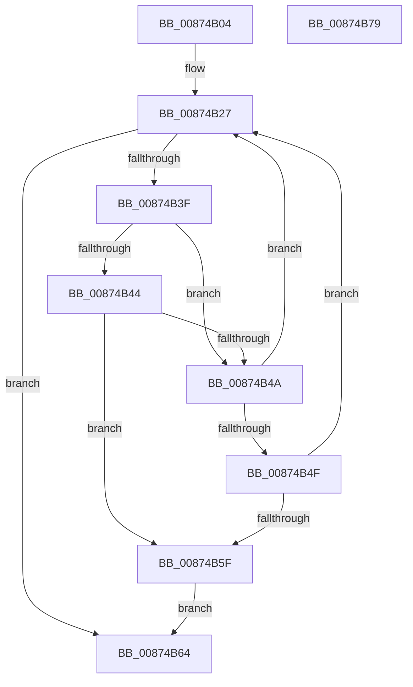

# CmpSearchForTrans

- RVA: `0x00874B04`–`0x00874B7A` (길이 `118` bytes)
- VA: `0x0000000140874B04`
- 실행 섹션: `PAGE`
- PDB 이름 있음: `예`; PDB Function 태그: `아니요`
- unwind 정보 RVA: `0x0006C8E8`
- 디코드: `37`개 명령, `118/118` bytes 표시
- 미해석 바이트: `0` (있으면 어셈블리에 `.byte`로 보존)

> 이 문서는 커널 이미지의 기계어와 PDB 기호를 분석해 생성했습니다. 4번과 5번은 함수 원형과 자료형을 바이너리 사용 방식에서 추정한 C 해석이며 원본 소스 복구 결과는 아닙니다.

## 1. Dependencies

- 직접 호출 지점: **2**; 고유 호출 대상: **2**
- 직접 호출자로 확인된 함수: **1**
- RIP 상대 이미지 참조: **0**

### Outgoing calls
- `0x00874B32` → [CmListGetNextElement](../../pagecmrc/BC/CmListGetNextElement_function_00BC9940.md) (function, `0x00BC9940`)
- `0x00874B56` → [CmpTransUowIsEqual](../70/CmpTransUowIsEqual_function_007049CC.md) (function, `0x007049CC`)

### Direct callers
- [CmpTransSearchAddTrans](CmpTransSearchAddTrans_function_008743FC.md) at `0x00874458`

### Static image references
- 디코드된 RIP-relative 메모리 참조가 없습니다.

## 2. Other-region calls and transfers

- 다른 실행 섹션으로 향하는 call: **1**
  - `0x00874B32` → [CmListGetNextElement](../../pagecmrc/BC/CmListGetNextElement_function_00BC9940.md) (`PAGE` → `PAGECMRC`)
- 별도 외부 분기/꼬리 이동을 확인하지 못했습니다.

## 3. Assembly (complete function range)

```asm
00874B04  48 8B C4                        mov rax, rsp
00874B07  48 89 58 10                     mov qword ptr [rax + 0x10], rbx
00874B0B  48 89 68 18                     mov qword ptr [rax + 0x18], rbp
00874B0F  48 89 70 20                     mov qword ptr [rax + 0x20], rsi
00874B13  57                              push rdi
00874B14  48 83 EC 20                     sub rsp, 0x20
00874B18  48 83 60 08 00                  and qword ptr [rax + 8], 0
00874B1D  48 8D 69 10                     lea rbp, [rcx + 0x10]
00874B21  49 8B F0                        mov rsi, r8
00874B24  48 8B DA                        mov rbx, rdx
00874B27  45 33 C0                        xor r8d, r8d
00874B2A  48 8D 54 24 30                  lea rdx, [rsp + 0x30]
00874B2F  48 8B CD                        mov rcx, rbp
00874B32  E8 09 4E 35 00                  call 0x140bc9940
00874B37  48 8B F8                        mov rdi, rax
00874B3A  48 85 C0                        test rax, rax
00874B3D  74 25                           je 0x140874b64
00874B3F  48 85 DB                        test rbx, rbx
00874B42  74 06                           je 0x140874b4a
00874B44  48 3B 58 38                     cmp rbx, qword ptr [rax + 0x38]
00874B48  74 15                           je 0x140874b5f
00874B4A  48 85 F6                        test rsi, rsi
00874B4D  74 D8                           je 0x140874b27
00874B4F  48 8D 50 58                     lea rdx, [rax + 0x58]
00874B53  48 8B CE                        mov rcx, rsi
00874B56  E8 71 FE E8 FF                  call 0x1407049cc
00874B5B  84 C0                           test al, al
00874B5D  74 C8                           je 0x140874b27
00874B5F  48 8B C7                        mov rax, rdi
00874B62  EB 00                           jmp 0x140874b64
00874B64  48 8B 5C 24 38                  mov rbx, qword ptr [rsp + 0x38]
00874B69  48 8B 6C 24 40                  mov rbp, qword ptr [rsp + 0x40]
00874B6E  48 8B 74 24 48                  mov rsi, qword ptr [rsp + 0x48]
00874B73  48 83 C4 20                     add rsp, 0x20
00874B77  5F                              pop rdi
00874B78  C3                              ret
00874B79  CC                              int3
```

## 4. C-style interpretation (structured pseudocode)

```c
__int64 __fastcall CmpSearchForTrans(__int64 a1, __int64 a2, __int64 a3)
{
    __int64 result;
    __int64 v_rsp;
    unsigned __int64 v_stack_p10;
    unsigned __int64 v_stack_p18;
    unsigned __int64 v_stack_p20;
    unsigned __int64 v_stack_p8;

    *(unsigned __int64 *)(v_rsp + 16) = v_rbx;
    *(unsigned __int64 *)(v_rsp + 24) = v_rbp;
    *(unsigned __int64 *)(v_rsp + 32) = v_rsi;
    v_rsp = (v_rsp) - (32);
loc_00874B27:
    a3 = 0;
    result = CmListGetNextElement(a1 + 16, v_stack_p8, a3, a4);
    if (result == 0) goto loc_00874B64;
    if (a2 == 0) goto loc_00874B4A;
    if (a2 == (*(unsigned __int64 *)(result + 56))) goto loc_00874B5F;
loc_00874B4A:
    if (0 == 0) goto loc_00874B27;
    result = CmpTransUowIsEqual(0, result + 88, a3, a4);
    if ((unsigned __int8)(result) == 0) goto loc_00874B27;
loc_00874B5F:
    goto loc_00874B64;
loc_00874B64:
    v_rsp = (v_rsp) + (32);
    return result;
}
```

## 5. (Beta) C Style

```c
int64_t CmpSearchForTrans(void *Arg1, int64_t Arg2, int64_t Arg3)
{
    uint8_t *arg1 = (uint8_t *)Arg1;

    int64_t result;
    int64_t local_rsp;
    uint64_t v_stack_p10;
    uint64_t v_stack_p18;
    uint64_t v_stack_p20;
    uint64_t v_stack_p8;

    *(uint64_t *)(local_rsp + 0x10) = local_rbx;
    *(uint64_t *)(local_rsp + 0x18) = local_rbp;
    *(uint64_t *)(local_rsp + 0x20) = local_rsi;
    local_rsp = (local_rsp) - (32);
loc_00874B27:
    Arg3 = 0;
    result = CmListGetNextElement(Arg1 + 16, v_stack_p8, Arg3, a4);
    if (result == 0) goto loc_00874B64;
    if (Arg2 == 0) goto loc_00874B4A;
    if (Arg2 == (*(uint64_t *)(result + 0x38))) goto loc_00874B5F;
loc_00874B4A:
    if (0 == 0) goto loc_00874B27;
    result = CmpTransUowIsEqual(0, result + 88, Arg3, a4);
    if ((uint8_t)(result) == 0) goto loc_00874B27;
loc_00874B5F:
    goto loc_00874B64;
loc_00874B64:
    local_rsp = (local_rsp) + (32);
    return result;
}
```

### 관측된 메모리 오프셋

구조체 형식이 확인되지 않은 접근은 인자 기준의 오프셋으로만 기록했습니다.

| 기준 인자 | 오프셋 표현 | 폭 (bit) | 접근 |
|---|---:|---:|---|
| `Arg1` | `+ 0x10` | `64` | `R` |

## 6. Execution-region graph

[열기: 2D/3D 그래프와 함수 탐색 컨트롤 패널](../../../control-panel.html?section=page&rva=0x00874B04&view=graph)

- 2D 그래프는 위에서 아래로 흐르고, 3D 그래프는 빈 공간을 드래그해 회전합니다. Shift+드래그는 이동, 휠은 확대·축소, 함수 노드 선택은 대상 보고서 이동입니다.

### Static fallback


