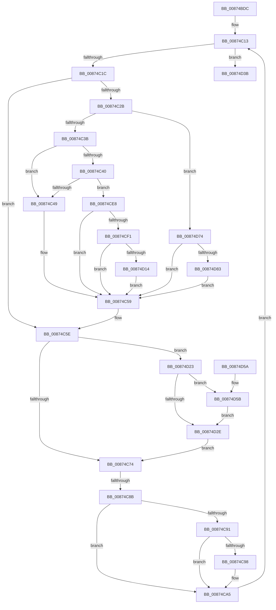

# CmpTransMgrFreeVolatileData

- RVA: `0x00874BDC`–`0x00874D98` (길이 `444` bytes)
- VA: `0x0000000140874BDC`
- 실행 섹션: `PAGE`
- PDB 이름 있음: `예`; PDB Function 태그: `예`
- unwind 정보 RVA: `0x0006C900`
- 디코드: `112`개 명령, `444/444` bytes 표시
- 미해석 바이트: `0` (있으면 어셈블리에 `.byte`로 보존)

> 이 문서는 커널 이미지의 기계어와 PDB 기호를 분석해 생성했습니다. 4번과 5번은 함수 원형과 자료형을 바이너리 사용 방식에서 추정한 C 해석이며 원본 소스 복구 결과는 아닙니다.

## 1. Dependencies

- 직접 호출 지점: **17**; 고유 호출 대상: **15**
- 직접 호출자로 확인된 함수: **4**
- RIP 상대 이미지 참조: **0**

### Outgoing calls
- `0x00874C0A` → [CmpInitializeDelayDerefContext](../../text/42/CmpInitializeDelayDerefContext_function_0042A7F0.md) (function, `0x0042A7F0`)
- `0x00874C2B` → [CmpLockRegistryExclusive](../84/CmpLockRegistryExclusive_function_0084F9B4.md) (function, `0x0084F9B4`)
- `0x00874C54` → [CmpFreeValue](../84/CmpFreeValue_function_0084AF98.md) (function, `0x0084AF98`)
- `0x00874C59` → [CmpUnlockRegistry](../../pagecmrc/BC/CmpUnlockRegistry_function_00BC9A84.md) (function, `0x00BC9A84`)
- `0x00874C5E` → [CmpLockRegistryExclusive](../84/CmpLockRegistryExclusive_function_0084F9B4.md) (function, `0x0084F9B4`)
- `0x00874C7E` → [CmEqualTrans](../84/CmEqualTrans_function_0084BF60.md) (function, `0x0084BF60`)
- `0x00874CA0` → [CmpRebuildKcbCache](CmpRebuildKcbCache_function_00874DF8.md) (function, `0x00874DF8`)
- `0x00874CA8` → [CmpReferenceKeyControlBlockUnsafe](CmpReferenceKeyControlBlockUnsafe_function_00874DA0.md) (function, `0x00874DA0`)
- `0x00874CB0` → [CmpRundownUnitOfWork](CmpRundownUnitOfWork_function_0087497C.md) (function, `0x0087497C`)
- `0x00874CBD` → [ExFreePoolWithTag](../../poolcode/B8/ExFreePoolWithTag_function_00B82870.md) (function, `0x00B82870`)
- `0x00874CCD` → [CmpDereferenceKeyControlBlockWithLock](../86/CmpDereferenceKeyControlBlockWithLock_function_00862B60.md) (function, `0x00862B60`)
- `0x00874CD9` → [CmpDrainDelayDerefContext](../../text/41/CmpDrainDelayDerefContext_function_0041B9A0.md) (function, `0x0041B9A0`)
- `0x00874CDE` → [CmpUnlockRegistry](../../pagecmrc/BC/CmpUnlockRegistry_function_00BC9A84.md) (function, `0x00BC9A84`)
- `0x00874D07` → [HvpMarkCellDirty](../85/HvpMarkCellDirty_function_00858080.md) (function, `0x00858080`)
- `0x00874D19` → [CmpDereferenceSecurityNode](../../text/4A/CmpDereferenceSecurityNode_function_004A672C.md) (function, `0x004A672C`)
- `0x00874D5F` → [HvFreeCell](../85/HvFreeCell_function_0085A72C.md) (function, `0x0085A72C`)
- `0x00874D8E` → [CmpFreeKeyByCell](../84/CmpFreeKeyByCell_function_0084AD70.md) (function, `0x0084AD70`)

### Direct callers
- [CmpRmUnDoPhase](../7F/CmpRmUnDoPhase_function_007F0968.md) at `0x007F0A90`
- [CmpCleanupTransactionState](../84/CmpCleanupTransactionState_function_008428E0.md) at `0x0084292D`
- [CmpCleanupLightWeightTransaction](../9B/CmpCleanupLightWeightTransaction_function_009B1340.md) at `0x009B1384`
- [CmRmFinalizeRecovery](../AB/CmRmFinalizeRecovery_function_00ABEB68.md) at `0x00ABEBFE`

### Static image references
- 디코드된 RIP-relative 메모리 참조가 없습니다.

## 2. Other-region calls and transfers

- 다른 실행 섹션으로 향하는 call: **6**
  - `0x00874C0A` → [CmpInitializeDelayDerefContext](../../text/42/CmpInitializeDelayDerefContext_function_0042A7F0.md) (`PAGE` → `.text`)
  - `0x00874C59` → [CmpUnlockRegistry](../../pagecmrc/BC/CmpUnlockRegistry_function_00BC9A84.md) (`PAGE` → `PAGECMRC`)
  - `0x00874CBD` → [ExFreePoolWithTag](../../poolcode/B8/ExFreePoolWithTag_function_00B82870.md) (`PAGE` → `POOLCODE`)
  - `0x00874CD9` → [CmpDrainDelayDerefContext](../../text/41/CmpDrainDelayDerefContext_function_0041B9A0.md) (`PAGE` → `.text`)
  - `0x00874CDE` → [CmpUnlockRegistry](../../pagecmrc/BC/CmpUnlockRegistry_function_00BC9A84.md) (`PAGE` → `PAGECMRC`)
  - `0x00874D19` → [CmpDereferenceSecurityNode](../../text/4A/CmpDereferenceSecurityNode_function_004A672C.md) (`PAGE` → `.text`)
- call이 아닌 외부 분기/꼬리 이동: **1**
  - `0x00874C85` → [sub_00B1787E](../B1/Unknown_function_00B1787E.md) (`tail-transfer`)

## 3. Assembly (complete function range)

```asm
00874BDC  48 8B C4                        mov rax, rsp
00874BDF  48 89 58 08                     mov qword ptr [rax + 8], rbx
00874BE3  48 89 68 10                     mov qword ptr [rax + 0x10], rbp
00874BE7  48 89 70 18                     mov qword ptr [rax + 0x18], rsi
00874BEB  48 89 78 20                     mov qword ptr [rax + 0x20], rdi
00874BEF  41 54                           push r12
00874BF1  41 56                           push r14
00874BF3  41 57                           push r15
00874BF5  48 83 EC 40                     sub rsp, 0x40
00874BF9  48 8B F1                        mov rsi, rcx
00874BFC  0F 57 C0                        xorps xmm0, xmm0
00874BFF  48 8D 48 D8                     lea rcx, [rax - 0x28]
00874C03  44 8B E2                        mov r12d, edx
00874C06  0F 11 40 D8                     movups xmmword ptr [rax - 0x28], xmm0
00874C0A  E8 E1 5B BB FF                  call 0x14042a7f0
00874C0F  4C 8D 7E 10                     lea r15, [rsi + 0x10]
00874C13  4D 39 3F                        cmp qword ptr [r15], r15
00874C16  0F 84 1F 01 00 00               je 0x140874d3b
00874C1C  48 8B 7E 18                     mov rdi, qword ptr [rsi + 0x18]
00874C20  48 8B 47 30                     mov rax, qword ptr [rdi + 0x30]
00874C24  48 83 78 20 00                  cmp qword ptr [rax + 0x20], 0
00874C29  74 33                           je 0x140874c5e
00874C2B  E8 84 AD FD FF                  call 0x14084f9b4
00874C30  8B 4F 44                        mov ecx, dword ptr [rdi + 0x44]
00874C33  85 C9                           test ecx, ecx
00874C35  0F 84 39 01 00 00               je 0x140874d74
00874C3B  83 E9 04                        sub ecx, 4
00874C3E  74 09                           je 0x140874c49
00874C40  83 E9 01                        sub ecx, 1
00874C43  0F 85 9F 00 00 00               jne 0x140874ce8
00874C49  48 8B 4F 30                     mov rcx, qword ptr [rdi + 0x30]
00874C4D  8B 57 5C                        mov edx, dword ptr [rdi + 0x5c]
00874C50  48 8B 49 20                     mov rcx, qword ptr [rcx + 0x20]
00874C54  E8 3F 63 FD FF                  call 0x14084af98
00874C59  E8 26 4E 35 00                  call 0x140bc9a84
00874C5E  E8 51 AD FD FF                  call 0x14084f9b4
00874C63  48 8B 5F 30                     mov rbx, qword ptr [rdi + 0x30]
00874C67  48 39 B3 20 01 00 00            cmp qword ptr [rbx + 0x120], rsi
00874C6E  0F 84 AF 00 00 00               je 0x140874d23
00874C74  48 8B 8B F0 00 00 00            mov rcx, qword ptr [rbx + 0xf0]
00874C7B  48 8B D6                        mov rdx, rsi
00874C7E  E8 DD 72 FD FF                  call 0x14084bf60
00874C83  84 C0                           test al, al
00874C85  0F 85 F3 2B 2A 00               jne 0x140b1787e
00874C8B  83 7B 28 FF                     cmp dword ptr [rbx + 0x28], -1
00874C8F  74 14                           je 0x140874ca5
00874C91  48 83 7B 20 00                  cmp qword ptr [rbx + 0x20], 0
00874C96  74 0D                           je 0x140874ca5
00874C98  48 8D 54 24 30                  lea rdx, [rsp + 0x30]
00874C9D  48 8B CB                        mov rcx, rbx
00874CA0  E8 53 01 00 00                  call 0x140874df8
00874CA5  48 8B CB                        mov rcx, rbx
00874CA8  E8 F3 00 00 00                  call 0x140874da0
00874CAD  48 8B CF                        mov rcx, rdi
00874CB0  E8 C7 FC FF FF                  call 0x14087497c
00874CB5  BA 43 4D 55 77                  mov edx, 0x77554d43
00874CBA  48 8B CF                        mov rcx, rdi
00874CBD  E8 AE DB 30 00                  call 0x140b82870
00874CC2  41 B0 01                        mov r8b, 1
00874CC5  48 8D 54 24 30                  lea rdx, [rsp + 0x30]
00874CCA  48 8B CB                        mov rcx, rbx
00874CCD  E8 8E DE FE FF                  call 0x140862b60
00874CD2  33 D2                           xor edx, edx
00874CD4  48 8D 4C 24 30                  lea rcx, [rsp + 0x30]
00874CD9  E8 C2 6C BA FF                  call 0x14041b9a0
00874CDE  E8 A1 4D 35 00                  call 0x140bc9a84
00874CE3  E9 2B FF FF FF                  jmp 0x140874c13
00874CE8  83 F9 04                        cmp ecx, 4
00874CEB  0F 85 68 FF FF FF               jne 0x140874c59
00874CF1  48 8B 47 30                     mov rax, qword ptr [rdi + 0x30]
00874CF5  45 33 C9                        xor r9d, r9d
00874CF8  8B 6F 60                        mov ebp, dword ptr [rdi + 0x60]
00874CFB  41 B0 01                        mov r8b, 1
00874CFE  8B D5                           mov edx, ebp
00874D00  48 8B 58 20                     mov rbx, qword ptr [rax + 0x20]
00874D04  48 8B CB                        mov rcx, rbx
00874D07  E8 74 33 FE FF                  call 0x140858080
00874D0C  85 C0                           test eax, eax
00874D0E  0F 88 45 FF FF FF               js 0x140874c59
00874D14  8B D5                           mov edx, ebp
00874D16  48 8B CB                        mov rcx, rbx
00874D19  E8 0E 1A C3 FF                  call 0x1404a672c
00874D1E  E9 36 FF FF FF                  jmp 0x140874c59
00874D23  8B 93 1C 01 00 00               mov edx, dword ptr [rbx + 0x11c]
00874D29  83 FA FF                        cmp edx, -1
00874D2C  75 2D                           jne 0x140874d5b
00874D2E  48 83 A3 20 01 00 00 00         and qword ptr [rbx + 0x120], 0
00874D36  E9 39 FF FF FF                  jmp 0x140874c74
00874D3B  48 8B 5C 24 60                  mov rbx, qword ptr [rsp + 0x60]
00874D40  48 8B 6C 24 68                  mov rbp, qword ptr [rsp + 0x68]
00874D45  48 8B 74 24 70                  mov rsi, qword ptr [rsp + 0x70]
00874D4A  48 8B 7C 24 78                  mov rdi, qword ptr [rsp + 0x78]
00874D4F  48 83 C4 40                     add rsp, 0x40
00874D53  41 5F                           pop r15
00874D55  41 5E                           pop r14
00874D57  41 5C                           pop r12
00874D59  C3                              ret
00874D5A  CC                              int3
00874D5B  48 8B 4B 20                     mov rcx, qword ptr [rbx + 0x20]
00874D5F  E8 C8 59 FE FF                  call 0x14085a72c
00874D64  83 A3 18 01 00 00 00            and dword ptr [rbx + 0x118], 0
00874D6B  83 8B 1C 01 00 00 FF            or dword ptr [rbx + 0x11c], 0xffffffff
00874D72  EB BA                           jmp 0x140874d2e
00874D74  8B 57 58                        mov edx, dword ptr [rdi + 0x58]
00874D77  8D 42 FF                        lea eax, [rdx - 1]
00874D7A  83 F8 FD                        cmp eax, -3
00874D7D  0F 87 D6 FE FF FF               ja 0x140874c59
00874D83  48 8B 4F 30                     mov rcx, qword ptr [rdi + 0x30]
00874D87  45 33 C0                        xor r8d, r8d
00874D8A  48 8B 49 20                     mov rcx, qword ptr [rcx + 0x20]
00874D8E  E8 DD 5F FD FF                  call 0x14084ad70
00874D93  E9 C1 FE FF FF                  jmp 0x140874c59
```

## 4. C-style interpretation (structured pseudocode)

```c
__int64 __fastcall CmpTransMgrFreeVolatileData(__int64 a1, int a2, __int64 a3, int a4)
{
    __int64 result;
    __int64 v_rsp;
    unsigned __int64 v_stack_m28;
    unsigned __int64 v_stack_p10;
    unsigned __int64 v_stack_p18;
    unsigned __int64 v_stack_p20;
    unsigned __int64 v_stack_p8;

    *(unsigned __int64 *)(v_rsp + 8) = v_rbx;
    *(unsigned __int64 *)(v_rsp + 16) = v_rbp;
    *(unsigned __int64 *)(v_rsp + 24) = v_rsi;
    *(unsigned __int64 *)(v_rsp + 32) = v_rdi;
    v_rsp = (v_rsp) - (64);
    *(unsigned __int64 *)(v_rsp - 40) = v_xmm0;
    result = CmpInitializeDelayDerefContext(v_rsp - 40, a2, a3, a4);
loc_00874C13:
    if ((*(unsigned __int64 *)(a1 + 16)) == (a1 + 16)) goto loc_00874D3B;
    if ((*(unsigned __int64 *)(*(unsigned __int64 *)(*(unsigned __int64 *)(a1 + 24) + 48) + 32)) == 0) goto loc_00874C5E;
    result = CmpLockRegistryExclusive(v_rsp - 40, a2, a3, a4);
    if ((unsigned int)((unsigned int)(*(unsigned int *)(*(unsigned __int64 *)(a1 + 24) + 68))) == 0) goto loc_00874D74;
    a1 = (unsigned int)(((unsigned int)(*(unsigned int *)(*(unsigned __int64 *)(a1 + 24) + 68))) - (4));
    if (condition_is_equal) goto loc_00874C49;
    a1 = (unsigned int)((a1) - (1));
    if (condition_is_not_equal) goto loc_00874CE8;
loc_00874C49:
    result = CmpFreeValue(*(unsigned __int64 *)(*(unsigned __int64 *)(*(unsigned __int64 *)(a1 + 24) + 48) + 32), (unsigned int)(*(unsigned int *)(*(unsigned __int64 *)(a1 + 24) + 92)), a3, a4);
loc_00874C59:
    result = CmpUnlockRegistry(*(unsigned __int64 *)(*(unsigned __int64 *)(*(unsigned __int64 *)(a1 + 24) + 48) + 32), (unsigned int)(*(unsigned int *)(*(unsigned __int64 *)(a1 + 24) + 92)), a3, a4);
loc_00874C5E:
    result = CmpLockRegistryExclusive(*(unsigned __int64 *)(*(unsigned __int64 *)(*(unsigned __int64 *)(a1 + 24) + 48) + 32), (unsigned int)(*(unsigned int *)(*(unsigned __int64 *)(a1 + 24) + 92)), a3, a4);
    if ((*(unsigned __int64 *)(*(unsigned __int64 *)(*(unsigned __int64 *)(a1 + 24) + 48) + 288)) == a1) goto loc_00874D23;
loc_00874C74:
    result = CmEqualTrans(*(unsigned __int64 *)(*(unsigned __int64 *)(*(unsigned __int64 *)(a1 + 24) + 48) + 240), a1, a3, a4);
    if ((*(unsigned int *)(*(unsigned __int64 *)(*(unsigned __int64 *)(a1 + 24) + 48) + 40)) == -1) goto loc_00874CA5;
    if ((*(unsigned __int64 *)(*(unsigned __int64 *)(*(unsigned __int64 *)(a1 + 24) + 48) + 32)) != 0) {
        a2 = v_stack_m28;
        a1 = *(unsigned __int64 *)(*(unsigned __int64 *)(a1 + 24) + 48);
        result = CmpRebuildKcbCache(a1, a2, a3, a4);
    }
    result = CmpReferenceKeyControlBlockUnsafe(*(unsigned __int64 *)(*(unsigned __int64 *)(a1 + 24) + 48), a2, a3, a4);
    result = CmpRundownUnitOfWork(*(unsigned __int64 *)(a1 + 24), a2, a3, a4);
    result = ExFreePoolWithTag(*(unsigned __int64 *)(a1 + 24), (unsigned int)(0x77554D43ULL), a3, a4);
    result = CmpDereferenceKeyControlBlockWithLock(*(unsigned __int64 *)(*(unsigned __int64 *)(a1 + 24) + 48), v_stack_m28, 1, a4);
    a2 = 0;
    result = CmpDrainDelayDerefContext(v_stack_m28, a2, 1, a4);
    result = CmpUnlockRegistry(v_stack_m28, a2, 1, a4);
    goto loc_00874C13;
loc_00874CE8:
    if (((unsigned int)(v_stack_m28)) != 4) goto loc_00874C59;
    a4 = 0;
    result = HvpMarkCellDirty(*(unsigned __int64 *)(*(unsigned __int64 *)(*(unsigned __int64 *)(a1 + 24) + 48) + 32), (unsigned int)((unsigned int)((unsigned int)(*(unsigned int *)(*(unsigned __int64 *)(a1 + 24) + 96)))), 1, a4);
    if (sign_flag) goto loc_00874C59;
    result = CmpDereferenceSecurityNode(*(unsigned __int64 *)(*(unsigned __int64 *)(*(unsigned __int64 *)(a1 + 24) + 48) + 32), (unsigned int)((unsigned int)((unsigned int)(*(unsigned int *)(*(unsigned __int64 *)(a1 + 24) + 96)))), 1, a4);
    goto loc_00874C59;
loc_00874D23:
    if (((unsigned int)((unsigned int)(*(unsigned int *)(*(unsigned __int64 *)(*(unsigned __int64 *)(*(unsigned __int64 *)(a1 + 24) + 48) + 32) + 284)))) != -1) goto loc_00874D5B;
loc_00874D2E:
    goto loc_00874C74;
loc_00874D3B:
    v_rsp = (v_rsp) + (64);
    return result;
loc_00874D5B:
    result = HvFreeCell(*(unsigned __int64 *)(v_stack_p8 + 32), (unsigned int)(*(unsigned int *)(*(unsigned __int64 *)(*(unsigned __int64 *)(*(unsigned __int64 *)(a1 + 24) + 48) + 32) + 284)), 1, a4);
    goto loc_00874D2E;
loc_00874D74:
    if (((unsigned int)((unsigned int)(*(unsigned int *)(v_stack_p20 + 88)) - 1)) > -3) goto loc_00874C59;
    a3 = 0;
    result = CmpFreeKeyByCell(*(unsigned __int64 *)(*(unsigned __int64 *)(v_stack_p20 + 48) + 32), (unsigned int)(*(unsigned int *)(v_stack_p20 + 88)), a3, a4);
    goto loc_00874C59;
}
```

## 5. (Beta) C Style

```c
int64_t CmpTransMgrFreeVolatileData(void *Arg1, int32_t Arg2, int64_t Arg3, int32_t Arg4)
{
    uint8_t *arg1 = (uint8_t *)Arg1;

    int64_t result;
    int64_t local_rsp;
    uint64_t v_stack_m28;
    uint64_t v_stack_p10;
    uint64_t v_stack_p18;
    uint64_t v_stack_p20;
    uint64_t v_stack_p8;

    *(uint64_t *)(local_rsp + 0x8) = local_rbx;
    *(uint64_t *)(local_rsp + 0x10) = local_rbp;
    *(uint64_t *)(local_rsp + 0x18) = local_rsi;
    *(uint64_t *)(local_rsp + 0x20) = local_rdi;
    local_rsp = (local_rsp) - (64);
    *(uint64_t *)(local_rsp - 0x28) = v_xmm0;
    result = CmpInitializeDelayDerefContext(local_rsp - 40, Arg2, Arg3, Arg4);
loc_00874C13:
    if ((*(uint64_t *)(arg1 + 0x10)) == (Arg1 + 16)) goto loc_00874D3B;
    if ((*(uint64_t *)(*(uint64_t *)(*(uint64_t *)(arg1 + 0x18) + 0x30) + 0x20)) == 0) goto loc_00874C5E;
    result = CmpLockRegistryExclusive(local_rsp - 40, Arg2, Arg3, Arg4);
    if ((uint32_t)((uint32_t)(*(uint32_t *)(*(uint64_t *)(arg1 + 0x18) + 0x44))) == 0) goto loc_00874D74;
    Arg1 = (uint32_t)(((uint32_t)(*(uint32_t *)(*(uint64_t *)(arg1 + 0x18) + 0x44))) - (4));
    if (condition_is_equal) goto loc_00874C49;
    Arg1 = (uint32_t)((Arg1) - (1));
    if (condition_is_not_equal) goto loc_00874CE8;
loc_00874C49:
    result = CmpFreeValue(*(uint64_t *)(*(uint64_t *)(*(uint64_t *)(arg1 + 0x18) + 0x30) + 0x20), (uint32_t)(*(uint32_t *)(*(uint64_t *)(arg1 + 0x18) + 0x5C)), Arg3, Arg4);
loc_00874C59:
    result = CmpUnlockRegistry(*(uint64_t *)(*(uint64_t *)(*(uint64_t *)(arg1 + 0x18) + 0x30) + 0x20), (uint32_t)(*(uint32_t *)(*(uint64_t *)(arg1 + 0x18) + 0x5C)), Arg3, Arg4);
loc_00874C5E:
    result = CmpLockRegistryExclusive(*(uint64_t *)(*(uint64_t *)(*(uint64_t *)(arg1 + 0x18) + 0x30) + 0x20), (uint32_t)(*(uint32_t *)(*(uint64_t *)(arg1 + 0x18) + 0x5C)), Arg3, Arg4);
    if ((*(uint64_t *)(*(uint64_t *)(*(uint64_t *)(arg1 + 0x18) + 0x30) + 0x120)) == Arg1) goto loc_00874D23;
loc_00874C74:
    result = CmEqualTrans(*(uint64_t *)(*(uint64_t *)(*(uint64_t *)(arg1 + 0x18) + 0x30) + 0xF0), Arg1, Arg3, Arg4);
    if ((*(uint32_t *)(*(uint64_t *)(*(uint64_t *)(arg1 + 0x18) + 0x30) + 0x28)) == -1) goto loc_00874CA5;
    if ((*(uint64_t *)(*(uint64_t *)(*(uint64_t *)(arg1 + 0x18) + 0x30) + 0x20)) != 0) {
        Arg2 = v_stack_m28;
        Arg1 = *(uint64_t *)(*(uint64_t *)(arg1 + 0x18) + 0x30);
        result = CmpRebuildKcbCache(Arg1, Arg2, Arg3, Arg4);
    }
    result = CmpReferenceKeyControlBlockUnsafe(*(uint64_t *)(*(uint64_t *)(arg1 + 0x18) + 0x30), Arg2, Arg3, Arg4);
    result = CmpRundownUnitOfWork(*(uint64_t *)(arg1 + 0x18), Arg2, Arg3, Arg4);
    result = ExFreePoolWithTag(*(uint64_t *)(arg1 + 0x18), (uint32_t)(0x77554D43ULL), Arg3, Arg4);
    result = CmpDereferenceKeyControlBlockWithLock(*(uint64_t *)(*(uint64_t *)(arg1 + 0x18) + 0x30), v_stack_m28, 1, Arg4);
    Arg2 = 0;
    result = CmpDrainDelayDerefContext(v_stack_m28, Arg2, 1, Arg4);
    result = CmpUnlockRegistry(v_stack_m28, Arg2, 1, Arg4);
    goto loc_00874C13;
loc_00874CE8:
    if (((uint32_t)(v_stack_m28)) != 4) goto loc_00874C59;
    Arg4 = 0;
    result = HvpMarkCellDirty(*(uint64_t *)(*(uint64_t *)(*(uint64_t *)(arg1 + 0x18) + 0x30) + 0x20), (uint32_t)((uint32_t)((uint32_t)(*(uint32_t *)(*(uint64_t *)(arg1 + 0x18) + 0x60)))), 1, Arg4);
    if (sign_flag) goto loc_00874C59;
    result = CmpDereferenceSecurityNode(*(uint64_t *)(*(uint64_t *)(*(uint64_t *)(arg1 + 0x18) + 0x30) + 0x20), (uint32_t)((uint32_t)((uint32_t)(*(uint32_t *)(*(uint64_t *)(arg1 + 0x18) + 0x60)))), 1, Arg4);
    goto loc_00874C59;
loc_00874D23:
    if (((uint32_t)((uint32_t)(*(uint32_t *)(*(uint64_t *)(*(uint64_t *)(*(uint64_t *)(arg1 + 0x18) + 0x30) + 0x20) + 0x11C)))) != -1) goto loc_00874D5B;
loc_00874D2E:
    goto loc_00874C74;
loc_00874D3B:
    local_rsp = (local_rsp) + (64);
    return result;
loc_00874D5B:
    result = HvFreeCell(*(uint64_t *)(v_stack_p8 + 0x20), (uint32_t)(*(uint32_t *)(*(uint64_t *)(*(uint64_t *)(*(uint64_t *)(arg1 + 0x18) + 0x30) + 0x20) + 0x11C)), 1, Arg4);
    goto loc_00874D2E;
loc_00874D74:
    if (((uint32_t)((uint32_t)(*(uint32_t *)(v_stack_p20 + 0x58)) - 1)) > -3) goto loc_00874C59;
    Arg3 = 0;
    result = CmpFreeKeyByCell(*(uint64_t *)(*(uint64_t *)(v_stack_p20 + 0x30) + 0x20), (uint32_t)(*(uint32_t *)(v_stack_p20 + 0x58)), Arg3, Arg4);
    goto loc_00874C59;
}
```

### 관측된 메모리 오프셋

구조체 형식이 확인되지 않은 접근은 인자 기준의 오프셋으로만 기록했습니다.

| 기준 인자 | 오프셋 표현 | 폭 (bit) | 접근 |
|---|---:|---:|---|
| `Arg1` | `+ 0x0` | `64` | `R` |
| `Arg1` | `+ 0x10` | `64` | `R` |
| `Arg1` | `+ 0x18` | `64` | `R` |

## 6. Execution-region graph

[열기: 2D/3D 그래프와 함수 탐색 컨트롤 패널](../../../control-panel.html?section=page&rva=0x00874BDC&view=graph)

- 2D 그래프는 위에서 아래로 흐르고, 3D 그래프는 빈 공간을 드래그해 회전합니다. Shift+드래그는 이동, 휠은 확대·축소, 함수 노드 선택은 대상 보고서 이동입니다.

### Static fallback


