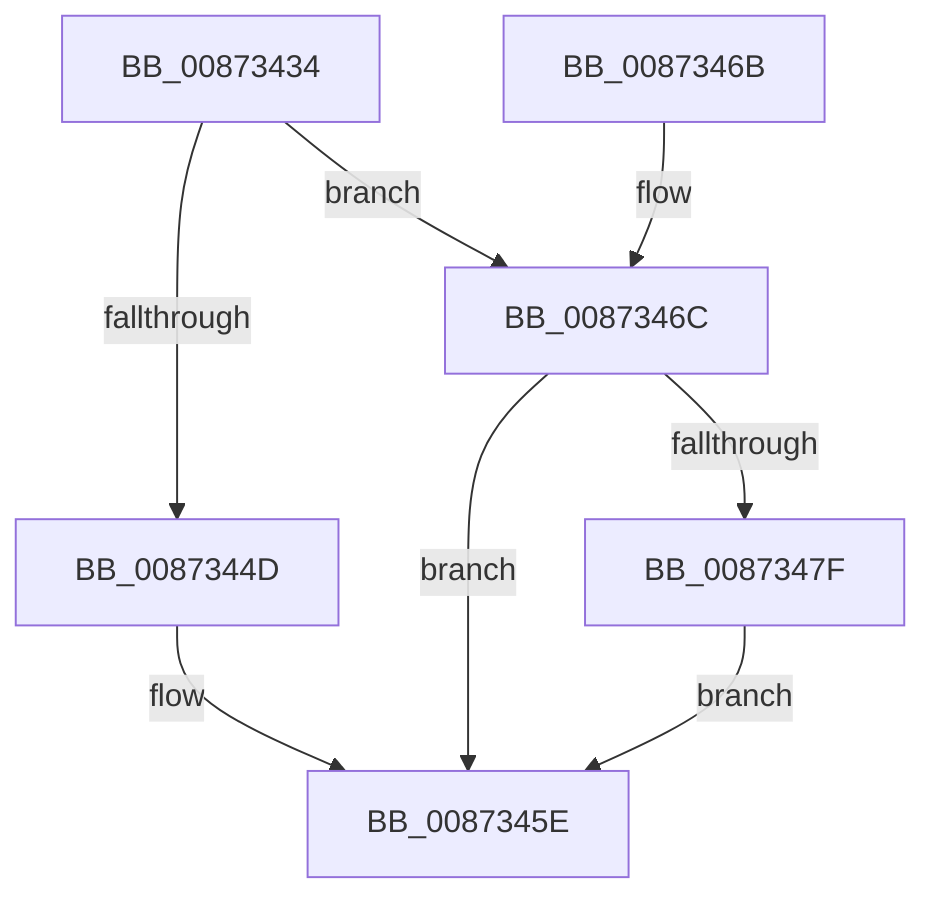

# CmpTransReferenceTransaction

- RVA: `0x00873434`–`0x0087348E` (길이 `90` bytes)
- VA: `0x0000000140873434`
- 실행 섹션: `PAGE`
- PDB 이름 있음: `예`; PDB Function 태그: `아니요`
- unwind 정보 RVA: `0x000687A0`
- 디코드: `29`개 명령, `90/90` bytes 표시
- 미해석 바이트: `0` (있으면 어셈블리에 `.byte`로 보존)

> 이 문서는 커널 이미지의 기계어와 PDB 기호를 분석해 생성했습니다. 4번과 5번은 함수 원형과 자료형을 바이너리 사용 방식에서 추정한 C 해석이며 원본 소스 복구 결과는 아닙니다.

## 1. Dependencies

- 직접 호출 지점: **4**; 고유 호출 대상: **3**
- 직접 호출자로 확인된 함수: **8**
- RIP 상대 이미지 참조: **0**

### Outgoing calls
- `0x0087344D` → [ObfReferenceObject](../../text/20/ObfReferenceObject_function_0020FA20.md) (function, `0x0020FA20`)
- `0x0087346E` → [ObfReferenceObject](../../text/20/ObfReferenceObject_function_0020FA20.md) (function, `0x0020FA20`)
- `0x00873476` → [TmIsTransactionActive](../../text/4F/TmIsTransactionActive_function_004FE1A0.md) (function, `0x004FE1A0`)
- `0x00873482` → [ObfDereferenceObject](../../text/2F/ObfDereferenceObject_function_002F9350.md) (function, `0x002F9350`)

### Direct callers
- [CmpTransInitializeTransaction](../84/CmpTransInitializeTransaction_function_008422C8.md) at `0x00842342`
- [CmQueryKey](../85/CmQueryKey_function_00858240.md) at `0x00858CD0`
- [CmpDoParseKey](../85/CmpDoParseKey_function_0085F750.md) at `0x0085FE5D`
- [CmpSecurityMethod](CmpSecurityMethod_function_00870CC0.md) at `0x00871320`
- [CmpTransSearchAddLightWeightTrans](CmpTransSearchAddLightWeightTrans_function_00873494.md) at `0x008734C7`
- [CmpTransSearchAddTransFromKeyBody](CmpTransSearchAddTransFromKeyBody_function_008736B8.md) at `0x00873705`
- [CmpTransSearchAddTrans](CmpTransSearchAddTrans_function_008743FC.md) at `0x0087442E`
- [sub_008C405D](../8C/Unknown_function_008C405D.md) at `0x008C4072`

### Static image references
- 디코드된 RIP-relative 메모리 참조가 없습니다.

## 2. Other-region calls and transfers

- 다른 실행 섹션으로 향하는 call: **4**
  - `0x0087344D` → [ObfReferenceObject](../../text/20/ObfReferenceObject_function_0020FA20.md) (`PAGE` → `.text`)
  - `0x0087346E` → [ObfReferenceObject](../../text/20/ObfReferenceObject_function_0020FA20.md) (`PAGE` → `.text`)
  - `0x00873476` → [TmIsTransactionActive](../../text/4F/TmIsTransactionActive_function_004FE1A0.md) (`PAGE` → `.text`)
  - `0x00873482` → [ObfDereferenceObject](../../text/2F/ObfDereferenceObject_function_002F9350.md) (`PAGE` → `.text`)
- 별도 외부 분기/꼬리 이동을 확인하지 못했습니다.

## 3. Assembly (complete function range)

```asm
00873434  48 89 5C 24 08                  mov qword ptr [rsp + 8], rbx
00873439  57                              push rdi
0087343A  48 83 EC 20                     sub rsp, 0x20
0087343E  48 8B D9                        mov rbx, rcx
00873441  48 83 E3 FE                     and rbx, 0xfffffffffffffffe
00873445  F6 C1 01                        test cl, 1
00873448  48 8B CB                        mov rcx, rbx
0087344B  74 1F                           je 0x14087346c
0087344D  E8 CE C5 99 FF                  call 0x14020fa20
00873452  8B 03                           mov eax, dword ptr [rbx]
00873454  F7 D8                           neg eax
00873456  1B FF                           sbb edi, edi
00873458  81 E7 03 00 19 C0               and edi, 0xc0190003
0087345E  48 8B 5C 24 30                  mov rbx, qword ptr [rsp + 0x30]
00873463  8B C7                           mov eax, edi
00873465  48 83 C4 20                     add rsp, 0x20
00873469  5F                              pop rdi
0087346A  C3                              ret
0087346B  CC                              int3
0087346C  33 FF                           xor edi, edi
0087346E  E8 AD C5 99 FF                  call 0x14020fa20
00873473  48 8B CB                        mov rcx, rbx
00873476  E8 25 AD C8 FF                  call 0x1404fe1a0
0087347B  84 C0                           test al, al
0087347D  75 DF                           jne 0x14087345e
0087347F  48 8B CB                        mov rcx, rbx
00873482  E8 C9 5E A8 FF                  call 0x1402f9350
00873487  BF 03 00 19 C0                  mov edi, 0xc0190003
0087348C  EB D0                           jmp 0x14087345e
```

## 4. C-style interpretation (structured pseudocode)

```c
__int64 __fastcall CmpTransReferenceTransaction(__int64 a1)
{
    __int64 result;
    __int64 v_rbx;
    __int64 v_rdi;
    __int64 v_rsp;
    unsigned __int64 v_stack_p8;

    v_stack_p8 = v_rbx;
    v_rsp = (v_rsp) - (32);
    v_rbx = (a1) & (-2);
    if ((((unsigned __int8)(a1)) & (1)) == 0) goto loc_0087346C;
    result = ObfReferenceObject(v_rbx, a2, a3, a4);
    result = (unsigned int)(-((unsigned int)(*(unsigned int *)(v_rbx))));
    v_rdi = (unsigned int)((v_rdi) & (0xC0190003ULL));
loc_0087345E:
    v_rsp = (v_rsp) + (32);
    return (unsigned int)((unsigned int)(v_rdi));
loc_0087346C:
    v_rdi = 0;
    result = ObfReferenceObject(v_rbx, a2, a3, a4);
    result = TmIsTransactionActive(v_stack_p8, a2, a3, a4);
    if ((unsigned __int8)(result) != 0) goto loc_0087345E;
    result = ObfDereferenceObject(v_stack_p8, a2, a3, a4);
    goto loc_0087345E;
}
```

## 5. (Beta) C Style

```c
int64_t CmpTransReferenceTransaction(void *Arg1)
{
    uint8_t *arg1 = (uint8_t *)Arg1;

    int64_t result;
    int64_t local_rbx;
    int64_t local_rdi;
    int64_t local_rsp;
    uint64_t v_stack_p8;

    v_stack_p8 = local_rbx;
    local_rsp = (local_rsp) - (32);
    local_rbx = (Arg1) & (-2);
    if ((((uint8_t)(Arg1)) & (1)) == 0) goto loc_0087346C;
    result = ObfReferenceObject(local_rbx, a2, a3, a4);
    result = (uint32_t)(-((uint32_t)(*(uint32_t *)(local_rbx))));
    local_rdi = (uint32_t)((local_rdi) & (0xC0190003ULL));
loc_0087345E:
    local_rsp = (local_rsp) + (32);
    return (uint32_t)((uint32_t)(local_rdi));
loc_0087346C:
    local_rdi = 0;
    result = ObfReferenceObject(local_rbx, a2, a3, a4);
    result = TmIsTransactionActive(v_stack_p8, a2, a3, a4);
    if ((uint8_t)(result) != 0) goto loc_0087345E;
    result = ObfDereferenceObject(v_stack_p8, a2, a3, a4);
    goto loc_0087345E;
}
```

### 관측된 메모리 오프셋

구조체 형식이 확인되지 않은 접근은 인자 기준의 오프셋으로만 기록했습니다.

| 기준 인자 | 오프셋 표현 | 폭 (bit) | 접근 |
|---|---:|---:|---|
| `Arg1` | `+ 0x0` | `32` | `R` |

## 6. Execution-region graph

[열기: 2D/3D 그래프와 함수 탐색 컨트롤 패널](../../../control-panel.html?section=page&rva=0x00873434&view=graph)

- 2D 그래프는 위에서 아래로 흐르고, 3D 그래프는 빈 공간을 드래그해 회전합니다. Shift+드래그는 이동, 휠은 확대·축소, 함수 노드 선택은 대상 보고서 이동입니다.

### Static fallback


