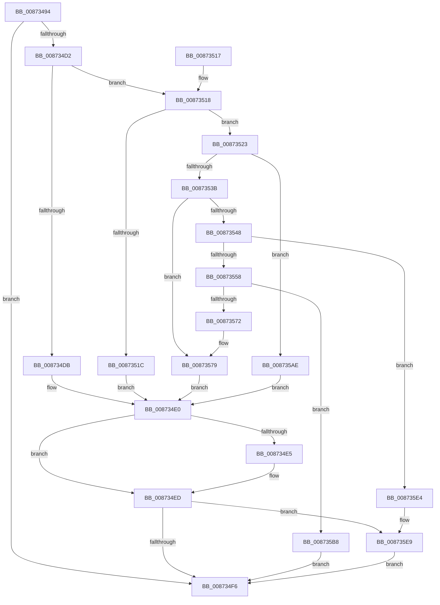

# CmpTransSearchAddLightWeightTrans

- RVA: `0x00873494`–`0x008735FF` (길이 `363` bytes)
- VA: `0x0000000140873494`
- 실행 섹션: `PAGE`
- PDB 이름 있음: `예`; PDB Function 태그: `아니요`
- unwind 정보 RVA: `0x0006C6DC`
- 디코드: `99`개 명령, `363/363` bytes 표시
- 미해석 바이트: `0` (있으면 어셈블리에 `.byte`로 보존)

> 이 문서는 커널 이미지의 기계어와 PDB 기호를 분석해 생성했습니다. 4번과 5번은 함수 원형과 자료형을 바이너리 사용 방식에서 추정한 C 해석이며 원본 소스 복구 결과는 아닙니다.

## 1. Dependencies

- 직접 호출 지점: **11**; 고유 호출 대상: **8**
- 직접 호출자로 확인된 함수: **1**
- RIP 상대 이미지 참조: **4**

### Outgoing calls
- `0x008734C7` → [CmpTransReferenceTransaction](CmpTransReferenceTransaction_function_00873434.md) (function, `0x00873434`)
- `0x008734E8` → [CmpTransDereferenceTransaction](CmpTransDereferenceTransaction_function_00873608.md) (function, `0x00873608`)
- `0x0087352E` → [CmpTransAllocateTrans](../A9/CmpTransAllocateTrans_function_00A95DF8.md) (function, `0x00A95DF8`)
- `0x00873548` → [LOCK_TRANSACTION_LIST](LOCK_TRANSACTION_LIST_function_00874AD4.md) (function, `0x00874AD4`)
- `0x0087357F` → [LOCK_TRANSACTION_LIST](LOCK_TRANSACTION_LIST_function_00874AD4.md) (function, `0x00874AD4`)
- `0x0087358A` → [CmpBindHiveToTrans](CmpBindHiveToTrans_function_00874B80.md) (function, `0x00874B80`)
- `0x008735A4` → [ExFreePoolWithTag](../../poolcode/B8/ExFreePoolWithTag_function_00B82870.md) (function, `0x00B82870`)
- `0x008735D0` → [ExReleaseFastMutexUnsafe](../../text/25/ExReleaseFastMutexUnsafe_function_002503A0.md) (function, `0x002503A0`)
- `0x008735D5` → [KeLeaveCriticalRegion](../../text/25/KeLeaveCriticalRegion_function_0025D8B0.md) (function, `0x0025D8B0`)
- `0x008735F0` → [ExReleaseFastMutexUnsafe](../../text/25/ExReleaseFastMutexUnsafe_function_002503A0.md) (function, `0x002503A0`)
- `0x008735F5` → [KeLeaveCriticalRegion](../../text/25/KeLeaveCriticalRegion_function_0025D8B0.md) (function, `0x0025D8B0`)

### Direct callers
- [CmpDoParseKey](../85/CmpDoParseKey_function_0085F750.md) at `0x00860A93`

### Static image references
- `0x0087355F` → RVA `0x00EF5800` (`.data`; read)
- `0x00873566` → RVA `0x00EF5808` (`.data`; read)
- `0x008735BB` → RVA `0x00EF5820` (`.data`; read)
- `0x008735C9` → RVA `0x00EF5808` (`.data`; write)

## 2. Other-region calls and transfers

- 다른 실행 섹션으로 향하는 call: **5**
  - `0x008735A4` → [ExFreePoolWithTag](../../poolcode/B8/ExFreePoolWithTag_function_00B82870.md) (`PAGE` → `POOLCODE`)
  - `0x008735D0` → [ExReleaseFastMutexUnsafe](../../text/25/ExReleaseFastMutexUnsafe_function_002503A0.md) (`PAGE` → `.text`)
  - `0x008735D5` → [KeLeaveCriticalRegion](../../text/25/KeLeaveCriticalRegion_function_0025D8B0.md) (`PAGE` → `.text`)
  - `0x008735F0` → [ExReleaseFastMutexUnsafe](../../text/25/ExReleaseFastMutexUnsafe_function_002503A0.md) (`PAGE` → `.text`)
  - `0x008735F5` → [KeLeaveCriticalRegion](../../text/25/KeLeaveCriticalRegion_function_0025D8B0.md) (`PAGE` → `.text`)
- 별도 외부 분기/꼬리 이동을 확인하지 못했습니다.

## 3. Assembly (complete function range)

```asm
00873494  48 8B C4                        mov rax, rsp
00873497  48 89 58 08                     mov qword ptr [rax + 8], rbx
0087349B  48 89 68 10                     mov qword ptr [rax + 0x10], rbp
0087349F  48 89 70 18                     mov qword ptr [rax + 0x18], rsi
008734A3  48 89 78 20                     mov qword ptr [rax + 0x20], rdi
008734A7  41 54                           push r12
008734A9  41 56                           push r14
008734AB  41 57                           push r15
008734AD  48 83 EC 20                     sub rsp, 0x20
008734B1  48 8B E9                        mov rbp, rcx
008734B4  4D 8B F1                        mov r14, r9
008734B7  48 83 E5 FE                     and rbp, 0xfffffffffffffffe
008734BB  41 8B F0                        mov esi, r8d
008734BE  4C 8B E2                        mov r12, rdx
008734C1  48 8B D9                        mov rbx, rcx
008734C4  45 33 FF                        xor r15d, r15d
008734C7  E8 68 FF FF FF                  call 0x140873434
008734CC  8B F8                           mov edi, eax
008734CE  85 C0                           test eax, eax
008734D0  78 24                           js 0x1408734f6
008734D2  48 8B 45 10                     mov rax, qword ptr [rbp + 0x10]
008734D6  48 85 C0                        test rax, rax
008734D9  74 3D                           je 0x140873518
008734DB  49 89 06                        mov qword ptr [r14], rax
008734DE  33 FF                           xor edi, edi
008734E0  48 85 DB                        test rbx, rbx
008734E3  74 08                           je 0x1408734ed
008734E5  48 8B CB                        mov rcx, rbx
008734E8  E8 1B 01 00 00                  call 0x140873608
008734ED  45 85 FF                        test r15d, r15d
008734F0  0F 85 F3 00 00 00               jne 0x1408735e9
008734F6  48 8B 5C 24 40                  mov rbx, qword ptr [rsp + 0x40]
008734FB  8B C7                           mov eax, edi
008734FD  48 8B 7C 24 58                  mov rdi, qword ptr [rsp + 0x58]
00873502  48 8B 6C 24 48                  mov rbp, qword ptr [rsp + 0x48]
00873507  48 8B 74 24 50                  mov rsi, qword ptr [rsp + 0x50]
0087350C  48 83 C4 20                     add rsp, 0x20
00873510  41 5F                           pop r15
00873512  41 5E                           pop r14
00873514  41 5C                           pop r12
00873516  C3                              ret
00873517  CC                              int3
00873518  85 F6                           test esi, esi
0087351A  75 07                           jne 0x140873523
0087351C  BF 02 00 19 C0                  mov edi, 0xc0190002
00873521  EB BD                           jmp 0x1408734e0
00873523  4D 8B CC                        mov r9, r12
00873526  45 33 C0                        xor r8d, r8d
00873529  33 D2                           xor edx, edx
0087352B  48 8B CB                        mov rcx, rbx
0087352E  E8 C5 28 22 00                  call 0x140a95df8
00873533  48 8B F0                        mov rsi, rax
00873536  48 85 C0                        test rax, rax
00873539  74 73                           je 0x1408735ae
0087353B  33 C0                           xor eax, eax
0087353D  F0 48 0F B1 75 10               lock cmpxchg qword ptr [rbp + 0x10], rsi
00873543  48 8B F8                        mov rdi, rax
00873546  75 31                           jne 0x140873579
00873548  E8 87 15 00 00                  call 0x140874ad4
0087354D  8B 46 30                        mov eax, dword ptr [rsi + 0x30]
00873550  A8 07                           test al, 7
00873552  0F 85 8C 00 00 00               jne 0x1408735e4
00873558  C7 46 30 80 00 00 00            mov dword ptr [rsi + 0x30], 0x80
0087355F  48 8D 0D 9A 22 68 00            lea rcx, [rip + 0x68229a]
00873566  48 8B 05 9B 22 68 00            mov rax, qword ptr [rip + 0x68229b]
0087356D  48 39 08                        cmp qword ptr [rax], rcx
00873570  74 46                           je 0x1408735b8
00873572  B9 03 00 00 00                  mov ecx, 3
00873577  CD 29                           int 0x29
00873579  41 BF 01 00 00 00               mov r15d, 1
0087357F  E8 50 15 00 00                  call 0x140874ad4
00873584  48 8B D7                        mov rdx, rdi
00873587  49 8B CC                        mov rcx, r12
0087358A  E8 F1 15 00 00                  call 0x140874b80
0087358F  F7 D8                           neg eax
00873591  BA 43 4D 54 72                  mov edx, 0x72544d43
00873596  48 8B CE                        mov rcx, rsi
00873599  1B FF                           sbb edi, edi
0087359B  83 E7 02                        and edi, 2
0087359E  81 C7 01 00 19 C0               add edi, 0xc0190001
008735A4  E8 C7 F2 30 00                  call 0x140b82870
008735A9  E9 32 FF FF FF                  jmp 0x1408734e0
008735AE  BF 9A 00 00 C0                  mov edi, 0xc000009a
008735B3  E9 28 FF FF FF                  jmp 0x1408734e0
008735B8  48 89 0E                        mov qword ptr [rsi], rcx
008735BB  48 8D 0D 5E 22 68 00            lea rcx, [rip + 0x68225e]
008735C2  48 89 46 08                     mov qword ptr [rsi + 8], rax
008735C6  48 89 30                        mov qword ptr [rax], rsi
008735C9  48 89 35 38 22 68 00            mov qword ptr [rip + 0x682238], rsi
008735D0  E8 CB CD 9D FF                  call 0x1402503a0
008735D5  E8 D6 A2 9E FF                  call 0x14025d8b0
008735DA  33 FF                           xor edi, edi
008735DC  49 89 36                        mov qword ptr [r14], rsi
008735DF  E9 12 FF FF FF                  jmp 0x1408734f6
008735E4  BF 02 00 19 C0                  mov edi, 0xc0190002
008735E9  48 8D 0D 30 22 68 00            lea rcx, [rip + 0x682230]
008735F0  E8 AB CD 9D FF                  call 0x1402503a0
008735F5  E8 B6 A2 9E FF                  call 0x14025d8b0
008735FA  E9 F7 FE FF FF                  jmp 0x1408734f6
```

## 4. C-style interpretation (structured pseudocode)

```c
__int64 __fastcall CmpTransSearchAddLightWeightTrans(__int64 a1, __int64 a2, int a3, __int64 a4)
{
    __int64 result;
    __int64 v_r15;
    __int64 v_rbp;
    __int64 v_rdi;
    __int64 v_rsp;
    unsigned __int64 v_stack_p10;
    unsigned __int64 v_stack_p18;
    unsigned __int64 v_stack_p20;
    unsigned __int64 v_stack_p8;

    *(unsigned __int64 *)(v_rsp + 8) = v_rbx;
    *(unsigned __int64 *)(v_rsp + 16) = v_rbp;
    *(unsigned __int64 *)(v_rsp + 24) = v_rsi;
    *(unsigned __int64 *)(v_rsp + 32) = v_rdi;
    v_rsp = (v_rsp) - (32);
    v_rbp = (a1) & (-2);
    v_r15 = 0;
    result = CmpTransReferenceTransaction(a1, a2, a3, a4);
    if (sign_flag) goto loc_008734F6;
    if (*(unsigned __int64 *)(v_rbp + 16) == 0) goto loc_00873518;
    *(unsigned __int64 *)(a4) = *(unsigned __int64 *)(v_rbp + 16);
    v_rdi = 0;
loc_008734E0:
    result = *(unsigned __int64 *)(v_rbp + 16);
    if (a1 != 0) {
        a1 = a1;
        result = CmpTransDereferenceTransaction(a1, a2, a3, a4);
    }
    if (0 != 0) goto loc_008735E9;
loc_008734F6:
    v_rsp = (v_rsp) + (32);
    return 0;
loc_00873518:
    if ((unsigned int)(v_stack_p18) != 0) goto loc_00873523;
    goto loc_008734E0;
loc_00873523:
    a3 = 0;
    a2 = 0;
    result = CmpTransAllocateTrans(v_stack_p8, a2, a3, a2);
    if (result == 0) goto loc_008735AE;
    result = 0;
    if (condition_is_not_equal) goto loc_00873579;
    result = LOCK_TRANSACTION_LIST(v_stack_p8, a2, a3, a2);
    if ((((unsigned __int8)((unsigned int)(*(unsigned int *)(result + 48)))) & (7)) != 0) goto loc_008735E4;
    *(unsigned int *)(result + 48) = 128;
    if ((*(unsigned __int64 *)(*(unsigned __int64 *)(v_rip + 6824603))) == (v_rip + 6824602)) goto loc_008735B8;
loc_00873579:
    result = LOCK_TRANSACTION_LIST(3, a2, a3, a2);
    result = CmpBindHiveToTrans(0, 0, a3, a2);
    result = (unsigned int)(-(result));
    v_rdi = (unsigned int)((0) & (2));
    v_rdi = (unsigned int)((v_rdi) + (0xC0190001ULL));
    result = ExFreePoolWithTag(result, (unsigned int)(0x72544D43ULL), a3, a2);
    goto loc_008734E0;
loc_008735AE:
    goto loc_008734E0;
loc_008735B8:
    *(unsigned __int64 *)(result) = result;
    *(unsigned __int64 *)(result + 8) = result;
    *(unsigned __int64 *)(result) = result;
    *(unsigned __int64 *)(v_rip + 6824504) = result;
    result = ExReleaseFastMutexUnsafe(v_rip + 6824542, (unsigned int)(0x72544D43ULL), a3, a2);
    result = KeLeaveCriticalRegion(v_rip + 6824542, (unsigned int)(0x72544D43ULL), a3, a2);
    v_rdi = 0;
    *(unsigned __int64 *)(a4) = result;
    goto loc_008734F6;
loc_008735E4:
loc_008735E9:
    result = ExReleaseFastMutexUnsafe(v_rip + 6824496, (unsigned int)(0x72544D43ULL), a3, a2);
    result = KeLeaveCriticalRegion(v_rip + 6824496, (unsigned int)(0x72544D43ULL), a3, a2);
    goto loc_008734F6;
}
```

## 5. (Beta) C Style

```c
int64_t CmpTransSearchAddLightWeightTrans(void *Arg1, int64_t Arg2, int32_t Arg3, void *Arg4)
{
    uint8_t *arg1 = (uint8_t *)Arg1;
    uint8_t *arg4 = (uint8_t *)Arg4;

    int64_t result;
    int64_t local_r15;
    int64_t local_rbp;
    int64_t local_rdi;
    int64_t local_rsp;
    uint64_t v_stack_p10;
    uint64_t v_stack_p18;
    uint64_t v_stack_p20;
    uint64_t v_stack_p8;

    *(uint64_t *)(local_rsp + 0x8) = local_rbx;
    *(uint64_t *)(local_rsp + 0x10) = local_rbp;
    *(uint64_t *)(local_rsp + 0x18) = local_rsi;
    *(uint64_t *)(local_rsp + 0x20) = local_rdi;
    local_rsp = (local_rsp) - (32);
    local_rbp = (Arg1) & (-2);
    local_r15 = 0;
    result = CmpTransReferenceTransaction(Arg1, Arg2, Arg3, Arg4);
    if (sign_flag) goto loc_008734F6;
    if (*(uint64_t *)(local_rbp + 0x10) == 0) goto loc_00873518;
    *(uint64_t *)(arg4) = *(uint64_t *)(local_rbp + 0x10);
    local_rdi = 0;
loc_008734E0:
    result = *(uint64_t *)(local_rbp + 0x10);
    if (Arg1 != NULL) {
        Arg1 = Arg1;
        result = CmpTransDereferenceTransaction(Arg1, Arg2, Arg3, Arg4);
    }
    if (0 != 0) goto loc_008735E9;
loc_008734F6:
    local_rsp = (local_rsp) + (32);
    return 0;
loc_00873518:
    if ((uint32_t)(v_stack_p18) != 0) goto loc_00873523;
    goto loc_008734E0;
loc_00873523:
    Arg3 = 0;
    Arg2 = 0;
    result = CmpTransAllocateTrans(v_stack_p8, Arg2, Arg3, Arg2);
    if (result == 0) goto loc_008735AE;
    result = 0;
    if (condition_is_not_equal) goto loc_00873579;
    result = LOCK_TRANSACTION_LIST(v_stack_p8, Arg2, Arg3, Arg2);
    if ((((uint8_t)((uint32_t)(*(uint32_t *)(result + 0x30)))) & (7)) != 0) goto loc_008735E4;
    *(uint32_t *)(result + 0x30) = 128;
    if ((*(uint64_t *)(*(uint64_t *)(v_rip + 0x68229B))) == (v_rip + 6824602)) goto loc_008735B8;
loc_00873579:
    result = LOCK_TRANSACTION_LIST(3, Arg2, Arg3, Arg2);
    result = CmpBindHiveToTrans(0, 0, Arg3, Arg2);
    result = (uint32_t)(-(result));
    local_rdi = (uint32_t)((0) & (2));
    local_rdi = (uint32_t)((local_rdi) + (0xC0190001ULL));
    result = ExFreePoolWithTag(result, (uint32_t)(0x72544D43ULL), Arg3, Arg2);
    goto loc_008734E0;
loc_008735AE:
    goto loc_008734E0;
loc_008735B8:
    *(uint64_t *)(result) = result;
    *(uint64_t *)(result + 0x8) = result;
    *(uint64_t *)(result) = result;
    *(uint64_t *)(v_rip + 0x682238) = result;
    result = ExReleaseFastMutexUnsafe(v_rip + 6824542, (uint32_t)(0x72544D43ULL), Arg3, Arg2);
    result = KeLeaveCriticalRegion(v_rip + 6824542, (uint32_t)(0x72544D43ULL), Arg3, Arg2);
    local_rdi = 0;
    *(uint64_t *)(arg4) = result;
    goto loc_008734F6;
loc_008735E4:
loc_008735E9:
    result = ExReleaseFastMutexUnsafe(v_rip + 6824496, (uint32_t)(0x72544D43ULL), Arg3, Arg2);
    result = KeLeaveCriticalRegion(v_rip + 6824496, (uint32_t)(0x72544D43ULL), Arg3, Arg2);
    goto loc_008734F6;
}
```

### 관측된 메모리 오프셋

구조체 형식이 확인되지 않은 접근은 인자 기준의 오프셋으로만 기록했습니다.

| 기준 인자 | 오프셋 표현 | 폭 (bit) | 접근 |
|---|---:|---:|---|
| `Arg1` | `+ 0x10` | `64` | `R` |
| `Arg4` | `+ 0x0` | `64` | `W` |

## 6. Execution-region graph

[열기: 2D/3D 그래프와 함수 탐색 컨트롤 패널](../../../control-panel.html?section=page&rva=0x00873494&view=graph)

- 2D 그래프는 위에서 아래로 흐르고, 3D 그래프는 빈 공간을 드래그해 회전합니다. Shift+드래그는 이동, 휠은 확대·축소, 함수 노드 선택은 대상 보고서 이동입니다.

### Static fallback


