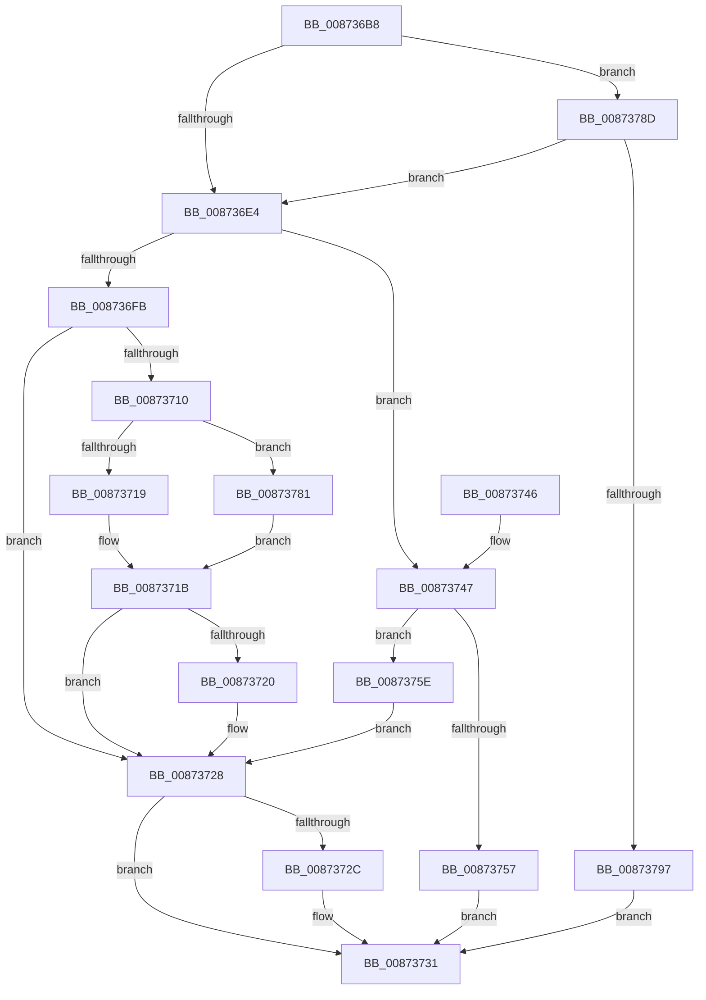

# CmpTransSearchAddTransFromKeyBody

- RVA: `0x008736B8`–`0x0087379E` (길이 `230` bytes)
- VA: `0x00000001408736B8`
- 실행 섹션: `PAGE`
- PDB 이름 있음: `예`; PDB Function 태그: `아니요`
- unwind 정보 RVA: `0x0006C714`
- 디코드: `70`개 명령, `230/230` bytes 표시
- 미해석 바이트: `0` (있으면 어셈블리에 `.byte`로 보존)

> 이 문서는 커널 이미지의 기계어와 PDB 기호를 분석해 생성했습니다. 4번과 5번은 함수 원형과 자료형을 바이너리 사용 방식에서 추정한 C 해석이며 원본 소스 복구 결과는 아닙니다.

## 1. Dependencies

- 직접 호출 지점: **3**; 고유 호출 대상: **3**
- 직접 호출자로 확인된 함수: **13**
- RIP 상대 이미지 참조: **0**

### Outgoing calls
- `0x00873705` → [CmpTransReferenceTransaction](CmpTransReferenceTransaction_function_00873434.md) (function, `0x00873434`)
- `0x00873723` → [CmpTransDereferenceTransaction](CmpTransDereferenceTransaction_function_00873608.md) (function, `0x00873608`)
- `0x00873773` → [CmpTransSearchAddTrans](CmpTransSearchAddTrans_function_008743FC.md) (function, `0x008743FC`)

### Direct callers
- [CmRenameKey](../7E/CmRenameKey_function_007E8F48.md) at `0x007E914D`
- [CmSetLastWriteTimeKey](../84/CmSetLastWriteTimeKey_function_00843368.md) at `0x0084345D`
- [CmSetValueKey](../84/CmSetValueKey_function_008457C0.md) at `0x008459B8`
- [CmQueryMultipleValueKey](../84/CmQueryMultipleValueKey_function_00846EC0.md) at `0x00847429`
- [CmDeleteValueKey](../84/CmDeleteValueKey_function_008476E8.md) at `0x00847D2E`
- [CmDeleteKey](../84/CmDeleteKey_function_00848E5C.md) at `0x0084908F`
- [sub_0084E7D5](../84/Unknown_function_0084E7D5.md) at `0x0084E7FB`
- [sub_00855472](../85/Unknown_function_00855472.md) at `0x008554A7`
- [NtEnumerateValueKey](../8B/NtEnumerateValueKey_function_008B3B50.md) at `0x008B4665`
- [CmpSetKeySecurity](../94/CmpSetKeySecurity_function_0094A124.md) at `0x0094A26D`
- [CmSetKeyFlags](../9A/CmSetKeyFlags_function_009AEEA4.md) at `0x009AEF80`
- [CmEnumerateValueKeyFromMergedView](../A7/CmEnumerateValueKeyFromMergedView_function_00A7D650.md) at `0x00A7D6F4`
- [sub_00B1664A](../B1/Unknown_function_00B1664A.md) at `0x00B1674C`

### Static image references
- 디코드된 RIP-relative 메모리 참조가 없습니다.

## 2. Other-region calls and transfers

- 다른 실행 섹션으로 향하는 call: **0**
- 별도 외부 분기/꼬리 이동을 확인하지 못했습니다.

## 3. Assembly (complete function range)

```asm
008736B8  48 89 5C 24 10                  mov qword ptr [rsp + 0x10], rbx
008736BD  48 89 6C 24 18                  mov qword ptr [rsp + 0x18], rbp
008736C2  56                              push rsi
008736C3  57                              push rdi
008736C4  41 56                           push r14
008736C6  48 83 EC 30                     sub rsp, 0x30
008736CA  48 8B 59 38                     mov rbx, qword ptr [rcx + 0x38]
008736CE  33 F6                           xor esi, esi
008736D0  48 89 74 24 50                  mov qword ptr [rsp + 0x50], rsi
008736D5  4C 8B F2                        mov r14, rdx
008736D8  4C 8B D1                        mov r10, rcx
008736DB  48 85 DB                        test rbx, rbx
008736DE  0F 84 A9 00 00 00               je 0x14087378d
008736E4  48 8B 49 08                     mov rcx, qword ptr [rcx + 8]
008736E8  4C 8B C1                        mov r8, rcx
008736EB  49 83 F0 01                     xor r8, 1
008736EF  F6 C1 01                        test cl, 1
008736F2  4C 0F 44 C1                     cmove r8, rcx
008736F6  F6 C3 01                        test bl, 1
008736F9  74 4C                           je 0x140873747
008736FB  48 8B EB                        mov rbp, rbx
008736FE  48 8B CB                        mov rcx, rbx
00873701  48 83 E5 FE                     and rbp, 0xfffffffffffffffe
00873705  E8 2A FD FF FF                  call 0x140873434
0087370A  8B F8                           mov edi, eax
0087370C  85 C0                           test eax, eax
0087370E  78 18                           js 0x140873728
00873710  48 8B 75 10                     mov rsi, qword ptr [rbp + 0x10]
00873714  48 85 F6                        test rsi, rsi
00873717  74 68                           je 0x140873781
00873719  33 FF                           xor edi, edi
0087371B  48 85 DB                        test rbx, rbx
0087371E  74 08                           je 0x140873728
00873720  48 8B CB                        mov rcx, rbx
00873723  E8 E0 FE FF FF                  call 0x140873608
00873728  85 FF                           test edi, edi
0087372A  78 05                           js 0x140873731
0087372C  49 89 36                        mov qword ptr [r14], rsi
0087372F  33 FF                           xor edi, edi
00873731  48 8B 5C 24 58                  mov rbx, qword ptr [rsp + 0x58]
00873736  8B C7                           mov eax, edi
00873738  48 8B 6C 24 60                  mov rbp, qword ptr [rsp + 0x60]
0087373D  48 83 C4 30                     add rsp, 0x30
00873741  41 5E                           pop r14
00873743  5F                              pop rdi
00873744  5E                              pop rsi
00873745  C3                              ret
00873746  CC                              int3
00873747  4D 8B 48 20                     mov r9, qword ptr [r8 + 0x20]
0087374B  4D 8B 81 38 10 00 00            mov r8, qword ptr [r9 + 0x1038]
00873752  4D 85 C0                        test r8, r8
00873755  75 07                           jne 0x14087375e
00873757  BF 05 00 19 C0                  mov edi, 0xc0190005
0087375C  EB D3                           jmp 0x140873731
0087375E  49 8B 52 40                     mov rdx, qword ptr [r10 + 0x40]
00873762  48 8D 44 24 50                  lea rax, [rsp + 0x50]
00873767  48 89 44 24 28                  mov qword ptr [rsp + 0x28], rax
0087376C  48 8B CB                        mov rcx, rbx
0087376F  21 74 24 20                     and dword ptr [rsp + 0x20], esi
00873773  E8 84 0C 00 00                  call 0x1408743fc
00873778  48 8B 74 24 50                  mov rsi, qword ptr [rsp + 0x50]
0087377D  8B F8                           mov edi, eax
0087377F  EB A7                           jmp 0x140873728
00873781  48 8B 74 24 50                  mov rsi, qword ptr [rsp + 0x50]
00873786  BF 02 00 19 C0                  mov edi, 0xc0190002
0087378B  EB 8E                           jmp 0x14087371b
0087378D  48 39 71 40                     cmp qword ptr [rcx + 0x40], rsi
00873791  0F 85 4D FF FF FF               jne 0x1408736e4
00873797  BF 02 00 19 C0                  mov edi, 0xc0190002
0087379C  EB 93                           jmp 0x140873731
```

## 4. C-style interpretation (structured pseudocode)

```c
__int64 __fastcall CmpTransSearchAddTransFromKeyBody(__int64 a1, __int64 a2)
{
    __int64 result;
    __int64 v_rbp;
    __int64 v_rdi;
    __int64 v_rsi;
    __int64 v_rsp;
    unsigned __int64 v_stack_p10;
    unsigned __int64 v_stack_p18;
    unsigned int v_stack_p20;
    unsigned __int64 v_stack_p28;
    unsigned __int64 v_stack_p50;
    unsigned __int64 v_stack_p8;

    v_stack_p10 = v_rbx;
    v_stack_p18 = v_rbp;
    v_rsp = (v_rsp) - (48);
    v_rsi = 0;
    v_stack_p8 = 0;
    if (*(unsigned __int64 *)(a1 + 56) == 0) goto loc_0087378D;
loc_008736E4:
    a3 = (*(unsigned __int64 *)(a1 + 8)) ^ (1);
    if ((((unsigned __int8)(*(unsigned __int64 *)(a1 + 8))) & (1)) == 0) { a3 = *(unsigned __int64 *)(a1 + 8); }
    if ((((unsigned __int8)(*(unsigned __int64 *)(a1 + 56))) & (1)) == 0) goto loc_00873747;
    v_rbp = (*(unsigned __int64 *)(a1 + 56)) & (-2);
    result = CmpTransReferenceTransaction(*(unsigned __int64 *)(a1 + 56), a2, a3, a4);
    if (sign_flag) goto loc_00873728;
    if (*(unsigned __int64 *)(v_rbp + 16) == 0) goto loc_00873781;
    v_rdi = 0;
loc_0087371B:
    if (*(unsigned __int64 *)(a1 + 56) != 0) {
        a1 = *(unsigned __int64 *)(a1 + 56);
        result = CmpTransDereferenceTransaction(a1, a2, a3, a4);
    }
    if (!(sign_flag)) {
        *(unsigned __int64 *)(a2) = *(unsigned __int64 *)(v_rbp + 16);
        v_rdi = 0;
    }
    v_rsp = (v_rsp) + (48);
    return 0;
loc_00873747:
    if (*(unsigned __int64 *)(*(unsigned __int64 *)(a3 + 32) + 4152) != 0) goto loc_0087375E;
    goto loc_00873731;
loc_0087375E:
    v_stack_p28 = v_stack_p50;
    result = CmpTransSearchAddTrans(v_stack_p10, *(unsigned __int64 *)(a1 + 64), *(unsigned __int64 *)(*(unsigned __int64 *)(a3 + 32) + 4152), *(unsigned __int64 *)(a3 + 32));
    goto loc_00873728;
loc_00873781:
    goto loc_0087371B;
loc_0087378D:
    if ((*(unsigned __int64 *)(v_stack_p10 + 64)) != v_stack_p50) goto loc_008736E4;
    goto loc_00873731;
}
```

## 5. (Beta) C Style

```c
int64_t CmpTransSearchAddTransFromKeyBody(void *Arg1, void *Arg2)
{
    uint8_t *arg1 = (uint8_t *)Arg1;
    uint8_t *arg2 = (uint8_t *)Arg2;

    int64_t result;
    int64_t local_rbp;
    int64_t local_rdi;
    int64_t local_rsi;
    int64_t local_rsp;
    uint64_t v_stack_p10;
    uint64_t v_stack_p18;
    uint32_t v_stack_p20;
    uint64_t v_stack_p28;
    uint64_t v_stack_p50;
    uint64_t v_stack_p8;

    v_stack_p10 = local_rbx;
    v_stack_p18 = local_rbp;
    local_rsp = (local_rsp) - (48);
    local_rsi = 0;
    v_stack_p8 = 0;
    if (*(uint64_t *)(arg1 + 0x38) == 0) goto loc_0087378D;
loc_008736E4:
    a3 = (*(uint64_t *)(arg1 + 0x8)) ^ (1);
    if ((((uint8_t)(*(uint64_t *)(arg1 + 0x8))) & (1)) == 0) { a3 = *(uint64_t *)(arg1 + 0x8); }
    if ((((uint8_t)(*(uint64_t *)(arg1 + 0x38))) & (1)) == 0) goto loc_00873747;
    local_rbp = (*(uint64_t *)(arg1 + 0x38)) & (-2);
    result = CmpTransReferenceTransaction(*(uint64_t *)(arg1 + 0x38), Arg2, a3, a4);
    if (sign_flag) goto loc_00873728;
    if (*(uint64_t *)(local_rbp + 0x10) == 0) goto loc_00873781;
    local_rdi = 0;
loc_0087371B:
    if (*(uint64_t *)(arg1 + 0x38) != 0) {
        Arg1 = *(uint64_t *)(arg1 + 0x38);
        result = CmpTransDereferenceTransaction(Arg1, Arg2, a3, a4);
    }
    if (!(sign_flag)) {
        *(uint64_t *)(arg2) = *(uint64_t *)(local_rbp + 0x10);
        local_rdi = 0;
    }
    local_rsp = (local_rsp) + (48);
    return 0;
loc_00873747:
    if (*(uint64_t *)(*(uint64_t *)(a3 + 0x20) + 0x1038) != 0) goto loc_0087375E;
    goto loc_00873731;
loc_0087375E:
    v_stack_p28 = v_stack_p50;
    result = CmpTransSearchAddTrans(v_stack_p10, *(uint64_t *)(arg1 + 0x40), *(uint64_t *)(*(uint64_t *)(a3 + 0x20) + 0x1038), *(uint64_t *)(a3 + 0x20));
    goto loc_00873728;
loc_00873781:
    goto loc_0087371B;
loc_0087378D:
    if ((*(uint64_t *)(v_stack_p10 + 0x40)) != v_stack_p50) goto loc_008736E4;
    goto loc_00873731;
}
```

### 관측된 메모리 오프셋

구조체 형식이 확인되지 않은 접근은 인자 기준의 오프셋으로만 기록했습니다.

| 기준 인자 | 오프셋 표현 | 폭 (bit) | 접근 |
|---|---:|---:|---|
| `Arg1` | `+ 0x8` | `64` | `R` |
| `Arg1` | `+ 0x38` | `64` | `R` |
| `Arg1` | `+ 0x40` | `64` | `R` |
| `Arg2` | `+ 0x0` | `64` | `W` |

## 6. Execution-region graph

[열기: 2D/3D 그래프와 함수 탐색 컨트롤 패널](../../../control-panel.html?section=page&rva=0x008736B8&view=graph)

- 2D 그래프는 위에서 아래로 흐르고, 3D 그래프는 빈 공간을 드래그해 회전합니다. Shift+드래그는 이동, 휠은 확대·축소, 함수 노드 선택은 대상 보고서 이동입니다.

### Static fallback


