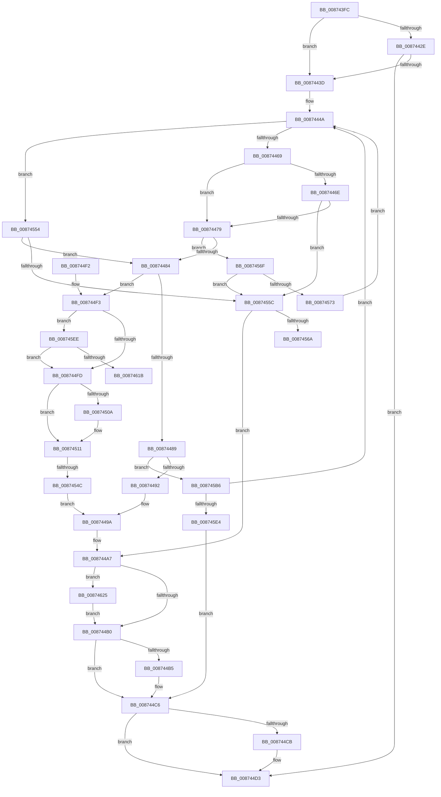

# CmpTransSearchAddTrans

- RVA: `0x008743FC`–`0x0087463B` (길이 `575` bytes)
- VA: `0x00000001408743FC`
- 실행 섹션: `PAGE`
- PDB 이름 있음: `예`; PDB Function 태그: `예`
- unwind 정보 RVA: `0x0006C858`
- 디코드: `143`개 명령, `575/575` bytes 표시
- 미해석 바이트: `0` (있으면 어셈블리에 `.byte`로 보존)

> 이 문서는 커널 이미지의 기계어와 PDB 기호를 분석해 생성했습니다. 4번과 5번은 함수 원형과 자료형을 바이너리 사용 방식에서 추정한 C 해석이며 원본 소스 복구 결과는 아닙니다.

## 1. Dependencies

- 직접 호출 지점: **19**; 고유 호출 대상: **12**
- 직접 호출자로 확인된 함수: **5**
- RIP 상대 이미지 참조: **4**

### Outgoing calls
- `0x0087442E` → [CmpTransReferenceTransaction](CmpTransReferenceTransaction_function_00873434.md) (function, `0x00873434`)
- `0x0087444A` → [LOCK_TRANSACTION_LIST](LOCK_TRANSACTION_LIST_function_00874AD4.md) (function, `0x00874AD4`)
- `0x00874458` → [CmpSearchForTrans](CmpSearchForTrans_function_00874B04.md) (function, `0x00874B04`)
- `0x00874495` → [CmpBindHiveToTrans](CmpBindHiveToTrans_function_00874B80.md) (function, `0x00874B80`)
- `0x008744BC` → [ExReleaseFastMutexUnsafe](../../text/25/ExReleaseFastMutexUnsafe_function_002503A0.md) (function, `0x002503A0`)
- `0x008744C1` → [KeLeaveCriticalRegion](../../text/25/KeLeaveCriticalRegion_function_0025D8B0.md) (function, `0x0025D8B0`)
- `0x008744CE` → [CmpTransDereferenceTransaction](CmpTransDereferenceTransaction_function_00873608.md) (function, `0x00873608`)
- `0x0087452D` → [ExReleaseFastMutexUnsafe](../../text/25/ExReleaseFastMutexUnsafe_function_002503A0.md) (function, `0x002503A0`)
- `0x00874532` → [KeLeaveCriticalRegion](../../text/25/KeLeaveCriticalRegion_function_0025D8B0.md) (function, `0x0025D8B0`)
- `0x0087453D` → [CmpTransInitializeTransaction](../84/CmpTransInitializeTransaction_function_008422C8.md) (function, `0x008422C8`)
- `0x00874584` → [ExReleaseFastMutexUnsafe](../../text/25/ExReleaseFastMutexUnsafe_function_002503A0.md) (function, `0x002503A0`)
- `0x00874589` → [KeLeaveCriticalRegion](../../text/25/KeLeaveCriticalRegion_function_0025D8B0.md) (function, `0x0025D8B0`)
- `0x008745AC` → [ExBlockOnAddressPushLock](../../text/2A/ExBlockOnAddressPushLock_function_002A43A0.md) (function, `0x002A43A0`)
- `0x008745BD` → [ExReleaseFastMutexUnsafe](../../text/25/ExReleaseFastMutexUnsafe_function_002503A0.md) (function, `0x002503A0`)
- `0x008745C2` → [KeLeaveCriticalRegion](../../text/25/KeLeaveCriticalRegion_function_0025D8B0.md) (function, `0x0025D8B0`)
- `0x008745D3` → [CmpTransAllocateTrans](../A9/CmpTransAllocateTrans_function_00A95DF8.md) (function, `0x00A95DF8`)
- `0x0087460A` → [ExAcquireRundownProtection](../../text/21/ExAcquireRundownProtection_function_00216620.md) (function, `0x00216620`)
- `0x0087462C` → [ExReleaseRundownProtection](../../text/34/ExReleaseRundownProtection_function_00349E80.md) (function, `0x00349E80`)
- `0x00874631` → [KeLeaveCriticalRegion](../../text/25/KeLeaveCriticalRegion_function_0025D8B0.md) (function, `0x0025D8B0`)

### Direct callers
- [CmpTransInitializeTransaction](../84/CmpTransInitializeTransaction_function_008422C8.md) at `0x00842329`
- [CmQueryKey](../85/CmQueryKey_function_00858240.md) at `0x00858DF4`
- [CmpSecurityMethod](CmpSecurityMethod_function_00870CC0.md) at `0x008713BE`
- [CmpTransSearchAddTransFromKeyBody](CmpTransSearchAddTransFromKeyBody_function_008736B8.md) at `0x00873773`
- [CmpTransSearchAddTransFromRm](../A6/CmpTransSearchAddTransFromRm_function_00A6023C.md) at `0x00A60283`

### Static image references
- `0x008744B5` → RVA `0x00EF5820` (`.data`; read)
- `0x00874526` → RVA `0x00EEFC38` (`.data`; read/write)
- `0x00874573` → RVA `0x00EEFC38` (`.data`; read)
- `0x008745A5` → RVA `0x00EF5810` (`.data`; read)

## 2. Other-region calls and transfers

- 다른 실행 섹션으로 향하는 call: **12**
  - `0x008744BC` → [ExReleaseFastMutexUnsafe](../../text/25/ExReleaseFastMutexUnsafe_function_002503A0.md) (`PAGE` → `.text`)
  - `0x008744C1` → [KeLeaveCriticalRegion](../../text/25/KeLeaveCriticalRegion_function_0025D8B0.md) (`PAGE` → `.text`)
  - `0x0087452D` → [ExReleaseFastMutexUnsafe](../../text/25/ExReleaseFastMutexUnsafe_function_002503A0.md) (`PAGE` → `.text`)
  - `0x00874532` → [KeLeaveCriticalRegion](../../text/25/KeLeaveCriticalRegion_function_0025D8B0.md) (`PAGE` → `.text`)
  - `0x00874584` → [ExReleaseFastMutexUnsafe](../../text/25/ExReleaseFastMutexUnsafe_function_002503A0.md) (`PAGE` → `.text`)
  - `0x00874589` → [KeLeaveCriticalRegion](../../text/25/KeLeaveCriticalRegion_function_0025D8B0.md) (`PAGE` → `.text`)
  - `0x008745AC` → [ExBlockOnAddressPushLock](../../text/2A/ExBlockOnAddressPushLock_function_002A43A0.md) (`PAGE` → `.text`)
  - `0x008745BD` → [ExReleaseFastMutexUnsafe](../../text/25/ExReleaseFastMutexUnsafe_function_002503A0.md) (`PAGE` → `.text`)
  - `0x008745C2` → [KeLeaveCriticalRegion](../../text/25/KeLeaveCriticalRegion_function_0025D8B0.md) (`PAGE` → `.text`)
  - `0x0087460A` → [ExAcquireRundownProtection](../../text/21/ExAcquireRundownProtection_function_00216620.md) (`PAGE` → `.text`)
  - `0x0087462C` → [ExReleaseRundownProtection](../../text/34/ExReleaseRundownProtection_function_00349E80.md) (`PAGE` → `.text`)
  - `0x00874631` → [KeLeaveCriticalRegion](../../text/25/KeLeaveCriticalRegion_function_0025D8B0.md) (`PAGE` → `.text`)
- call이 아닌 외부 분기/꼬리 이동: **3**
  - `0x00874546` → [sub_00B17700](../B1/Unknown_function_00B17700.md) (`tail-transfer`)
  - `0x0087456A` → [sub_00B17700 + 0x59](../B1/Unknown_function_00B17700.md) (`tail-transfer`)
  - `0x00874620` → [sub_00B17700 + 0x59](../B1/Unknown_function_00B17700.md) (`tail-transfer`)

## 3. Assembly (complete function range)

```asm
008743FC  48 89 5C 24 10                  mov qword ptr [rsp + 0x10], rbx
00874401  48 89 6C 24 18                  mov qword ptr [rsp + 0x18], rbp
00874406  48 89 74 24 20                  mov qword ptr [rsp + 0x20], rsi
0087440B  57                              push rdi
0087440C  41 54                           push r12
0087440E  41 55                           push r13
00874410  41 56                           push r14
00874412  41 57                           push r15
00874414  48 83 EC 30                     sub rsp, 0x30
00874418  33 F6                           xor esi, esi
0087441A  45 33 E4                        xor r12d, r12d
0087441D  4D 8B E9                        mov r13, r9
00874420  49 8B E8                        mov rbp, r8
00874423  4C 8B FA                        mov r15, rdx
00874426  48 8B D9                        mov rbx, rcx
00874429  48 85 C9                        test rcx, rcx
0087442C  74 0F                           je 0x14087443d
0087442E  E8 01 F0 FF FF                  call 0x140873434
00874433  8B F8                           mov edi, eax
00874435  85 C0                           test eax, eax
00874437  0F 88 96 00 00 00               js 0x1408744d3
0087443D  8B BC 24 80 00 00 00            mov edi, dword ptr [rsp + 0x80]
00874444  41 BE 01 00 00 00               mov r14d, 1
0087444A  E8 85 06 00 00                  call 0x140874ad4
0087444F  4D 8B C7                        mov r8, r15
00874452  48 8B D3                        mov rdx, rbx
00874455  48 8B CD                        mov rcx, rbp
00874458  E8 A7 06 00 00                  call 0x140874b04
0087445D  48 8B D0                        mov rdx, rax
00874460  48 85 C0                        test rax, rax
00874463  0F 84 EB 00 00 00               je 0x140874554
00874469  48 85 DB                        test rbx, rbx
0087446C  74 0B                           je 0x140874479
0087446E  8B 40 30                        mov eax, dword ptr [rax + 0x30]
00874471  A8 07                           test al, 7
00874473  0F 85 E3 00 00 00               jne 0x14087455c
00874479  8B 42 30                        mov eax, dword ptr [rdx + 0x30]
0087447C  A8 08                           test al, 8
0087447E  0F 85 EB 00 00 00               jne 0x14087456f
00874484  48 85 F6                        test rsi, rsi
00874487  75 6A                           jne 0x1408744f3
00874489  48 85 D2                        test rdx, rdx
0087448C  0F 84 24 01 00 00               je 0x1408745b6
00874492  49 8B CD                        mov rcx, r13
00874495  E8 E6 06 00 00                  call 0x140874b80
0087449A  48 8B 84 24 88 00 00 00         mov rax, qword ptr [rsp + 0x88]
008744A2  33 FF                           xor edi, edi
008744A4  48 89 10                        mov qword ptr [rax], rdx
008744A7  45 85 E4                        test r12d, r12d
008744AA  0F 85 75 01 00 00               jne 0x140874625
008744B0  45 85 F6                        test r14d, r14d
008744B3  74 11                           je 0x1408744c6
008744B5  48 8D 0D 64 13 68 00            lea rcx, [rip + 0x681364]
008744BC  E8 DF BE 9D FF                  call 0x1402503a0
008744C1  E8 EA 93 9E FF                  call 0x14025d8b0
008744C6  48 85 DB                        test rbx, rbx
008744C9  74 08                           je 0x1408744d3
008744CB  48 8B CB                        mov rcx, rbx
008744CE  E8 35 F1 FF FF                  call 0x140873608
008744D3  48 8B 5C 24 68                  mov rbx, qword ptr [rsp + 0x68]
008744D8  8B C7                           mov eax, edi
008744DA  48 8B 6C 24 70                  mov rbp, qword ptr [rsp + 0x70]
008744DF  48 8B 74 24 78                  mov rsi, qword ptr [rsp + 0x78]
008744E4  48 83 C4 30                     add rsp, 0x30
008744E8  41 5F                           pop r15
008744EA  41 5E                           pop r14
008744EC  41 5D                           pop r13
008744EE  41 5C                           pop r12
008744F0  5F                              pop rdi
008744F1  C3                              ret
008744F2  CC                              int3
008744F3  4C 39 65 50                     cmp qword ptr [rbp + 0x50], r12
008744F7  0F 85 F1 00 00 00               jne 0x1408745ee
008744FD  48 8D 45 10                     lea rax, [rbp + 0x10]
00874501  48 8B 48 08                     mov rcx, qword ptr [rax + 8]
00874505  48 39 01                        cmp qword ptr [rcx], rax
00874508  74 07                           je 0x140874511
0087450A  B9 03 00 00 00                  mov ecx, 3
0087450F  CD 29                           int 0x29
00874511  48 89 4E 08                     mov qword ptr [rsi + 8], rcx
00874515  48 89 06                        mov qword ptr [rsi], rax
00874518  48 89 31                        mov qword ptr [rcx], rsi
0087451B  48 8D 0D FE 12 68 00            lea rcx, [rip + 0x6812fe]
00874522  48 89 70 08                     mov qword ptr [rax + 8], rsi
00874526  44 01 35 0B B7 67 00            add dword ptr [rip + 0x67b70b], r14d
0087452D  E8 6E BE 9D FF                  call 0x1402503a0
00874532  E8 79 93 9E FF                  call 0x14025d8b0
00874537  48 8B CE                        mov rcx, rsi
0087453A  45 33 F6                        xor r14d, r14d
0087453D  E8 86 DD FC FF                  call 0x1408422c8
00874542  8B F8                           mov edi, eax
00874544  85 C0                           test eax, eax
00874546  0F 88 B4 31 2A 00               js 0x140b17700
0087454C  48 8B D6                        mov rdx, rsi
0087454F  E9 46 FF FF FF                  jmp 0x14087449a
00874554  85 FF                           test edi, edi
00874556  0F 85 28 FF FF FF               jne 0x140874484
0087455C  BF 02 00 19 C0                  mov edi, 0xc0190002
00874561  48 85 F6                        test rsi, rsi
00874564  0F 84 3D FF FF FF               je 0x1408744a7
0087456A  E9 EA 31 2A 00                  jmp 0x140b17759
0087456F  85 FF                           test edi, edi
00874571  74 E9                           je 0x14087455c
00874573  8B 05 BF B6 67 00               mov eax, dword ptr [rip + 0x67b6bf]
00874579  48 8D 0D A0 12 68 00            lea rcx, [rip + 0x6812a0]
00874580  89 44 24 60                     mov dword ptr [rsp + 0x60], eax
00874584  E8 17 BE 9D FF                  call 0x1402503a0
00874589  E8 22 93 9E FF                  call 0x14025d8b0
0087458E  4C 21 64 24 20                  and qword ptr [rsp + 0x20], r12
00874593  4C 8D 44 24 60                  lea r8, [rsp + 0x60]
00874598  41 B9 04 00 00 00               mov r9d, 4
0087459E  48 8D 15 93 B6 67 00            lea rdx, [rip + 0x67b693]
008745A5  48 8D 0D 64 12 68 00            lea rcx, [rip + 0x681264]
008745AC  E8 EF FD A2 FF                  call 0x1402a43a0
008745B1  E9 94 FE FF FF                  jmp 0x14087444a
008745B6  48 8D 0D 63 12 68 00            lea rcx, [rip + 0x681263]
008745BD  E8 DE BD 9D FF                  call 0x1402503a0
008745C2  E8 E9 92 9E FF                  call 0x14025d8b0
008745C7  4D 8B CD                        mov r9, r13
008745CA  4C 8B C5                        mov r8, rbp
008745CD  49 8B D7                        mov rdx, r15
008745D0  48 8B CB                        mov rcx, rbx
008745D3  E8 20 18 22 00                  call 0x140a95df8
008745D8  48 8B F0                        mov rsi, rax
008745DB  48 85 C0                        test rax, rax
008745DE  0F 85 66 FE FF FF               jne 0x14087444a
008745E4  BF 9A 00 00 C0                  mov edi, 0xc000009a
008745E9  E9 D8 FE FF FF                  jmp 0x1408744c6
008745EE  65 48 8B 04 25 88 01 00 00      mov rax, qword ptr gs:[0x188]
008745F7  66 FF 88 E4 01 00 00            dec word ptr [rax + 0x1e4]
008745FE  90                              nop
008745FF  48 8B 4D 50                     mov rcx, qword ptr [rbp + 0x50]
00874603  48 81 C1 68 06 00 00            add rcx, 0x668
0087460A  E8 11 20 9A FF                  call 0x140216620
0087460F  44 0F B6 E0                     movzx r12d, al
00874613  84 C0                           test al, al
00874615  0F 85 E2 FE FF FF               jne 0x1408744fd
0087461B  BF 89 01 00 C0                  mov edi, 0xc0000189
00874620  E9 34 31 2A 00                  jmp 0x140b17759
00874625  49 8D 8D 68 06 00 00            lea rcx, [r13 + 0x668]
0087462C  E8 4F 58 AD FF                  call 0x140349e80
00874631  E8 7A 92 9E FF                  call 0x14025d8b0
00874636  E9 75 FE FF FF                  jmp 0x1408744b0
```

## 4. C-style interpretation (structured pseudocode)

```c
__int64 __fastcall CmpTransSearchAddTrans(__int64 a1, __int64 a2, __int64 a3, __int64 a4, unsigned int a5, __int64 a6)
{
    __int64 result;
    __int64 v_r12;
    __int64 v_r14;
    __int64 v_rdi;
    __int64 v_rsi;
    __int64 v_rsp;
    unsigned __int64 v_stack_p10;
    unsigned __int64 v_stack_p18;
    unsigned __int64 v_stack_p20;
    unsigned int v_stack_p60;

    v_stack_p10 = v_rbx;
    v_stack_p18 = v_rbp;
    v_stack_p20 = v_rsi;
    v_rsp = (v_rsp) - (48);
    v_rsi = 0;
    v_r12 = 0;
    if (a1 == 0) goto loc_0087443D;
    result = CmpTransReferenceTransaction(a1, a2, a3, a4);
    if (sign_flag) goto loc_008744D3;
loc_0087443D:
loc_0087444A:
    result = LOCK_TRANSACTION_LIST(a1, a2, a3, a4);
    result = CmpSearchForTrans(a3, a1, a2, a4);
    if (result == 0) goto loc_00874554;
    if (a1 == 0) goto loc_00874479;
    if ((((unsigned __int8)((unsigned int)(*(unsigned int *)(result + 48)))) & (7)) != 0) goto loc_0087455C;
loc_00874479:
    if ((((unsigned __int8)((unsigned int)(*(unsigned int *)(result + 48)))) & (8)) != 0) goto loc_0087456F;
loc_00874484:
    if (0 != 0) goto loc_008744F3;
    if (result == 0) goto loc_008745B6;
    result = CmpBindHiveToTrans(a4, result, a2, a4);
loc_0087449A:
    v_rdi = 0;
    *(unsigned __int64 *)(a6) = result;
loc_008744A7:
    if (0 != 0) goto loc_00874625;
loc_008744B0:
    result = a6;
    if (1 != 0) {
        a1 = v_rip + 6820708;
        result = ExReleaseFastMutexUnsafe(a1, result, a2, a4);
        result = KeLeaveCriticalRegion(a1, result, a2, a4);
    }
    if (a1 != 0) {
        a1 = a1;
        result = CmpTransDereferenceTransaction(a1, result, a2, a4);
    }
    v_rsp = (v_rsp) + (48);
    return 0;
loc_008744F3:
    if ((*(unsigned __int64 *)(v_stack_p18 + 80)) != 0) goto loc_008745EE;
loc_008744FD:
    if ((*(unsigned __int64 *)(*(unsigned __int64 *)(v_stack_p18 + 16 + 8))) != (v_stack_p18 + 16)) {
        a1 = 3;
    }
    *(unsigned __int64 *)(v_stack_p20 + 8) = a1;
    *(unsigned __int64 *)(v_stack_p20) = v_stack_p18 + 16;
    *(unsigned __int64 *)(a1) = v_stack_p20;
    *(unsigned __int64 *)(v_stack_p18 + 16 + 8) = v_stack_p20;
    result = ExReleaseFastMutexUnsafe(v_rip + 6820606, result, a2, a4);
    result = KeLeaveCriticalRegion(v_rip + 6820606, result, a2, a4);
    v_r14 = 0;
    result = CmpTransInitializeTransaction(v_stack_p20, result, a2, a4);
    goto loc_0087449A;
loc_00874554:
    if ((unsigned int)((unsigned int)((unsigned int)(result))) != 0) goto loc_00874484;
loc_0087455C:
    if (v_stack_p20 == 0) goto loc_008744A7;
loc_0087456F:
    if ((unsigned int)((unsigned int)(0xC0190002ULL)) == 0) goto loc_0087455C;
    v_stack_p60 = (unsigned int)((unsigned int)(*(unsigned int *)(v_rip + 6796991)));
    result = ExReleaseFastMutexUnsafe(v_rip + 6820512, v_stack_p20, a2, a4);
    result = KeLeaveCriticalRegion(v_rip + 6820512, v_stack_p20, a2, a4);
    result = ExBlockOnAddressPushLock(v_rip + 6820452, v_rip + 6796947, v_stack_p60, 4);
    goto loc_0087444A;
loc_008745B6:
    result = ExReleaseFastMutexUnsafe(v_rip + 6820451, v_rip + 6796947, v_stack_p60, 4);
    result = KeLeaveCriticalRegion(v_rip + 6820451, v_rip + 6796947, v_stack_p60, 4);
    result = CmpTransAllocateTrans(v_stack_p10, a2, v_stack_p18, a4);
    if (result != 0) goto loc_0087444A;
    goto loc_008744C6;
loc_008745EE:
    a1 = (*(unsigned __int64 *)(v_stack_p18 + 80)) + (0x668ULL);
    result = ExAcquireRundownProtection(a1, a2, v_stack_p18, a4);
    if ((unsigned __int8)(result) != 0) goto loc_008744FD;
loc_00874625:
    result = ExReleaseRundownProtection(a4 + 1640, a2, v_stack_p18, a4);
    result = KeLeaveCriticalRegion(a4 + 1640, a2, v_stack_p18, a4);
    goto loc_008744B0;
}
```

## 5. (Beta) C Style

```c
int64_t CmpTransSearchAddTrans(int64_t Arg1, int64_t Arg2, void *Arg3, void *Arg4, uint32_t Arg5, void *Arg6)
{
    uint8_t *arg3 = (uint8_t *)Arg3;
    uint8_t *arg4 = (uint8_t *)Arg4;
    uint8_t *arg6 = (uint8_t *)Arg6;

    int64_t result;
    int64_t local_r12;
    int64_t local_r14;
    int64_t local_rdi;
    int64_t local_rsi;
    int64_t local_rsp;
    uint64_t v_stack_p10;
    uint64_t v_stack_p18;
    uint64_t v_stack_p20;
    uint32_t v_stack_p60;

    v_stack_p10 = local_rbx;
    v_stack_p18 = local_rbp;
    v_stack_p20 = local_rsi;
    local_rsp = (local_rsp) - (48);
    local_rsi = 0;
    local_r12 = 0;
    if (Arg1 == 0) goto loc_0087443D;
    result = CmpTransReferenceTransaction(Arg1, Arg2, Arg3, Arg4);
    if (sign_flag) goto loc_008744D3;
loc_0087443D:
loc_0087444A:
    result = LOCK_TRANSACTION_LIST(Arg1, Arg2, Arg3, Arg4);
    result = CmpSearchForTrans(Arg3, Arg1, Arg2, Arg4);
    if (result == 0) goto loc_00874554;
    if (Arg1 == 0) goto loc_00874479;
    if ((((uint8_t)((uint32_t)(*(uint32_t *)(result + 0x30)))) & (7)) != 0) goto loc_0087455C;
loc_00874479:
    if ((((uint8_t)((uint32_t)(*(uint32_t *)(result + 0x30)))) & (8)) != 0) goto loc_0087456F;
loc_00874484:
    if (0 != 0) goto loc_008744F3;
    if (result == 0) goto loc_008745B6;
    result = CmpBindHiveToTrans(Arg4, result, Arg2, Arg4);
loc_0087449A:
    local_rdi = 0;
    *(uint64_t *)(arg6) = result;
loc_008744A7:
    if (0 != 0) goto loc_00874625;
loc_008744B0:
    result = Arg6;
    if (1 != 0) {
        Arg1 = v_rip + 6820708;
        result = ExReleaseFastMutexUnsafe(Arg1, result, Arg2, Arg4);
        result = KeLeaveCriticalRegion(Arg1, result, Arg2, Arg4);
    }
    if (Arg1 != 0) {
        Arg1 = Arg1;
        result = CmpTransDereferenceTransaction(Arg1, result, Arg2, Arg4);
    }
    local_rsp = (local_rsp) + (48);
    return 0;
loc_008744F3:
    if ((*(uint64_t *)(v_stack_p18 + 0x50)) != 0) goto loc_008745EE;
loc_008744FD:
    if ((*(uint64_t *)(*(uint64_t *)(v_stack_p18 + 0x10 + 0x8))) != (v_stack_p18 + 16)) {
        Arg1 = 3;
    }
    *(uint64_t *)(v_stack_p20 + 0x8) = Arg1;
    *(uint64_t *)(v_stack_p20) = v_stack_p18 + 16;
    *(uint64_t *)(Arg1) = v_stack_p20;
    *(uint64_t *)(v_stack_p18 + 0x10 + 0x8) = v_stack_p20;
    result = ExReleaseFastMutexUnsafe(v_rip + 6820606, result, Arg2, Arg4);
    result = KeLeaveCriticalRegion(v_rip + 6820606, result, Arg2, Arg4);
    local_r14 = 0;
    result = CmpTransInitializeTransaction(v_stack_p20, result, Arg2, Arg4);
    goto loc_0087449A;
loc_00874554:
    if ((uint32_t)((uint32_t)((uint32_t)(result))) != 0) goto loc_00874484;
loc_0087455C:
    if (v_stack_p20 == 0) goto loc_008744A7;
loc_0087456F:
    if ((uint32_t)((uint32_t)(0xC0190002ULL)) == 0) goto loc_0087455C;
    v_stack_p60 = (uint32_t)((uint32_t)(*(uint32_t *)(v_rip + 0x67B6BF)));
    result = ExReleaseFastMutexUnsafe(v_rip + 6820512, v_stack_p20, Arg2, Arg4);
    result = KeLeaveCriticalRegion(v_rip + 6820512, v_stack_p20, Arg2, Arg4);
    result = ExBlockOnAddressPushLock(v_rip + 6820452, v_rip + 6796947, v_stack_p60, 4);
    goto loc_0087444A;
loc_008745B6:
    result = ExReleaseFastMutexUnsafe(v_rip + 6820451, v_rip + 6796947, v_stack_p60, 4);
    result = KeLeaveCriticalRegion(v_rip + 6820451, v_rip + 6796947, v_stack_p60, 4);
    result = CmpTransAllocateTrans(v_stack_p10, Arg2, v_stack_p18, Arg4);
    if (result != 0) goto loc_0087444A;
    goto loc_008744C6;
loc_008745EE:
    Arg1 = (*(uint64_t *)(v_stack_p18 + 0x50)) + (0x668ULL);
    result = ExAcquireRundownProtection(Arg1, Arg2, v_stack_p18, Arg4);
    if ((uint8_t)(result) != 0) goto loc_008744FD;
loc_00874625:
    result = ExReleaseRundownProtection(Arg4 + 1640, Arg2, v_stack_p18, Arg4);
    result = KeLeaveCriticalRegion(Arg4 + 1640, Arg2, v_stack_p18, Arg4);
    goto loc_008744B0;
}
```

### 관측된 메모리 오프셋

구조체 형식이 확인되지 않은 접근은 인자 기준의 오프셋으로만 기록했습니다.

| 기준 인자 | 오프셋 표현 | 폭 (bit) | 접근 |
|---|---:|---:|---|
| `Arg3` | `+ 0x8` | `64` | `R` |
| `Arg3` | `+ 0x8` | `64` | `W` |
| `Arg3` | `+ 0x10` | `64` | `R` |
| `Arg3` | `+ 0x50` | `64` | `R` |
| `Arg4` | `+ 0x668` | `64` | `R` |
| `Arg6` | `+ 0x0` | `64` | `W` |

## 6. Execution-region graph

[열기: 2D/3D 그래프와 함수 탐색 컨트롤 패널](../../../control-panel.html?section=page&rva=0x008743FC&view=graph)

- 2D 그래프는 위에서 아래로 흐르고, 3D 그래프는 빈 공간을 드래그해 회전합니다. Shift+드래그는 이동, 휠은 확대·축소, 함수 노드 선택은 대상 보고서 이동입니다.

### Static fallback


