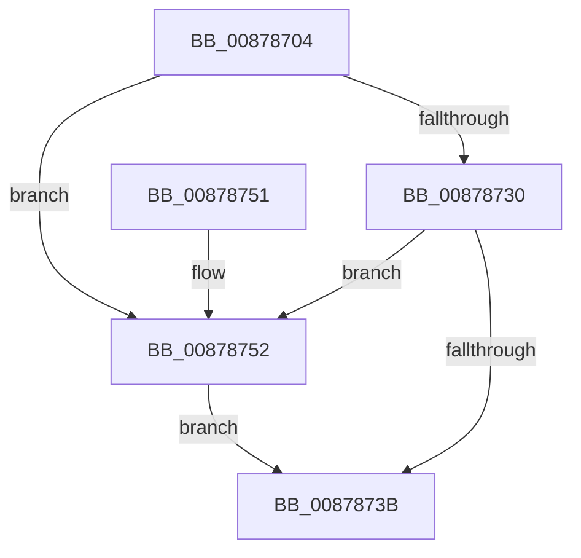

# CmpUnlockAppHiveLoadList

- RVA: `0x00878704`–`0x00878760` (길이 `92` bytes)
- VA: `0x0000000140878704`
- 실행 섹션: `PAGE`
- PDB 이름 있음: `예`; PDB Function 태그: `아니요`
- unwind 정보 RVA: `0x00064C74`
- 디코드: `22`개 명령, `92/92` bytes 표시
- 미해석 바이트: `0` (있으면 어셈블리에 `.byte`로 보존)

> 이 문서는 커널 이미지의 기계어와 PDB 기호를 분석해 생성했습니다. 4번과 5번은 함수 원형과 자료형을 바이너리 사용 방식에서 추정한 C 해석이며 원본 소스 복구 결과는 아닙니다.

## 1. Dependencies

- 직접 호출 지점: **3**; 고유 호출 대상: **3**
- 직접 호출자로 확인된 함수: **1**
- RIP 상대 이미지 참조: **1**

### Outgoing calls
- `0x00878742` → [KeAbPostRelease](../../text/2E/KeAbPostRelease_function_002E1600.md) (function, `0x002E1600`)
- `0x00878747` → [KeLeaveCriticalRegion](../../text/25/KeLeaveCriticalRegion_function_0025D8B0.md) (function, `0x0025D8B0`)
- `0x00878759` → [ExfReleasePushLock](../../text/26/ExfReleasePushLock_function_002638D0.md) (function, `0x002638D0`)

### Direct callers
- [CmLoadAppKey](CmLoadAppKey_function_00876FFC.md) at `0x008772F2`
- [CmLoadAppKey](CmLoadAppKey_function_00876FFC.md) at `0x00877339`
- [CmLoadAppKey](CmLoadAppKey_function_00876FFC.md) at `0x008776C3`

### Static image references
- `0x00878708` → RVA `0x00EF5980` (`.data`; read)

## 2. Other-region calls and transfers

- 다른 실행 섹션으로 향하는 call: **3**
  - `0x00878742` → [KeAbPostRelease](../../text/2E/KeAbPostRelease_function_002E1600.md) (`PAGE` → `.text`)
  - `0x00878747` → [KeLeaveCriticalRegion](../../text/25/KeLeaveCriticalRegion_function_0025D8B0.md) (`PAGE` → `.text`)
  - `0x00878759` → [ExfReleasePushLock](../../text/26/ExfReleasePushLock_function_002638D0.md) (`PAGE` → `.text`)
- 별도 외부 분기/꼬리 이동을 확인하지 못했습니다.

## 3. Assembly (complete function range)

```asm
00878704  48 83 EC 28                     sub rsp, 0x28
00878708  0F 0D 0D 71 D2 67 00            prefetchw byte ptr [rip + 0x67d271]
0087870F  48 8B 05 6A D2 67 00            mov rax, qword ptr [rip + 0x67d26a]
00878716  45 33 C0                        xor r8d, r8d
00878719  48 8B C8                        mov rcx, rax
0087871C  48 83 E1 F0                     and rcx, 0xfffffffffffffff0
00878720  48 83 F9 10                     cmp rcx, 0x10
00878724  48 8D 50 F0                     lea rdx, [rax - 0x10]
00878728  49 0F 46 D0                     cmovbe rdx, r8
0087872C  A8 02                           test al, 2
0087872E  75 22                           jne 0x140878752
00878730  F0 48 0F B1 15 47 D2 67 00      lock cmpxchg qword ptr [rip + 0x67d247], rdx
00878739  75 17                           jne 0x140878752
0087873B  48 8D 0D 3E D2 67 00            lea rcx, [rip + 0x67d23e]
00878742  E8 B9 8E A6 FF                  call 0x1402e1600
00878747  E8 64 51 9E FF                  call 0x14025d8b0
0087874C  48 83 C4 28                     add rsp, 0x28
00878750  C3                              ret
00878751  CC                              int3
00878752  48 8D 0D 27 D2 67 00            lea rcx, [rip + 0x67d227]
00878759  E8 72 B1 9E FF                  call 0x1402638d0
0087875E  EB DB                           jmp 0x14087873b
```

## 4. C-style interpretation (structured pseudocode)

```c
__int64 __fastcall CmpUnlockAppHiveLoadList(__int64 a1, __int64 a2, int a3)
{
    __int64 result;
    __int64 v_rsp;

    v_rsp = (v_rsp) - (40);
    a3 = 0;
    a1 = (*(unsigned __int64 *)(v_rip + 6804074)) & (-16);
    a2 = *(unsigned __int64 *)(v_rip + 6804074) - 16;
    if (a1 <= 16) { a2 = 0; }
    if ((((unsigned __int8)(*(unsigned __int64 *)(v_rip + 6804074))) & (2)) != 0) goto loc_00878752;
    if ((((unsigned __int8)(*(unsigned __int64 *)(v_rip + 6804074))) & (2)) != 0) goto loc_00878752;
loc_0087873B:
    result = KeAbPostRelease(v_rip + 6804030, a2, a3, a4);
    result = KeLeaveCriticalRegion(v_rip + 6804030, a2, a3, a4);
    v_rsp = (v_rsp) + (40);
    return result;
loc_00878752:
    result = ExfReleasePushLock(v_rip + 6804007, a2, a3, a4);
    goto loc_0087873B;
}
```

## 5. (Beta) C Style

```c
int64_t CmpUnlockAppHiveLoadList(int64_t Arg1, int64_t Arg2, int32_t Arg3)
{
    int64_t result;
    int64_t local_rsp;

    local_rsp = (local_rsp) - (40);
    Arg3 = 0;
    Arg1 = (*(uint64_t *)(v_rip + 0x67D26A)) & (-16);
    Arg2 = *(uint64_t *)(v_rip + 0x67D26A) - 16;
    if (Arg1 <= 16) { Arg2 = 0; }
    if ((((uint8_t)(*(uint64_t *)(v_rip + 0x67D26A))) & (2)) != 0) goto loc_00878752;
    if ((((uint8_t)(*(uint64_t *)(v_rip + 0x67D26A))) & (2)) != 0) goto loc_00878752;
loc_0087873B:
    result = KeAbPostRelease(v_rip + 6804030, Arg2, Arg3, a4);
    result = KeLeaveCriticalRegion(v_rip + 6804030, Arg2, Arg3, a4);
    local_rsp = (local_rsp) + (40);
    return result;
loc_00878752:
    result = ExfReleasePushLock(v_rip + 6804007, Arg2, Arg3, a4);
    goto loc_0087873B;
}
```

## 6. Execution-region graph

[열기: 2D/3D 그래프와 함수 탐색 컨트롤 패널](../../../control-panel.html?section=page&rva=0x00878704&view=graph)

- 2D 그래프는 위에서 아래로 흐르고, 3D 그래프는 빈 공간을 드래그해 회전합니다. Shift+드래그는 이동, 휠은 확대·축소, 함수 노드 선택은 대상 보고서 이동입니다.

### Static fallback


