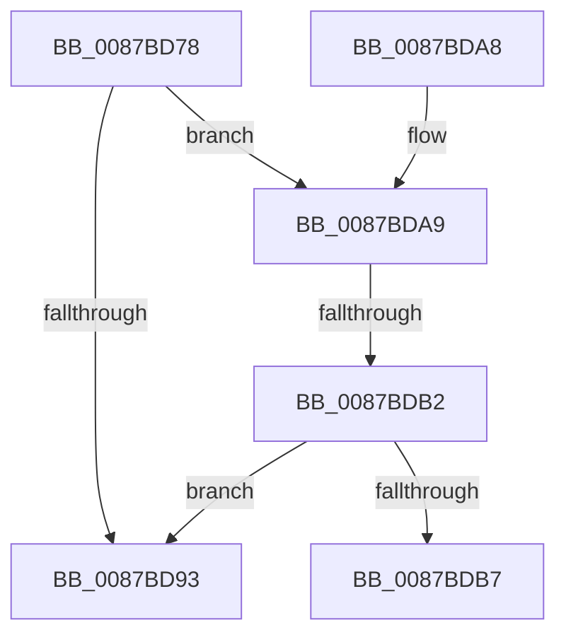

# CmpVolumeContextCanHiveSectionBeExtended

- RVA: `0x0087BD78`–`0x0087BDBC` (길이 `68` bytes)
- VA: `0x000000014087BD78`
- 실행 섹션: `PAGE`
- PDB 이름 있음: `예`; PDB Function 태그: `예`
- unwind 정보 RVA: `0x00065624`
- 디코드: `22`개 명령, `68/68` bytes 표시
- 미해석 바이트: `0` (있으면 어셈블리에 `.byte`로 보존)

> 이 문서는 커널 이미지의 기계어와 PDB 기호를 분석해 생성했습니다. 4번과 5번은 함수 원형과 자료형을 바이너리 사용 방식에서 추정한 C 해석이며 원본 소스 복구 결과는 아닙니다.

## 1. Dependencies

- 직접 호출 지점: **2**; 고유 호출 대상: **2**
- 직접 호출자로 확인된 함수: **2**
- RIP 상대 이미지 참조: **0**

### Outgoing calls
- `0x0087BD85` → [CmpVolumeContextLockShared](CmpVolumeContextLockShared_function_0087BE04.md) (function, `0x0087BE04`)
- `0x0087BD96` → [CmpVolumeContextUnlockShared](CmpVolumeContextUnlockShared_function_0087BE5C.md) (function, `0x0087BE5C`)

### Direct callers
- [CmpRecheckHiveVolumePolicy](../../text/46/CmpRecheckHiveVolumePolicy_function_0046EE14.md) at `0x0046EE7A`
- [CmpCreateHive](CmpCreateHive_function_00879DF0.md) at `0x0087A113`

### Static image references
- 디코드된 RIP-relative 메모리 참조가 없습니다.

## 2. Other-region calls and transfers

- 다른 실행 섹션으로 향하는 call: **0**
- call이 아닌 외부 분기/꼬리 이동: **2**
  - `0x0087BDAC` → [sub_00B18A10](../B1/Unknown_function_00B18A10.md) (`tail-transfer`)
  - `0x0087BDB7` → [sub_00B18A10](../B1/Unknown_function_00B18A10.md) (`tail-transfer`)

## 3. Assembly (complete function range)

```asm
0087BD78  48 89 5C 24 08                  mov qword ptr [rsp + 8], rbx
0087BD7D  57                              push rdi
0087BD7E  48 83 EC 20                     sub rsp, 0x20
0087BD82  48 8B F9                        mov rdi, rcx
0087BD85  E8 7A 00 00 00                  call 0x14087be04
0087BD8A  8B 57 40                        mov edx, dword ptr [rdi + 0x40]
0087BD8D  33 DB                           xor ebx, ebx
0087BD8F  85 D2                           test edx, edx
0087BD91  75 16                           jne 0x14087bda9
0087BD93  48 8B CF                        mov rcx, rdi
0087BD96  E8 C1 00 00 00                  call 0x14087be5c
0087BD9B  8A C3                           mov al, bl
0087BD9D  48 8B 5C 24 30                  mov rbx, qword ptr [rsp + 0x30]
0087BDA2  48 83 C4 20                     add rsp, 0x20
0087BDA6  5F                              pop rdi
0087BDA7  C3                              ret
0087BDA8  CC                              int3
0087BDA9  83 EA 01                        sub edx, 1
0087BDAC  0F 84 5E CC 29 00               je 0x140b18a10
0087BDB2  83 FA 01                        cmp edx, 1
0087BDB5  75 DC                           jne 0x14087bd93
0087BDB7  E9 54 CC 29 00                  jmp 0x140b18a10
```

## 4. C-style interpretation (structured pseudocode)

```c
__int64 __fastcall CmpVolumeContextCanHiveSectionBeExtended(__int64 a1)
{
    __int64 result;
    __int64 v_rbx;
    __int64 v_rsp;
    unsigned __int64 v_stack_p8;

    v_stack_p8 = v_rbx;
    v_rsp = (v_rsp) - (32);
    result = CmpVolumeContextLockShared(a1, a2, a3, a4);
    v_rbx = 0;
    if ((unsigned int)((unsigned int)(*(unsigned int *)(a1 + 64))) != 0) goto loc_0087BDA9;
loc_0087BD93:
    result = CmpVolumeContextUnlockShared(a1, (unsigned int)(*(unsigned int *)(a1 + 64)), a3, a4);
    v_rsp = (v_rsp) + (32);
    return 0;
loc_0087BDA9:
    a2 = (unsigned int)(((unsigned int)(*(unsigned int *)(a1 + 64))) - (1));
    if (((unsigned int)(a2)) != 1) goto loc_0087BD93;
}
```

## 5. (Beta) C Style

```c
int64_t CmpVolumeContextCanHiveSectionBeExtended(void *Arg1)
{
    uint8_t *arg1 = (uint8_t *)Arg1;

    int64_t result;
    int64_t local_rbx;
    int64_t local_rsp;
    uint64_t v_stack_p8;

    v_stack_p8 = local_rbx;
    local_rsp = (local_rsp) - (32);
    result = CmpVolumeContextLockShared(Arg1, a2, a3, a4);
    local_rbx = 0;
    if ((uint32_t)((uint32_t)(*(uint32_t *)(arg1 + 0x40))) != 0) goto loc_0087BDA9;
loc_0087BD93:
    result = CmpVolumeContextUnlockShared(Arg1, (uint32_t)(*(uint32_t *)(arg1 + 0x40)), a3, a4);
    local_rsp = (local_rsp) + (32);
    return 0;
loc_0087BDA9:
    a2 = (uint32_t)(((uint32_t)(*(uint32_t *)(arg1 + 0x40))) - (1));
    if (((uint32_t)(a2)) != 1) goto loc_0087BD93;
}
```

### 관측된 메모리 오프셋

구조체 형식이 확인되지 않은 접근은 인자 기준의 오프셋으로만 기록했습니다.

| 기준 인자 | 오프셋 표현 | 폭 (bit) | 접근 |
|---|---:|---:|---|
| `Arg1` | `+ 0x40` | `32` | `R` |

## 6. Execution-region graph

[열기: 2D/3D 그래프와 함수 탐색 컨트롤 패널](../../../control-panel.html?section=page&rva=0x0087BD78&view=graph)

- 2D 그래프는 위에서 아래로 흐르고, 3D 그래프는 빈 공간을 드래그해 회전합니다. Shift+드래그는 이동, 휠은 확대·축소, 함수 노드 선택은 대상 보고서 이동입니다.

### Static fallback


