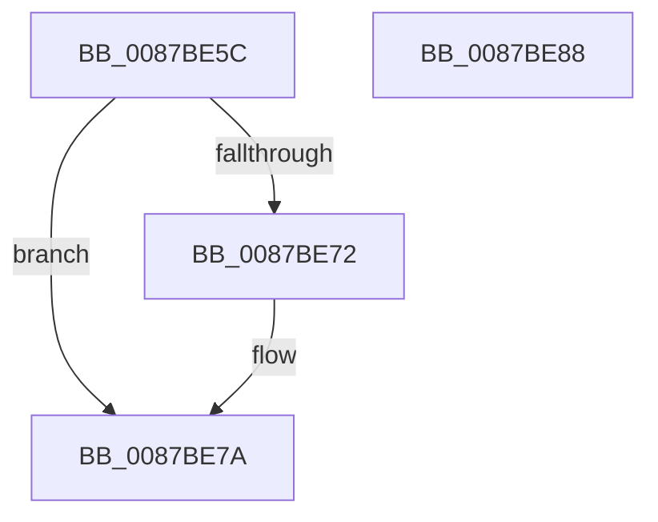

# CmpVolumeContextUnlockShared

- RVA: `0x0087BE5C`–`0x0087BE89` (길이 `45` bytes)
- VA: `0x000000014087BE5C`
- 실행 섹션: `PAGE`
- PDB 이름 있음: `예`; PDB Function 태그: `아니요`
- unwind 정보 RVA: `0x0005CF00`
- 디코드: `15`개 명령, `45/45` bytes 표시
- 미해석 바이트: `0` (있으면 어셈블리에 `.byte`로 보존)

> 이 문서는 커널 이미지의 기계어와 PDB 기호를 분석해 생성했습니다. 4번과 5번은 함수 원형과 자료형을 바이너리 사용 방식에서 추정한 C 해석이며 원본 소스 복구 결과는 아닙니다.

## 1. Dependencies

- 직접 호출 지점: **2**; 고유 호출 대상: **2**
- 직접 호출자로 확인된 함수: **3**
- RIP 상대 이미지 참조: **0**

### Outgoing calls
- `0x0087BE75` → [ExfReleasePushLockShared](../../text/26/ExfReleasePushLockShared_function_00263440.md) (function, `0x00263440`)
- `0x0087BE7D` → [KeAbPostRelease](../../text/2E/KeAbPostRelease_function_002E1600.md) (function, `0x002E1600`)

### Direct callers
- [CmpVolumeContextSendDeviceUsageNotification](../7E/CmpVolumeContextSendDeviceUsageNotification_function_007E87DC.md) at `0x007E8850`
- [CmpVolumeContextSendDeviceUsageNotification](../7E/CmpVolumeContextSendDeviceUsageNotification_function_007E87DC.md) at `0x007E8857`
- [CmpVolumeContextCanHiveSectionBeExtended](CmpVolumeContextCanHiveSectionBeExtended_function_0087BD78.md) at `0x0087BD96`
- [CmpVolumeContextMustHiveFilePagesBeKeptLocal](CmpVolumeContextMustHiveFilePagesBeKeptLocal_function_0087BDC4.md) at `0x0087BDE4`

### Static image references
- 디코드된 RIP-relative 메모리 참조가 없습니다.

## 2. Other-region calls and transfers

- 다른 실행 섹션으로 향하는 call: **2**
  - `0x0087BE75` → [ExfReleasePushLockShared](../../text/26/ExfReleasePushLockShared_function_00263440.md) (`PAGE` → `.text`)
  - `0x0087BE7D` → [KeAbPostRelease](../../text/2E/KeAbPostRelease_function_002E1600.md) (`PAGE` → `.text`)
- 별도 외부 분기/꼬리 이동을 확인하지 못했습니다.

## 3. Assembly (complete function range)

```asm
0087BE5C  40 53                           push rbx
0087BE5E  48 83 EC 20                     sub rsp, 0x20
0087BE62  48 8D 59 38                     lea rbx, [rcx + 0x38]
0087BE66  33 C9                           xor ecx, ecx
0087BE68  8D 41 11                        lea eax, [rcx + 0x11]
0087BE6B  F0 48 0F B1 0B                  lock cmpxchg qword ptr [rbx], rcx
0087BE70  74 08                           je 0x14087be7a
0087BE72  48 8B CB                        mov rcx, rbx
0087BE75  E8 C6 75 9E FF                  call 0x140263440
0087BE7A  48 8B CB                        mov rcx, rbx
0087BE7D  E8 7E 57 A6 FF                  call 0x1402e1600
0087BE82  48 83 C4 20                     add rsp, 0x20
0087BE86  5B                              pop rbx
0087BE87  C3                              ret
0087BE88  CC                              int3
```

## 4. C-style interpretation (structured pseudocode)

```c
__int64 __fastcall CmpVolumeContextUnlockShared(__int64 a1)
{
    __int64 result;
    __int64 v_rsp;

    v_rsp = (v_rsp) - (32);
    a1 = 0;
    result = a1 + 17;
    if (!(condition_is_equal)) {
        a1 = a1 + 56;
        result = ExfReleasePushLockShared(a1, a2, a3, a4);
    }
    result = KeAbPostRelease(a1 + 56, a2, a3, a4);
    v_rsp = (v_rsp) + (32);
    return result;
}
```

## 5. (Beta) C Style

```c
int64_t CmpVolumeContextUnlockShared(void *Arg1)
{
    uint8_t *arg1 = (uint8_t *)Arg1;

    int64_t result;
    int64_t local_rsp;

    local_rsp = (local_rsp) - (32);
    Arg1 = 0;
    result = Arg1 + 17;
    if (!(condition_is_equal)) {
        Arg1 = Arg1 + 56;
        result = ExfReleasePushLockShared(Arg1, a2, a3, a4);
    }
    result = KeAbPostRelease(Arg1 + 56, a2, a3, a4);
    local_rsp = (local_rsp) + (32);
    return result;
}
```

### 관측된 메모리 오프셋

구조체 형식이 확인되지 않은 접근은 인자 기준의 오프셋으로만 기록했습니다.

| 기준 인자 | 오프셋 표현 | 폭 (bit) | 접근 |
|---|---:|---:|---|
| `Arg1` | `+ 0x0` | `64` | `R` |
| `Arg1` | `+ 0x38` | `64` | `R` |

## 6. Execution-region graph

[열기: 2D/3D 그래프와 함수 탐색 컨트롤 패널](../../../control-panel.html?section=page&rva=0x0087BE5C&view=graph)

- 2D 그래프는 위에서 아래로 흐르고, 3D 그래프는 빈 공간을 드래그해 회전합니다. Shift+드래그는 이동, 휠은 확대·축소, 함수 노드 선택은 대상 보고서 이동입니다.

### Static fallback


