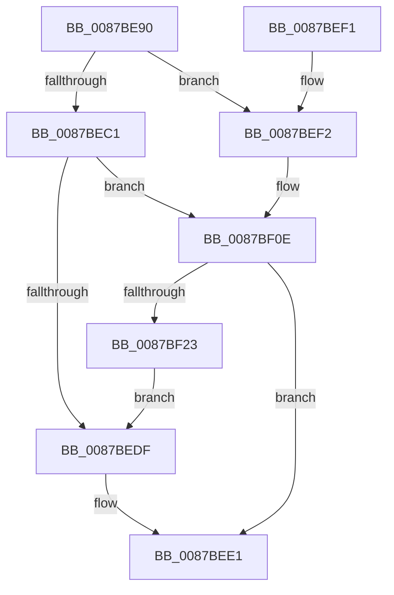

# HvCheckAndUpdateHiveBackupTimeStamp

- RVA: `0x0087BE90`–`0x0087BF31` (길이 `161` bytes)
- VA: `0x000000014087BE90`
- 실행 섹션: `PAGE`
- PDB 이름 있음: `예`; PDB Function 태그: `아니요`
- unwind 정보 RVA: `0x0006CF38`
- 디코드: `48`개 명령, `161/161` bytes 표시
- 미해석 바이트: `0` (있으면 어셈블리에 `.byte`로 보존)

> 이 문서는 커널 이미지의 기계어와 PDB 기호를 분석해 생성했습니다. 4번과 5번은 함수 원형과 자료형을 바이너리 사용 방식에서 추정한 C 해석이며 원본 소스 복구 결과는 아닙니다.

## 1. Dependencies

- 직접 호출 지점: **5**; 고유 호출 대상: **5**
- 직접 호출자로 확인된 함수: **5**
- RIP 상대 이미지 참조: **0**

### Outgoing calls
- `0x0087BEAD` → [HvpGetBinContextInitialize](../../pagecmrc/BC/HvpGetBinContextInitialize_function_00BC98D0.md) (function, `0x00BC98D0`)
- `0x0087BEB7` → [HvpGetCellMap](../../pagecmrc/BC/HvpGetCellMap_function_00BC9710.md) (function, `0x00BC9710`)
- `0x0087BEC9` → [HvpMapEntryGetBinAddress](../../pagecmrc/BC/HvpMapEntryGetBinAddress_function_00BC9770.md) (function, `0x00BC9770`)
- `0x0087BF08` → [KeBugCheckEx](../../text/4F/KeBugCheckEx_function_004FD660.md) (function, `0x004FD660`)
- `0x0087BF1A` → [HvpMarkDirty](../85/HvpMarkDirty_function_008593C0.md) (function, `0x008593C0`)

### Direct callers
- [CmpMountPreloadedHives](../7D/CmpMountPreloadedHives_function_007DBE18.md) at `0x007DC2BA`
- [CmpRecoverFlushProtocolStateFromFiles](../7E/CmpRecoverFlushProtocolStateFromFiles_function_007EE4B0.md) at `0x007EE503`
- [CmpCreateHive](CmpCreateHive_function_00879DF0.md) at `0x0087A21C`
- [HvpPerformLogFileRecovery](../9B/HvpPerformLogFileRecovery_function_009B7994.md) at `0x009B7C8C`
- [CmpCreateHiveRootCell](../AB/CmpCreateHiveRootCell_function_00ABF568.md) at `0x00ABF758`

### Static image references
- 디코드된 RIP-relative 메모리 참조가 없습니다.

## 2. Other-region calls and transfers

- 다른 실행 섹션으로 향하는 call: **4**
  - `0x0087BEAD` → [HvpGetBinContextInitialize](../../pagecmrc/BC/HvpGetBinContextInitialize_function_00BC98D0.md) (`PAGE` → `PAGECMRC`)
  - `0x0087BEB7` → [HvpGetCellMap](../../pagecmrc/BC/HvpGetCellMap_function_00BC9710.md) (`PAGE` → `PAGECMRC`)
  - `0x0087BEC9` → [HvpMapEntryGetBinAddress](../../pagecmrc/BC/HvpMapEntryGetBinAddress_function_00BC9770.md) (`PAGE` → `PAGECMRC`)
  - `0x0087BF08` → [KeBugCheckEx](../../text/4F/KeBugCheckEx_function_004FD660.md) (`PAGE` → `.text`)
- 별도 외부 분기/꼬리 이동을 확인하지 못했습니다.

## 3. Assembly (complete function range)

```asm
0087BE90  48 8B C4                        mov rax, rsp
0087BE93  48 89 58 08                     mov qword ptr [rax + 8], rbx
0087BE97  48 89 70 18                     mov qword ptr [rax + 0x18], rsi
0087BE9B  57                              push rdi
0087BE9C  48 83 EC 30                     sub rsp, 0x30
0087BEA0  48 8B D9                        mov rbx, rcx
0087BEA3  33 F6                           xor esi, esi
0087BEA5  48 8D 48 10                     lea rcx, [rax + 0x10]
0087BEA9  66 89 70 10                     mov word ptr [rax + 0x10], si
0087BEAD  E8 1E DA 34 00                  call 0x140bc98d0
0087BEB2  33 D2                           xor edx, edx
0087BEB4  48 8B CB                        mov rcx, rbx
0087BEB7  E8 54 D8 34 00                  call 0x140bc9710
0087BEBC  48 85 C0                        test rax, rax
0087BEBF  74 31                           je 0x14087bef2
0087BEC1  4C 8D 44 24 48                  lea r8, [rsp + 0x48]
0087BEC6  48 8B D0                        mov rdx, rax
0087BEC9  E8 A2 D8 34 00                  call 0x140bc9770
0087BECE  48 8B 4B 40                     mov rcx, qword ptr [rbx + 0x40]
0087BED2  48 8B F8                        mov rdi, rax
0087BED5  48 8B 51 0C                     mov rdx, qword ptr [rcx + 0xc]
0087BED9  48 39 50 14                     cmp qword ptr [rax + 0x14], rdx
0087BEDD  75 2F                           jne 0x14087bf0e
0087BEDF  8B C6                           mov eax, esi
0087BEE1  48 8B 5C 24 40                  mov rbx, qword ptr [rsp + 0x40]
0087BEE6  48 8B 74 24 50                  mov rsi, qword ptr [rsp + 0x50]
0087BEEB  48 83 C4 30                     add rsp, 0x30
0087BEEF  5F                              pop rdi
0087BEF0  C3                              ret
0087BEF1  CC                              int3
0087BEF2  45 33 C9                        xor r9d, r9d
0087BEF5  48 C7 44 24 20 19 14 00 00      mov qword ptr [rsp + 0x20], 0x1419
0087BEFE  4C 8B C3                        mov r8, rbx
0087BF01  41 8D 51 01                     lea edx, [r9 + 1]
0087BF05  8D 4A 50                        lea ecx, [rdx + 0x50]
0087BF08  E8 53 17 C8 FF                  call 0x1404fd660
0087BF0D  CC                              int3
0087BF0E  45 33 C9                        xor r9d, r9d
0087BF11  33 D2                           xor edx, edx
0087BF13  48 8B CB                        mov rcx, rbx
0087BF16  45 8D 41 20                     lea r8d, [r9 + 0x20]
0087BF1A  E8 A1 D4 FD FF                  call 0x1408593c0
0087BF1F  85 C0                           test eax, eax
0087BF21  78 BE                           js 0x14087bee1
0087BF23  48 8B 43 40                     mov rax, qword ptr [rbx + 0x40]
0087BF27  48 8B 48 0C                     mov rcx, qword ptr [rax + 0xc]
0087BF2B  48 89 4F 14                     mov qword ptr [rdi + 0x14], rcx
0087BF2F  EB AE                           jmp 0x14087bedf
```

## 4. C-style interpretation (structured pseudocode)

```c
__int64 __fastcall HvCheckAndUpdateHiveBackupTimeStamp(__int64 a1, int a2, __int64 a3, int a4)
{
    __int64 result;
    __int64 v_rsi;
    __int64 v_rsp;
    unsigned __int64 v_stack_p10;
    unsigned __int64 v_stack_p18;
    unsigned __int64 v_stack_p20;
    unsigned __int64 v_stack_p8;

    *(unsigned __int64 *)(v_rsp + 8) = v_rbx;
    *(unsigned __int64 *)(v_rsp + 24) = v_rsi;
    v_rsp = (v_rsp) - (48);
    v_rsi = 0;
    *(unsigned __int16 *)(v_rsp + 16) = 0;
    result = HvpGetBinContextInitialize(v_rsp + 16, a2, a3, a4);
    a2 = 0;
    result = HvpGetCellMap(a1, a2, a3, a4);
    if (result == 0) goto loc_0087BEF2;
    result = HvpMapEntryGetBinAddress(a1, result, v_stack_p10, a4);
    if ((*(unsigned __int64 *)(result + 20)) != (*(unsigned __int64 *)(*(unsigned __int64 *)(a1 + 64) + 12))) goto loc_0087BF0E;
loc_0087BEDF:
loc_0087BEE1:
    v_rsp = (v_rsp) + (48);
    return 0;
loc_0087BEF2:
    a4 = 0;
    v_stack_p20 = 0x1419ULL;
    result = KeBugCheckEx(a4 + 1 + 80, a4 + 1, v_stack_p8, a4);
loc_0087BF0E:
    a4 = 0;
    a2 = 0;
    result = HvpMarkDirty(v_stack_p8, a2, a4 + 32, a4);
    if (sign_flag) goto loc_0087BEE1;
    *(unsigned __int64 *)(result + 20) = *(unsigned __int64 *)(*(unsigned __int64 *)(v_stack_p8 + 64) + 12);
    goto loc_0087BEDF;
}
```

## 5. (Beta) C Style

```c
int64_t HvCheckAndUpdateHiveBackupTimeStamp(void *Arg1, int32_t Arg2, int64_t Arg3, int32_t Arg4)
{
    uint8_t *arg1 = (uint8_t *)Arg1;

    int64_t result;
    int64_t local_rsi;
    int64_t local_rsp;
    uint64_t v_stack_p10;
    uint64_t v_stack_p18;
    uint64_t v_stack_p20;
    uint64_t v_stack_p8;

    *(uint64_t *)(local_rsp + 0x8) = local_rbx;
    *(uint64_t *)(local_rsp + 0x18) = local_rsi;
    local_rsp = (local_rsp) - (48);
    local_rsi = 0;
    *(uint16_t *)(local_rsp + 0x10) = 0;
    result = HvpGetBinContextInitialize(local_rsp + 16, Arg2, Arg3, Arg4);
    Arg2 = 0;
    result = HvpGetCellMap(Arg1, Arg2, Arg3, Arg4);
    if (result == 0) goto loc_0087BEF2;
    result = HvpMapEntryGetBinAddress(Arg1, result, v_stack_p10, Arg4);
    if ((*(uint64_t *)(result + 0x14)) != (*(uint64_t *)(*(uint64_t *)(arg1 + 0x40) + 0xC))) goto loc_0087BF0E;
loc_0087BEDF:
loc_0087BEE1:
    local_rsp = (local_rsp) + (48);
    return 0;
loc_0087BEF2:
    Arg4 = 0;
    v_stack_p20 = 0x1419ULL;
    result = KeBugCheckEx(Arg4 + 1 + 80, Arg4 + 1, v_stack_p8, Arg4);
loc_0087BF0E:
    Arg4 = 0;
    Arg2 = 0;
    result = HvpMarkDirty(v_stack_p8, Arg2, Arg4 + 32, Arg4);
    if (sign_flag) goto loc_0087BEE1;
    *(uint64_t *)(result + 0x14) = *(uint64_t *)(*(uint64_t *)(v_stack_p8 + 0x40) + 0xC);
    goto loc_0087BEDF;
}
```

### 관측된 메모리 오프셋

구조체 형식이 확인되지 않은 접근은 인자 기준의 오프셋으로만 기록했습니다.

| 기준 인자 | 오프셋 표현 | 폭 (bit) | 접근 |
|---|---:|---:|---|
| `Arg1` | `+ 0x40` | `64` | `R` |

## 6. Execution-region graph

[열기: 2D/3D 그래프와 함수 탐색 컨트롤 패널](../../../control-panel.html?section=page&rva=0x0087BE90&view=graph)

- 2D 그래프는 위에서 아래로 흐르고, 3D 그래프는 빈 공간을 드래그해 회전합니다. Shift+드래그는 이동, 휠은 확대·축소, 함수 노드 선택은 대상 보고서 이동입니다.

### Static fallback


