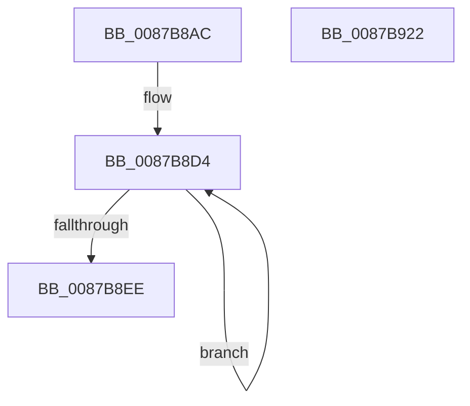

# HvHiveInitialize

- RVA: `0x0087B8AC`–`0x0087B923` (길이 `119` bytes)
- VA: `0x000000014087B8AC`
- 실행 섹션: `PAGE`
- PDB 이름 있음: `예`; PDB Function 태그: `아니요`
- unwind 정보 RVA: `0x0005CF00`
- 디코드: `27`개 명령, `119/119` bytes 표시
- 미해석 바이트: `0` (있으면 어셈블리에 `.byte`로 보존)

> 이 문서는 커널 이미지의 기계어와 PDB 기호를 분석해 생성했습니다. 4번과 5번은 함수 원형과 자료형을 바이너리 사용 방식에서 추정한 C 해석이며 원본 소스 복구 결과는 아닙니다.

## 1. Dependencies

- 직접 호출 지점: **1**; 고유 호출 대상: **1**
- 직접 호출자로 확인된 함수: **2**
- RIP 상대 이미지 참조: **0**

### Outgoing calls
- `0x0087B8BD` → [memset](../../text/6C/memset_function_006C6C40.md) (function, `0x006C6C40`)

### Direct callers
- [CmpHiveInitialize](CmpHiveInitialize_function_0087B7AC.md) at `0x0087B7CC`
- [CmpGetSystemControlValues](../../init/C5/CmpGetSystemControlValues_function_00C5959C.md) at `0x00C5964C`

### Static image references
- 디코드된 RIP-relative 메모리 참조가 없습니다.

## 2. Other-region calls and transfers

- 다른 실행 섹션으로 향하는 call: **1**
  - `0x0087B8BD` → [memset](../../text/6C/memset_function_006C6C40.md) (`PAGE` → `.text`)
- 별도 외부 분기/꼬리 이동을 확인하지 못했습니다.

## 3. Assembly (complete function range)

```asm
0087B8AC  40 53                           push rbx
0087B8AE  48 83 EC 20                     sub rsp, 0x20
0087B8B2  33 D2                           xor edx, edx
0087B8B4  41 B8 08 06 00 00               mov r8d, 0x608
0087B8BA  48 8B D9                        mov rbx, rcx
0087B8BD  E8 7E B3 E4 FF                  call 0x1406c6c40
0087B8C2  48 8D 83 78 03 00 00            lea rax, [rbx + 0x378]
0087B8C9  C7 03 E0 BE E0 BE               mov dword ptr [rbx], 0xbee0bee0
0087B8CF  B9 02 00 00 00                  mov ecx, 2
0087B8D4  83 88 B8 FD FF FF FF            or dword ptr [rax - 0x248], 0xffffffff
0087B8DB  48 89 40 08                     mov qword ptr [rax + 8], rax
0087B8DF  48 89 00                        mov qword ptr [rax], rax
0087B8E2  48 05 78 02 00 00               add rax, 0x278
0087B8E8  48 83 E9 01                     sub rcx, 1
0087B8EC  75 E6                           jne 0x14087b8d4
0087B8EE  48 89 4B 48                     mov qword ptr [rbx + 0x48], rcx
0087B8F2  0F 57 C0                        xorps xmm0, xmm0
0087B8F5  48 89 4B 50                     mov qword ptr [rbx + 0x50], rcx
0087B8F9  0F 11 83 E0 00 00 00            movups xmmword ptr [rbx + 0xe0], xmm0
0087B900  0F 11 83 F0 00 00 00            movups xmmword ptr [rbx + 0xf0], xmm0
0087B907  0F 11 83 00 01 00 00            movups xmmword ptr [rbx + 0x100], xmm0
0087B90E  48 89 8B 08 01 00 00            mov qword ptr [rbx + 0x108], rcx
0087B915  48 89 8B 10 01 00 00            mov qword ptr [rbx + 0x110], rcx
0087B91C  48 83 C4 20                     add rsp, 0x20
0087B920  5B                              pop rbx
0087B921  C3                              ret
0087B922  CC                              int3
```

## 4. C-style interpretation (structured pseudocode)

```c
__int64 __fastcall HvHiveInitialize(__int64 a1, int a2)
{
    __int64 result;
    __int64 v_rsp;

    v_rsp = (v_rsp) - (32);
    a2 = 0;
    result = memset(a1, a2, (unsigned int)(0x608ULL), a4);
    *(unsigned int *)(a1) = 0xBEE0BEE0ULL;
loc_0087B8D4:
    *(unsigned __int64 *)(a1 + 888 + 8) = a1 + 888;
    *(unsigned __int64 *)(a1 + 888) = a1 + 888;
    result = (a1 + 888) + (632);
    a1 = (2) - (1);
    if (condition_is_not_equal) goto loc_0087B8D4;
    *(unsigned __int64 *)(a1 + 72) = a1;
    *(unsigned __int64 *)(a1 + 80) = a1;
    *(unsigned __int64 *)(a1 + 224) = v_xmm0;
    *(unsigned __int64 *)(a1 + 240) = v_xmm0;
    *(unsigned __int64 *)(a1 + 256) = v_xmm0;
    *(unsigned __int64 *)(a1 + 264) = a1;
    *(unsigned __int64 *)(a1 + 272) = a1;
    v_rsp = (v_rsp) + (32);
    return result;
}
```

## 5. (Beta) C Style

```c
int64_t HvHiveInitialize(void *Arg1, int32_t Arg2)
{
    uint8_t *arg1 = (uint8_t *)Arg1;

    int64_t result;
    int64_t local_rsp;

    local_rsp = (local_rsp) - (32);
    Arg2 = 0;
    result = memset(Arg1, Arg2, (uint32_t)(0x608ULL), a4);
    *(uint32_t *)(arg1) = 0xBEE0BEE0ULL;
loc_0087B8D4:
    *(void **)(arg1 + 0x378 + 0x8) = Arg1 + 888;
    *(void **)(arg1 + 0x378) = Arg1 + 888;
    result = (Arg1 + 888) + (632);
    Arg1 = (2) - (1);
    if (condition_is_not_equal) goto loc_0087B8D4;
    *(void **)(arg1 + 0x48) = Arg1;
    *(void **)(arg1 + 0x50) = Arg1;
    *(uint64_t *)(arg1 + 0xE0) = v_xmm0;
    *(uint64_t *)(arg1 + 0xF0) = v_xmm0;
    *(uint64_t *)(arg1 + 0x100) = v_xmm0;
    *(void **)(arg1 + 0x108) = Arg1;
    *(void **)(arg1 + 0x110) = Arg1;
    local_rsp = (local_rsp) + (32);
    return result;
}
```

### 관측된 메모리 오프셋

구조체 형식이 확인되지 않은 접근은 인자 기준의 오프셋으로만 기록했습니다.

| 기준 인자 | 오프셋 표현 | 폭 (bit) | 접근 |
|---|---:|---:|---|
| `Arg1` | `- 0x248` | `32` | `R/W` |
| `Arg1` | `+ 0x0` | `32` | `W` |
| `Arg1` | `+ 0x0` | `64` | `W` |
| `Arg1` | `+ 0x8` | `64` | `W` |
| `Arg1` | `+ 0x48` | `64` | `W` |
| `Arg1` | `+ 0x50` | `64` | `W` |
| `Arg1` | `+ 0xE0` | `128` | `R` |
| `Arg1` | `+ 0xF0` | `128` | `R` |
| `Arg1` | `+ 0x100` | `128` | `R` |
| `Arg1` | `+ 0x108` | `64` | `W` |
| `Arg1` | `+ 0x110` | `64` | `W` |
| `Arg1` | `+ 0x378` | `64` | `R` |

## 6. Execution-region graph

[열기: 2D/3D 그래프와 함수 탐색 컨트롤 패널](../../../control-panel.html?section=page&rva=0x0087B8AC&view=graph)

- 2D 그래프는 위에서 아래로 흐르고, 3D 그래프는 빈 공간을 드래그해 회전합니다. Shift+드래그는 이동, 휠은 확대·축소, 함수 노드 선택은 대상 보고서 이동입니다.

### Static fallback


