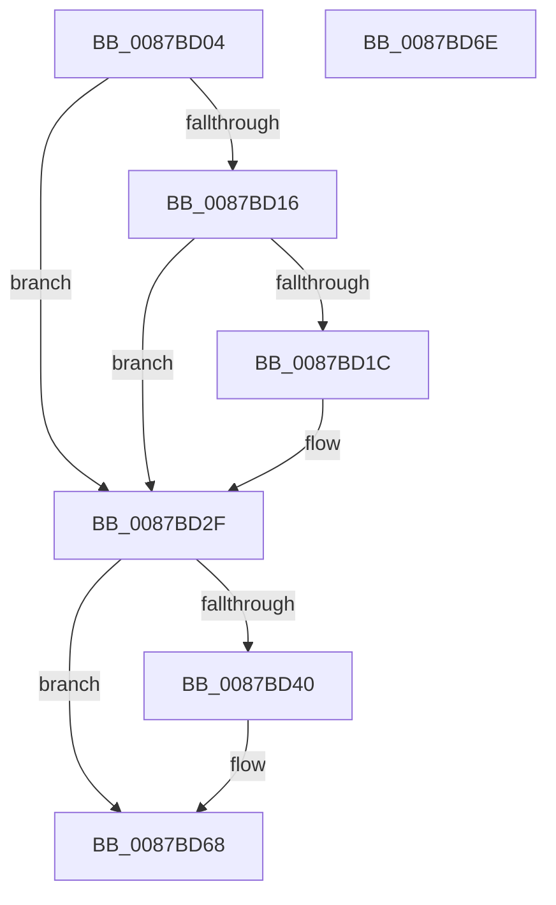

# HvMarkBaseBlockDirty

- RVA: `0x0087BD04`–`0x0087BD6F` (길이 `107` bytes)
- VA: `0x000000014087BD04`
- 실행 섹션: `PAGE`
- PDB 이름 있음: `예`; PDB Function 태그: `아니요`
- unwind 정보 RVA: `0x0005CF00`
- 디코드: `27`개 명령, `107/107` bytes 표시
- 미해석 바이트: `0` (있으면 어셈블리에 `.byte`로 보존)

> 이 문서는 커널 이미지의 기계어와 PDB 기호를 분석해 생성했습니다. 4번과 5번은 함수 원형과 자료형을 바이너리 사용 방식에서 추정한 C 해석이며 원본 소스 복구 결과는 아닙니다.

## 1. Dependencies

- 직접 호출 지점: **3**; 고유 호출 대상: **3**
- 직접 호출자로 확인된 함수: **11**
- RIP 상대 이미지 참조: **1**

### Outgoing calls
- `0x0087BD1E` → [KiQueryUnbiasedInterruptTime](../../text/42/KiQueryUnbiasedInterruptTime_function_0042D180.md) (function, `0x0042D180`)
- `0x0087BD2A` → [CmpIssueNewDirtyCallback](../A6/CmpIssueNewDirtyCallback_function_00A6F050.md) (function, `0x00A6F050`)
- `0x0087BD63` → [CmpArmLazyWriter](../../text/20/CmpArmLazyWriter_function_00204770.md) (function, `0x00204770`)

### Direct callers
- [CmShutdownSystem1](../../text/66/CmShutdownSystem1_function_0066A5B0.md) at `0x0066A698`
- [CmShutdownSystem1](../../text/66/CmShutdownSystem1_function_0066A5B0.md) at `0x0066A6DD`
- [NtCompressKey](../7D/NtCompressKey_function_007DF9D0.md) at `0x007DFB59`
- [CmFreezeRegistry](../7E/CmFreezeRegistry_function_007E834C.md) at `0x007E8427`
- [CmThawRegistry](../7E/CmThawRegistry_function_007E8510.md) at `0x007E85CA`
- [CmpReorganizeHive](CmpReorganizeHive_function_0087B92C.md) at `0x0087BAE5`
- [CmpInitCmRM](CmpInitCmRM_function_0087C700.md) at `0x0087CE6F`
- [HvHiveStartFileBacked](../9B/HvHiveStartFileBacked_function_009B7E20.md) at `0x009B801C`
- [CmpCreateHiveRootCell](../AB/CmpCreateHiveRootCell_function_00ABF568.md) at `0x00ABF74F`
- [sub_00B1802A](../B1/Unknown_function_00B1802A.md) at `0x00B182F9`
- [sub_00B1845C](../B1/Unknown_function_00B1845C.md) at `0x00B184E8`
- [sub_00B1845C](../B1/Unknown_function_00B1845C.md) at `0x00B186DB`
- [sub_00B1845C](../B1/Unknown_function_00B1845C.md) at `0x00B187D3`
- [sub_00B1845C](../B1/Unknown_function_00B1845C.md) at `0x00B188F0`
- [sub_00B2DCB2](../B2/Unknown_function_00B2DCB2.md) at `0x00B2DCBE`

### Static image references
- `0x0087BD40` → RVA `0x00E0ECB4` (`.data`; read)

## 2. Other-region calls and transfers

- 다른 실행 섹션으로 향하는 call: **2**
  - `0x0087BD1E` → [KiQueryUnbiasedInterruptTime](../../text/42/KiQueryUnbiasedInterruptTime_function_0042D180.md) (`PAGE` → `.text`)
  - `0x0087BD63` → [CmpArmLazyWriter](../../text/20/CmpArmLazyWriter_function_00204770.md) (`PAGE` → `.text`)
- 별도 외부 분기/꼬리 이동을 확인하지 못했습니다.

## 3. Assembly (complete function range)

```asm
0087BD04  40 53                           push rbx
0087BD06  48 83 EC 20                     sub rsp, 0x20
0087BD0A  80 B9 C3 00 00 00 00            cmp byte ptr [rcx + 0xc3], 0
0087BD11  48 8B D9                        mov rbx, rcx
0087BD14  75 19                           jne 0x14087bd2f
0087BD16  83 79 68 00                     cmp dword ptr [rcx + 0x68], 0
0087BD1A  75 13                           jne 0x14087bd2f
0087BD1C  B1 01                           mov cl, 1
0087BD1E  E8 5D 14 BB FF                  call 0x14042d180
0087BD23  48 89 83 28 10 00 00            mov qword ptr [rbx + 0x1028], rax
0087BD2A  E8 21 33 1F 00                  call 0x140a6f050
0087BD2F  8B 83 A0 00 00 00               mov eax, dword ptr [rbx + 0xa0]
0087BD35  C6 83 C3 00 00 00 01            mov byte ptr [rbx + 0xc3], 1
0087BD3C  A8 02                           test al, 2
0087BD3E  75 28                           jne 0x14087bd68
0087BD40  8B 05 6E 2F 59 00               mov eax, dword ptr [rip + 0x592f6e]
0087BD46  48 8D 54 24 30                  lea rdx, [rsp + 0x30]
0087BD4B  48 69 C8 80 96 98 00            imul rcx, rax, 0x989680
0087BD52  45 33 C0                        xor r8d, r8d
0087BD55  48 03 8B 28 10 00 00            add rcx, qword ptr [rbx + 0x1028]
0087BD5C  48 89 4C 24 30                  mov qword ptr [rsp + 0x30], rcx
0087BD61  33 C9                           xor ecx, ecx
0087BD63  E8 08 8A 98 FF                  call 0x140204770
0087BD68  48 83 C4 20                     add rsp, 0x20
0087BD6C  5B                              pop rbx
0087BD6D  C3                              ret
0087BD6E  CC                              int3
```

## 4. C-style interpretation (structured pseudocode)

```c
__int64 __fastcall HvMarkBaseBlockDirty(__int64 a1, __int64 a2, int a3)
{
    __int64 result;
    __int64 v_rsp;
    unsigned __int64 v_stack_p8;

    v_rsp = (v_rsp) - (32);
    if ((*(unsigned __int8 *)(a1 + 195)) != 0) goto loc_0087BD2F;
    if ((*(unsigned int *)(a1 + 104)) == 0) {
        a1 = 1;
        result = KiQueryUnbiasedInterruptTime(a1, a2, a3, a4);
        *(unsigned __int64 *)(a1 + 4136) = result;
        result = CmpIssueNewDirtyCallback(a1, a2, a3, a4);
    }
    *(unsigned __int8 *)(a1 + 195) = 1;
    result = (unsigned int)(*(unsigned int *)(a1 + 160));
    if ((((unsigned __int8)((unsigned int)(*(unsigned int *)(a1 + 160)))) & (2)) == 0) {
        result = *(unsigned int *)(v_rip + 5844846);
        a2 = v_stack_p8;
        a1 = (a1) * (result);
        a3 = 0;
        a1 = (a1) + (*(unsigned __int64 *)(a1 + 4136));
        v_stack_p8 = a1;
        a1 = 0;
        result = CmpArmLazyWriter(a1, a2, a3, a4);
    }
    v_rsp = (v_rsp) + (32);
    return result;
}
```

## 5. (Beta) C Style

```c
int64_t HvMarkBaseBlockDirty(void *Arg1, int64_t Arg2, int32_t Arg3)
{
    uint8_t *arg1 = (uint8_t *)Arg1;

    int64_t result;
    int64_t local_rsp;
    uint64_t v_stack_p8;

    local_rsp = (local_rsp) - (32);
    if ((*(uint8_t *)(arg1 + 0xC3)) != 0) goto loc_0087BD2F;
    if ((*(uint32_t *)(arg1 + 0x68)) == 0) {
        Arg1 = 1;
        result = KiQueryUnbiasedInterruptTime(Arg1, Arg2, Arg3, a4);
        *(uint64_t *)(arg1 + 0x1028) = result;
        result = CmpIssueNewDirtyCallback(Arg1, Arg2, Arg3, a4);
    }
    *(uint8_t *)(arg1 + 0xC3) = 1;
    result = (uint32_t)(*(uint32_t *)(arg1 + 0xA0));
    if ((((uint8_t)((uint32_t)(*(uint32_t *)(arg1 + 0xA0)))) & (2)) == 0) {
        result = *(uint32_t *)(v_rip + 0x592F6E);
        Arg2 = v_stack_p8;
        Arg1 = (Arg1) * (result);
        Arg3 = 0;
        Arg1 = (Arg1) + (*(uint64_t *)(arg1 + 0x1028));
        v_stack_p8 = Arg1;
        Arg1 = 0;
        result = CmpArmLazyWriter(Arg1, Arg2, Arg3, a4);
    }
    local_rsp = (local_rsp) + (32);
    return result;
}
```

### 관측된 메모리 오프셋

구조체 형식이 확인되지 않은 접근은 인자 기준의 오프셋으로만 기록했습니다.

| 기준 인자 | 오프셋 표현 | 폭 (bit) | 접근 |
|---|---:|---:|---|
| `Arg1` | `+ 0x68` | `32` | `R` |
| `Arg1` | `+ 0xA0` | `32` | `R` |
| `Arg1` | `+ 0xC3` | `8` | `R` |
| `Arg1` | `+ 0xC3` | `8` | `W` |
| `Arg1` | `+ 0x1028` | `64` | `R` |
| `Arg1` | `+ 0x1028` | `64` | `W` |

## 6. Execution-region graph

[열기: 2D/3D 그래프와 함수 탐색 컨트롤 패널](../../../control-panel.html?section=page&rva=0x0087BD04&view=graph)

- 2D 그래프는 위에서 아래로 흐르고, 3D 그래프는 빈 공간을 드래그해 회전합니다. Shift+드래그는 이동, 휠은 확대·축소, 함수 노드 선택은 대상 보고서 이동입니다.

### Static fallback


