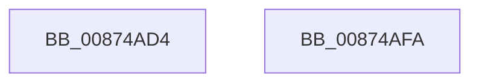

# LOCK_TRANSACTION_LIST

- RVA: `0x00874AD4`–`0x00874AFB` (길이 `39` bytes)
- VA: `0x0000000140874AD4`
- 실행 섹션: `PAGE`
- PDB 이름 있음: `예`; PDB Function 태그: `아니요`
- unwind 정보 RVA: `0x0005C788`
- 디코드: `9`개 명령, `39/39` bytes 표시
- 미해석 바이트: `0` (있으면 어셈블리에 `.byte`로 보존)

> 이 문서는 커널 이미지의 기계어와 PDB 기호를 분석해 생성했습니다. 4번과 5번은 함수 원형과 자료형을 바이너리 사용 방식에서 추정한 C 해석이며 원본 소스 복구 결과는 아닙니다.

## 1. Dependencies

- 직접 호출 지점: **1**; 고유 호출 대상: **1**
- 직접 호출자로 확인된 함수: **19**
- RIP 상대 이미지 참조: **1**

### Outgoing calls
- `0x00874AF0` → [ExAcquireFastMutexUnsafe](../../text/3F/ExAcquireFastMutexUnsafe_function_003F3720.md) (function, `0x003F3720`)

### Direct callers
- [CmpTransEnlistUowInCmTrans](../../text/48/CmpTransEnlistUowInCmTrans_function_0048B330.md) at `0x0048B340`
- [CmObliterateRMTxArray](../7E/CmObliterateRMTxArray_function_007EDF3C.md) at `0x007EDF5C`
- [CmpLazyCommitWorker](../7E/CmpLazyCommitWorker_function_007EE030.md) at `0x007EE08A`
- [CmpLazyCommitWorker](../7E/CmpLazyCommitWorker_function_007EE030.md) at `0x007EE13D`
- [CmpTransInitializeTransaction](../84/CmpTransInitializeTransaction_function_008422C8.md) at `0x008423CF`
- [CmpCleanupTransactionState](../84/CmpCleanupTransactionState_function_008428E0.md) at `0x00842941`
- [CmpLogCheckpoint](../84/CmpLogCheckpoint_function_00842F04.md) at `0x00842F70`
- [CmpTransSearchAddLightWeightTrans](CmpTransSearchAddLightWeightTrans_function_00873494.md) at `0x00873548`
- [CmpTransSearchAddLightWeightTrans](CmpTransSearchAddLightWeightTrans_function_00873494.md) at `0x0087357F`
- [CmpTransSearchAddTrans](CmpTransSearchAddTrans_function_008743FC.md) at `0x0087444A`
- [CmpRundownUnitOfWork](CmpRundownUnitOfWork_function_0087497C.md) at `0x008749FD`
- [CmSnapshotRMTxArray](../9A/CmSnapshotRMTxArray_function_009AEC9C.md) at `0x009AECBB`
- [CmpRunDownCmRM](../9B/CmpRunDownCmRM_function_009B062C.md) at `0x009B0667`
- [CmpCommitPreparedLightWeightTransaction](../9B/CmpCommitPreparedLightWeightTransaction_function_009B0B88.md) at `0x009B0BF2`
- [CmpPrepareLightWeightTransaction](../9B/CmpPrepareLightWeightTransaction_function_009B0D24.md) at `0x009B0DA8`
- [CmpCleanupLightWeightTransaction](../9B/CmpCleanupLightWeightTransaction_function_009B1340.md) at `0x009B1398`
- [CmpTransMgrRollback](../9B/CmpTransMgrRollback_function_009B1400.md) at `0x009B1419`
- [CmpTransMgrPrepare](../9B/CmpTransMgrPrepare_function_009B175C.md) at `0x009B179E`
- [CmKtmNotification](../9B/CmKtmNotification_function_009B1950.md) at `0x009B1A17`
- [CmRmFinalizeRecovery](../AB/CmRmFinalizeRecovery_function_00ABEB68.md) at `0x00ABEB9B`
- [CmRmFinalizeRecovery](../AB/CmRmFinalizeRecovery_function_00ABEB68.md) at `0x00ABEC46`
- [sub_00B17700](../B1/Unknown_function_00B17700.md) at `0x00B17700`

### Static image references
- `0x00874AE1` → RVA `0x00EF5820` (`.data`; read)

## 2. Other-region calls and transfers

- 다른 실행 섹션으로 향하는 call: **1**
  - `0x00874AF0` → [ExAcquireFastMutexUnsafe](../../text/3F/ExAcquireFastMutexUnsafe_function_003F3720.md) (`PAGE` → `.text`)
- 별도 외부 분기/꼬리 이동을 확인하지 못했습니다.

## 3. Assembly (complete function range)

```asm
00874AD4  48 83 EC 28                     sub rsp, 0x28
00874AD8  65 48 8B 04 25 88 01 00 00      mov rax, qword ptr gs:[0x188]
00874AE1  48 8D 0D 38 0D 68 00            lea rcx, [rip + 0x680d38]
00874AE8  66 FF 88 E4 01 00 00            dec word ptr [rax + 0x1e4]
00874AEF  90                              nop
00874AF0  E8 2B EC B7 FF                  call 0x1403f3720
00874AF5  48 83 C4 28                     add rsp, 0x28
00874AF9  C3                              ret
00874AFA  CC                              int3
```

## 4. C-style interpretation (structured pseudocode)

```c
__int64 __fastcall LOCK_TRANSACTION_LIST(void)
{
    __int64 result;
    __int64 v_rsp;

    v_rsp = (v_rsp) - (40);
    result = ExAcquireFastMutexUnsafe(v_rip + 6819128, a2, a3, a4);
    v_rsp = (v_rsp) + (40);
    return result;
}
```

## 5. (Beta) C Style

```c
void LOCK_TRANSACTION_LIST(void)
{
    int64_t result;
    int64_t local_rsp;

    local_rsp = (local_rsp) - (40);
    result = ExAcquireFastMutexUnsafe(v_rip + 6819128, a2, a3, a4);
    local_rsp = (local_rsp) + (40);
    return result;
}
```

## 6. Execution-region graph

[열기: 2D/3D 그래프와 함수 탐색 컨트롤 패널](../../../control-panel.html?section=page&rva=0x00874AD4&view=graph)

- 2D 그래프는 위에서 아래로 흐르고, 3D 그래프는 빈 공간을 드래그해 회전합니다. Shift+드래그는 이동, 휠은 확대·축소, 함수 노드 선택은 대상 보고서 이동입니다.

### Static fallback


