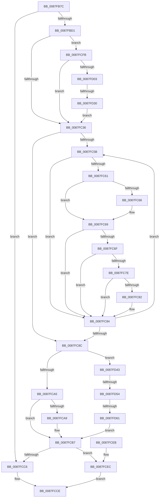

# MiFreeToSubAllocatedRegion

- RVA: `0x0087FB7C`–`0x0087FD74` (길이 `504` bytes)
- VA: `0x000000014087FB7C`
- 실행 섹션: `PAGE`
- PDB 이름 있음: `예`; PDB Function 태그: `예`
- unwind 정보 RVA: `0x0007C350`
- 디코드: `140`개 명령, `504/504` bytes 표시
- 미해석 바이트: `0` (있으면 어셈블리에 `.byte`로 보존)

> 이 문서는 커널 이미지의 기계어와 PDB 기호를 분석해 생성했습니다. 4번과 5번은 함수 원형과 자료형을 바이너리 사용 방식에서 추정한 C 해석이며 원본 소스 복구 결과는 아닙니다.

## 1. Dependencies

- 직접 호출 지점: **7**; 고유 호출 대상: **7**
- 직접 호출자로 확인된 함수: **2**
- RIP 상대 이미지 참조: **0**

### Outgoing calls
- `0x0087FBC3` → [MiLocateLockedVadEvent](../../text/2A/MiLocateLockedVadEvent_function_002A7A0C.md) (function, `0x002A7A0C`)
- `0x0087FBF7` → [LOCK_PAGE_TABLE_COMMITMENT](../../text/2A/LOCK_PAGE_TABLE_COMMITMENT_function_002A6090.md) (function, `0x002A6090`)
- `0x0087FC10` → [RtlClearBitsEx](../../text/29/RtlClearBitsEx_function_00297740.md) (function, `0x00297740`)
- `0x0087FCB2` → [MiDecommitRegion](../88/MiDecommitRegion_function_008807A0.md) (function, `0x008807A0`)
- `0x0087FCBD` → [UNLOCK_PAGE_TABLE_COMMITMENT](../../text/2E/UNLOCK_PAGE_TABLE_COMMITMENT_function_002E27D0.md) (function, `0x002E27D0`)
- `0x0087FCC9` → [MiUnlockAndDereferenceVad](../../text/31/MiUnlockAndDereferenceVad_function_00316E60.md) (function, `0x00316E60`)
- `0x0087FCF4` → [MiDeleteVad](../88/MiDeleteVad_function_00888C80.md) (function, `0x00888C80`)

### Direct callers
- [MmDeleteTeb](MmDeleteTeb_function_0087FAC0.md) at `0x0087FB29`
- [MiAllocateFromSubAllocatedRegion](../98/MiAllocateFromSubAllocatedRegion_function_00981C24.md) at `0x00981EAE`

### Static image references
- 디코드된 RIP-relative 메모리 참조가 없습니다.

## 2. Other-region calls and transfers

- 다른 실행 섹션으로 향하는 call: **5**
  - `0x0087FBC3` → [MiLocateLockedVadEvent](../../text/2A/MiLocateLockedVadEvent_function_002A7A0C.md) (`PAGE` → `.text`)
  - `0x0087FBF7` → [LOCK_PAGE_TABLE_COMMITMENT](../../text/2A/LOCK_PAGE_TABLE_COMMITMENT_function_002A6090.md) (`PAGE` → `.text`)
  - `0x0087FC10` → [RtlClearBitsEx](../../text/29/RtlClearBitsEx_function_00297740.md) (`PAGE` → `.text`)
  - `0x0087FCBD` → [UNLOCK_PAGE_TABLE_COMMITMENT](../../text/2E/UNLOCK_PAGE_TABLE_COMMITMENT_function_002E27D0.md) (`PAGE` → `.text`)
  - `0x0087FCC9` → [MiUnlockAndDereferenceVad](../../text/31/MiUnlockAndDereferenceVad_function_00316E60.md) (`PAGE` → `.text`)
- call이 아닌 외부 분기/꼬리 이동: **3**
  - `0x0087FD2A` → [sub_00B18C56](../B1/Unknown_function_00B18C56.md) (`tail-transfer`)
  - `0x0087FD4E` → [sub_00B18C56](../B1/Unknown_function_00B18C56.md) (`tail-transfer`)
  - `0x0087FD5B` → [sub_00B18C56](../B1/Unknown_function_00B18C56.md) (`tail-transfer`)

## 3. Assembly (complete function range)

```asm
0087FB7C  48 89 5C 24 08                  mov qword ptr [rsp + 8], rbx
0087FB81  48 89 6C 24 10                  mov qword ptr [rsp + 0x10], rbp
0087FB86  48 89 74 24 18                  mov qword ptr [rsp + 0x18], rsi
0087FB8B  57                              push rdi
0087FB8C  41 54                           push r12
0087FB8E  41 55                           push r13
0087FB90  41 56                           push r14
0087FB92  41 57                           push r15
0087FB94  48 83 EC 30                     sub rsp, 0x30
0087FB98  65 4C 8B 24 25 88 01 00 00      mov r12, qword ptr gs:[0x188]
0087FBA1  4D 8B E9                        mov r13, r9
0087FBA4  45 33 C9                        xor r9d, r9d
0087FBA7  4D 8B F8                        mov r15, r8
0087FBAA  48 8B E9                        mov rbp, rcx
0087FBAD  4C 89 4C 24 20                  mov qword ptr [rsp + 0x20], r9
0087FBB2  4D 8B 84 24 B8 00 00 00         mov r8, qword ptr [r12 + 0xb8]
0087FBBA  41 8D 51 40                     lea edx, [r9 + 0x40]
0087FBBE  4C 89 44 24 28                  mov qword ptr [rsp + 0x28], r8
0087FBC3  E8 44 7E A2 FF                  call 0x1402a7a0c
0087FBC8  48 85 C0                        test rax, rax
0087FBCB  0F 84 F5 00 00 00               je 0x14087fcc6
0087FBD1  0F B6 59 20                     movzx ebx, byte ptr [rcx + 0x20]
0087FBD5  4C 8D 70 08                     lea r14, [rax + 8]
0087FBD9  8B 41 18                        mov eax, dword ptr [rcx + 0x18]
0087FBDC  8D 72 C1                        lea esi, [rdx - 0x3f]
0087FBDF  48 C1 E3 20                     shl rbx, 0x20
0087FBE3  49 8D BD FF 0F 00 00            lea rdi, [r13 + 0xfff]
0087FBEA  49 8B D0                        mov rdx, r8
0087FBED  48 C1 EF 0C                     shr rdi, 0xc
0087FBF1  49 8B CC                        mov rcx, r12
0087FBF4  48 0B D8                        or rbx, rax
0087FBF7  E8 94 64 A2 FF                  call 0x1402a6090
0087FBFC  49 8B D7                        mov rdx, r15
0087FBFF  48 C1 E3 0C                     shl rbx, 0xc
0087FC03  48 2B D3                        sub rdx, rbx
0087FC06  4C 8B C7                        mov r8, rdi
0087FC09  48 C1 EA 0C                     shr rdx, 0xc
0087FC0D  49 8B CE                        mov rcx, r14
0087FC10  E8 2B 7B A1 FF                  call 0x140297740
0087FC15  41 8B 46 28                     mov eax, dword ptr [r14 + 0x28]
0087FC19  41 8B 56 2C                     mov edx, dword ptr [r14 + 0x2c]
0087FC1D  2B C7                           sub eax, edi
0087FC1F  8B C8                           mov ecx, eax
0087FC21  48 03 C7                        add rax, rdi
0087FC24  48 8B 7C 24 28                  mov rdi, qword ptr [rsp + 0x28]
0087FC29  41 89 4E 28                     mov dword ptr [r14 + 0x28], ecx
0087FC2D  48 3B C2                        cmp rax, rdx
0087FC30  0F 83 C5 00 00 00               jae 0x14087fcfb
0087FC36  48 8B 4D 38                     mov rcx, qword ptr [rbp + 0x38]
0087FC3A  4D 8D 4D FF                     lea r9, [r13 - 1]
0087FC3E  8B 54 24 24                     mov edx, dword ptr [rsp + 0x24]
0087FC42  45 33 DB                        xor r11d, r11d
0087FC45  45 39 5E 28                     cmp dword ptr [r14 + 0x28], r11d
0087FC49  44 8B 44 24 20                  mov r8d, dword ptr [rsp + 0x20]
0087FC4E  41 0F 94 C2                     sete r10b
0087FC52  4D 03 CF                        add r9, r15
0087FC55  48 83 E1 F0                     and rcx, 0xfffffffffffffff0
0087FC59  74 31                           je 0x14087fc8c
0087FC5B  83 79 50 02                     cmp dword ptr [rcx + 0x50], 2
0087FC5F  75 23                           jne 0x14087fc84
0087FC61  44 3B C6                        cmp r8d, esi
0087FC64  77 03                           ja 0x14087fc69
0087FC66  44 03 C6                        add r8d, esi
0087FC69  4C 3B 79 10                     cmp r15, qword ptr [rcx + 0x10]
0087FC6D  77 15                           ja 0x14087fc84
0087FC6F  48 8B 41 08                     mov rax, qword ptr [rcx + 8]
0087FC73  48 25 00 F0 FF FF               and rax, 0xfffffffffffff000
0087FC79  4C 3B C8                        cmp r9, rax
0087FC7C  72 06                           jb 0x14087fc84
0087FC7E  3B D6                           cmp edx, esi
0087FC80  77 02                           ja 0x14087fc84
0087FC82  03 D6                           add edx, esi
0087FC84  48 8B 09                        mov rcx, qword ptr [rcx]
0087FC87  48 85 C9                        test rcx, rcx
0087FC8A  75 CF                           jne 0x14087fc5b
0087FC8C  44 3B C6                        cmp r8d, esi
0087FC8F  41 0F B6 DA                     movzx ebx, r10b
0087FC93  41 0F 45 DB                     cmovne ebx, r11d
0087FC97  3B D6                           cmp edx, esi
0087FC99  41 0F 45 F3                     cmovne esi, r11d
0087FC9D  84 DB                           test bl, bl
0087FC9F  0F 85 9E 00 00 00               jne 0x14087fd43
0087FCA5  85 F6                           test esi, esi
0087FCA7  74 0E                           je 0x14087fcb7
0087FCA9  4D 8B C1                        mov r8, r9
0087FCAC  49 8B D7                        mov rdx, r15
0087FCAF  48 8B CD                        mov rcx, rbp
0087FCB2  E8 E9 0A 00 00                  call 0x1408807a0
0087FCB7  48 8B D7                        mov rdx, rdi
0087FCBA  49 8B CC                        mov rcx, r12
0087FCBD  E8 0E 2B A6 FF                  call 0x1402e27d0
0087FCC2  84 DB                           test bl, bl
0087FCC4  75 26                           jne 0x14087fcec
0087FCC6  48 8B CD                        mov rcx, rbp
0087FCC9  E8 92 71 A9 FF                  call 0x140316e60
0087FCCE  48 8B 5C 24 60                  mov rbx, qword ptr [rsp + 0x60]
0087FCD3  48 8B 6C 24 68                  mov rbp, qword ptr [rsp + 0x68]
0087FCD8  48 8B 74 24 70                  mov rsi, qword ptr [rsp + 0x70]
0087FCDD  48 83 C4 30                     add rsp, 0x30
0087FCE1  41 5F                           pop r15
0087FCE3  41 5E                           pop r14
0087FCE5  41 5D                           pop r13
0087FCE7  41 5C                           pop r12
0087FCE9  5F                              pop rdi
0087FCEA  C3                              ret
0087FCEB  CC                              int3
0087FCEC  45 33 C0                        xor r8d, r8d
0087FCEF  33 D2                           xor edx, edx
0087FCF1  48 8B CD                        mov rcx, rbp
0087FCF4  E8 87 8F 00 00                  call 0x140888c80
0087FCF9  EB D3                           jmp 0x14087fcce
0087FCFB  3B CA                           cmp ecx, edx
0087FCFD  0F 83 33 FF FF FF               jae 0x14087fc36
0087FD03  41 8B 4E 30                     mov ecx, dword ptr [r14 + 0x30]
0087FD07  49 8D 56 10                     lea rdx, [r14 + 0x10]
0087FD0B  4C 8B 87 10 04 00 00            mov r8, qword ptr [rdi + 0x410]
0087FD12  83 E1 03                        and ecx, 3
0087FD15  48 C1 E1 04                     shl rcx, 4
0087FD19  49 81 C0 08 04 00 00            add r8, 0x408
0087FD20  4C 03 C1                        add r8, rcx
0087FD23  49 8B 00                        mov rax, qword ptr [r8]
0087FD26  4C 39 40 08                     cmp qword ptr [rax + 8], r8
0087FD2A  0F 85 26 8F 29 00               jne 0x140b18c56
0087FD30  48 89 02                        mov qword ptr [rdx], rax
0087FD33  4C 89 42 08                     mov qword ptr [rdx + 8], r8
0087FD37  48 89 50 08                     mov qword ptr [rax + 8], rdx
0087FD3B  49 89 10                        mov qword ptr [r8], rdx
0087FD3E  E9 F3 FE FF FF                  jmp 0x14087fc36
0087FD43  49 8D 46 10                     lea rax, [r14 + 0x10]
0087FD47  48 8B 10                        mov rdx, qword ptr [rax]
0087FD4A  48 39 42 08                     cmp qword ptr [rdx + 8], rax
0087FD4E  0F 85 02 8F 29 00               jne 0x140b18c56
0087FD54  48 8B 48 08                     mov rcx, qword ptr [rax + 8]
0087FD58  48 39 01                        cmp qword ptr [rcx], rax
0087FD5B  0F 85 F5 8E 29 00               jne 0x140b18c56
0087FD61  48 89 11                        mov qword ptr [rcx], rdx
0087FD64  48 89 4A 08                     mov qword ptr [rdx + 8], rcx
0087FD68  4C 89 18                        mov qword ptr [rax], r11
0087FD6B  4D 89 5E 18                     mov qword ptr [r14 + 0x18], r11
0087FD6F  E9 43 FF FF FF                  jmp 0x14087fcb7
```

## 4. C-style interpretation (structured pseudocode)

```c
__int64 __fastcall MiFreeToSubAllocatedRegion(__int64 a1, __int64 a2, __int64 a3, __int64 a4)
{
    __int64 result;
    __int64 v_r10;
    __int64 v_r11;
    __int64 v_rbx;
    __int64 v_rdi;
    __int64 v_rsi;
    __int64 v_rsp;
    unsigned __int64 v_stack_m30;
    unsigned int v_stack_m34;
    unsigned __int64 v_stack_m38;
    unsigned __int64 v_stack_p10;
    unsigned __int64 v_stack_p18;
    unsigned __int64 v_stack_p8;

    v_stack_p8 = v_rbx;
    v_stack_p10 = v_rbp;
    v_stack_p18 = v_rsi;
    v_rsp = (v_rsp) - (48);
    a4 = 0;
    v_stack_m38 = 0;
    v_stack_m30 = *(unsigned __int64 *)(*(unsigned __int64 *)(gs_base + (0 + 392)) + 184);
    result = MiLocateLockedVadEvent(a1, a4 + 64, *(unsigned __int64 *)(*(unsigned __int64 *)(gs_base + (0 + 392)) + 184), a4);
    if (result == 0) goto loc_0087FCC6;
    v_rbx = (*(unsigned __int8 *)(a1 + 32)) << (32);
    v_rdi = (a4 + 4095) >> (12);
    v_rbx = (v_rbx) | ((unsigned int)(*(unsigned int *)(a1 + 24)));
    result = LOCK_PAGE_TABLE_COMMITMENT(*(unsigned __int64 *)(gs_base + (0 + 392)), *(unsigned __int64 *)(*(unsigned __int64 *)(gs_base + (0 + 392)) + 184), *(unsigned __int64 *)(*(unsigned __int64 *)(gs_base + (0 + 392)) + 184), a4);
    v_rbx = (v_rbx) << (12);
    a2 = (a3) - (v_rbx);
    a2 = (a2) >> (12);
    result = RtlClearBitsEx(result + 8, a2, v_rdi, a4);
    result = (unsigned int)(((unsigned int)(*(unsigned int *)(result + 8 + 40))) - ((unsigned int)(v_rdi)));
    result = (result) + (v_rdi);
    *(unsigned int *)(result + 8 + 40) = (unsigned int)((unsigned int)((unsigned int)(result)));
    if (result >= ((unsigned int)(*(unsigned int *)(result + 8 + 44)))) goto loc_0087FCFB;
loc_0087FC36:
    v_r11 = 0;
    v_r10 = ((*(unsigned int *)(result + 8 + 40)) == 0) ? 1 : 0;
    a4 = (a4 - 1) + (a3);
    a1 = (*(unsigned __int64 *)(a1 + 56)) & (-16);
    if (condition_is_equal) goto loc_0087FC8C;
loc_0087FC5B:
    if ((*(unsigned int *)(a1 + 80)) != 2) goto loc_0087FC84;
    if (((unsigned int)((unsigned int)(v_stack_m38))) <= ((unsigned int)(a4 + 64 - 63))) {
        a3 = (unsigned int)(((unsigned int)(v_stack_m38)) + ((unsigned int)(a4 + 64 - 63)));
    }
    if (a3 > (*(unsigned __int64 *)(a1 + 16))) goto loc_0087FC84;
    result = (*(unsigned __int64 *)(a1 + 8)) & (0xFFFFFFFFFFFFF000ULL);
    if (a4 < result) goto loc_0087FC84;
    if (((unsigned int)((unsigned int)(v_stack_m34))) <= ((unsigned int)(a4 + 64 - 63))) {
        a2 = (unsigned int)(((unsigned int)(v_stack_m34)) + ((unsigned int)(a4 + 64 - 63)));
    }
    if (*(unsigned __int64 *)(a1) != 0) goto loc_0087FC5B;
loc_0087FC8C:
    v_rbx = (unsigned __int8)(v_r10);
    if (((unsigned int)(a3)) != ((unsigned int)(a4 + 64 - 63))) { v_rbx = 0; }
    v_rsi = a4 + 64 - 63;
    if (((unsigned int)(a2)) != ((unsigned int)(a4 + 64 - 63))) { v_rsi = 0; }
    if ((unsigned __int8)(v_rbx) != 0) goto loc_0087FD43;
    if ((unsigned int)(v_rsi) != 0) {
        a3 = a4;
        a2 = a3;
        a1 = a1;
        result = MiDecommitRegion(a1, a2, a3, a4);
    }
    result = UNLOCK_PAGE_TABLE_COMMITMENT(*(unsigned __int64 *)(gs_base + (0 + 392)), v_stack_m30, a3, a4);
    if ((unsigned __int8)(v_rbx) != 0) goto loc_0087FCEC;
loc_0087FCC6:
    result = MiUnlockAndDereferenceVad(a1, v_stack_m30, a3, a4);
loc_0087FCCE:
    v_rsp = (v_rsp) + (48);
    return result;
loc_0087FCEC:
    a3 = 0;
    a2 = 0;
    result = MiDeleteVad(v_stack_p10, a2, a3, a4);
    goto loc_0087FCCE;
loc_0087FCFB:
    if (((unsigned int)(v_stack_p10)) >= 0) goto loc_0087FC36;
    a1 = (unsigned int)(((unsigned int)(*(unsigned int *)(result + 8 + 48))) & (3));
    a1 = (a1) << (4);
    a3 = (*(unsigned __int64 *)(v_stack_m30 + 1040)) + (0x408ULL);
    a3 = (a3) + (a1);
    *(unsigned __int64 *)(result + 8 + 16) = *(unsigned __int64 *)(a3);
    *(unsigned __int64 *)(result + 8 + 16 + 8) = a3;
    *(unsigned __int64 *)(*(unsigned __int64 *)(a3) + 8) = result + 8 + 16;
    *(unsigned __int64 *)(a3) = result + 8 + 16;
    goto loc_0087FC36;
loc_0087FD43:
    *(unsigned __int64 *)(*(unsigned __int64 *)(result + 8 + 16 + 8)) = *(unsigned __int64 *)(result + 8 + 16);
    *(unsigned __int64 *)(*(unsigned __int64 *)(result + 8 + 16) + 8) = *(unsigned __int64 *)(result + 8 + 16 + 8);
    *(unsigned __int64 *)(result + 8 + 16) = 0;
    *(unsigned __int64 *)(result + 8 + 24) = 0;
    goto loc_0087FCB7;
}
```

## 5. (Beta) C Style

```c
int64_t MiFreeToSubAllocatedRegion(void *Arg1, int64_t Arg2, int64_t Arg3, void *Arg4)
{
    uint8_t *arg1 = (uint8_t *)Arg1;
    uint8_t *arg4 = (uint8_t *)Arg4;

    int64_t result;
    int64_t local_r10;
    int64_t local_r11;
    int64_t local_rbx;
    int64_t local_rdi;
    int64_t local_rsi;
    int64_t local_rsp;
    uint64_t v_stack_m30;
    uint32_t v_stack_m34;
    uint64_t v_stack_m38;
    uint64_t v_stack_p10;
    uint64_t v_stack_p18;
    uint64_t v_stack_p8;

    v_stack_p8 = local_rbx;
    v_stack_p10 = local_rbp;
    v_stack_p18 = local_rsi;
    local_rsp = (local_rsp) - (48);
    Arg4 = 0;
    v_stack_m38 = 0;
    v_stack_m30 = *(uint64_t *)(*(uint64_t *)(gs_base + (0 + 0x188)) + 0xB8);
    result = MiLocateLockedVadEvent(Arg1, Arg4 + 64, *(uint64_t *)(*(uint64_t *)(gs_base + (0 + 0x188)) + 0xB8), Arg4);
    if (result == 0) goto loc_0087FCC6;
    local_rbx = (*(uint8_t *)(arg1 + 0x20)) << (32);
    local_rdi = (Arg4 + 4095) >> (12);
    local_rbx = (local_rbx) | ((uint32_t)(*(uint32_t *)(arg1 + 0x18)));
    result = LOCK_PAGE_TABLE_COMMITMENT(*(uint64_t *)(gs_base + (0 + 0x188)), *(uint64_t *)(*(uint64_t *)(gs_base + (0 + 0x188)) + 0xB8), *(uint64_t *)(*(uint64_t *)(gs_base + (0 + 0x188)) + 0xB8), Arg4);
    local_rbx = (local_rbx) << (12);
    Arg2 = (Arg3) - (local_rbx);
    Arg2 = (Arg2) >> (12);
    result = RtlClearBitsEx(result + 8, Arg2, local_rdi, Arg4);
    result = (uint32_t)(((uint32_t)(*(uint32_t *)(result + 0x8 + 0x28))) - ((uint32_t)(local_rdi)));
    result = (result) + (local_rdi);
    *(uint32_t *)(result + 0x8 + 0x28) = (uint32_t)((uint32_t)((uint32_t)(result)));
    if (result >= ((uint32_t)(*(uint32_t *)(result + 0x8 + 0x2C)))) goto loc_0087FCFB;
loc_0087FC36:
    local_r11 = 0;
    local_r10 = ((*(uint32_t *)(result + 0x8 + 0x28)) == 0) ? 1 : 0;
    Arg4 = (Arg4 - 1) + (Arg3);
    Arg1 = (*(uint64_t *)(arg1 + 0x38)) & (-16);
    if (condition_is_equal) goto loc_0087FC8C;
loc_0087FC5B:
    if ((*(uint32_t *)(arg1 + 0x50)) != 2) goto loc_0087FC84;
    if (((uint32_t)((uint32_t)(v_stack_m38))) <= ((uint32_t)(Arg4 + 64 - 63))) {
        Arg3 = (uint32_t)(((uint32_t)(v_stack_m38)) + ((uint32_t)(Arg4 + 64 - 63)));
    }
    if (Arg3 > (*(uint64_t *)(arg1 + 0x10))) goto loc_0087FC84;
    result = (*(uint64_t *)(arg1 + 0x8)) & (0xFFFFFFFFFFFFF000ULL);
    if (Arg4 < result) goto loc_0087FC84;
    if (((uint32_t)((uint32_t)(v_stack_m34))) <= ((uint32_t)(Arg4 + 64 - 63))) {
        Arg2 = (uint32_t)(((uint32_t)(v_stack_m34)) + ((uint32_t)(Arg4 + 64 - 63)));
    }
    if (*(uint64_t *)(arg1) != 0) goto loc_0087FC5B;
loc_0087FC8C:
    local_rbx = (uint8_t)(local_r10);
    if (((uint32_t)(Arg3)) != ((uint32_t)(Arg4 + 64 - 63))) { local_rbx = 0; }
    local_rsi = Arg4 + 64 - 63;
    if (((uint32_t)(Arg2)) != ((uint32_t)(Arg4 + 64 - 63))) { local_rsi = 0; }
    if ((uint8_t)(local_rbx) != 0) goto loc_0087FD43;
    if ((uint32_t)(local_rsi) != 0) {
        Arg3 = Arg4;
        Arg2 = Arg3;
        Arg1 = Arg1;
        result = MiDecommitRegion(Arg1, Arg2, Arg3, Arg4);
    }
    result = UNLOCK_PAGE_TABLE_COMMITMENT(*(uint64_t *)(gs_base + (0 + 0x188)), v_stack_m30, Arg3, Arg4);
    if ((uint8_t)(local_rbx) != 0) goto loc_0087FCEC;
loc_0087FCC6:
    result = MiUnlockAndDereferenceVad(Arg1, v_stack_m30, Arg3, Arg4);
loc_0087FCCE:
    local_rsp = (local_rsp) + (48);
    return result;
loc_0087FCEC:
    Arg3 = 0;
    Arg2 = 0;
    result = MiDeleteVad(v_stack_p10, Arg2, Arg3, Arg4);
    goto loc_0087FCCE;
loc_0087FCFB:
    if (((uint32_t)(v_stack_p10)) >= 0) goto loc_0087FC36;
    Arg1 = (uint32_t)(((uint32_t)(*(uint32_t *)(result + 0x8 + 0x30))) & (3));
    Arg1 = (Arg1) << (4);
    Arg3 = (*(uint64_t *)(v_stack_m30 + 0x410)) + (0x408ULL);
    Arg3 = (Arg3) + (Arg1);
    *(uint64_t *)(result + 0x8 + 0x10) = *(uint64_t *)(Arg3);
    *(uint64_t *)(result + 0x8 + 0x10 + 0x8) = Arg3;
    *(uint64_t *)(*(uint64_t *)(Arg3) + 0x8) = result + 8 + 16;
    *(uint64_t *)(Arg3) = result + 8 + 16;
    goto loc_0087FC36;
loc_0087FD43:
    *(uint64_t *)(*(uint64_t *)(result + 0x8 + 0x10 + 0x8)) = *(uint64_t *)(result + 0x8 + 0x10);
    *(uint64_t *)(*(uint64_t *)(result + 0x8 + 0x10) + 0x8) = *(uint64_t *)(result + 0x8 + 0x10 + 0x8);
    *(uint64_t *)(result + 0x8 + 0x10) = 0;
    *(uint64_t *)(result + 0x8 + 0x18) = 0;
    goto loc_0087FCB7;
}
```

### 관측된 메모리 오프셋

구조체 형식이 확인되지 않은 접근은 인자 기준의 오프셋으로만 기록했습니다.

| 기준 인자 | 오프셋 표현 | 폭 (bit) | 접근 |
|---|---:|---:|---|
| `Arg1` | `+ 0x38` | `64` | `R` |
| `Arg4` | `- 0x1` | `64` | `R` |
| `Arg4` | `+ 0xFFF` | `64` | `R` |

## 6. Execution-region graph

[열기: 2D/3D 그래프와 함수 탐색 컨트롤 패널](../../../control-panel.html?section=page&rva=0x0087FB7C&view=graph)

- 2D 그래프는 위에서 아래로 흐르고, 3D 그래프는 빈 공간을 드래그해 회전합니다. Shift+드래그는 이동, 휠은 확대·축소, 함수 노드 선택은 대상 보고서 이동입니다.

### Static fallback


