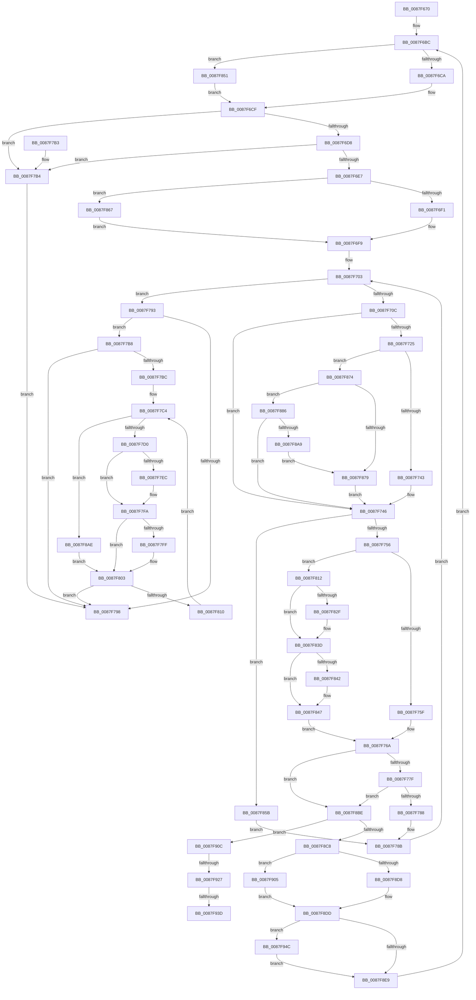

# MiLockVadRange

- RVA: `0x0087F670`–`0x0087F953` (길이 `739` bytes)
- VA: `0x000000014087F670`
- 실행 섹션: `PAGE`
- PDB 이름 있음: `예`; PDB Function 태그: `예`
- unwind 정보 RVA: `0x0007C2C8`
- 디코드: `201`개 명령, `739/739` bytes 표시
- 미해석 바이트: `0` (있으면 어셈블리에 `.byte`로 보존)

> 이 문서는 커널 이미지의 기계어와 PDB 기호를 분석해 생성했습니다. 4번과 5번은 함수 원형과 자료형을 바이너리 사용 방식에서 추정한 C 해석이며 원본 소스 복구 결과는 아닙니다.

## 1. Dependencies

- 직접 호출 지점: **22**; 고유 호출 대상: **16**
- 직접 호출자로 확인된 함수: **5**
- RIP 상대 이미지 참조: **0**

### Outgoing calls
- `0x0087F6CA` → [LOCK_ADDRESS_SPACE_SHARED](../../text/2A/LOCK_ADDRESS_SPACE_SHARED_function_002A8B3C.md) (function, `0x002A8B3C`)
- `0x0087F6F4` → [MiLocateAddress](../../text/31/MiLocateAddress_function_003168D0.md) (function, `0x003168D0`)
- `0x0087F70F` → [MiGetNextVad](../../text/29/MiGetNextVad_function_00297224.md) (function, `0x00297224`)
- `0x0087F749` → [MiVadIsMetadataBitmap](MiVadIsMetadataBitmap_function_0087F95C.md) (function, `0x0087F95C`)
- `0x0087F765` → [MiLockVad](../../text/29/MiLockVad_function_00295810.md) (function, `0x00295810`)
- `0x0087F76D` → [MiVadDeleted](../../text/43/MiVadDeleted_function_00431350.md) (function, `0x00431350`)
- `0x0087F7DC` → [KeAbPreAcquire](../../text/21/KeAbPreAcquire_function_00210230.md) (function, `0x00210230`)
- `0x0087F7F5` → [ExfAcquirePushLockExclusiveEx](../../text/20/ExfAcquirePushLockExclusiveEx_function_0020FC90.md) (function, `0x0020FC90`)
- `0x0087F81E` → [KeAbPreAcquire](../../text/21/KeAbPreAcquire_function_00210230.md) (function, `0x00210230`)
- `0x0087F838` → [ExfAcquirePushLockExclusiveEx](../../text/20/ExfAcquirePushLockExclusiveEx_function_0020FC90.md) (function, `0x0020FC90`)
- `0x0087F851` → [LOCK_ADDRESS_SPACE](../../text/2A/LOCK_ADDRESS_SPACE_function_002A4944.md) (function, `0x002A4944`)
- `0x0087F86A` → [MiGetFirstVad](../../text/2A/MiGetFirstVad_function_002A8BBC.md) (function, `0x002A8BBC`)
- `0x0087F8B4` → [MiLockVad](../../text/29/MiLockVad_function_00295810.md) (function, `0x00295810`)
- `0x0087F8BE` → [MiReferenceVad](../../text/29/MiReferenceVad_function_00295890.md) (function, `0x00295890`)
- `0x0087F8D8` → [UNLOCK_ADDRESS_SPACE](../../text/2A/UNLOCK_ADDRESS_SPACE_function_002A4844.md) (function, `0x002A4844`)
- `0x0087F8E0` → [MiVadDeleted](../../text/43/MiVadDeleted_function_00431350.md) (function, `0x00431350`)
- `0x0087F8EC` → [MiUnlockAndDereferenceVad](../../text/31/MiUnlockAndDereferenceVad_function_00316E60.md) (function, `0x00316E60`)
- `0x0087F905` → [UNLOCK_ADDRESS_SPACE_SHARED_UNORDERED](../../text/4F/UNLOCK_ADDRESS_SPACE_SHARED_UNORDERED_function_004F8924.md) (function, `0x004F8924`)
- `0x0087F90F` → [MiGetNextVad](../../text/29/MiGetNextVad_function_00297224.md) (function, `0x00297224`)
- `0x0087F91A` → [MiVadIsMetadataBitmap](MiVadIsMetadataBitmap_function_0087F95C.md) (function, `0x0087F95C`)
- `0x0087F941` → [ExfTryToWakePushLock](../../text/26/ExfTryToWakePushLock_function_00265DD0.md) (function, `0x00265DD0`)
- `0x0087F94C` → [MiWaitForVadDeletion](../../text/31/MiWaitForVadDeletion_function_00316F1C.md) (function, `0x00316F1C`)

### Direct callers
- [NtLockVirtualMemory](../../text/40/NtLockVirtualMemory_function_004088A0.md) at `0x00408A43`
- [NtUnlockVirtualMemory](../../text/4E/NtUnlockVirtualMemory_function_004EE890.md) at `0x004EE9A8`
- [MmAssignProcessToJob](MmAssignProcessToJob_function_0087EEF8.md) at `0x0087EF6D`
- [MiCoalescePlaceholderAllocations](../88/MiCoalescePlaceholderAllocations_function_0088095C.md) at `0x0088099C`
- [MiCloneProcessAddressSpace](../AD/MiCloneProcessAddressSpace_function_00AD6F7C.md) at `0x00AD7055`

### Static image references
- 디코드된 RIP-relative 메모리 참조가 없습니다.

## 2. Other-region calls and transfers

- 다른 실행 섹션으로 향하는 call: **20**
  - `0x0087F6CA` → [LOCK_ADDRESS_SPACE_SHARED](../../text/2A/LOCK_ADDRESS_SPACE_SHARED_function_002A8B3C.md) (`PAGE` → `.text`)
  - `0x0087F6F4` → [MiLocateAddress](../../text/31/MiLocateAddress_function_003168D0.md) (`PAGE` → `.text`)
  - `0x0087F70F` → [MiGetNextVad](../../text/29/MiGetNextVad_function_00297224.md) (`PAGE` → `.text`)
  - `0x0087F765` → [MiLockVad](../../text/29/MiLockVad_function_00295810.md) (`PAGE` → `.text`)
  - `0x0087F76D` → [MiVadDeleted](../../text/43/MiVadDeleted_function_00431350.md) (`PAGE` → `.text`)
  - `0x0087F7DC` → [KeAbPreAcquire](../../text/21/KeAbPreAcquire_function_00210230.md) (`PAGE` → `.text`)
  - `0x0087F7F5` → [ExfAcquirePushLockExclusiveEx](../../text/20/ExfAcquirePushLockExclusiveEx_function_0020FC90.md) (`PAGE` → `.text`)
  - `0x0087F81E` → [KeAbPreAcquire](../../text/21/KeAbPreAcquire_function_00210230.md) (`PAGE` → `.text`)
  - `0x0087F838` → [ExfAcquirePushLockExclusiveEx](../../text/20/ExfAcquirePushLockExclusiveEx_function_0020FC90.md) (`PAGE` → `.text`)
  - `0x0087F851` → [LOCK_ADDRESS_SPACE](../../text/2A/LOCK_ADDRESS_SPACE_function_002A4944.md) (`PAGE` → `.text`)
  - `0x0087F86A` → [MiGetFirstVad](../../text/2A/MiGetFirstVad_function_002A8BBC.md) (`PAGE` → `.text`)
  - `0x0087F8B4` → [MiLockVad](../../text/29/MiLockVad_function_00295810.md) (`PAGE` → `.text`)
  - `0x0087F8BE` → [MiReferenceVad](../../text/29/MiReferenceVad_function_00295890.md) (`PAGE` → `.text`)
  - `0x0087F8D8` → [UNLOCK_ADDRESS_SPACE](../../text/2A/UNLOCK_ADDRESS_SPACE_function_002A4844.md) (`PAGE` → `.text`)
  - `0x0087F8E0` → [MiVadDeleted](../../text/43/MiVadDeleted_function_00431350.md) (`PAGE` → `.text`)
  - `0x0087F8EC` → [MiUnlockAndDereferenceVad](../../text/31/MiUnlockAndDereferenceVad_function_00316E60.md) (`PAGE` → `.text`)
  - `0x0087F905` → [UNLOCK_ADDRESS_SPACE_SHARED_UNORDERED](../../text/4F/UNLOCK_ADDRESS_SPACE_SHARED_UNORDERED_function_004F8924.md) (`PAGE` → `.text`)
  - `0x0087F90F` → [MiGetNextVad](../../text/29/MiGetNextVad_function_00297224.md) (`PAGE` → `.text`)
  - `0x0087F941` → [ExfTryToWakePushLock](../../text/26/ExfTryToWakePushLock_function_00265DD0.md) (`PAGE` → `.text`)
  - `0x0087F94C` → [MiWaitForVadDeletion](../../text/31/MiWaitForVadDeletion_function_00316F1C.md) (`PAGE` → `.text`)
- call이 아닌 외부 분기/꼬리 이동: **3**
  - `0x0087F921` → [sub_00B18BC4 + 0x9](../B1/Unknown_function_00B18BC4.md) (`tail-transfer`)
  - `0x0087F937` → [sub_00B18BC4](../B1/Unknown_function_00B18BC4.md) (`tail-transfer`)
  - `0x0087F947` → [sub_00B18BC4](../B1/Unknown_function_00B18BC4.md) (`tail-transfer`)

## 3. Assembly (complete function range)

```asm
0087F670  48 8B C4                        mov rax, rsp
0087F673  48 89 58 08                     mov qword ptr [rax + 8], rbx
0087F677  44 89 48 20                     mov dword ptr [rax + 0x20], r9d
0087F67B  4C 89 40 18                     mov qword ptr [rax + 0x18], r8
0087F67F  48 89 50 10                     mov qword ptr [rax + 0x10], rdx
0087F683  55                              push rbp
0087F684  56                              push rsi
0087F685  57                              push rdi
0087F686  41 54                           push r12
0087F688  41 55                           push r13
0087F68A  41 56                           push r14
0087F68C  41 57                           push r15
0087F68E  48 83 EC 40                     sub rsp, 0x40
0087F692  65 4C 8B 3C 25 88 01 00 00      mov r15, qword ptr gs:[0x188]
0087F69B  0F 57 C0                        xorps xmm0, xmm0
0087F69E  41 BC 01 00 00 00               mov r12d, 1
0087F6A4  4C 89 7C 24 28                  mov qword ptr [rsp + 0x28], r15
0087F6A9  0F 11 44 24 30                  movups xmmword ptr [rsp + 0x30], xmm0
0087F6AE  44 89 64 24 20                  mov dword ptr [rsp + 0x20], r12d
0087F6B3  41 8B C1                        mov eax, r9d
0087F6B6  48 8B DA                        mov rbx, rdx
0087F6B9  4C 8B E9                        mov r13, rcx
0087F6BC  49 8B D5                        mov rdx, r13
0087F6BF  49 8B CF                        mov rcx, r15
0087F6C2  85 C0                           test eax, eax
0087F6C4  0F 85 87 01 00 00               jne 0x14087f851
0087F6CA  E8 6D 94 A2 FF                  call 0x1402a8b3c
0087F6CF  45 85 E4                        test r12d, r12d
0087F6D2  0F 84 DC 00 00 00               je 0x14087f7b4
0087F6D8  41 8B 85 F4 01 00 00            mov eax, dword ptr [r13 + 0x1f4]
0087F6DF  A8 20                           test al, 0x20
0087F6E1  0F 85 CD 00 00 00               jne 0x14087f7b4
0087F6E7  48 83 FB FF                     cmp rbx, -1
0087F6EB  0F 84 76 01 00 00               je 0x14087f867
0087F6F1  48 8B CB                        mov rcx, rbx
0087F6F4  E8 D7 71 A9 FF                  call 0x1403168d0
0087F6F9  33 FF                           xor edi, edi
0087F6FB  48 8B F0                        mov rsi, rax
0087F6FE  33 ED                           xor ebp, ebp
0087F700  48 8B D8                        mov rbx, rax
0087F703  48 85 DB                        test rbx, rbx
0087F706  0F 84 87 00 00 00               je 0x14087f793
0087F70C  48 8B CB                        mov rcx, rbx
0087F70F  E8 10 7B A1 FF                  call 0x140297224
0087F714  4C 8B F0                        mov r14, rax
0087F717  48 8B 84 24 90 00 00 00         mov rax, qword ptr [rsp + 0x90]
0087F71F  48 83 F8 FF                     cmp rax, -1
0087F723  74 21                           je 0x14087f746
0087F725  0F B6 53 21                     movzx edx, byte ptr [rbx + 0x21]
0087F729  44 8B 43 1C                     mov r8d, dword ptr [rbx + 0x1c]
0087F72D  8B CA                           mov ecx, edx
0087F72F  48 C1 E1 20                     shl rcx, 0x20
0087F733  49 0B C8                        or rcx, r8
0087F736  48 C1 E1 0C                     shl rcx, 0xc
0087F73A  48 3B C1                        cmp rax, rcx
0087F73D  0F 87 31 01 00 00               ja 0x14087f874
0087F743  45 33 F6                        xor r14d, r14d
0087F746  48 8B CB                        mov rcx, rbx
0087F749  E8 0E 02 00 00                  call 0x14087f95c
0087F74E  85 C0                           test eax, eax
0087F750  0F 85 05 01 00 00               jne 0x14087f85b
0087F756  48 85 FF                        test rdi, rdi
0087F759  0F 85 B3 00 00 00               jne 0x14087f812
0087F75F  48 8B D3                        mov rdx, rbx
0087F762  49 8B CF                        mov rcx, r15
0087F765  E8 A6 60 A1 FF                  call 0x140295810
0087F76A  48 8B CB                        mov rcx, rbx
0087F76D  E8 DE 1B BB FF                  call 0x140431350
0087F772  44 8B 64 24 20                  mov r12d, dword ptr [rsp + 0x20]
0087F777  85 C0                           test eax, eax
0087F779  0F 85 3F 01 00 00               jne 0x14087f8be
0087F77F  45 85 E4                        test r12d, r12d
0087F782  0F 84 36 01 00 00               je 0x14087f8be
0087F788  48 FF C7                        inc rdi
0087F78B  49 8B DE                        mov rbx, r14
0087F78E  E9 70 FF FF FF                  jmp 0x14087f703
0087F793  45 85 E4                        test r12d, r12d
0087F796  75 20                           jne 0x14087f7b8
0087F798  48 8B 9C 24 80 00 00 00         mov rbx, qword ptr [rsp + 0x80]
0087F7A0  48 8B C7                        mov rax, rdi
0087F7A3  48 83 C4 40                     add rsp, 0x40
0087F7A7  41 5F                           pop r15
0087F7A9  41 5E                           pop r14
0087F7AB  41 5D                           pop r13
0087F7AD  41 5C                           pop r12
0087F7AF  5F                              pop rdi
0087F7B0  5E                              pop rsi
0087F7B1  5D                              pop rbp
0087F7B2  C3                              ret
0087F7B3  CC                              int3
0087F7B4  33 FF                           xor edi, edi
0087F7B6  EB E0                           jmp 0x14087f798
0087F7B8  85 ED                           test ebp, ebp
0087F7BA  74 DC                           je 0x14087f798
0087F7BC  48 8D 74 24 30                  lea rsi, [rsp + 0x30]
0087F7C1  44 8B F5                        mov r14d, ebp
0087F7C4  48 8B 1E                        mov rbx, qword ptr [rsi]
0087F7C7  48 85 FF                        test rdi, rdi
0087F7CA  0F 84 DE 00 00 00               je 0x14087f8ae
0087F7D0  48 83 C3 28                     add rbx, 0x28
0087F7D4  45 33 C0                        xor r8d, r8d
0087F7D7  48 8B CB                        mov rcx, rbx
0087F7DA  33 D2                           xor edx, edx
0087F7DC  E8 4F 0A 99 FF                  call 0x140210230
0087F7E1  F0 48 0F BA 2B 00               lock bts qword ptr [rbx], 0
0087F7E7  48 8B E8                        mov rbp, rax
0087F7EA  73 0E                           jae 0x14087f7fa
0087F7EC  4C 8B C3                        mov r8, rbx
0087F7EF  48 8B D0                        mov rdx, rax
0087F7F2  48 8B CB                        mov rcx, rbx
0087F7F5  E8 96 04 99 FF                  call 0x14020fc90
0087F7FA  48 85 ED                        test rbp, rbp
0087F7FD  74 04                           je 0x14087f803
0087F7FF  C6 45 0A 01                     mov byte ptr [rbp + 0xa], 1
0087F803  48 FF C7                        inc rdi
0087F806  48 83 C6 08                     add rsi, 8
0087F80A  49 83 EE 01                     sub r14, 1
0087F80E  74 88                           je 0x14087f798
0087F810  EB B2                           jmp 0x14087f7c4
0087F812  4C 8D 63 28                     lea r12, [rbx + 0x28]
0087F816  45 33 C0                        xor r8d, r8d
0087F819  49 8B CC                        mov rcx, r12
0087F81C  33 D2                           xor edx, edx
0087F81E  E8 0D 0A 99 FF                  call 0x140210230
0087F823  F0 49 0F BA 2C 24 00            lock bts qword ptr [r12], 0
0087F82A  4C 8B F8                        mov r15, rax
0087F82D  73 0E                           jae 0x14087f83d
0087F82F  4D 8B C4                        mov r8, r12
0087F832  48 8B D0                        mov rdx, rax
0087F835  49 8B CC                        mov rcx, r12
0087F838  E8 53 04 99 FF                  call 0x14020fc90
0087F83D  4D 85 FF                        test r15, r15
0087F840  74 05                           je 0x14087f847
0087F842  41 C6 47 0A 01                  mov byte ptr [r15 + 0xa], 1
0087F847  4C 8B 7C 24 28                  mov r15, qword ptr [rsp + 0x28]
0087F84C  E9 19 FF FF FF                  jmp 0x14087f76a
0087F851  E8 EE 50 A2 FF                  call 0x1402a4944
0087F856  E9 74 FE FF FF                  jmp 0x14087f6cf
0087F85B  48 89 5C EC 30                  mov qword ptr [rsp + rbp*8 + 0x30], rbx
0087F860  FF C5                           inc ebp
0087F862  E9 24 FF FF FF                  jmp 0x14087f78b
0087F867  49 8B CD                        mov rcx, r13
0087F86A  E8 4D 93 A2 FF                  call 0x1402a8bbc
0087F86F  E9 85 FE FF FF                  jmp 0x14087f6f9
0087F874  4D 85 F6                        test r14, r14
0087F877  75 0D                           jne 0x14087f886
0087F879  45 33 E4                        xor r12d, r12d
0087F87C  44 89 64 24 20                  mov dword ptr [rsp + 0x20], r12d
0087F881  E9 C0 FE FF FF                  jmp 0x14087f746
0087F886  41 0F B6 4E 20                  movzx ecx, byte ptr [r14 + 0x20]
0087F88B  41 8B 46 18                     mov eax, dword ptr [r14 + 0x18]
0087F88F  48 C1 E2 20                     shl rdx, 0x20
0087F893  48 C1 E1 20                     shl rcx, 0x20
0087F897  49 0B D0                        or rdx, r8
0087F89A  48 0B C8                        or rcx, rax
0087F89D  48 FF C2                        inc rdx
0087F8A0  48 3B D1                        cmp rdx, rcx
0087F8A3  0F 84 9D FE FF FF               je 0x14087f746
0087F8A9  45 33 F6                        xor r14d, r14d
0087F8AC  EB CB                           jmp 0x14087f879
0087F8AE  48 8B D3                        mov rdx, rbx
0087F8B1  49 8B CF                        mov rcx, r15
0087F8B4  E8 57 5F A1 FF                  call 0x140295810
0087F8B9  E9 45 FF FF FF                  jmp 0x14087f803
0087F8BE  E8 CD 5F A1 FF                  call 0x140295890
0087F8C3  48 3B F3                        cmp rsi, rbx
0087F8C6  75 44                           jne 0x14087f90c
0087F8C8  83 BC 24 98 00 00 00 00         cmp dword ptr [rsp + 0x98], 0
0087F8D0  49 8B D5                        mov rdx, r13
0087F8D3  49 8B CF                        mov rcx, r15
0087F8D6  74 2D                           je 0x14087f905
0087F8D8  E8 67 4F A2 FF                  call 0x1402a4844
0087F8DD  48 8B CB                        mov rcx, rbx
0087F8E0  E8 6B 1A BB FF                  call 0x140431350
0087F8E5  85 C0                           test eax, eax
0087F8E7  75 63                           jne 0x14087f94c
0087F8E9  48 8B CB                        mov rcx, rbx
0087F8EC  E8 6F 75 A9 FF                  call 0x140316e60
0087F8F1  8B 84 24 98 00 00 00            mov eax, dword ptr [rsp + 0x98]
0087F8F8  48 8B 9C 24 88 00 00 00         mov rbx, qword ptr [rsp + 0x88]
0087F900  E9 B7 FD FF FF                  jmp 0x14087f6bc
0087F905  E8 1A 90 C7 FF                  call 0x1404f8924
0087F90A  EB D1                           jmp 0x14087f8dd
0087F90C  48 8B CE                        mov rcx, rsi
0087F90F  E8 10 79 A1 FF                  call 0x140297224
0087F914  48 8B CE                        mov rcx, rsi
0087F917  48 8B F8                        mov rdi, rax
0087F91A  E8 3D 00 00 00                  call 0x14087f95c
0087F91F  85 C0                           test eax, eax
0087F921  0F 85 A6 92 29 00               jne 0x140b18bcd
0087F927  48 83 CA FF                     or rdx, 0xffffffffffffffff
0087F92B  F0 48 0F C1 56 28               lock xadd qword ptr [rsi + 0x28], rdx
0087F931  80 E2 06                        and dl, 6
0087F934  80 FA 02                        cmp dl, 2
0087F937  0F 85 87 92 29 00               jne 0x140b18bc4
0087F93D  48 8D 4E 28                     lea rcx, [rsi + 0x28]
0087F941  E8 8A 64 9E FF                  call 0x140265dd0
0087F946  90                              nop
0087F947  E9 78 92 29 00                  jmp 0x140b18bc4
0087F94C  E8 CB 75 A9 FF                  call 0x140316f1c
0087F951  EB 96                           jmp 0x14087f8e9
```

## 4. C-style interpretation (structured pseudocode)

```c
__int64 __fastcall MiLockVadRange(__int64 a1, __int64 a2, __int64 a3, int a4)
{
    __int64 result;
    __int64 v_r12;
    __int64 v_r14;
    __int64 v_rbp;
    __int64 v_rbx;
    __int64 v_rdi;
    __int64 v_rsi;
    __int64 v_rsp;
    unsigned __int64 v_stack_m48;
    unsigned __int64 v_stack_m50;
    unsigned int v_stack_m58;
    unsigned __int64 v_stack_p18;
    unsigned int v_stack_p20;
    unsigned __int64 v_stack_p28;
    unsigned __int64 v_stack_p30;
    unsigned __int64 v_stack_p8;
    unsigned __int64 v_stack_p88;
    unsigned int v_stack_p98;

    *(unsigned __int64 *)(v_rsp + 8) = v_rbx;
    *(unsigned int *)(v_rsp + 32) = a4;
    *(unsigned __int64 *)(v_rsp + 24) = a3;
    *(unsigned __int64 *)(v_rsp + 16) = a2;
    v_rsp = (v_rsp) - (64);
    v_stack_m50 = *(unsigned __int64 *)(gs_base + (0 + 392));
    v_stack_m48 = v_xmm0;
    v_stack_m58 = 1;
loc_0087F6BC:
    if ((unsigned int)((unsigned int)(a4)) != 0) goto loc_0087F851;
    result = LOCK_ADDRESS_SPACE_SHARED(*(unsigned __int64 *)(gs_base + (0 + 392)), a1, a3, a4);
loc_0087F6CF:
    if (1 == 0) goto loc_0087F7B4;
    if ((((unsigned __int8)((unsigned int)(*(unsigned int *)(a1 + 500)))) & (32)) != 0) goto loc_0087F7B4;
    if (a2 == -1) goto loc_0087F867;
    result = MiLocateAddress(a2, a1, a3, a4);
loc_0087F6F9:
    v_rdi = 0;
    v_rbp = 0;
loc_0087F703:
    if (result == 0) goto loc_0087F793;
    result = MiGetNextVad(result, a1, a3, a4);
    if (v_stack_p18 == -1) goto loc_0087F746;
    a1 = ((unsigned int)((unsigned int)(*(unsigned __int8 *)(result + 33)))) << (32);
    a1 = (a1) | ((unsigned int)(*(unsigned int *)(result + 28)));
    a1 = (a1) << (12);
    if (v_stack_p18 > a1) goto loc_0087F874;
    v_r14 = 0;
loc_0087F746:
    result = MiVadIsMetadataBitmap(result, *(unsigned __int8 *)(result + 33), (unsigned int)(*(unsigned int *)(result + 28)), a4);
    if ((unsigned int)(result) != 0) goto loc_0087F85B;
    if (0 != 0) goto loc_0087F812;
    result = MiLockVad(*(unsigned __int64 *)(gs_base + (0 + 392)), result, (unsigned int)(*(unsigned int *)(result + 28)), a4);
loc_0087F76A:
    result = MiVadDeleted(result, result, (unsigned int)(*(unsigned int *)(result + 28)), a4);
    if ((unsigned int)(result) != 0) goto loc_0087F8BE;
    if ((unsigned int)((unsigned int)(v_stack_m58)) == 0) goto loc_0087F8BE;
    v_rdi = (v_rdi) + 1;
loc_0087F78B:
    goto loc_0087F703;
loc_0087F793:
    if ((unsigned int)((unsigned int)(v_stack_m58)) != 0) goto loc_0087F7B8;
loc_0087F798:
    v_rsp = (v_rsp) + (64);
    return v_rdi;
loc_0087F7B4:
    v_rdi = 0;
    goto loc_0087F798;
loc_0087F7B8:
    if (0 == 0) goto loc_0087F798;
loc_0087F7C4:
    if (0 == 0) goto loc_0087F8AE;
    v_rbx = (*(unsigned __int64 *)(v_stack_p30)) + (40);
    a3 = 0;
    a2 = 0;
    result = KeAbPreAcquire(v_rbx, a2, a3, a4);
    if (!(condition_is_above_or_equal)) {
        a3 = v_rbx;
        a2 = result;
        a1 = v_rbx;
        result = ExfAcquirePushLockExclusiveEx(a1, a2, a3, a4);
    }
    if (result != 0) {
        *(unsigned __int8 *)(result + 10) = 1;
    }
    v_rdi = (v_rdi) + 1;
    v_rsi = (v_stack_p30) + (8);
    v_r14 = (0) - (1);
    if (condition_is_equal) goto loc_0087F798;
    goto loc_0087F7C4;
loc_0087F812:
    a3 = 0;
    a2 = 0;
    result = KeAbPreAcquire(v_rbx + 40, a2, a3, a4);
    if (!(condition_is_above_or_equal)) {
        a3 = v_rbx + 40;
        a2 = result;
        a1 = v_rbx + 40;
        result = ExfAcquirePushLockExclusiveEx(a1, a2, a3, a4);
    }
    if (result != 0) {
        *(unsigned __int8 *)(result + 10) = 1;
    }
    goto loc_0087F76A;
loc_0087F851:
    result = LOCK_ADDRESS_SPACE(a1, a2, a3, a4);
    goto loc_0087F6CF;
loc_0087F85B:
    *(unsigned __int64 *)(v_rsp + result * 8 + 48) = v_rbx;
    v_rbp = (unsigned int)((result) + 1);
    goto loc_0087F78B;
loc_0087F867:
    result = MiGetFirstVad(a1, a2, a3, a4);
    goto loc_0087F6F9;
loc_0087F874:
    if (v_r14 != 0) goto loc_0087F886;
loc_0087F879:
    v_r12 = 0;
    v_stack_p20 = 0;
    goto loc_0087F746;
loc_0087F886:
    a2 = (a2) << (32);
    a1 = (*(unsigned __int8 *)(v_r14 + 32)) << (32);
    a2 = (a2) | (a3);
    a1 = (a1) | ((unsigned int)(*(unsigned int *)(v_r14 + 24)));
    a2 = (a2) + 1;
    if (a2 == a1) goto loc_0087F746;
    v_r14 = 0;
    goto loc_0087F879;
loc_0087F8AE:
    result = MiLockVad(v_stack_p28, v_rbx, a3, a4);
    goto loc_0087F803;
loc_0087F8BE:
    result = MiReferenceVad(v_stack_p28, v_rbx, a3, a4);
    if (v_rsi != v_rbx) goto loc_0087F90C;
    if (v_stack_p98 == 0) goto loc_0087F905;
    result = UNLOCK_ADDRESS_SPACE(v_stack_p28, a1, a3, a4);
loc_0087F8DD:
    result = MiVadDeleted(v_rbx, a1, a3, a4);
    if ((unsigned int)(result) != 0) goto loc_0087F94C;
loc_0087F8E9:
    result = MiUnlockAndDereferenceVad(v_rbx, a1, a3, a4);
    goto loc_0087F6BC;
loc_0087F905:
    result = UNLOCK_ADDRESS_SPACE_SHARED_UNORDERED(v_rbx, a1, a3, a4);
    goto loc_0087F8DD;
loc_0087F90C:
    result = MiGetNextVad(v_rsi, a1, a3, a4);
    result = MiVadIsMetadataBitmap(v_rsi, a1, a3, a4);
    a2 = (a1) | (-1);
    a2 = (unsigned __int8)((a2) & (6));
    result = ExfTryToWakePushLock(v_rsi + 40, a2, a3, a4);
loc_0087F94C:
    result = MiWaitForVadDeletion(v_rsi + 40, a2, a3, a4);
    goto loc_0087F8E9;
}
```

## 5. (Beta) C Style

```c
int64_t MiLockVadRange(void *Arg1, int64_t Arg2, int64_t Arg3, int32_t Arg4)
{
    uint8_t *arg1 = (uint8_t *)Arg1;

    int64_t result;
    int64_t local_r12;
    int64_t local_r14;
    int64_t local_rbp;
    int64_t local_rbx;
    int64_t local_rdi;
    int64_t local_rsi;
    int64_t local_rsp;
    uint64_t v_stack_m48;
    uint64_t v_stack_m50;
    uint32_t v_stack_m58;
    uint64_t v_stack_p18;
    uint32_t v_stack_p20;
    uint64_t v_stack_p28;
    uint64_t v_stack_p30;
    uint64_t v_stack_p8;
    uint64_t v_stack_p88;
    uint32_t v_stack_p98;

    *(uint64_t *)(local_rsp + 0x8) = local_rbx;
    *(uint32_t *)(local_rsp + 0x20) = Arg4;
    *(uint64_t *)(local_rsp + 0x18) = Arg3;
    *(uint64_t *)(local_rsp + 0x10) = Arg2;
    local_rsp = (local_rsp) - (64);
    v_stack_m50 = *(uint64_t *)(gs_base + (0 + 0x188));
    v_stack_m48 = v_xmm0;
    v_stack_m58 = 1;
loc_0087F6BC:
    if ((uint32_t)((uint32_t)(Arg4)) != 0) goto loc_0087F851;
    result = LOCK_ADDRESS_SPACE_SHARED(*(uint64_t *)(gs_base + (0 + 0x188)), Arg1, Arg3, Arg4);
loc_0087F6CF:
    if (1 == 0) goto loc_0087F7B4;
    if ((((uint8_t)((uint32_t)(*(uint32_t *)(arg1 + 0x1F4)))) & (32)) != 0) goto loc_0087F7B4;
    if (Arg2 == -1) goto loc_0087F867;
    result = MiLocateAddress(Arg2, Arg1, Arg3, Arg4);
loc_0087F6F9:
    local_rdi = 0;
    local_rbp = 0;
loc_0087F703:
    if (result == 0) goto loc_0087F793;
    result = MiGetNextVad(result, Arg1, Arg3, Arg4);
    if (v_stack_p18 == -1) goto loc_0087F746;
    Arg1 = ((uint32_t)((uint32_t)(*(uint8_t *)(result + 0x21)))) << (32);
    Arg1 = (Arg1) | ((uint32_t)(*(uint32_t *)(result + 0x1C)));
    Arg1 = (Arg1) << (12);
    if (v_stack_p18 > Arg1) goto loc_0087F874;
    local_r14 = 0;
loc_0087F746:
    result = MiVadIsMetadataBitmap(result, *(uint8_t *)(result + 0x21), (uint32_t)(*(uint32_t *)(result + 0x1C)), Arg4);
    if ((uint32_t)(result) != 0) goto loc_0087F85B;
    if (0 != 0) goto loc_0087F812;
    result = MiLockVad(*(uint64_t *)(gs_base + (0 + 0x188)), result, (uint32_t)(*(uint32_t *)(result + 0x1C)), Arg4);
loc_0087F76A:
    result = MiVadDeleted(result, result, (uint32_t)(*(uint32_t *)(result + 0x1C)), Arg4);
    if ((uint32_t)(result) != 0) goto loc_0087F8BE;
    if ((uint32_t)((uint32_t)(v_stack_m58)) == 0) goto loc_0087F8BE;
    local_rdi = (local_rdi) + 1;
loc_0087F78B:
    goto loc_0087F703;
loc_0087F793:
    if ((uint32_t)((uint32_t)(v_stack_m58)) != 0) goto loc_0087F7B8;
loc_0087F798:
    local_rsp = (local_rsp) + (64);
    return local_rdi;
loc_0087F7B4:
    local_rdi = 0;
    goto loc_0087F798;
loc_0087F7B8:
    if (0 == 0) goto loc_0087F798;
loc_0087F7C4:
    if (0 == 0) goto loc_0087F8AE;
    local_rbx = (*(uint64_t *)(v_stack_p30)) + (40);
    Arg3 = 0;
    Arg2 = 0;
    result = KeAbPreAcquire(local_rbx, Arg2, Arg3, Arg4);
    if (!(condition_is_above_or_equal)) {
        Arg3 = local_rbx;
        Arg2 = result;
        Arg1 = local_rbx;
        result = ExfAcquirePushLockExclusiveEx(Arg1, Arg2, Arg3, Arg4);
    }
    if (result != 0) {
        *(uint8_t *)(result + 0xA) = 1;
    }
    local_rdi = (local_rdi) + 1;
    local_rsi = (v_stack_p30) + (8);
    local_r14 = (0) - (1);
    if (condition_is_equal) goto loc_0087F798;
    goto loc_0087F7C4;
loc_0087F812:
    Arg3 = 0;
    Arg2 = 0;
    result = KeAbPreAcquire(local_rbx + 40, Arg2, Arg3, Arg4);
    if (!(condition_is_above_or_equal)) {
        Arg3 = local_rbx + 40;
        Arg2 = result;
        Arg1 = local_rbx + 40;
        result = ExfAcquirePushLockExclusiveEx(Arg1, Arg2, Arg3, Arg4);
    }
    if (result != 0) {
        *(uint8_t *)(result + 0xA) = 1;
    }
    goto loc_0087F76A;
loc_0087F851:
    result = LOCK_ADDRESS_SPACE(Arg1, Arg2, Arg3, Arg4);
    goto loc_0087F6CF;
loc_0087F85B:
    *(uint64_t *)(local_rsp + result * 8 + 0x30) = local_rbx;
    local_rbp = (uint32_t)((result) + 1);
    goto loc_0087F78B;
loc_0087F867:
    result = MiGetFirstVad(Arg1, Arg2, Arg3, Arg4);
    goto loc_0087F6F9;
loc_0087F874:
    if (local_r14 != 0) goto loc_0087F886;
loc_0087F879:
    local_r12 = 0;
    v_stack_p20 = 0;
    goto loc_0087F746;
loc_0087F886:
    Arg2 = (Arg2) << (32);
    Arg1 = (*(uint8_t *)(local_r14 + 0x20)) << (32);
    Arg2 = (Arg2) | (Arg3);
    Arg1 = (Arg1) | ((uint32_t)(*(uint32_t *)(local_r14 + 0x18)));
    Arg2 = (Arg2) + 1;
    if (Arg2 == Arg1) goto loc_0087F746;
    local_r14 = 0;
    goto loc_0087F879;
loc_0087F8AE:
    result = MiLockVad(v_stack_p28, local_rbx, Arg3, Arg4);
    goto loc_0087F803;
loc_0087F8BE:
    result = MiReferenceVad(v_stack_p28, local_rbx, Arg3, Arg4);
    if (local_rsi != local_rbx) goto loc_0087F90C;
    if (v_stack_p98 == 0) goto loc_0087F905;
    result = UNLOCK_ADDRESS_SPACE(v_stack_p28, Arg1, Arg3, Arg4);
loc_0087F8DD:
    result = MiVadDeleted(local_rbx, Arg1, Arg3, Arg4);
    if ((uint32_t)(result) != 0) goto loc_0087F94C;
loc_0087F8E9:
    result = MiUnlockAndDereferenceVad(local_rbx, Arg1, Arg3, Arg4);
    goto loc_0087F6BC;
loc_0087F905:
    result = UNLOCK_ADDRESS_SPACE_SHARED_UNORDERED(local_rbx, Arg1, Arg3, Arg4);
    goto loc_0087F8DD;
loc_0087F90C:
    result = MiGetNextVad(local_rsi, Arg1, Arg3, Arg4);
    result = MiVadIsMetadataBitmap(local_rsi, Arg1, Arg3, Arg4);
    Arg2 = (Arg1) | (-1);
    Arg2 = (uint8_t)((Arg2) & (6));
    result = ExfTryToWakePushLock(local_rsi + 40, Arg2, Arg3, Arg4);
loc_0087F94C:
    result = MiWaitForVadDeletion(local_rsi + 40, Arg2, Arg3, Arg4);
    goto loc_0087F8E9;
}
```

### 관측된 메모리 오프셋

구조체 형식이 확인되지 않은 접근은 인자 기준의 오프셋으로만 기록했습니다.

| 기준 인자 | 오프셋 표현 | 폭 (bit) | 접근 |
|---|---:|---:|---|
| `Arg1` | `+ 0x1F4` | `32` | `R` |

## 6. Execution-region graph

[열기: 2D/3D 그래프와 함수 탐색 컨트롤 패널](../../../control-panel.html?section=page&rva=0x0087F670&view=graph)

- 2D 그래프는 위에서 아래로 흐르고, 3D 그래프는 빈 공간을 드래그해 회전합니다. Shift+드래그는 이동, 휠은 확대·축소, 함수 노드 선택은 대상 보고서 이동입니다.

### Static fallback


