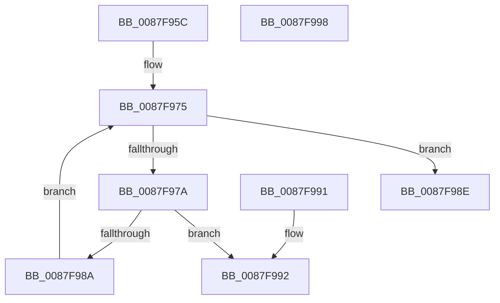

# MiVadIsMetadataBitmap

- RVA: `0x0087F95C`–`0x0087F999` (길이 `61` bytes)
- VA: `0x000000014087F95C`
- 실행 섹션: `PAGE`
- PDB 이름 있음: `예`; PDB Function 태그: `아니요`
- unwind 정보 RVA: `0x000DB714`
- 디코드: `18`개 명령, `61/61` bytes 표시
- 미해석 바이트: `0` (있으면 어셈블리에 `.byte`로 보존)

> 이 문서는 커널 이미지의 기계어와 PDB 기호를 분석해 생성했습니다. 4번과 5번은 함수 원형과 자료형을 바이너리 사용 방식에서 추정한 C 해석이며 원본 소스 복구 결과는 아닙니다.

## 1. Dependencies

- 직접 호출 지점: **0**; 고유 호출 대상: **0**
- 직접 호출자로 확인된 함수: **2**
- RIP 상대 이미지 참조: **0**

### Outgoing calls
- 직접 디코드된 call 명령이 없습니다.

### Direct callers
- [NtAreMappedFilesTheSame](NtAreMappedFilesTheSame_function_0087EC70.md) at `0x0087ECE2`
- [NtAreMappedFilesTheSame](NtAreMappedFilesTheSame_function_0087EC70.md) at `0x0087ECF2`
- [MiLockVadRange](MiLockVadRange_function_0087F670.md) at `0x0087F749`
- [MiLockVadRange](MiLockVadRange_function_0087F670.md) at `0x0087F91A`

### Static image references
- 디코드된 RIP-relative 메모리 참조가 없습니다.

## 2. Other-region calls and transfers

- 다른 실행 섹션으로 향하는 call: **0**
- 별도 외부 분기/꼬리 이동을 확인하지 못했습니다.

## 3. Assembly (complete function range)

```asm
0087F95C  65 48 8B 04 25 88 01 00 00      mov rax, qword ptr gs:[0x188]
0087F965  48 8B 90 B8 00 00 00            mov rdx, qword ptr [rax + 0xb8]
0087F96C  4C 8B 82 10 04 00 00            mov r8, qword ptr [rdx + 0x410]
0087F973  33 D2                           xor edx, edx
0087F975  83 FA 02                        cmp edx, 2
0087F978  73 14                           jae 0x14087f98e
0087F97A  8B C2                           mov eax, edx
0087F97C  48 C1 E0 05                     shl rax, 5
0087F980  4A 39 8C 00 B0 04 00 00         cmp qword ptr [rax + r8 + 0x4b0], rcx
0087F988  74 08                           je 0x14087f992
0087F98A  FF C2                           inc edx
0087F98C  EB E7                           jmp 0x14087f975
0087F98E  33 C0                           xor eax, eax
0087F990  C3                              ret
0087F991  CC                              int3
0087F992  B8 01 00 00 00                  mov eax, 1
0087F997  C3                              ret
0087F998  CC                              int3
```

## 4. C-style interpretation (structured pseudocode)

```c
__int64 __fastcall MiVadIsMetadataBitmap(__int64 a1)
{
    __int64 result;

    a2 = 0;
loc_0087F975:
    if (0 >= 2) goto loc_0087F98E;
    result = (0) << (5);
    if ((*(unsigned __int64 *)(result + *(unsigned __int64 *)(*(unsigned __int64 *)(*(unsigned __int64 *)(gs_base + (0 + 392)) + 184) + 1040) * 1 + 1200)) == a1) goto loc_0087F992;
    a2 = (unsigned int)((a2) + 1);
    goto loc_0087F975;
loc_0087F98E:
    result = 0;
    return result;
loc_0087F992:
    return 1;
}
```

## 5. (Beta) C Style

```c
int64_t MiVadIsMetadataBitmap(int64_t Arg1)
{
    int64_t result;

    a2 = 0;
loc_0087F975:
    if (0 >= 2) goto loc_0087F98E;
    result = (0) << (5);
    if ((*(uint64_t *)(result + *(uint64_t *)(*(uint64_t *)(*(uint64_t *)(gs_base + (0 + 0x188)) + 0xB8) + 0x410) * 1 + 0x4B0)) == Arg1) goto loc_0087F992;
    a2 = (uint32_t)((a2) + 1);
    goto loc_0087F975;
loc_0087F98E:
    result = 0;
    return result;
loc_0087F992:
    return 1;
}
```

## 6. Execution-region graph

[열기: 2D/3D 그래프와 함수 탐색 컨트롤 패널](../../../control-panel.html?section=page&rva=0x0087F95C&view=graph)

- 2D 그래프는 위에서 아래로 흐르고, 3D 그래프는 빈 공간을 드래그해 회전합니다. Shift+드래그는 이동, 휠은 확대·축소, 함수 노드 선택은 대상 보고서 이동입니다.

### Static fallback


