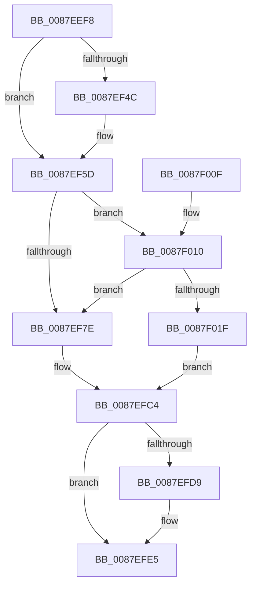

# MmAssignProcessToJob

- RVA: `0x0087EEF8`–`0x0087F024` (길이 `300` bytes)
- VA: `0x000000014087EEF8`
- 실행 섹션: `PAGE`
- PDB 이름 있음: `예`; PDB Function 태그: `아니요`
- unwind 정보 RVA: `0x0007C0C8`
- 디코드: `81`개 명령, `300/300` bytes 표시
- 미해석 바이트: `0` (있으면 어셈블리에 `.byte`로 보존)

> 이 문서는 커널 이미지의 기계어와 PDB 기호를 분석해 생성했습니다. 4번과 5번은 함수 원형과 자료형을 바이너리 사용 방식에서 추정한 C 해석이며 원본 소스 복구 결과는 아닙니다.

## 1. Dependencies

- 직접 호출 지점: **8**; 고유 호출 대상: **8**
- 직접 호출자로 확인된 함수: **2**
- RIP 상대 이미지 참조: **1**

### Outgoing calls
- `0x0087EF58` → [KiStackAttachProcess](../../text/21/KiStackAttachProcess_function_00216820.md) (function, `0x00216820`)
- `0x0087EF6D` → [MiLockVadRange](MiLockVadRange_function_0087F670.md) (function, `0x0087F670`)
- `0x0087EF84` → [LOCK_PAGE_TABLE_COMMITMENT](../../text/2A/LOCK_PAGE_TABLE_COMMITMENT_function_002A6090.md) (function, `0x002A6090`)
- `0x0087EFA9` → [PspChangeJobMemoryUsageByProcess](PspChangeJobMemoryUsageByProcess_function_0087F030.md) (function, `0x0087F030`)
- `0x0087EFBF` → [UNLOCK_PAGE_TABLE_COMMITMENT](../../text/2E/UNLOCK_PAGE_TABLE_COMMITMENT_function_002E27D0.md) (function, `0x002E27D0`)
- `0x0087EFD0` → [MiUnlockVadRange](MiUnlockVadRange_function_0087F590.md) (function, `0x0087F590`)
- `0x0087EFE0` → [KiUnstackDetachProcess](../../text/21/KiUnstackDetachProcess_function_00217D30.md) (function, `0x00217D30`)
- `0x0087EFF1` → [_security_check_cookie](../../text/6A/_security_check_cookie_function_006AC640.md) (function, `0x006AC640`)

### Direct callers
- [PspImplicitAssignProcessToJob](PspImplicitAssignProcessToJob_function_0087D584.md) at `0x0087D6DC`
- [PspAssignProcessToJob](../A2/PspAssignProcessToJob_function_00A23370.md) at `0x00A237DB`

### Static image references
- `0x0087EF0E` → RVA `0x00E0A740` (`.data`; read)

## 2. Other-region calls and transfers

- 다른 실행 섹션으로 향하는 call: **5**
  - `0x0087EF58` → [KiStackAttachProcess](../../text/21/KiStackAttachProcess_function_00216820.md) (`PAGE` → `.text`)
  - `0x0087EF84` → [LOCK_PAGE_TABLE_COMMITMENT](../../text/2A/LOCK_PAGE_TABLE_COMMITMENT_function_002A6090.md) (`PAGE` → `.text`)
  - `0x0087EFBF` → [UNLOCK_PAGE_TABLE_COMMITMENT](../../text/2E/UNLOCK_PAGE_TABLE_COMMITMENT_function_002E27D0.md) (`PAGE` → `.text`)
  - `0x0087EFE0` → [KiUnstackDetachProcess](../../text/21/KiUnstackDetachProcess_function_00217D30.md) (`PAGE` → `.text`)
  - `0x0087EFF1` → [_security_check_cookie](../../text/6A/_security_check_cookie_function_006AC640.md) (`PAGE` → `.text`)
- 별도 외부 분기/꼬리 이동을 확인하지 못했습니다.

## 3. Assembly (complete function range)

```asm
0087EEF8  48 89 5C 24 18                  mov qword ptr [rsp + 0x18], rbx
0087EEFD  48 89 6C 24 20                  mov qword ptr [rsp + 0x20], rbp
0087EF02  56                              push rsi
0087EF03  57                              push rdi
0087EF04  41 54                           push r12
0087EF06  41 56                           push r14
0087EF08  41 57                           push r15
0087EF0A  48 83 EC 60                     sub rsp, 0x60
0087EF0E  48 8B 05 2B B8 58 00            mov rax, qword ptr [rip + 0x58b82b]
0087EF15  48 33 C4                        xor rax, rsp
0087EF18  48 89 44 24 50                  mov qword ptr [rsp + 0x50], rax
0087EF1D  0F 57 C0                        xorps xmm0, xmm0
0087EF20  33 F6                           xor esi, esi
0087EF22  0F 11 44 24 20                  movups xmmword ptr [rsp + 0x20], xmm0
0087EF27  41 8B F8                        mov edi, r8d
0087EF2A  4C 8B FA                        mov r15, rdx
0087EF2D  0F 11 44 24 30                  movups xmmword ptr [rsp + 0x30], xmm0
0087EF32  48 8B D9                        mov rbx, rcx
0087EF35  0F 11 44 24 40                  movups xmmword ptr [rsp + 0x40], xmm0
0087EF3A  65 4C 8B 34 25 88 01 00 00      mov r14, qword ptr gs:[0x188]
0087EF43  49 39 8E B8 00 00 00            cmp qword ptr [r14 + 0xb8], rcx
0087EF4A  74 11                           je 0x14087ef5d
0087EF4C  4C 8D 44 24 20                  lea r8, [rsp + 0x20]
0087EF51  33 D2                           xor edx, edx
0087EF53  BE 01 00 00 00                  mov esi, 1
0087EF58  E8 C3 78 99 FF                  call 0x140216820
0087EF5D  49 83 CC FF                     or r12, 0xffffffffffffffff
0087EF61  45 33 C9                        xor r9d, r9d
0087EF64  4D 8B C4                        mov r8, r12
0087EF67  49 8B D4                        mov rdx, r12
0087EF6A  48 8B CB                        mov rcx, rbx
0087EF6D  E8 FE 06 00 00                  call 0x14087f670
0087EF72  48 8B E8                        mov rbp, rax
0087EF75  48 85 C0                        test rax, rax
0087EF78  0F 84 92 00 00 00               je 0x14087f010
0087EF7E  48 8B D3                        mov rdx, rbx
0087EF81  49 8B CE                        mov rcx, r14
0087EF84  E8 07 71 A2 FF                  call 0x1402a6090
0087EF89  48 8B 83 A0 02 00 00            mov rax, qword ptr [rbx + 0x2a0]
0087EF90  83 CF 03                        or edi, 3
0087EF93  48 8B 93 D8 03 00 00            mov rdx, qword ptr [rbx + 0x3d8]
0087EF9A  8B CF                           mov ecx, edi
0087EF9C  4D 8B CF                        mov r9, r15
0087EF9F  48 89 83 78 02 00 00            mov qword ptr [rbx + 0x278], rax
0087EFA6  4C 8B C3                        mov r8, rbx
0087EFA9  E8 82 00 00 00                  call 0x14087f030
0087EFAE  40 8A F8                        mov dil, al
0087EFB1  F0 83 8B F0 01 00 00 10         lock or dword ptr [rbx + 0x1f0], 0x10
0087EFB9  48 8B D3                        mov rdx, rbx
0087EFBC  49 8B CE                        mov rcx, r14
0087EFBF  E8 0C 38 A6 FF                  call 0x1402e27d0
0087EFC4  45 33 C9                        xor r9d, r9d
0087EFC7  4C 8B C5                        mov r8, rbp
0087EFCA  49 8B D4                        mov rdx, r12
0087EFCD  48 8B CB                        mov rcx, rbx
0087EFD0  E8 BB 05 00 00                  call 0x14087f590
0087EFD5  85 F6                           test esi, esi
0087EFD7  74 0C                           je 0x14087efe5
0087EFD9  33 D2                           xor edx, edx
0087EFDB  48 8D 4C 24 20                  lea rcx, [rsp + 0x20]
0087EFE0  E8 4B 8D 99 FF                  call 0x140217d30
0087EFE5  40 0F B6 C7                     movzx eax, dil
0087EFE9  48 8B 4C 24 50                  mov rcx, qword ptr [rsp + 0x50]
0087EFEE  48 33 CC                        xor rcx, rsp
0087EFF1  E8 4A D6 E2 FF                  call 0x1406ac640
0087EFF6  4C 8D 5C 24 60                  lea r11, [rsp + 0x60]
0087EFFB  49 8B 5B 40                     mov rbx, qword ptr [r11 + 0x40]
0087EFFF  49 8B 6B 48                     mov rbp, qword ptr [r11 + 0x48]
0087F003  49 8B E3                        mov rsp, r11
0087F006  41 5F                           pop r15
0087F008  41 5E                           pop r14
0087F00A  41 5C                           pop r12
0087F00C  5F                              pop rdi
0087F00D  5E                              pop rsi
0087F00E  C3                              ret
0087F00F  CC                              int3
0087F010  8B 8B FC 05 00 00               mov ecx, dword ptr [rbx + 0x5fc]
0087F016  F6 C1 01                        test cl, 1
0087F019  0F 85 5F FF FF FF               jne 0x14087ef7e
0087F01F  40 32 FF                        xor dil, dil
0087F022  EB A0                           jmp 0x14087efc4
```

## 4. C-style interpretation (structured pseudocode)

```c
__int64 __fastcall MmAssignProcessToJob(__int64 a1, __int64 a2, int a3, int a4)
{
    __int64 result;
    __int64 v_r12;
    __int64 v_rdi;
    __int64 v_rsi;
    __int64 v_rsp;
    unsigned __int64 v_stack_m28;
    unsigned __int64 v_stack_m38;
    unsigned __int64 v_stack_m48;
    unsigned __int64 v_stack_m58;
    unsigned __int64 v_stack_m68;
    unsigned __int64 v_stack_p18;
    unsigned __int64 v_stack_p20;

    v_stack_p18 = v_rbx;
    v_stack_p20 = v_rbp;
    v_rsp = (v_rsp) - (96);
    result = (*(unsigned __int64 *)(v_rip + 5814315)) ^ (v_rsp);
    v_stack_m38 = result;
    v_rsi = 0;
    v_stack_m68 = v_xmm0;
    v_stack_m58 = v_xmm0;
    v_stack_m48 = v_xmm0;
    if ((*(unsigned __int64 *)(*(unsigned __int64 *)(gs_base + (0 + 392)) + 184)) != a1) {
        a3 = v_stack_m68;
        a2 = 0;
        v_rsi = 1;
        result = KiStackAttachProcess(a1, a2, a3, a4);
    }
    v_r12 = (v_r12) | (-1);
    a4 = 0;
    result = MiLockVadRange(a1, v_r12, v_r12, a4);
    if (result == 0) goto loc_0087F010;
loc_0087EF7E:
    result = LOCK_PAGE_TABLE_COMMITMENT(*(unsigned __int64 *)(gs_base + (0 + 392)), a1, v_r12, a4);
    v_rdi = (unsigned int)(((unsigned int)(a3)) | (3));
    *(unsigned __int64 *)(a1 + 632) = *(unsigned __int64 *)(a1 + 672);
    result = PspChangeJobMemoryUsageByProcess((unsigned int)((unsigned int)(v_rdi)), *(unsigned __int64 *)(a1 + 984), a1, 0);
    result = UNLOCK_PAGE_TABLE_COMMITMENT(*(unsigned __int64 *)(gs_base + (0 + 392)), a1, a1, 0);
loc_0087EFC4:
    a4 = 0;
    result = MiUnlockVadRange(a1, v_r12, result, a4);
    if ((unsigned int)(v_rsi) != 0) {
        a2 = 0;
        a1 = v_stack_m68;
        result = KiUnstackDetachProcess(a1, a2, result, a4);
    }
    a1 = (v_stack_m38) ^ (v_rsp);
    result = _security_check_cookie(a1, a2, result, a4);
    return result;
loc_0087F010:
    if ((((unsigned __int8)((unsigned int)(*(unsigned int *)(*(unsigned __int64 *)(v_stack_m28 + 64) + 1532)))) & (1)) != 0) goto loc_0087EF7E;
    v_rdi = 0;
    goto loc_0087EFC4;
}
```

## 5. (Beta) C Style

```c
int64_t MmAssignProcessToJob(void *Arg1, int64_t Arg2, int32_t Arg3, int32_t Arg4)
{
    uint8_t *arg1 = (uint8_t *)Arg1;

    int64_t result;
    int64_t local_r12;
    int64_t local_rdi;
    int64_t local_rsi;
    int64_t local_rsp;
    uint64_t v_stack_m28;
    uint64_t v_stack_m38;
    uint64_t v_stack_m48;
    uint64_t v_stack_m58;
    uint64_t v_stack_m68;
    uint64_t v_stack_p18;
    uint64_t v_stack_p20;

    v_stack_p18 = local_rbx;
    v_stack_p20 = local_rbp;
    local_rsp = (local_rsp) - (96);
    result = (*(uint64_t *)(v_rip + 0x58B82B)) ^ (local_rsp);
    v_stack_m38 = result;
    local_rsi = 0;
    v_stack_m68 = v_xmm0;
    v_stack_m58 = v_xmm0;
    v_stack_m48 = v_xmm0;
    if ((*(uint64_t *)(*(uint64_t *)(gs_base + (0 + 0x188)) + 0xB8)) != Arg1) {
        Arg3 = v_stack_m68;
        Arg2 = 0;
        local_rsi = 1;
        result = KiStackAttachProcess(Arg1, Arg2, Arg3, Arg4);
    }
    local_r12 = (local_r12) | (-1);
    Arg4 = 0;
    result = MiLockVadRange(Arg1, local_r12, local_r12, Arg4);
    if (result == 0) goto loc_0087F010;
loc_0087EF7E:
    result = LOCK_PAGE_TABLE_COMMITMENT(*(uint64_t *)(gs_base + (0 + 0x188)), Arg1, local_r12, Arg4);
    local_rdi = (uint32_t)(((uint32_t)(Arg3)) | (3));
    *(uint64_t *)(arg1 + 0x278) = *(uint64_t *)(arg1 + 0x2A0);
    result = PspChangeJobMemoryUsageByProcess((uint32_t)((uint32_t)(local_rdi)), *(uint64_t *)(arg1 + 0x3D8), Arg1, 0);
    result = UNLOCK_PAGE_TABLE_COMMITMENT(*(uint64_t *)(gs_base + (0 + 0x188)), Arg1, Arg1, 0);
loc_0087EFC4:
    Arg4 = 0;
    result = MiUnlockVadRange(Arg1, local_r12, result, Arg4);
    if ((uint32_t)(local_rsi) != 0) {
        Arg2 = 0;
        Arg1 = v_stack_m68;
        result = KiUnstackDetachProcess(Arg1, Arg2, result, Arg4);
    }
    Arg1 = (v_stack_m38) ^ (local_rsp);
    result = _security_check_cookie(Arg1, Arg2, result, Arg4);
    return result;
loc_0087F010:
    if ((((uint8_t)((uint32_t)(*(uint32_t *)(*(uint64_t *)(v_stack_m28 + 0x40) + 0x5FC)))) & (1)) != 0) goto loc_0087EF7E;
    local_rdi = 0;
    goto loc_0087EFC4;
}
```

### 관측된 메모리 오프셋

구조체 형식이 확인되지 않은 접근은 인자 기준의 오프셋으로만 기록했습니다.

| 기준 인자 | 오프셋 표현 | 폭 (bit) | 접근 |
|---|---:|---:|---|
| `Arg1` | `+ 0x1F0` | `32` | `R/W` |
| `Arg1` | `+ 0x278` | `64` | `W` |
| `Arg1` | `+ 0x2A0` | `64` | `R` |
| `Arg1` | `+ 0x3D8` | `64` | `R` |
| `Arg1` | `+ 0x5FC` | `32` | `R` |

## 6. Execution-region graph

[열기: 2D/3D 그래프와 함수 탐색 컨트롤 패널](../../../control-panel.html?section=page&rva=0x0087EEF8&view=graph)

- 2D 그래프는 위에서 아래로 흐르고, 3D 그래프는 빈 공간을 드래그해 회전합니다. Shift+드래그는 이동, 휠은 확대·축소, 함수 노드 선택은 대상 보고서 이동입니다.

### Static fallback


