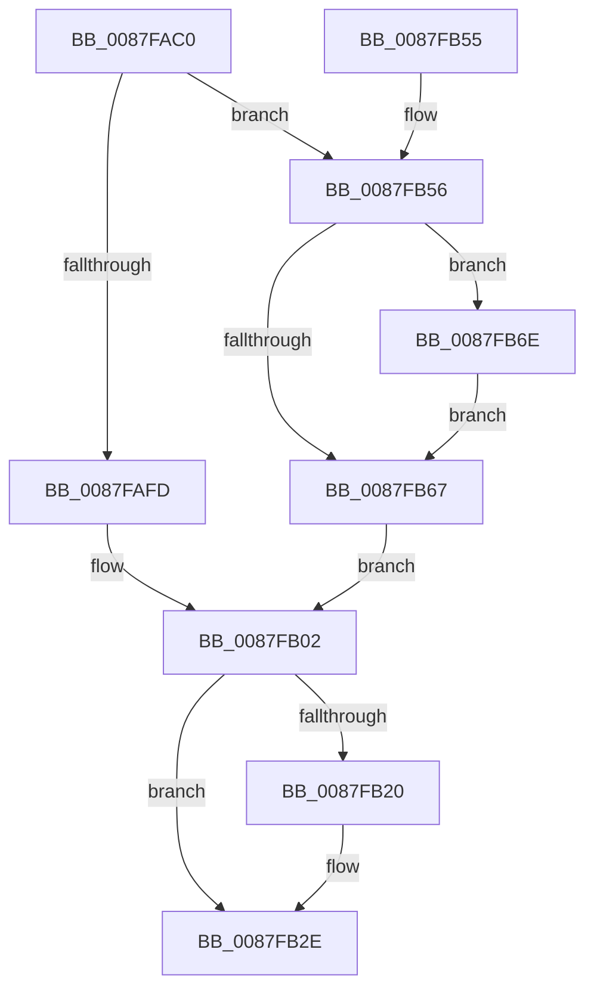

# MmDeleteTeb

- RVA: `0x0087FAC0`–`0x0087FB75` (길이 `181` bytes)
- VA: `0x000000014087FAC0`
- 실행 섹션: `PAGE`
- PDB 이름 있음: `예`; PDB Function 태그: `아니요`
- unwind 정보 RVA: `0x0007C338`
- 디코드: `46`개 명령, `181/181` bytes 표시
- 미해석 바이트: `0` (있으면 어셈블리에 `.byte`로 보존)

> 이 문서는 커널 이미지의 기계어와 PDB 기호를 분석해 생성했습니다. 4번과 5번은 함수 원형과 자료형을 바이너리 사용 방식에서 추정한 C 해석이며 원본 소스 복구 결과는 아닙니다.

## 1. Dependencies

- 직접 호출 지점: **5**; 고유 호출 대상: **5**
- 직접 호출자로 확인된 함수: **3**
- RIP 상대 이미지 참조: **1**

### Outgoing calls
- `0x0087FB07` → [KeStackAttachProcess](../../text/21/KeStackAttachProcess_function_00216800.md) (function, `0x00216800`)
- `0x0087FB16` → [MiObtainReferencedVadEx](../../text/31/MiObtainReferencedVadEx_function_00316690.md) (function, `0x00316690`)
- `0x0087FB29` → [MiFreeToSubAllocatedRegion](MiFreeToSubAllocatedRegion_function_0087FB7C.md) (function, `0x0087FB7C`)
- `0x0087FB35` → [KiUnstackDetachProcess](../../text/21/KiUnstackDetachProcess_function_00217D30.md) (function, `0x00217D30`)
- `0x0087FB42` → [_security_check_cookie](../../text/6A/_security_check_cookie_function_006AC640.md) (function, `0x006AC640`)

### Direct callers
- [PspExitThread](../90/PspExitThread_function_00905F60.md) at `0x00906418`
- [PspAllocateThread](../9E/PspAllocateThread_function_009EF72C.md) at `0x009F02FD`
- [PspInsertThread](../9F/PspInsertThread_function_009F0314.md) at `0x009F0615`

### Static image references
- `0x0087FACA` → RVA `0x00E0A740` (`.data`; read)

## 2. Other-region calls and transfers

- 다른 실행 섹션으로 향하는 call: **4**
  - `0x0087FB07` → [KeStackAttachProcess](../../text/21/KeStackAttachProcess_function_00216800.md) (`PAGE` → `.text`)
  - `0x0087FB16` → [MiObtainReferencedVadEx](../../text/31/MiObtainReferencedVadEx_function_00316690.md) (`PAGE` → `.text`)
  - `0x0087FB35` → [KiUnstackDetachProcess](../../text/21/KiUnstackDetachProcess_function_00217D30.md) (`PAGE` → `.text`)
  - `0x0087FB42` → [_security_check_cookie](../../text/6A/_security_check_cookie_function_006AC640.md) (`PAGE` → `.text`)
- 별도 외부 분기/꼬리 이동을 확인하지 못했습니다.

## 3. Assembly (complete function range)

```asm
0087FAC0  48 89 5C 24 18                  mov qword ptr [rsp + 0x18], rbx
0087FAC5  57                              push rdi
0087FAC6  48 83 EC 60                     sub rsp, 0x60
0087FACA  48 8B 05 6F AC 58 00            mov rax, qword ptr [rip + 0x58ac6f]
0087FAD1  48 33 C4                        xor rax, rsp
0087FAD4  48 89 44 24 58                  mov qword ptr [rsp + 0x58], rax
0087FAD9  83 64 24 20 00                  and dword ptr [rsp + 0x20], 0
0087FADE  0F 57 C0                        xorps xmm0, xmm0
0087FAE1  48 83 B9 10 03 00 00 00         cmp qword ptr [rcx + 0x310], 0
0087FAE9  48 8B FA                        mov rdi, rdx
0087FAEC  0F 11 44 24 28                  movups xmmword ptr [rsp + 0x28], xmm0
0087FAF1  0F 11 44 24 38                  movups xmmword ptr [rsp + 0x38], xmm0
0087FAF6  0F 11 44 24 48                  movups xmmword ptr [rsp + 0x48], xmm0
0087FAFB  75 59                           jne 0x14087fb56
0087FAFD  BB 00 20 00 00                  mov ebx, 0x2000
0087FB02  48 8D 54 24 28                  lea rdx, [rsp + 0x28]
0087FB07  E8 F4 6C 99 FF                  call 0x140216800
0087FB0C  4C 8D 44 24 20                  lea r8, [rsp + 0x20]
0087FB11  33 D2                           xor edx, edx
0087FB13  48 8B CF                        mov rcx, rdi
0087FB16  E8 75 6B A9 FF                  call 0x140316690
0087FB1B  48 85 C0                        test rax, rax
0087FB1E  74 0E                           je 0x14087fb2e
0087FB20  4C 8B CB                        mov r9, rbx
0087FB23  4C 8B C7                        mov r8, rdi
0087FB26  48 8B C8                        mov rcx, rax
0087FB29  E8 4E 00 00 00                  call 0x14087fb7c
0087FB2E  33 D2                           xor edx, edx
0087FB30  48 8D 4C 24 28                  lea rcx, [rsp + 0x28]
0087FB35  E8 F6 81 99 FF                  call 0x140217d30
0087FB3A  48 8B 4C 24 58                  mov rcx, qword ptr [rsp + 0x58]
0087FB3F  48 33 CC                        xor rcx, rsp
0087FB42  E8 F9 CA E2 FF                  call 0x1406ac640
0087FB47  48 8B 9C 24 80 00 00 00         mov rbx, qword ptr [rsp + 0x80]
0087FB4F  48 83 C4 60                     add rsp, 0x60
0087FB53  5F                              pop rdi
0087FB54  C3                              ret
0087FB55  CC                              int3
0087FB56  0F B7 81 EC 06 00 00            movzx eax, word ptr [rcx + 0x6ec]
0087FB5D  BA 4C 01 00 00                  mov edx, 0x14c
0087FB62  66 3B C2                        cmp ax, dx
0087FB65  75 07                           jne 0x14087fb6e
0087FB67  BB 00 40 00 00                  mov ebx, 0x4000
0087FB6C  EB 94                           jmp 0x14087fb02
0087FB6E  BA C4 01 00 00                  mov edx, 0x1c4
0087FB73  EB F2                           jmp 0x14087fb67
```

## 4. C-style interpretation (structured pseudocode)

```c
__int64 __fastcall MmDeleteTeb(__int64 a1, __int64 a2)
{
    __int64 result;
    __int64 v_rsp;
    unsigned __int64 v_stack_m10;
    unsigned __int64 v_stack_m20;
    unsigned __int64 v_stack_m30;
    unsigned __int64 v_stack_m40;
    unsigned int v_stack_m48;
    unsigned __int64 v_stack_p18;

    v_stack_p18 = v_rbx;
    v_rsp = (v_rsp) - (96);
    result = (*(unsigned __int64 *)(v_rip + 5811311)) ^ (v_rsp);
    v_stack_m10 = result;
    v_stack_m40 = v_xmm0;
    v_stack_m30 = v_xmm0;
    v_stack_m20 = v_xmm0;
    if ((*(unsigned __int64 *)(a1 + 784)) != 0) goto loc_0087FB56;
loc_0087FB02:
    result = KeStackAttachProcess(a1, v_stack_m40, a3, a4);
    a2 = 0;
    result = MiObtainReferencedVadEx(0, a2, v_stack_m48, a4);
    if (result != 0) {
        a4 = (unsigned int)(0x2000ULL);
        a3 = 0;
        a1 = result;
        result = MiFreeToSubAllocatedRegion(a1, a2, a3, a4);
    }
    a2 = 0;
    result = KiUnstackDetachProcess(v_stack_m40, a2, a3, a4);
    a1 = (v_stack_m10) ^ (v_rsp);
    result = _security_check_cookie(a1, a2, a3, a4);
    v_rsp = (v_rsp) + (96);
    return result;
loc_0087FB56:
    if (((unsigned __int16)(*(unsigned __int16 *)(a1 + 1772))) != 332) goto loc_0087FB6E;
loc_0087FB67:
    goto loc_0087FB02;
loc_0087FB6E:
    goto loc_0087FB67;
}
```

## 5. (Beta) C Style

```c
int64_t MmDeleteTeb(void *Arg1, int64_t Arg2)
{
    uint8_t *arg1 = (uint8_t *)Arg1;

    int64_t result;
    int64_t local_rsp;
    uint64_t v_stack_m10;
    uint64_t v_stack_m20;
    uint64_t v_stack_m30;
    uint64_t v_stack_m40;
    uint32_t v_stack_m48;
    uint64_t v_stack_p18;

    v_stack_p18 = local_rbx;
    local_rsp = (local_rsp) - (96);
    result = (*(uint64_t *)(v_rip + 0x58AC6F)) ^ (local_rsp);
    v_stack_m10 = result;
    v_stack_m40 = v_xmm0;
    v_stack_m30 = v_xmm0;
    v_stack_m20 = v_xmm0;
    if ((*(uint64_t *)(arg1 + 0x310)) != 0) goto loc_0087FB56;
loc_0087FB02:
    result = KeStackAttachProcess(Arg1, v_stack_m40, a3, a4);
    Arg2 = 0;
    result = MiObtainReferencedVadEx(0, Arg2, v_stack_m48, a4);
    if (result != 0) {
        a4 = (uint32_t)(0x2000ULL);
        a3 = 0;
        Arg1 = result;
        result = MiFreeToSubAllocatedRegion(Arg1, Arg2, a3, a4);
    }
    Arg2 = 0;
    result = KiUnstackDetachProcess(v_stack_m40, Arg2, a3, a4);
    Arg1 = (v_stack_m10) ^ (local_rsp);
    result = _security_check_cookie(Arg1, Arg2, a3, a4);
    local_rsp = (local_rsp) + (96);
    return result;
loc_0087FB56:
    if (((uint16_t)(*(uint16_t *)(arg1 + 0x6EC))) != 332) goto loc_0087FB6E;
loc_0087FB67:
    goto loc_0087FB02;
loc_0087FB6E:
    goto loc_0087FB67;
}
```

### 관측된 메모리 오프셋

구조체 형식이 확인되지 않은 접근은 인자 기준의 오프셋으로만 기록했습니다.

| 기준 인자 | 오프셋 표현 | 폭 (bit) | 접근 |
|---|---:|---:|---|
| `Arg1` | `+ 0x310` | `64` | `R` |
| `Arg1` | `+ 0x6EC` | `16` | `R` |

## 6. Execution-region graph

[열기: 2D/3D 그래프와 함수 탐색 컨트롤 패널](../../../control-panel.html?section=page&rva=0x0087FAC0&view=graph)

- 2D 그래프는 위에서 아래로 흐르고, 3D 그래프는 빈 공간을 드래그해 회전합니다. Shift+드래그는 이동, 휠은 확대·축소, 함수 노드 선택은 대상 보고서 이동입니다.

### Static fallback


