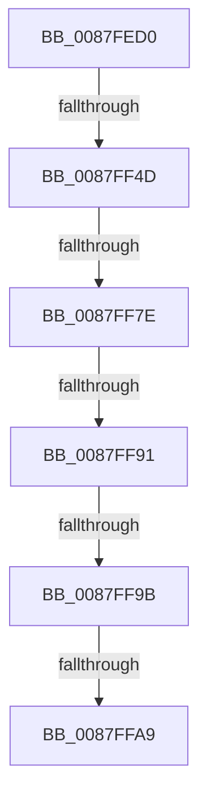

# MmFreeVirtualMemory

- RVA: `0x0087FED0`–`0x0087FFB4` (길이 `228` bytes)
- VA: `0x000000014087FED0`
- 실행 섹션: `PAGE`
- PDB 이름 있음: `예`; PDB Function 태그: `예`
- unwind 정보 RVA: `0x0007C3C4`
- 디코드: `56`개 명령, `228/228` bytes 표시
- 미해석 바이트: `0` (있으면 어셈블리에 `.byte`로 보존)

> 이 문서는 커널 이미지의 기계어와 PDB 기호를 분석해 생성했습니다. 4번과 5번은 함수 원형과 자료형을 바이너리 사용 방식에서 추정한 C 해석이며 원본 소스 복구 결과는 아닙니다.

## 1. Dependencies

- 직접 호출 지점: **0**; 고유 호출 대상: **0**
- 직접 호출자로 확인된 함수: **8**
- RIP 상대 이미지 참조: **1**

### Outgoing calls
- 직접 디코드된 call 명령이 없습니다.

### Direct callers
- [PsDispatchIumService](../../text/4A/PsDispatchIumService_function_004A2F0C.md) at `0x004A3075`
- [PspFreeUserFiberShadowStack](PspFreeUserFiberShadowStack_function_0087F9A0.md) at `0x0087FAAF`
- [PspFreeCurrentThreadUserShadowStack](PspFreeCurrentThreadUserShadowStack_function_0087FD7C.md) at `0x0087FDF8`
- [NtFreeVirtualMemory](NtFreeVirtualMemory_function_0087FE10.md) at `0x0087FE98`
- [PspSetupUserFiberShadowStack](../88/PspSetupUserFiberShadowStack_function_008824F0.md) at `0x008825B4`
- [PspSetupUserShadowStack](../88/PspSetupUserShadowStack_function_008825D4.md) at `0x00882798`
- [PspReserveAndCommitUserShadowStack](../88/PspReserveAndCommitUserShadowStack_function_008827A8.md) at `0x00882936`
- [PspDeleteUserStack](../A7/PspDeleteUserStack_function_00A78D18.md) at `0x00A78E09`

### Static image references
- `0x0087FEE4` → RVA `0x00E0A740` (`.data`; read)

## 2. Other-region calls and transfers

- 다른 실행 섹션으로 향하는 call: **0**
- call이 아닌 외부 분기/꼬리 이동: **6**
  - `0x0087FF47` → [sub_0088016C](../88/Unknown_function_0088016C.md) (`tail-transfer`)
  - `0x0087FF78` → [sub_008800F2 + 0x58](../88/Unknown_function_008800F2.md) (`tail-transfer`)
  - `0x0087FF8B` → [sub_008800F2 + 0x58](../88/Unknown_function_008800F2.md) (`tail-transfer`)
  - `0x0087FF95` → [sub_0088016C + 0xA](../88/Unknown_function_0088016C.md) (`tail-transfer`)
  - `0x0087FFA3` → [sub_0088020A](../88/Unknown_function_0088020A.md) (`tail-transfer`)
  - `0x0087FFAE` → [sub_008800F2 + 0x1C](../88/Unknown_function_008800F2.md) (`tail-transfer`)

## 3. Assembly (complete function range)

```asm
0087FED0  40 55                           push rbp
0087FED2  56                              push rsi
0087FED3  57                              push rdi
0087FED4  41 54                           push r12
0087FED6  41 56                           push r14
0087FED8  48 8D 6C 24 D9                  lea rbp, [rsp - 0x27]
0087FEDD  48 81 EC 00 01 00 00            sub rsp, 0x100
0087FEE4  48 8B 05 55 A8 58 00            mov rax, qword ptr [rip + 0x58a855]
0087FEEB  48 33 C4                        xor rax, rsp
0087FEEE  48 89 45 07                     mov qword ptr [rbp + 7], rax
0087FEF2  45 33 DB                        xor r11d, r11d
0087FEF5  48 89 4D CF                     mov qword ptr [rbp - 0x31], rcx
0087FEF9  41 8B F1                        mov esi, r9d
0087FEFC  4C 89 45 BF                     mov qword ptr [rbp - 0x41], r8
0087FF00  8B C6                           mov eax, esi
0087FF02  48 89 55 C7                     mov qword ptr [rbp - 0x39], rdx
0087FF06  25 00 C0 00 00                  and eax, 0xc000
0087FF0B  4C 89 5D D7                     mov qword ptr [rbp - 0x29], r11
0087FF0F  3D 00 C0 00 00                  cmp eax, 0xc000
0087FF14  4C 89 5D EF                     mov qword ptr [rbp - 0x11], r11
0087FF18  4C 8B D1                        mov r10, rcx
0087FF1B  4C 89 5D FF                     mov qword ptr [rbp - 1], r11
0087FF1F  0F 95 C1                        setne cl
0087FF22  4C 89 5D 8F                     mov qword ptr [rbp - 0x71], r11
0087FF26  85 C0                           test eax, eax
0087FF28  44 89 5D 87                     mov dword ptr [rbp - 0x79], r11d
0087FF2C  0F 57 C0                        xorps xmm0, xmm0
0087FF2F  4C 89 5D AF                     mov qword ptr [rbp - 0x51], r11
0087FF33  0F 95 C0                        setne al
0087FF36  4C 89 5D A7                     mov qword ptr [rbp - 0x59], r11
0087FF3A  4D 8B C8                        mov r9, r8
0087FF3D  4C 8B C2                        mov r8, rdx
0087FF40  F3 0F 7F 45 DF                  movdqu xmmword ptr [rbp - 0x21], xmm0
0087FF45  84 C8                           test al, cl
0087FF47  0F 84 1F 02 00 00               je 0x14088016c
0087FF4D  65 48 8B 04 25 88 01 00 00      mov rax, qword ptr gs:[0x188]
0087FF56  4D 8B 31                        mov r14, qword ptr [r9]
0087FF59  49 8B 38                        mov rdi, qword ptr [r8]
0087FF5C  4D 85 F6                        test r14, r14
0087FF5F  48 8B 90 B8 00 00 00            mov rdx, qword ptr [rax + 0xb8]
0087FF66  49 8D 4E FF                     lea rcx, [r14 - 1]
0087FF6A  48 89 55 B7                     mov qword ptr [rbp - 0x49], rdx
0087FF6E  49 0F 44 CB                     cmove rcx, r11
0087FF72  48 03 CF                        add rcx, rdi
0087FF75  48 3B CF                        cmp rcx, rdi
0087FF78  0F 82 CC 01 00 00               jb 0x14088014a
0087FF7E  48 B8 FF FF FE FF FF 7F 00 00   movabs rax, 0x7ffffffeffff
0087FF88  48 3B C8                        cmp rcx, rax
0087FF8B  0F 87 B9 01 00 00               ja 0x14088014a
0087FF91  40 F6 C6 02                     test sil, 2
0087FF95  0F 85 DB 01 00 00               jne 0x140880176
0087FF9B  44 8B 65 7F                     mov r12d, dword ptr [rbp + 0x7f]
0087FF9F  40 F6 C6 01                     test sil, 1
0087FFA3  0F 85 61 02 00 00               jne 0x14088020a
0087FFA9  41 0F BA E4 1A                  bt r12d, 0x1a
0087FFAE  0F 82 5A 01 00 00               jb 0x14088010e
```

## 4. C-style interpretation (structured pseudocode)

```c
__int64 __fastcall MmFreeVirtualMemory(__int64 a1, __int64 a2, __int64 a3, int a4, __int64 a5, unsigned int a6)
{
    __int64 result;
    __int64 v_r11;
    __int64 v_rsp;
    unsigned __int64 v_stack_m48;
    unsigned __int64 v_stack_m4F;
    unsigned __int64 v_stack_m50;
    unsigned __int64 v_stack_m60;
    unsigned __int64 v_stack_m70;
    unsigned __int64 v_stack_m78;
    unsigned __int64 v_stack_m80;
    unsigned __int64 v_stack_m88;
    unsigned __int64 v_stack_m90;
    unsigned __int64 v_stack_m98;
    unsigned __int64 v_stack_mA0;
    unsigned __int64 v_stack_mA8;
    unsigned __int64 v_stack_mC0;
    unsigned int v_stack_mC8;

    v_rsp = (v_rsp) - (256);
    result = (*(unsigned __int64 *)(v_rip + 5810261)) ^ (v_rsp);
    v_stack_m48 = result;
    v_r11 = 0;
    v_stack_m80 = a1;
    v_stack_m90 = a3;
    v_stack_m88 = a2;
    result = (unsigned int)(((unsigned int)((unsigned int)((unsigned int)(a4)))) & (0xC000ULL));
    v_stack_m78 = 0;
    v_stack_m60 = 0;
    v_stack_m50 = 0;
    a1 = (((unsigned int)(result)) != 0xC000ULL) ? 1 : 0;
    v_stack_mC0 = 0;
    v_stack_mC8 = 0;
    v_stack_mA0 = 0;
    result = ((unsigned int)(result) != 0) ? 1 : 0;
    v_stack_mA8 = 0;
    v_stack_m70 = v_xmm0;
    v_stack_m98 = *(unsigned __int64 *)(*(unsigned __int64 *)(gs_base + (0 + 392)) + 184);
    a1 = *(unsigned __int64 *)(a3) - 1;
    if (*(unsigned __int64 *)(a3) == 0) { a1 = 0; }
    a1 = (a1) + (*(unsigned __int64 *)(a2));
}
```

## 5. (Beta) C Style

```c
int64_t MmFreeVirtualMemory(int64_t Arg1, void *Arg2, void *Arg3, int32_t Arg4, uint64_t Arg5, uint32_t Arg6)
{
    uint8_t *arg2 = (uint8_t *)Arg2;
    uint8_t *arg3 = (uint8_t *)Arg3;

    int64_t result;
    int64_t local_r11;
    int64_t local_rsp;
    uint64_t v_stack_m48;
    uint64_t v_stack_m4F;
    uint64_t v_stack_m50;
    uint64_t v_stack_m60;
    uint64_t v_stack_m70;
    uint64_t v_stack_m78;
    uint64_t v_stack_m80;
    uint64_t v_stack_m88;
    uint64_t v_stack_m90;
    uint64_t v_stack_m98;
    uint64_t v_stack_mA0;
    uint64_t v_stack_mA8;
    uint64_t v_stack_mC0;
    uint32_t v_stack_mC8;

    local_rsp = (local_rsp) - (256);
    result = (*(uint64_t *)(v_rip + 0x58A855)) ^ (local_rsp);
    v_stack_m48 = result;
    local_r11 = 0;
    v_stack_m80 = Arg1;
    v_stack_m90 = Arg3;
    v_stack_m88 = Arg2;
    result = (uint32_t)(((uint32_t)((uint32_t)((uint32_t)(Arg4)))) & (0xC000ULL));
    v_stack_m78 = 0;
    v_stack_m60 = 0;
    v_stack_m50 = 0;
    Arg1 = (((uint32_t)(result)) != 0xC000ULL) ? 1 : 0;
    v_stack_mC0 = 0;
    v_stack_mC8 = 0;
    v_stack_mA0 = 0;
    result = ((uint32_t)(result) != 0) ? 1 : 0;
    v_stack_mA8 = 0;
    v_stack_m70 = v_xmm0;
    v_stack_m98 = *(uint64_t *)(*(uint64_t *)(gs_base + (0 + 0x188)) + 0xB8);
    Arg1 = *(uint64_t *)(arg3) - 1;
    if (*(uint64_t *)(arg3) == 0) { Arg1 = 0; }
    Arg1 = (Arg1) + (*(uint64_t *)(arg2));
}
```

### 관측된 메모리 오프셋

구조체 형식이 확인되지 않은 접근은 인자 기준의 오프셋으로만 기록했습니다.

| 기준 인자 | 오프셋 표현 | 폭 (bit) | 접근 |
|---|---:|---:|---|
| `Arg2` | `+ 0x0` | `64` | `R` |
| `Arg3` | `+ 0x0` | `64` | `R` |

## 6. Execution-region graph

[열기: 2D/3D 그래프와 함수 탐색 컨트롤 패널](../../../control-panel.html?section=page&rva=0x0087FED0&view=graph)

- 2D 그래프는 위에서 아래로 흐르고, 3D 그래프는 빈 공간을 드래그해 회전합니다. Shift+드래그는 이동, 휠은 확대·축소, 함수 노드 선택은 대상 보고서 이동입니다.

### Static fallback


