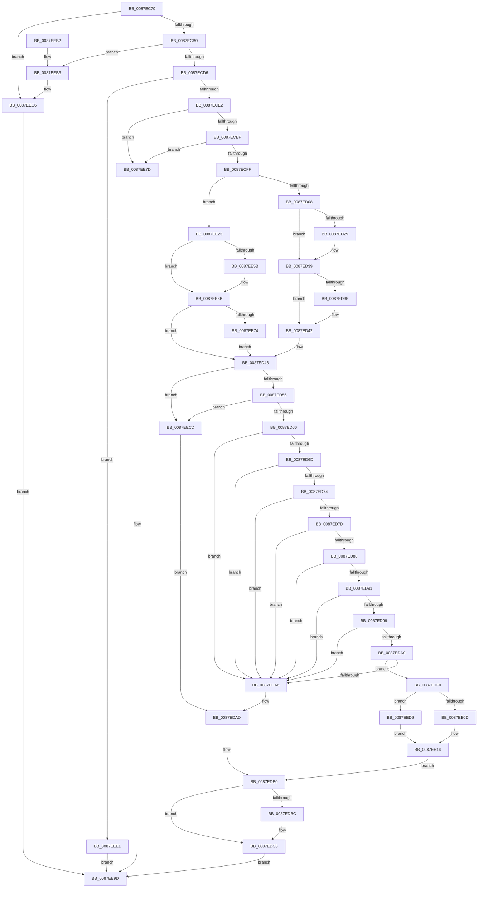

# NtAreMappedFilesTheSame

- RVA: `0x0087EC70`–`0x0087EEF2` (길이 `642` bytes)
- VA: `0x000000014087EC70`
- 실행 섹션: `PAGE`
- PDB 이름 있음: `예`; PDB Function 태그: `아니요`
- unwind 정보 RVA: `0x0007C0AC`
- 디코드: `184`개 명령, `642/642` bytes 표시
- 미해석 바이트: `0` (있으면 어셈블리에 `.byte`로 보존)

> 이 문서는 커널 이미지의 기계어와 PDB 기호를 분석해 생성했습니다. 4번과 5번은 함수 원형과 자료형을 바이너리 사용 방식에서 추정한 C 해석이며 원본 소스 복구 결과는 아닙니다.

## 1. Dependencies

- 직접 호출 지점: **27**; 고유 호출 대상: **13**
- 직접 호출자로 확인된 함수: **0**
- RIP 상대 이미지 참조: **0**

### Outgoing calls
- `0x0087EC9F` → [MiObtainReferencedVadEx](../../text/31/MiObtainReferencedVadEx_function_00316690.md) (function, `0x00316690`)
- `0x0087ECB6` → [MiUnlockVadShared](../../text/2E/MiUnlockVadShared_function_002E2420.md) (function, `0x002E2420`)
- `0x0087ECC5` → [MiObtainReferencedVadEx](../../text/31/MiObtainReferencedVadEx_function_00316690.md) (function, `0x00316690`)
- `0x0087ECE2` → [MiVadIsMetadataBitmap](MiVadIsMetadataBitmap_function_0087F95C.md) (function, `0x0087F95C`)
- `0x0087ECF2` → [MiVadIsMetadataBitmap](MiVadIsMetadataBitmap_function_0087F95C.md) (function, `0x0087F95C`)
- `0x0087ED14` → [KeAbPreAcquire](../../text/21/KeAbPreAcquire_function_00210230.md) (function, `0x00210230`)
- `0x0087ED34` → [ExfAcquirePushLockSharedEx](../../text/21/ExfAcquirePushLockSharedEx_function_0021044C.md) (function, `0x0021044C`)
- `0x0087ED49` → [MiVadDeleted](../../text/43/MiVadDeleted_function_00431350.md) (function, `0x00431350`)
- `0x0087ED59` → [MiVadDeleted](../../text/43/MiVadDeleted_function_00431350.md) (function, `0x00431350`)
- `0x0087EDBF` → [ExfReleasePushLockShared](../../text/26/ExfReleasePushLockShared_function_00263440.md) (function, `0x00263440`)
- `0x0087EDC9` → [KeAbPostRelease](../../text/2E/KeAbPostRelease_function_002E1600.md) (function, `0x002E1600`)
- `0x0087EDD1` → [MiUnlockAndDereferenceVadShared](../../text/2A/MiUnlockAndDereferenceVadShared_function_002AEF10.md) (function, `0x002AEF10`)
- `0x0087EDDC` → [MiLockVadShared](../../text/31/MiLockVadShared_function_00316DE0.md) (function, `0x00316DE0`)
- `0x0087EDE4` → [MiUnlockAndDereferenceVadShared](../../text/2A/MiUnlockAndDereferenceVadShared_function_002AEF10.md) (function, `0x002AEF10`)
- `0x0087EDF3` → [MiReferenceControlAreaFile](../../text/43/MiReferenceControlAreaFile_function_00431554.md) (function, `0x00431554`)
- `0x0087EE1C` → [MiDereferenceControlAreaFile](../../text/43/MiDereferenceControlAreaFile_function_004345E0.md) (function, `0x004345E0`)
- `0x0087EE29` → [MiUnlockVadShared](../../text/2E/MiUnlockVadShared_function_002E2420.md) (function, `0x002E2420`)
- `0x0087EE34` → [MiLockVadShared](../../text/31/MiLockVadShared_function_00316DE0.md) (function, `0x00316DE0`)
- `0x0087EE45` → [KeAbPreAcquire](../../text/21/KeAbPreAcquire_function_00210230.md) (function, `0x00210230`)
- `0x0087EE66` → [ExfAcquirePushLockSharedEx](../../text/21/ExfAcquirePushLockSharedEx_function_0021044C.md) (function, `0x0021044C`)
- `0x0087EE80` → [MiUnlockAndDereferenceVadShared](../../text/2A/MiUnlockAndDereferenceVadShared_function_002AEF10.md) (function, `0x002AEF10`)
- `0x0087EE8B` → [MiLockVadShared](../../text/31/MiLockVadShared_function_00316DE0.md) (function, `0x00316DE0`)
- `0x0087EE93` → [MiUnlockAndDereferenceVadShared](../../text/2A/MiUnlockAndDereferenceVadShared_function_002AEF10.md) (function, `0x002AEF10`)
- `0x0087EEB9` → [MiLockVadShared](../../text/31/MiLockVadShared_function_00316DE0.md) (function, `0x00316DE0`)
- `0x0087EEC1` → [MiUnlockAndDereferenceVadShared](../../text/2A/MiUnlockAndDereferenceVadShared_function_002AEF10.md) (function, `0x002AEF10`)
- `0x0087EEE1` → [MiDereferenceVad](../../text/29/MiDereferenceVad_function_00295EE0.md) (function, `0x00295EE0`)
- `0x0087EEE9` → [MiUnlockAndDereferenceVadShared](../../text/2A/MiUnlockAndDereferenceVadShared_function_002AEF10.md) (function, `0x002AEF10`)

### Direct callers
- 이 함수 시작 RVA로 연결되는 직접 call은 확인되지 않았습니다. 간접 호출은 완전히 역산할 수 없습니다.

### Static image references
- 디코드된 RIP-relative 메모리 참조가 없습니다.

## 2. Other-region calls and transfers

- 다른 실행 섹션으로 향하는 call: **25**
  - `0x0087EC9F` → [MiObtainReferencedVadEx](../../text/31/MiObtainReferencedVadEx_function_00316690.md) (`PAGE` → `.text`)
  - `0x0087ECB6` → [MiUnlockVadShared](../../text/2E/MiUnlockVadShared_function_002E2420.md) (`PAGE` → `.text`)
  - `0x0087ECC5` → [MiObtainReferencedVadEx](../../text/31/MiObtainReferencedVadEx_function_00316690.md) (`PAGE` → `.text`)
  - `0x0087ED14` → [KeAbPreAcquire](../../text/21/KeAbPreAcquire_function_00210230.md) (`PAGE` → `.text`)
  - `0x0087ED34` → [ExfAcquirePushLockSharedEx](../../text/21/ExfAcquirePushLockSharedEx_function_0021044C.md) (`PAGE` → `.text`)
  - `0x0087ED49` → [MiVadDeleted](../../text/43/MiVadDeleted_function_00431350.md) (`PAGE` → `.text`)
  - `0x0087ED59` → [MiVadDeleted](../../text/43/MiVadDeleted_function_00431350.md) (`PAGE` → `.text`)
  - `0x0087EDBF` → [ExfReleasePushLockShared](../../text/26/ExfReleasePushLockShared_function_00263440.md) (`PAGE` → `.text`)
  - `0x0087EDC9` → [KeAbPostRelease](../../text/2E/KeAbPostRelease_function_002E1600.md) (`PAGE` → `.text`)
  - `0x0087EDD1` → [MiUnlockAndDereferenceVadShared](../../text/2A/MiUnlockAndDereferenceVadShared_function_002AEF10.md) (`PAGE` → `.text`)
  - `0x0087EDDC` → [MiLockVadShared](../../text/31/MiLockVadShared_function_00316DE0.md) (`PAGE` → `.text`)
  - `0x0087EDE4` → [MiUnlockAndDereferenceVadShared](../../text/2A/MiUnlockAndDereferenceVadShared_function_002AEF10.md) (`PAGE` → `.text`)
  - `0x0087EDF3` → [MiReferenceControlAreaFile](../../text/43/MiReferenceControlAreaFile_function_00431554.md) (`PAGE` → `.text`)
  - `0x0087EE1C` → [MiDereferenceControlAreaFile](../../text/43/MiDereferenceControlAreaFile_function_004345E0.md) (`PAGE` → `.text`)
  - `0x0087EE29` → [MiUnlockVadShared](../../text/2E/MiUnlockVadShared_function_002E2420.md) (`PAGE` → `.text`)
  - `0x0087EE34` → [MiLockVadShared](../../text/31/MiLockVadShared_function_00316DE0.md) (`PAGE` → `.text`)
  - `0x0087EE45` → [KeAbPreAcquire](../../text/21/KeAbPreAcquire_function_00210230.md) (`PAGE` → `.text`)
  - `0x0087EE66` → [ExfAcquirePushLockSharedEx](../../text/21/ExfAcquirePushLockSharedEx_function_0021044C.md) (`PAGE` → `.text`)
  - `0x0087EE80` → [MiUnlockAndDereferenceVadShared](../../text/2A/MiUnlockAndDereferenceVadShared_function_002AEF10.md) (`PAGE` → `.text`)
  - `0x0087EE8B` → [MiLockVadShared](../../text/31/MiLockVadShared_function_00316DE0.md) (`PAGE` → `.text`)
  - `0x0087EE93` → [MiUnlockAndDereferenceVadShared](../../text/2A/MiUnlockAndDereferenceVadShared_function_002AEF10.md) (`PAGE` → `.text`)
  - `0x0087EEB9` → [MiLockVadShared](../../text/31/MiLockVadShared_function_00316DE0.md) (`PAGE` → `.text`)
  - `0x0087EEC1` → [MiUnlockAndDereferenceVadShared](../../text/2A/MiUnlockAndDereferenceVadShared_function_002AEF10.md) (`PAGE` → `.text`)
  - `0x0087EEE1` → [MiDereferenceVad](../../text/29/MiDereferenceVad_function_00295EE0.md) (`PAGE` → `.text`)
  - `0x0087EEE9` → [MiUnlockAndDereferenceVadShared](../../text/2A/MiUnlockAndDereferenceVadShared_function_002AEF10.md) (`PAGE` → `.text`)
- 별도 외부 분기/꼬리 이동을 확인하지 못했습니다.

## 3. Assembly (complete function range)

```asm
0087EC70  48 89 5C 24 08                  mov qword ptr [rsp + 8], rbx
0087EC75  55                              push rbp
0087EC76  56                              push rsi
0087EC77  57                              push rdi
0087EC78  41 54                           push r12
0087EC7A  41 55                           push r13
0087EC7C  41 56                           push r14
0087EC7E  41 57                           push r15
0087EC80  48 83 EC 20                     sub rsp, 0x20
0087EC84  65 4C 8B 2C 25 88 01 00 00      mov r13, qword ptr gs:[0x188]
0087EC8D  4C 8D 44 24 70                  lea r8, [rsp + 0x70]
0087EC92  48 8B DA                        mov rbx, rdx
0087EC95  BD 02 00 00 00                  mov ebp, 2
0087EC9A  8B D5                           mov edx, ebp
0087EC9C  48 8B F9                        mov rdi, rcx
0087EC9F  E8 EC 79 A9 FF                  call 0x140316690
0087ECA4  48 8B F0                        mov rsi, rax
0087ECA7  48 85 C0                        test rax, rax
0087ECAA  0F 84 16 02 00 00               je 0x14087eec6
0087ECB0  48 8B D0                        mov rdx, rax
0087ECB3  49 8B CD                        mov rcx, r13
0087ECB6  E8 65 37 A6 FF                  call 0x1402e2420
0087ECBB  4C 8D 44 24 70                  lea r8, [rsp + 0x70]
0087ECC0  8B D5                           mov edx, ebp
0087ECC2  48 8B CB                        mov rcx, rbx
0087ECC5  E8 C6 79 A9 FF                  call 0x140316690
0087ECCA  48 8B E8                        mov rbp, rax
0087ECCD  48 85 C0                        test rax, rax
0087ECD0  0F 84 DD 01 00 00               je 0x14087eeb3
0087ECD6  48 8B CE                        mov rcx, rsi
0087ECD9  48 3B F0                        cmp rsi, rax
0087ECDC  0F 84 FF 01 00 00               je 0x14087eee1
0087ECE2  E8 75 0C 00 00                  call 0x14087f95c
0087ECE7  85 C0                           test eax, eax
0087ECE9  0F 85 8E 01 00 00               jne 0x14087ee7d
0087ECEF  48 8B CD                        mov rcx, rbp
0087ECF2  E8 65 0C 00 00                  call 0x14087f95c
0087ECF7  85 C0                           test eax, eax
0087ECF9  0F 85 7E 01 00 00               jne 0x14087ee7d
0087ECFF  48 3B FB                        cmp rdi, rbx
0087ED02  0F 86 1B 01 00 00               jbe 0x14087ee23
0087ED08  48 8D 5E 28                     lea rbx, [rsi + 0x28]
0087ED0C  45 33 C0                        xor r8d, r8d
0087ED0F  48 8B CB                        mov rcx, rbx
0087ED12  33 D2                           xor edx, edx
0087ED14  E8 17 15 99 FF                  call 0x140210230
0087ED19  48 8B F8                        mov rdi, rax
0087ED1C  33 C0                           xor eax, eax
0087ED1E  44 8D 78 11                     lea r15d, [rax + 0x11]
0087ED22  F0 4C 0F B1 3B                  lock cmpxchg qword ptr [rbx], r15
0087ED27  74 10                           je 0x14087ed39
0087ED29  4C 8B CB                        mov r9, rbx
0087ED2C  4C 8B C7                        mov r8, rdi
0087ED2F  33 D2                           xor edx, edx
0087ED31  48 8B CB                        mov rcx, rbx
0087ED34  E8 13 17 99 FF                  call 0x14021044c
0087ED39  48 85 FF                        test rdi, rdi
0087ED3C  74 04                           je 0x14087ed42
0087ED3E  C6 47 0A 01                     mov byte ptr [rdi + 0xa], 1
0087ED42  4C 8D 75 28                     lea r14, [rbp + 0x28]
0087ED46  48 8B CE                        mov rcx, rsi
0087ED49  E8 02 26 BB FF                  call 0x140431350
0087ED4E  85 C0                           test eax, eax
0087ED50  0F 85 77 01 00 00               jne 0x14087eecd
0087ED56  48 8B CD                        mov rcx, rbp
0087ED59  E8 F2 25 BB FF                  call 0x140431350
0087ED5E  85 C0                           test eax, eax
0087ED60  0F 85 67 01 00 00               jne 0x14087eecd
0087ED66  0F BA 66 30 15                  bt dword ptr [rsi + 0x30], 0x15
0087ED6B  72 39                           jb 0x14087eda6
0087ED6D  0F BA 65 30 15                  bt dword ptr [rbp + 0x30], 0x15
0087ED72  72 32                           jb 0x14087eda6
0087ED74  4C 8B 66 48                     mov r12, qword ptr [rsi + 0x48]
0087ED78  4D 85 E4                        test r12, r12
0087ED7B  74 29                           je 0x14087eda6
0087ED7D  4C 8B 7D 48                     mov r15, qword ptr [rbp + 0x48]
0087ED81  33 C0                           xor eax, eax
0087ED83  4D 85 FF                        test r15, r15
0087ED86  74 1E                           je 0x14087eda6
0087ED88  4D 8B 24 24                     mov r12, qword ptr [r12]
0087ED8C  4D 85 E4                        test r12, r12
0087ED8F  74 15                           je 0x14087eda6
0087ED91  4D 8B 3F                        mov r15, qword ptr [r15]
0087ED94  4D 85 FF                        test r15, r15
0087ED97  74 0D                           je 0x14087eda6
0087ED99  49 39 44 24 40                  cmp qword ptr [r12 + 0x40], rax
0087ED9E  74 06                           je 0x14087eda6
0087EDA0  49 39 47 40                     cmp qword ptr [r15 + 0x40], rax
0087EDA4  75 4A                           jne 0x14087edf0
0087EDA6  BB 18 00 00 C0                  mov ebx, 0xc0000018
0087EDAB  8B FB                           mov edi, ebx
0087EDAD  45 33 E4                        xor r12d, r12d
0087EDB0  B8 11 00 00 00                  mov eax, 0x11
0087EDB5  F0 4D 0F B1 26                  lock cmpxchg qword ptr [r14], r12
0087EDBA  74 0A                           je 0x14087edc6
0087EDBC  49 8B CE                        mov rcx, r14
0087EDBF  E8 7C 46 9E FF                  call 0x140263440
0087EDC4  8B FB                           mov edi, ebx
0087EDC6  49 8B CE                        mov rcx, r14
0087EDC9  E8 32 28 A6 FF                  call 0x1402e1600
0087EDCE  48 8B CE                        mov rcx, rsi
0087EDD1  E8 3A 01 A3 FF                  call 0x1402aef10
0087EDD6  48 8B D5                        mov rdx, rbp
0087EDD9  49 8B CD                        mov rcx, r13
0087EDDC  E8 FF 7F A9 FF                  call 0x140316de0
0087EDE1  48 8B CD                        mov rcx, rbp
0087EDE4  E8 27 01 A3 FF                  call 0x1402aef10
0087EDE9  8B C7                           mov eax, edi
0087EDEB  E9 AD 00 00 00                  jmp 0x14087ee9d
0087EDF0  49 8B CF                        mov rcx, r15
0087EDF3  E8 5C 27 BB FF                  call 0x140431554
0087EDF8  BF D4 00 00 C0                  mov edi, 0xc00000d4
0087EDFD  8B DF                           mov ebx, edi
0087EDFF  48 8B 50 28                     mov rdx, qword ptr [rax + 0x28]
0087EE03  4C 3B 62 10                     cmp r12, qword ptr [rdx + 0x10]
0087EE07  0F 85 CC 00 00 00               jne 0x14087eed9
0087EE0D  45 33 E4                        xor r12d, r12d
0087EE10  41 8B FC                        mov edi, r12d
0087EE13  41 8B DC                        mov ebx, r12d
0087EE16  48 8B D0                        mov rdx, rax
0087EE19  49 8B CF                        mov rcx, r15
0087EE1C  E8 BF 57 BB FF                  call 0x1404345e0
0087EE21  EB 8D                           jmp 0x14087edb0
0087EE23  48 8B D5                        mov rdx, rbp
0087EE26  49 8B CD                        mov rcx, r13
0087EE29  E8 F2 35 A6 FF                  call 0x1402e2420
0087EE2E  48 8B D6                        mov rdx, rsi
0087EE31  49 8B CD                        mov rcx, r13
0087EE34  E8 A7 7F A9 FF                  call 0x140316de0
0087EE39  4C 8D 75 28                     lea r14, [rbp + 0x28]
0087EE3D  45 33 C0                        xor r8d, r8d
0087EE40  49 8B CE                        mov rcx, r14
0087EE43  33 D2                           xor edx, edx
0087EE45  E8 E6 13 99 FF                  call 0x140210230
0087EE4A  48 8B D8                        mov rbx, rax
0087EE4D  B9 11 00 00 00                  mov ecx, 0x11
0087EE52  33 C0                           xor eax, eax
0087EE54  F0 49 0F B1 0E                  lock cmpxchg qword ptr [r14], rcx
0087EE59  74 10                           je 0x14087ee6b
0087EE5B  4D 8B CE                        mov r9, r14
0087EE5E  4C 8B C3                        mov r8, rbx
0087EE61  33 D2                           xor edx, edx
0087EE63  49 8B CE                        mov rcx, r14
0087EE66  E8 E1 15 99 FF                  call 0x14021044c
0087EE6B  48 85 DB                        test rbx, rbx
0087EE6E  0F 84 D2 FE FF FF               je 0x14087ed46
0087EE74  C6 43 0A 01                     mov byte ptr [rbx + 0xa], 1
0087EE78  E9 C9 FE FF FF                  jmp 0x14087ed46
0087EE7D  48 8B CD                        mov rcx, rbp
0087EE80  E8 8B 00 A3 FF                  call 0x1402aef10
0087EE85  48 8B D6                        mov rdx, rsi
0087EE88  49 8B CD                        mov rcx, r13
0087EE8B  E8 50 7F A9 FF                  call 0x140316de0
0087EE90  48 8B CE                        mov rcx, rsi
0087EE93  E8 78 00 A3 FF                  call 0x1402aef10
0087EE98  B8 18 00 00 C0                  mov eax, 0xc0000018
0087EE9D  48 8B 5C 24 60                  mov rbx, qword ptr [rsp + 0x60]
0087EEA2  48 83 C4 20                     add rsp, 0x20
0087EEA6  41 5F                           pop r15
0087EEA8  41 5E                           pop r14
0087EEAA  41 5D                           pop r13
0087EEAC  41 5C                           pop r12
0087EEAE  5F                              pop rdi
0087EEAF  5E                              pop rsi
0087EEB0  5D                              pop rbp
0087EEB1  C3                              ret
0087EEB2  CC                              int3
0087EEB3  48 8B D6                        mov rdx, rsi
0087EEB6  49 8B CD                        mov rcx, r13
0087EEB9  E8 22 7F A9 FF                  call 0x140316de0
0087EEBE  48 8B CE                        mov rcx, rsi
0087EEC1  E8 4A 00 A3 FF                  call 0x1402aef10
0087EEC6  B8 41 01 00 C0                  mov eax, 0xc0000141
0087EECB  EB D0                           jmp 0x14087ee9d
0087EECD  BF 41 01 00 C0                  mov edi, 0xc0000141
0087EED2  8B DF                           mov ebx, edi
0087EED4  E9 D4 FE FF FF                  jmp 0x14087edad
0087EED9  45 33 E4                        xor r12d, r12d
0087EEDC  E9 35 FF FF FF                  jmp 0x14087ee16
0087EEE1  E8 FA 6F A1 FF                  call 0x140295ee0
0087EEE6  48 8B CD                        mov rcx, rbp
0087EEE9  E8 22 00 A3 FF                  call 0x1402aef10
0087EEEE  33 C0                           xor eax, eax
0087EEF0  EB AB                           jmp 0x14087ee9d
```

## 4. C-style interpretation (structured pseudocode)

```c
__int64 __fastcall NtAreMappedFilesTheSame(__int64 a1, __int64 a2)
{
    __int64 result;
    __int64 v_r12;
    __int64 v_rdi;
    __int64 v_rsp;
    unsigned __int64 v_stack_p18;
    unsigned __int64 v_stack_p8;

    v_stack_p8 = v_rbx;
    v_rsp = (v_rsp) - (32);
    result = MiObtainReferencedVadEx(a1, 2, v_stack_p18, a4);
    if (result == 0) goto loc_0087EEC6;
    result = MiUnlockVadShared(*(unsigned __int64 *)(gs_base + (0 + 392)), result, v_stack_p18, a4);
    result = MiObtainReferencedVadEx(a2, 2, v_stack_p18, a4);
    if (result == 0) goto loc_0087EEB3;
    if (result == result) goto loc_0087EEE1;
    result = MiVadIsMetadataBitmap(result, 2, v_stack_p18, a4);
    if ((unsigned int)(result) != 0) goto loc_0087EE7D;
    result = MiVadIsMetadataBitmap(result, 2, v_stack_p18, a4);
    if ((unsigned int)(result) != 0) goto loc_0087EE7D;
    if (a1 <= a2) goto loc_0087EE23;
    a3 = 0;
    a2 = 0;
    result = KeAbPreAcquire(result + 40, a2, a3, a4);
    result = 0;
    if (!(condition_is_equal)) {
        a4 = result + 40;
        a3 = 0;
        a2 = 0;
        a1 = result + 40;
        result = ExfAcquirePushLockSharedEx(a1, a2, a3, a4);
    }
    if (result != 0) {
        *(unsigned __int8 *)(result + 10) = 1;
    }
loc_0087ED46:
    result = MiVadDeleted(result, a2, a3, a4);
    if ((unsigned int)(result) != 0) goto loc_0087EECD;
    result = MiVadDeleted(result, a2, a3, a4);
    if ((unsigned int)(result) != 0) goto loc_0087EECD;
    if (condition_is_below) goto loc_0087EDA6;
    if (condition_is_below) goto loc_0087EDA6;
    if (*(unsigned __int64 *)(result + 72) == 0) goto loc_0087EDA6;
    result = 0;
    if (*(unsigned __int64 *)(result + 72) == 0) goto loc_0087EDA6;
    if (*(unsigned __int64 *)(*(unsigned __int64 *)(result + 72)) == 0) goto loc_0087EDA6;
    if (*(unsigned __int64 *)(*(unsigned __int64 *)(result + 72)) == 0) goto loc_0087EDA6;
    if ((*(unsigned __int64 *)(*(unsigned __int64 *)(*(unsigned __int64 *)(result + 72)) + 64)) == 0) goto loc_0087EDA6;
    if ((*(unsigned __int64 *)(*(unsigned __int64 *)(*(unsigned __int64 *)(result + 72)) + 64)) != 0) goto loc_0087EDF0;
loc_0087EDA6:
loc_0087EDAD:
    v_r12 = 0;
loc_0087EDB0:
    result = 17;
    v_rdi = (unsigned int)((unsigned int)((unsigned int)(0xC0000018ULL)));
    if (!(condition_is_equal)) {
        a1 = result + 40;
        result = ExfReleasePushLockShared(a1, a2, a3, a4);
        v_rdi = (unsigned int)((unsigned int)(0xC0000018ULL));
    }
    result = KeAbPostRelease(result + 40, a2, a3, a4);
    result = MiUnlockAndDereferenceVadShared(result, a2, a3, a4);
    result = MiLockVadShared(*(unsigned __int64 *)(gs_base + (0 + 392)), result, a3, a4);
    result = MiUnlockAndDereferenceVadShared(result, result, a3, a4);
    goto loc_0087EE9D;
loc_0087EDF0:
    result = MiReferenceControlAreaFile(*(unsigned __int64 *)(*(unsigned __int64 *)(result + 72)), result, a3, a4);
    if (0 != (*(unsigned __int64 *)(*(unsigned __int64 *)(result + 40) + 16))) goto loc_0087EED9;
    v_r12 = 0;
loc_0087EE16:
    result = MiDereferenceControlAreaFile(*(unsigned __int64 *)(*(unsigned __int64 *)(result + 72)), result, a3, a4);
    goto loc_0087EDB0;
loc_0087EE23:
    result = MiUnlockVadShared(*(unsigned __int64 *)(gs_base + (0 + 392)), result, a3, a4);
    result = MiLockVadShared(*(unsigned __int64 *)(gs_base + (0 + 392)), result, a3, a4);
    a3 = 0;
    a2 = 0;
    result = KeAbPreAcquire(result + 40, a2, a3, a4);
    result = 0;
    if (!(condition_is_equal)) {
        a4 = result + 40;
        a3 = 0;
        a2 = 0;
        a1 = result + 40;
        result = ExfAcquirePushLockSharedEx(a1, a2, a3, a4);
    }
    if (result == 0) goto loc_0087ED46;
    *(unsigned __int8 *)(result + 10) = 1;
    goto loc_0087ED46;
loc_0087EE7D:
    result = MiUnlockAndDereferenceVadShared(result, a2, a3, a4);
    result = MiLockVadShared(*(unsigned __int64 *)(gs_base + (0 + 392)), result, a3, a4);
    result = MiUnlockAndDereferenceVadShared(result, result, a3, a4);
loc_0087EE9D:
    v_rsp = (v_rsp) + (32);
    return (unsigned int)(0xC0000018ULL);
loc_0087EEB3:
    result = MiLockVadShared(*(unsigned __int64 *)(gs_base + (0 + 392)), result, a3, a4);
    result = MiUnlockAndDereferenceVadShared(result, result, a3, a4);
loc_0087EEC6:
    goto loc_0087EE9D;
loc_0087EECD:
    goto loc_0087EDAD;
loc_0087EED9:
    v_r12 = 0;
    goto loc_0087EE16;
loc_0087EEE1:
    result = MiDereferenceVad(result, result, a3, a4);
    result = MiUnlockAndDereferenceVadShared(result, result, a3, a4);
    result = 0;
    goto loc_0087EE9D;
}
```

## 5. (Beta) C Style

```c
int64_t NtAreMappedFilesTheSame(int64_t Arg1, int64_t Arg2)
{
    int64_t result;
    int64_t local_r12;
    int64_t local_rdi;
    int64_t local_rsp;
    uint64_t v_stack_p18;
    uint64_t v_stack_p8;

    v_stack_p8 = local_rbx;
    local_rsp = (local_rsp) - (32);
    result = MiObtainReferencedVadEx(Arg1, 2, v_stack_p18, a4);
    if (result == 0) goto loc_0087EEC6;
    result = MiUnlockVadShared(*(uint64_t *)(gs_base + (0 + 0x188)), result, v_stack_p18, a4);
    result = MiObtainReferencedVadEx(Arg2, 2, v_stack_p18, a4);
    if (result == 0) goto loc_0087EEB3;
    if (result == result) goto loc_0087EEE1;
    result = MiVadIsMetadataBitmap(result, 2, v_stack_p18, a4);
    if ((uint32_t)(result) != 0) goto loc_0087EE7D;
    result = MiVadIsMetadataBitmap(result, 2, v_stack_p18, a4);
    if ((uint32_t)(result) != 0) goto loc_0087EE7D;
    if (Arg1 <= Arg2) goto loc_0087EE23;
    a3 = 0;
    Arg2 = 0;
    result = KeAbPreAcquire(result + 40, Arg2, a3, a4);
    result = 0;
    if (!(condition_is_equal)) {
        a4 = result + 40;
        a3 = 0;
        Arg2 = 0;
        Arg1 = result + 40;
        result = ExfAcquirePushLockSharedEx(Arg1, Arg2, a3, a4);
    }
    if (result != 0) {
        *(uint8_t *)(result + 0xA) = 1;
    }
loc_0087ED46:
    result = MiVadDeleted(result, Arg2, a3, a4);
    if ((uint32_t)(result) != 0) goto loc_0087EECD;
    result = MiVadDeleted(result, Arg2, a3, a4);
    if ((uint32_t)(result) != 0) goto loc_0087EECD;
    if (condition_is_below) goto loc_0087EDA6;
    if (condition_is_below) goto loc_0087EDA6;
    if (*(uint64_t *)(result + 0x48) == 0) goto loc_0087EDA6;
    result = 0;
    if (*(uint64_t *)(result + 0x48) == 0) goto loc_0087EDA6;
    if (*(uint64_t *)(*(uint64_t *)(result + 0x48)) == 0) goto loc_0087EDA6;
    if (*(uint64_t *)(*(uint64_t *)(result + 0x48)) == 0) goto loc_0087EDA6;
    if ((*(uint64_t *)(*(uint64_t *)(*(uint64_t *)(result + 0x48)) + 0x40)) == 0) goto loc_0087EDA6;
    if ((*(uint64_t *)(*(uint64_t *)(*(uint64_t *)(result + 0x48)) + 0x40)) != 0) goto loc_0087EDF0;
loc_0087EDA6:
loc_0087EDAD:
    local_r12 = 0;
loc_0087EDB0:
    result = 17;
    local_rdi = (uint32_t)((uint32_t)((uint32_t)(0xC0000018ULL)));
    if (!(condition_is_equal)) {
        Arg1 = result + 40;
        result = ExfReleasePushLockShared(Arg1, Arg2, a3, a4);
        local_rdi = (uint32_t)((uint32_t)(0xC0000018ULL));
    }
    result = KeAbPostRelease(result + 40, Arg2, a3, a4);
    result = MiUnlockAndDereferenceVadShared(result, Arg2, a3, a4);
    result = MiLockVadShared(*(uint64_t *)(gs_base + (0 + 0x188)), result, a3, a4);
    result = MiUnlockAndDereferenceVadShared(result, result, a3, a4);
    goto loc_0087EE9D;
loc_0087EDF0:
    result = MiReferenceControlAreaFile(*(uint64_t *)(*(uint64_t *)(result + 0x48)), result, a3, a4);
    if (0 != (*(uint64_t *)(*(uint64_t *)(result + 0x28) + 0x10))) goto loc_0087EED9;
    local_r12 = 0;
loc_0087EE16:
    result = MiDereferenceControlAreaFile(*(uint64_t *)(*(uint64_t *)(result + 0x48)), result, a3, a4);
    goto loc_0087EDB0;
loc_0087EE23:
    result = MiUnlockVadShared(*(uint64_t *)(gs_base + (0 + 0x188)), result, a3, a4);
    result = MiLockVadShared(*(uint64_t *)(gs_base + (0 + 0x188)), result, a3, a4);
    a3 = 0;
    Arg2 = 0;
    result = KeAbPreAcquire(result + 40, Arg2, a3, a4);
    result = 0;
    if (!(condition_is_equal)) {
        a4 = result + 40;
        a3 = 0;
        Arg2 = 0;
        Arg1 = result + 40;
        result = ExfAcquirePushLockSharedEx(Arg1, Arg2, a3, a4);
    }
    if (result == 0) goto loc_0087ED46;
    *(uint8_t *)(result + 0xA) = 1;
    goto loc_0087ED46;
loc_0087EE7D:
    result = MiUnlockAndDereferenceVadShared(result, Arg2, a3, a4);
    result = MiLockVadShared(*(uint64_t *)(gs_base + (0 + 0x188)), result, a3, a4);
    result = MiUnlockAndDereferenceVadShared(result, result, a3, a4);
loc_0087EE9D:
    local_rsp = (local_rsp) + (32);
    return (uint32_t)(0xC0000018ULL);
loc_0087EEB3:
    result = MiLockVadShared(*(uint64_t *)(gs_base + (0 + 0x188)), result, a3, a4);
    result = MiUnlockAndDereferenceVadShared(result, result, a3, a4);
loc_0087EEC6:
    goto loc_0087EE9D;
loc_0087EECD:
    goto loc_0087EDAD;
loc_0087EED9:
    local_r12 = 0;
    goto loc_0087EE16;
loc_0087EEE1:
    result = MiDereferenceVad(result, result, a3, a4);
    result = MiUnlockAndDereferenceVadShared(result, result, a3, a4);
    result = 0;
    goto loc_0087EE9D;
}
```

## 6. Execution-region graph

[열기: 2D/3D 그래프와 함수 탐색 컨트롤 패널](../../../control-panel.html?section=page&rva=0x0087EC70&view=graph)

- 2D 그래프는 위에서 아래로 흐르고, 3D 그래프는 빈 공간을 드래그해 회전합니다. Shift+드래그는 이동, 휠은 확대·축소, 함수 노드 선택은 대상 보고서 이동입니다.

### Static fallback


