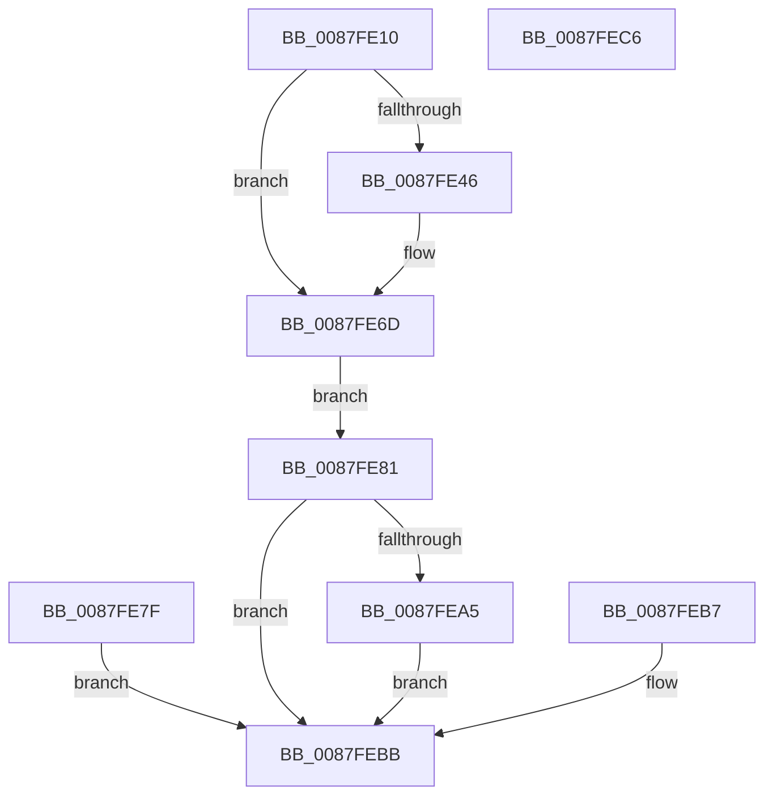

# NtFreeVirtualMemory

- RVA: `0x0087FE10`–`0x0087FEC7` (길이 `183` bytes)
- VA: `0x000000014087FE10`
- 실행 섹션: `PAGE`
- PDB 이름 있음: `예`; PDB Function 태그: `아니요`
- unwind 정보 RVA: `0x0007C380`
- 디코드: `49`개 명령, `183/183` bytes 표시
- 미해석 바이트: `0` (있으면 어셈블리에 `.byte`로 보존)

> 이 문서는 커널 이미지의 기계어와 PDB 기호를 분석해 생성했습니다. 4번과 5번은 함수 원형과 자료형을 바이너리 사용 방식에서 추정한 C 해석이며 원본 소스 복구 결과는 아닙니다.

## 1. Dependencies

- 직접 호출 지점: **1**; 고유 호출 대상: **1**
- 직접 호출자로 확인된 함수: **1**
- RIP 상대 이미지 참조: **0**

### Outgoing calls
- `0x0087FE98` → [MmFreeVirtualMemory](MmFreeVirtualMemory_function_0087FED0.md) (function, `0x0087FED0`)

### Direct callers
- [RtlpInitializeStackTraceDatabase](../78/RtlpInitializeStackTraceDatabase_function_0078C908.md) at `0x0078C972`

### Static image references
- 디코드된 RIP-relative 메모리 참조가 없습니다.

## 2. Other-region calls and transfers

- 다른 실행 섹션으로 향하는 call: **0**
- 별도 외부 분기/꼬리 이동을 확인하지 못했습니다.

## 3. Assembly (complete function range)

```asm
0087FE10  48 89 5C 24 08                  mov qword ptr [rsp + 8], rbx
0087FE15  57                              push rdi
0087FE16  48 83 EC 50                     sub rsp, 0x50
0087FE1A  49 8B D8                        mov rbx, r8
0087FE1D  48 8B FA                        mov rdi, rdx
0087FE20  4C 8B D1                        mov r10, rcx
0087FE23  45 33 DB                        xor r11d, r11d
0087FE26  4C 89 5C 24 38                  mov qword ptr [rsp + 0x38], r11
0087FE2B  4C 89 5C 24 40                  mov qword ptr [rsp + 0x40], r11
0087FE30  65 48 8B 04 25 88 01 00 00      mov rax, qword ptr gs:[0x188]
0087FE39  44 0F B6 80 32 02 00 00         movzx r8d, byte ptr [rax + 0x232]
0087FE41  45 84 C0                        test r8b, r8b
0087FE44  74 27                           je 0x14087fe6d
0087FE46  48 BA 00 00 FF FF FF 7F 00 00   movabs rdx, 0x7fffffff0000
0087FE50  48 8B CA                        mov rcx, rdx
0087FE53  48 3B FA                        cmp rdi, rdx
0087FE56  48 0F 42 CF                     cmovb rcx, rdi
0087FE5A  48 8B 01                        mov rax, qword ptr [rcx]
0087FE5D  48 89 01                        mov qword ptr [rcx], rax
0087FE60  48 3B DA                        cmp rbx, rdx
0087FE63  48 0F 42 D3                     cmovb rdx, rbx
0087FE67  48 8B 02                        mov rax, qword ptr [rdx]
0087FE6A  48 89 02                        mov qword ptr [rdx], rax
0087FE6D  48 8B 07                        mov rax, qword ptr [rdi]
0087FE70  48 89 44 24 40                  mov qword ptr [rsp + 0x40], rax
0087FE75  48 8B 03                        mov rax, qword ptr [rbx]
0087FE78  48 89 44 24 38                  mov qword ptr [rsp + 0x38], rax
0087FE7D  EB 02                           jmp 0x14087fe81
0087FE7F  EB 3A                           jmp 0x14087febb
0087FE81  44 89 5C 24 28                  mov dword ptr [rsp + 0x28], r11d
0087FE86  44 88 44 24 20                  mov byte ptr [rsp + 0x20], r8b
0087FE8B  4C 8D 44 24 38                  lea r8, [rsp + 0x38]
0087FE90  48 8D 54 24 40                  lea rdx, [rsp + 0x40]
0087FE95  49 8B CA                        mov rcx, r10
0087FE98  E8 33 00 00 00                  call 0x14087fed0
0087FE9D  89 44 24 34                     mov dword ptr [rsp + 0x34], eax
0087FEA1  85 C0                           test eax, eax
0087FEA3  78 16                           js 0x14087febb
0087FEA5  48 8B 4C 24 38                  mov rcx, qword ptr [rsp + 0x38]
0087FEAA  48 89 0B                        mov qword ptr [rbx], rcx
0087FEAD  48 8B 4C 24 40                  mov rcx, qword ptr [rsp + 0x40]
0087FEB2  48 89 0F                        mov qword ptr [rdi], rcx
0087FEB5  EB 04                           jmp 0x14087febb
0087FEB7  8B 44 24 34                     mov eax, dword ptr [rsp + 0x34]
0087FEBB  48 8B 5C 24 60                  mov rbx, qword ptr [rsp + 0x60]
0087FEC0  48 83 C4 50                     add rsp, 0x50
0087FEC4  5F                              pop rdi
0087FEC5  C3                              ret
0087FEC6  CC                              int3
```

## 4. C-style interpretation (structured pseudocode)

```c
__int64 __fastcall NtFreeVirtualMemory(__int64 a1, __int64 a2, __int64 a3)
{
    __int64 result;
    __int64 v_r11;
    __int64 v_rsp;
    unsigned __int64 v_stack_m18;
    unsigned __int64 v_stack_m20;
    unsigned int v_stack_m24;
    unsigned int v_stack_m30;
    unsigned __int8 v_stack_m38;
    unsigned __int64 v_stack_p8;

    v_stack_p8 = v_rbx;
    v_rsp = (v_rsp) - (80);
    v_r11 = 0;
    v_stack_m20 = 0;
    v_stack_m18 = 0;
    result = *(unsigned __int64 *)(gs_base + (0 + 392));
    if ((unsigned __int8)(*(unsigned __int8 *)(*(unsigned __int64 *)(gs_base + (0 + 392)) + 562)) != 0) {
        a1 = a2;
        if (a2 < a2) { a1 = a2; }
        result = *(unsigned __int64 *)(a1);
        *(unsigned __int64 *)(a1) = result;
        if (a3 < a2) { a2 = a3; }
        result = *(unsigned __int64 *)(a2);
        *(unsigned __int64 *)(a2) = result;
    }
    v_stack_m18 = *(unsigned __int64 *)(a2);
    v_stack_m20 = *(unsigned __int64 *)(a3);
    goto loc_0087FE81;
loc_0087FE81:
    v_stack_m30 = 0;
    v_stack_m38 = (unsigned __int8)(*(unsigned __int8 *)(*(unsigned __int64 *)(gs_base + (0 + 392)) + 562));
    result = MmFreeVirtualMemory(a1, v_stack_m18, v_stack_m20, a4);
    v_stack_m24 = (unsigned int)(result);
    if (sign_flag) goto loc_0087FEBB;
    *(unsigned __int64 *)(a3) = v_stack_m20;
    *(unsigned __int64 *)(a2) = v_stack_m18;
    goto loc_0087FEBB;
loc_0087FEBB:
    v_rsp = (v_rsp) + (80);
    return result;
}
```

## 5. (Beta) C Style

```c
int64_t NtFreeVirtualMemory(int64_t Arg1, int64_t Arg2, int64_t Arg3)
{
    int64_t result;
    int64_t local_r11;
    int64_t local_rsp;
    uint64_t v_stack_m18;
    uint64_t v_stack_m20;
    uint32_t v_stack_m24;
    uint32_t v_stack_m30;
    uint8_t v_stack_m38;
    uint64_t v_stack_p8;

    v_stack_p8 = local_rbx;
    local_rsp = (local_rsp) - (80);
    local_r11 = 0;
    v_stack_m20 = 0;
    v_stack_m18 = 0;
    result = *(uint64_t *)(gs_base + (0 + 0x188));
    if ((uint8_t)(*(uint8_t *)(*(uint64_t *)(gs_base + (0 + 0x188)) + 0x232)) != 0) {
        Arg1 = Arg2;
        if (Arg2 < Arg2) { Arg1 = Arg2; }
        result = *(uint64_t *)(Arg1);
        *(uint64_t *)(Arg1) = result;
        if (Arg3 < Arg2) { Arg2 = Arg3; }
        result = *(uint64_t *)(Arg2);
        *(uint64_t *)(Arg2) = result;
    }
    v_stack_m18 = *(uint64_t *)(Arg2);
    v_stack_m20 = *(uint64_t *)(Arg3);
    goto loc_0087FE81;
loc_0087FE81:
    v_stack_m30 = 0;
    v_stack_m38 = (uint8_t)(*(uint8_t *)(*(uint64_t *)(gs_base + (0 + 0x188)) + 0x232));
    result = MmFreeVirtualMemory(Arg1, v_stack_m18, v_stack_m20, a4);
    v_stack_m24 = (uint32_t)(result);
    if (sign_flag) goto loc_0087FEBB;
    *(uint64_t *)(Arg3) = v_stack_m20;
    *(uint64_t *)(Arg2) = v_stack_m18;
    goto loc_0087FEBB;
loc_0087FEBB:
    local_rsp = (local_rsp) + (80);
    return result;
}
```

## 6. Execution-region graph

[열기: 2D/3D 그래프와 함수 탐색 컨트롤 패널](../../../control-panel.html?section=page&rva=0x0087FE10&view=graph)

- 2D 그래프는 위에서 아래로 흐르고, 3D 그래프는 빈 공간을 드래그해 회전합니다. Shift+드래그는 이동, 휠은 확대·축소, 함수 노드 선택은 대상 보고서 이동입니다.

### Static fallback


