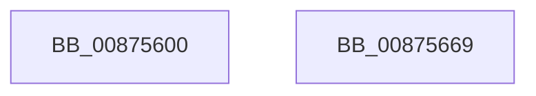

# NtLoadKeyEx

- RVA: `0x00875600`–`0x0087566A` (길이 `106` bytes)
- VA: `0x0000000140875600`
- 실행 섹션: `PAGE`
- PDB 이름 있음: `예`; PDB Function 태그: `아니요`
- unwind 정보 RVA: `0x0006C9B8`
- 디코드: `23`개 명령, `106/106` bytes 표시
- 미해석 바이트: `0` (있으면 어셈블리에 `.byte`로 보존)

> 이 문서는 커널 이미지의 기계어와 PDB 기호를 분석해 생성했습니다. 4번과 5번은 함수 원형과 자료형을 바이너리 사용 방식에서 추정한 C 해석이며 원본 소스 복구 결과는 아닙니다.

## 1. Dependencies

- 직접 호출 지점: **1**; 고유 호출 대상: **1**
- 직접 호출자로 확인된 함수: **1**
- RIP 상대 이미지 참조: **0**

### Outgoing calls
- `0x0087565F` → [CmLoadDifferencingKey](CmLoadDifferencingKey_function_00875670.md) (function, `0x00875670`)

### Direct callers
- [NtLoadKey](../AA/NtLoadKey_function_00AA00E0.md) at `0x00AA00FF`

### Static image references
- 디코드된 RIP-relative 메모리 참조가 없습니다.

## 2. Other-region calls and transfers

- 다른 실행 섹션으로 향하는 call: **0**
- 별도 외부 분기/꼬리 이동을 확인하지 못했습니다.

## 3. Assembly (complete function range)

```asm
00875600  4C 8B DC                        mov r11, rsp
00875603  48 83 EC 78                     sub rsp, 0x78
00875607  65 48 8B 04 25 88 01 00 00      mov rax, qword ptr gs:[0x188]
00875610  44 8A 90 32 02 00 00            mov r10b, byte ptr [rax + 0x232]
00875617  33 C0                           xor eax, eax
00875619  45 88 53 E8                     mov byte ptr [r11 - 0x18], r10b
0087561D  49 89 43 E0                     mov qword ptr [r11 - 0x20], rax
00875621  88 44 24 50                     mov byte ptr [rsp + 0x50], al
00875625  49 89 43 D0                     mov qword ptr [r11 - 0x30], rax
00875629  48 8B 84 24 B8 00 00 00         mov rax, qword ptr [rsp + 0xb8]
00875631  49 89 43 C8                     mov qword ptr [r11 - 0x38], rax
00875635  48 8B 84 24 B0 00 00 00         mov rax, qword ptr [rsp + 0xb0]
0087563D  49 89 43 C0                     mov qword ptr [r11 - 0x40], rax
00875641  8B 84 24 A8 00 00 00            mov eax, dword ptr [rsp + 0xa8]
00875648  89 44 24 30                     mov dword ptr [rsp + 0x30], eax
0087564C  48 8B 84 24 A0 00 00 00         mov rax, qword ptr [rsp + 0xa0]
00875654  49 89 43 B0                     mov qword ptr [r11 - 0x50], rax
00875658  4D 89 4B A8                     mov qword ptr [r11 - 0x58], r9
0087565C  45 33 C9                        xor r9d, r9d
0087565F  E8 0C 00 00 00                  call 0x140875670
00875664  48 83 C4 78                     add rsp, 0x78
00875668  C3                              ret
00875669  CC                              int3
```

## 4. C-style interpretation (structured pseudocode)

```c
__int64 __fastcall NtLoadKeyEx(__int64 a1, __int64 a2, __int64 a3, __int64 a4, __int64 a5, unsigned int a6, __int64 a7, __int64 a8)
{
    __int64 result;
    __int64 v_rsp;
    unsigned __int8 v_stack_m28;
    unsigned int v_stack_m48;

    v_rsp = (v_rsp) - (120);
    result = 0;
    *(unsigned __int8 *)(v_rsp - 24) = (unsigned __int8)(*(unsigned __int8 *)(*(unsigned __int64 *)(gs_base + (0 + 392)) + 562));
    *(unsigned __int64 *)(v_rsp - 32) = 0;
    v_stack_m28 = 0;
    *(unsigned __int64 *)(v_rsp - 48) = 0;
    *(unsigned __int64 *)(v_rsp - 56) = a8;
    *(unsigned __int64 *)(v_rsp - 64) = a7;
    v_stack_m48 = (unsigned int)((unsigned int)(a6));
    *(unsigned __int64 *)(v_rsp - 80) = a5;
    *(unsigned __int64 *)(v_rsp - 88) = a4;
    a4 = 0;
    result = CmLoadDifferencingKey(a1, a2, a3, a4);
    v_rsp = (v_rsp) + (120);
    return result;
}
```

## 5. (Beta) C Style

```c
int64_t NtLoadKeyEx(int64_t Arg1, int64_t Arg2, int64_t Arg3, int64_t Arg4, int64_t Arg5, uint32_t Arg6, int64_t Arg7, int64_t Arg8)
{
    int64_t result;
    int64_t local_rsp;
    uint8_t v_stack_m28;
    uint32_t v_stack_m48;

    local_rsp = (local_rsp) - (120);
    result = 0;
    *(uint8_t *)(local_rsp - 0x18) = (uint8_t)(*(uint8_t *)(*(uint64_t *)(gs_base + (0 + 0x188)) + 0x232));
    *(uint64_t *)(local_rsp - 0x20) = 0;
    v_stack_m28 = 0;
    *(uint64_t *)(local_rsp - 0x30) = 0;
    *(uint64_t *)(local_rsp - 0x38) = Arg8;
    *(uint64_t *)(local_rsp - 0x40) = Arg7;
    v_stack_m48 = (uint32_t)((uint32_t)(Arg6));
    *(uint64_t *)(local_rsp - 0x50) = Arg5;
    *(uint64_t *)(local_rsp - 0x58) = Arg4;
    Arg4 = 0;
    result = CmLoadDifferencingKey(Arg1, Arg2, Arg3, Arg4);
    local_rsp = (local_rsp) + (120);
    return result;
}
```

## 6. Execution-region graph

[열기: 2D/3D 그래프와 함수 탐색 컨트롤 패널](../../../control-panel.html?section=page&rva=0x00875600&view=graph)

- 2D 그래프는 위에서 아래로 흐르고, 3D 그래프는 빈 공간을 드래그해 회전합니다. Shift+드래그는 이동, 휠은 확대·축소, 함수 노드 선택은 대상 보고서 이동입니다.

### Static fallback


