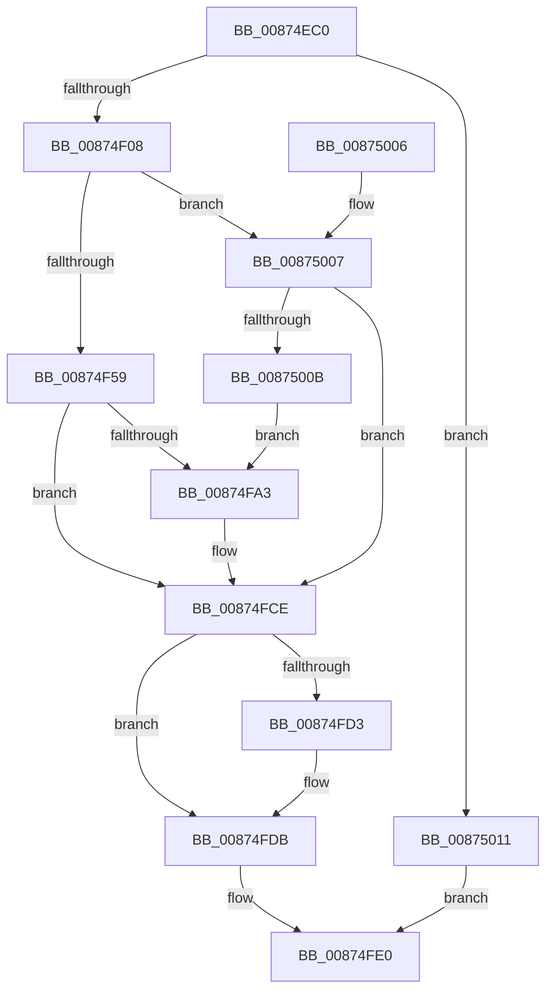

# NtOpenKeyTransactedEx

- RVA: `0x00874EC0`–`0x00875018` (길이 `344` bytes)
- VA: `0x0000000140874EC0`
- 실행 섹션: `PAGE`
- PDB 이름 있음: `예`; PDB Function 태그: `아니요`
- unwind 정보 RVA: `0x0006C944`
- 디코드: `83`개 명령, `344/344` bytes 표시
- 미해석 바이트: `0` (있으면 어셈블리에 `.byte`로 보존)

> 이 문서는 커널 이미지의 기계어와 PDB 기호를 분석해 생성했습니다. 4번과 5번은 함수 원형과 자료형을 바이너리 사용 방식에서 추정한 C 해석이며 원본 소스 복구 결과는 아닙니다.

## 1. Dependencies

- 직접 호출 지점: **8**; 고유 호출 대상: **7**
- 직접 호출자로 확인된 함수: **1**
- RIP 상대 이미지 참조: **2**

### Outgoing calls
- `0x00874EF6` → [CmpInitializeThreadInfo](../../text/3F/CmpInitializeThreadInfo_function_003FBE70.md) (function, `0x003FBE70`)
- `0x00874EFB` → [CmpAcquireShutdownRundown](../../pagecmrc/BC/CmpAcquireShutdownRundown_function_00BC9400.md) (function, `0x00BC9400`)
- `0x00874F42` → [ObReferenceObjectByHandle](../86/ObReferenceObjectByHandle_function_00868DB0.md) (function, `0x00868DB0`)
- `0x00874F93` → [ObReferenceObjectByHandle](../86/ObReferenceObjectByHandle_function_00868DB0.md) (function, `0x00868DB0`)
- `0x00874FC7` → [CmOpenKey](CmOpenKey_function_00876350.md) (function, `0x00876350`)
- `0x00874FD6` → [CmpTransDereferenceTransaction](CmpTransDereferenceTransaction_function_00873608.md) (function, `0x00873608`)
- `0x00874FDB` → [CmpReleaseShutdownRundown](../../pagecmrc/BC/CmpReleaseShutdownRundown_function_00BC9880.md) (function, `0x00BC9880`)
- `0x00874FE5` → [CmCleanupThreadInfo](../../text/41/CmCleanupThreadInfo_function_0041FD50.md) (function, `0x0041FD50`)

### Direct callers
- [NtOpenKeyTransacted](../7D/NtOpenKeyTransacted_function_007DFE20.md) at `0x007DFE2C`

### Static image references
- `0x00874F16` → RVA `0x00EF5720` (`.data`; read)
- `0x00874F67` → RVA `0x00FC6EF0` (`ALMOSTRO`; read)

## 2. Other-region calls and transfers

- 다른 실행 섹션으로 향하는 call: **4**
  - `0x00874EF6` → [CmpInitializeThreadInfo](../../text/3F/CmpInitializeThreadInfo_function_003FBE70.md) (`PAGE` → `.text`)
  - `0x00874EFB` → [CmpAcquireShutdownRundown](../../pagecmrc/BC/CmpAcquireShutdownRundown_function_00BC9400.md) (`PAGE` → `PAGECMRC`)
  - `0x00874FDB` → [CmpReleaseShutdownRundown](../../pagecmrc/BC/CmpReleaseShutdownRundown_function_00BC9880.md) (`PAGE` → `PAGECMRC`)
  - `0x00874FE5` → [CmCleanupThreadInfo](../../text/41/CmCleanupThreadInfo_function_0041FD50.md) (`PAGE` → `.text`)
- 별도 외부 분기/꼬리 이동을 확인하지 못했습니다.

## 3. Assembly (complete function range)

```asm
00874EC0  4C 8B DC                        mov r11, rsp
00874EC3  49 89 5B 08                     mov qword ptr [r11 + 8], rbx
00874EC7  49 89 6B 10                     mov qword ptr [r11 + 0x10], rbp
00874ECB  49 89 73 18                     mov qword ptr [r11 + 0x18], rsi
00874ECF  57                              push rdi
00874ED0  41 56                           push r14
00874ED2  41 57                           push r15
00874ED4  48 83 EC 50                     sub rsp, 0x50
00874ED8  0F 57 C0                        xorps xmm0, xmm0
00874EDB  33 C0                           xor eax, eax
00874EDD  0F 11 44 24 38                  movups xmmword ptr [rsp + 0x38], xmm0
00874EE2  4C 8B F9                        mov r15, rcx
00874EE5  49 89 43 E0                     mov qword ptr [r11 - 0x20], rax
00874EE9  49 8D 4B D0                     lea rcx, [r11 - 0x30]
00874EED  41 8B F1                        mov esi, r9d
00874EF0  49 8B E8                        mov rbp, r8
00874EF3  44 8B F2                        mov r14d, edx
00874EF6  E8 75 6F B8 FF                  call 0x1403fbe70
00874EFB  E8 00 45 35 00                  call 0x140bc9400
00874F00  84 C0                           test al, al
00874F02  0F 84 09 01 00 00               je 0x140875011
00874F08  65 48 8B 04 25 88 01 00 00      mov rax, qword ptr gs:[0x188]
00874F11  BA 04 00 00 00                  mov edx, 4
00874F16  4C 8B 05 03 08 68 00            mov r8, qword ptr [rip + 0x680803]
00874F1D  48 83 64 24 28 00               and qword ptr [rsp + 0x28], 0
00874F23  48 8B 8C 24 90 00 00 00         mov rcx, qword ptr [rsp + 0x90]
00874F2B  44 8A 88 32 02 00 00            mov r9b, byte ptr [rax + 0x232]
00874F32  48 8D 44 24 30                  lea rax, [rsp + 0x30]
00874F37  48 83 64 24 30 00               and qword ptr [rsp + 0x30], 0
00874F3D  48 89 44 24 20                  mov qword ptr [rsp + 0x20], rax
00874F42  E8 69 3E FF FF                  call 0x140868db0
00874F47  48 8B 5C 24 30                  mov rbx, qword ptr [rsp + 0x30]
00874F4C  8B F8                           mov edi, eax
00874F4E  3D 24 00 00 C0                  cmp eax, 0xc0000024
00874F53  0F 85 AE 00 00 00               jne 0x140875007
00874F59  65 48 8B 04 25 88 01 00 00      mov rax, qword ptr gs:[0x188]
00874F62  BA 04 00 00 00                  mov edx, 4
00874F67  4C 8B 05 82 1F 75 00            mov r8, qword ptr [rip + 0x751f82]
00874F6E  48 83 64 24 28 00               and qword ptr [rsp + 0x28], 0
00874F74  48 8B 8C 24 90 00 00 00         mov rcx, qword ptr [rsp + 0x90]
00874F7C  44 8A 88 32 02 00 00            mov r9b, byte ptr [rax + 0x232]
00874F83  48 8D 44 24 30                  lea rax, [rsp + 0x30]
00874F88  48 83 64 24 30 00               and qword ptr [rsp + 0x30], 0
00874F8E  48 89 44 24 20                  mov qword ptr [rsp + 0x20], rax
00874F93  E8 18 3E FF FF                  call 0x140868db0
00874F98  48 8B 5C 24 30                  mov rbx, qword ptr [rsp + 0x30]
00874F9D  8B F8                           mov edi, eax
00874F9F  85 C0                           test eax, eax
00874FA1  78 2B                           js 0x140874fce
00874FA3  65 48 8B 04 25 88 01 00 00      mov rax, qword ptr gs:[0x188]
00874FAC  44 8B CE                        mov r9d, esi
00874FAF  4C 8B C5                        mov r8, rbp
00874FB2  41 8B D6                        mov edx, r14d
00874FB5  8A 88 32 02 00 00               mov cl, byte ptr [rax + 0x232]
00874FBB  88 4C 24 28                     mov byte ptr [rsp + 0x28], cl
00874FBF  49 8B CF                        mov rcx, r15
00874FC2  48 89 5C 24 20                  mov qword ptr [rsp + 0x20], rbx
00874FC7  E8 84 13 00 00                  call 0x140876350
00874FCC  8B F8                           mov edi, eax
00874FCE  48 85 DB                        test rbx, rbx
00874FD1  74 08                           je 0x140874fdb
00874FD3  48 8B CB                        mov rcx, rbx
00874FD6  E8 2D E6 FF FF                  call 0x140873608
00874FDB  E8 A0 48 35 00                  call 0x140bc9880
00874FE0  48 8D 4C 24 38                  lea rcx, [rsp + 0x38]
00874FE5  E8 66 AD BA FF                  call 0x14041fd50
00874FEA  4C 8D 5C 24 50                  lea r11, [rsp + 0x50]
00874FEF  8B C7                           mov eax, edi
00874FF1  49 8B 5B 20                     mov rbx, qword ptr [r11 + 0x20]
00874FF5  49 8B 6B 28                     mov rbp, qword ptr [r11 + 0x28]
00874FF9  49 8B 73 30                     mov rsi, qword ptr [r11 + 0x30]
00874FFD  49 8B E3                        mov rsp, r11
00875000  41 5F                           pop r15
00875002  41 5E                           pop r14
00875004  5F                              pop rdi
00875005  C3                              ret
00875006  CC                              int3
00875007  85 C0                           test eax, eax
00875009  78 C3                           js 0x140874fce
0087500B  48 83 CB 01                     or rbx, 1
0087500F  EB 92                           jmp 0x140874fa3
00875011  BF 89 01 00 C0                  mov edi, 0xc0000189
00875016  EB C8                           jmp 0x140874fe0
```

## 4. C-style interpretation (structured pseudocode)

```c
__int64 __fastcall NtOpenKeyTransactedEx(__int64 a1, int a2, __int64 a3, int a4, __int64 a5)
{
    __int64 result;
    __int64 v_rbx;
    __int64 v_rdi;
    __int64 v_rsp;
    unsigned __int64 v_stack_m18;
    unsigned __int64 v_stack_m30;
    unsigned __int64 v_stack_m38;
    unsigned __int64 v_stack_m40;
    unsigned __int64 v_stack_m48;

    *(unsigned __int64 *)(v_rsp + 8) = v_rbx;
    *(unsigned __int64 *)(v_rsp + 16) = v_rbp;
    *(unsigned __int64 *)(v_rsp + 24) = v_rsi;
    v_rsp = (v_rsp) - (80);
    result = 0;
    v_stack_m30 = v_xmm0;
    *(unsigned __int64 *)(v_rsp - 32) = 0;
    result = CmpInitializeThreadInfo(v_rsp - 48, a2, a3, a4);
    result = CmpAcquireShutdownRundown(v_rsp - 48, a2, a3, a4);
    if ((unsigned __int8)(result) == 0) goto loc_00875011;
    v_stack_m48 = v_stack_m38;
    result = ObReferenceObjectByHandle(a5, 4, *(unsigned __int64 *)(v_rip + 6817795), *(unsigned __int8 *)(*(unsigned __int64 *)(gs_base + (0 + 392)) + 562));
    if (((unsigned int)(result)) != 0xC0000024ULL) goto loc_00875007;
    v_stack_m48 = v_stack_m38;
    result = ObReferenceObjectByHandle(a5, 4, *(unsigned __int64 *)(v_rip + 7675778), *(unsigned __int8 *)(*(unsigned __int64 *)(gs_base + (0 + 392)) + 562));
    v_rdi = (unsigned int)((unsigned int)(result));
    if (!(sign_flag)) {
        result = *(unsigned __int64 *)(gs_base + (0 + 392));
        a4 = (unsigned int)((unsigned int)(a4));
        a3 = a3;
        a2 = (unsigned int)((unsigned int)(a2));
        a1 = *(unsigned __int8 *)(result + 562);
        v_stack_m40 = (unsigned __int8)(a1);
        a1 = a1;
        v_stack_m48 = v_stack_m38;
        result = CmOpenKey(a1, a2, a3, a4);
        v_rdi = (unsigned int)(result);
    }
    if (v_stack_m38 != 0) {
        a1 = v_stack_m38;
        result = CmpTransDereferenceTransaction(a1, a2, a3, a4);
    }
    result = CmpReleaseShutdownRundown(a1, a2, a3, a4);
loc_00874FE0:
    result = CmCleanupThreadInfo(v_stack_m30, a2, a3, a4);
    return (unsigned int)((unsigned int)(v_rdi));
loc_00875007:
    if (sign_flag) goto loc_00874FCE;
    v_rbx = (*(unsigned __int64 *)(v_stack_m18 + 32)) | (1);
    goto loc_00874FA3;
loc_00875011:
    goto loc_00874FE0;
}
```

## 5. (Beta) C Style

```c
int64_t NtOpenKeyTransactedEx(int64_t Arg1, int32_t Arg2, int64_t Arg3, int32_t Arg4, int64_t Arg5)
{
    int64_t result;
    int64_t local_rbx;
    int64_t local_rdi;
    int64_t local_rsp;
    uint64_t v_stack_m18;
    uint64_t v_stack_m30;
    uint64_t v_stack_m38;
    uint64_t v_stack_m40;
    uint64_t v_stack_m48;

    *(uint64_t *)(local_rsp + 0x8) = local_rbx;
    *(uint64_t *)(local_rsp + 0x10) = local_rbp;
    *(uint64_t *)(local_rsp + 0x18) = local_rsi;
    local_rsp = (local_rsp) - (80);
    result = 0;
    v_stack_m30 = v_xmm0;
    *(uint64_t *)(local_rsp - 0x20) = 0;
    result = CmpInitializeThreadInfo(local_rsp - 48, Arg2, Arg3, Arg4);
    result = CmpAcquireShutdownRundown(local_rsp - 48, Arg2, Arg3, Arg4);
    if ((uint8_t)(result) == 0) goto loc_00875011;
    v_stack_m48 = v_stack_m38;
    result = ObReferenceObjectByHandle(Arg5, 4, *(uint64_t *)(v_rip + 0x680803), *(uint8_t *)(*(uint64_t *)(gs_base + (0 + 0x188)) + 0x232));
    if (((uint32_t)(result)) != 0xC0000024ULL) goto loc_00875007;
    v_stack_m48 = v_stack_m38;
    result = ObReferenceObjectByHandle(Arg5, 4, *(uint64_t *)(v_rip + 0x751F82), *(uint8_t *)(*(uint64_t *)(gs_base + (0 + 0x188)) + 0x232));
    local_rdi = (uint32_t)((uint32_t)(result));
    if (!(sign_flag)) {
        result = *(uint64_t *)(gs_base + (0 + 0x188));
        Arg4 = (uint32_t)((uint32_t)(Arg4));
        Arg3 = Arg3;
        Arg2 = (uint32_t)((uint32_t)(Arg2));
        Arg1 = *(uint8_t *)(result + 0x232);
        v_stack_m40 = (uint8_t)(Arg1);
        Arg1 = Arg1;
        v_stack_m48 = v_stack_m38;
        result = CmOpenKey(Arg1, Arg2, Arg3, Arg4);
        local_rdi = (uint32_t)(result);
    }
    if (v_stack_m38 != 0) {
        Arg1 = v_stack_m38;
        result = CmpTransDereferenceTransaction(Arg1, Arg2, Arg3, Arg4);
    }
    result = CmpReleaseShutdownRundown(Arg1, Arg2, Arg3, Arg4);
loc_00874FE0:
    result = CmCleanupThreadInfo(v_stack_m30, Arg2, Arg3, Arg4);
    return (uint32_t)((uint32_t)(local_rdi));
loc_00875007:
    if (sign_flag) goto loc_00874FCE;
    local_rbx = (*(uint64_t *)(v_stack_m18 + 0x20)) | (1);
    goto loc_00874FA3;
loc_00875011:
    goto loc_00874FE0;
}
```

## 6. Execution-region graph

[열기: 2D/3D 그래프와 함수 탐색 컨트롤 패널](../../../control-panel.html?section=page&rva=0x00874EC0&view=graph)

- 2D 그래프는 위에서 아래로 흐르고, 3D 그래프는 빈 공간을 드래그해 회전합니다. Shift+드래그는 이동, 휠은 확대·축소, 함수 노드 선택은 대상 보고서 이동입니다.

### Static fallback


