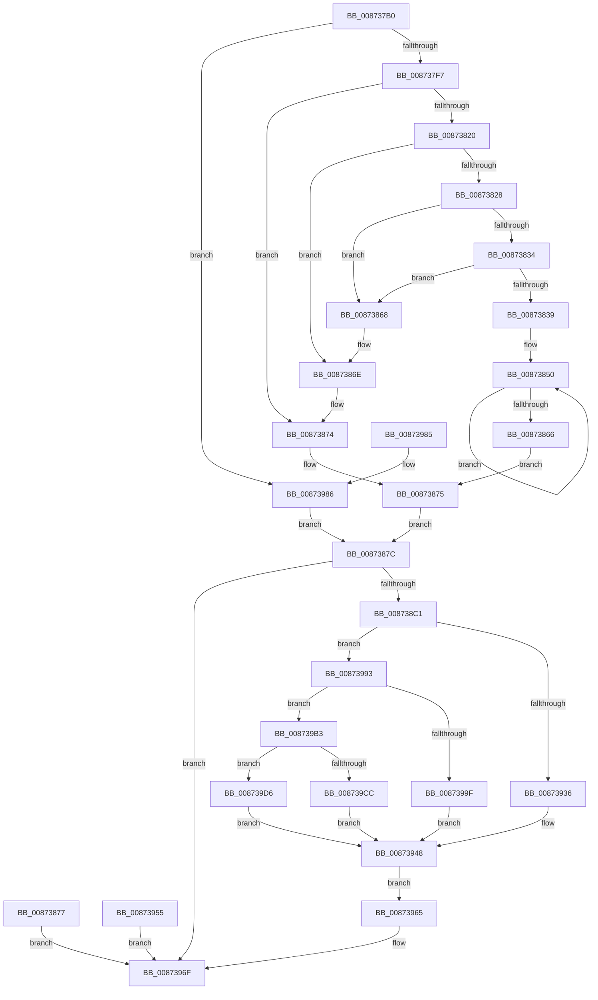

# NtQuerySecurityObject

- RVA: `0x008737B0`–`0x008739E3` (길이 `563` bytes)
- VA: `0x00000001408737B0`
- 실행 섹션: `PAGE`
- PDB 이름 있음: `예`; PDB Function 태그: `아니요`
- unwind 정보 RVA: `0x0006C72C`
- 디코드: `138`개 명령, `563/563` bytes 표시
- 미해석 바이트: `0` (있으면 어셈블리에 `.byte`로 보존)

> 이 문서는 커널 이미지의 기계어와 PDB 기호를 분석해 생성했습니다. 4번과 5번은 함수 원형과 자료형을 바이너리 사용 방식에서 추정한 C 해석이며 원본 소스 복구 결과는 아닙니다.

## 1. Dependencies

- 직접 호출 지점: **10**; 고유 호출 대상: **9**
- 직접 호출자로 확인된 함수: **1**
- RIP 상대 이미지 참조: **5**

### Outgoing calls
- `0x00873868` → [ExRaiseAccessViolation](../8E/ExRaiseAccessViolation_function_008E9240.md) (function, `0x008E9240`)
- `0x0087386E` → [ExRaiseDatatypeMisalignment](../89/ExRaiseDatatypeMisalignment_function_00899FD0.md) (function, `0x00899FD0`)
- `0x00873888` → [SeQuerySecurityAccessMask](SeQuerySecurityAccessMask_function_008739EC.md) (function, `0x008739EC`)
- `0x008738B4` → [ObReferenceObjectByHandle](../86/ObReferenceObjectByHandle_function_00868DB0.md) (function, `0x00868DB0`)
- `0x00873943` → [SeDefaultObjectMethod](../8B/SeDefaultObjectMethod_function_008BA2B0.md) (function, `0x008BA2B0`)
- `0x0087395C` → [ObfDereferenceObject](../../text/2F/ObfDereferenceObject_function_002F9350.md) (function, `0x002F9350`)
- `0x00873968` → [ObfDereferenceObject](../../text/2F/ObfDereferenceObject_function_002F9350.md) (function, `0x002F9350`)
- `0x008739AC` → [IopGetSetSecurityObject](IopGetSetSecurityObject_function_00873A80.md) (function, `0x00873A80`)
- `0x008739CC` → [CmpSecurityMethod](CmpSecurityMethod_function_00870CC0.md) (function, `0x00870CC0`)
- `0x008739D9` → [guard_dispatch_icall](../../text/6B/guard_dispatch_icall_function_006BAAD0.md) (function, `0x006BAAD0`)

### Direct callers
- [RtlpSysVolCheckOwnerAndSecurity](../79/RtlpSysVolCheckOwnerAndSecurity_function_00791324.md) at `0x00791383`
- [RtlpSysVolCheckOwnerAndSecurity](../79/RtlpSysVolCheckOwnerAndSecurity_function_00791324.md) at `0x007913D4`

### Static image references
- `0x008738DB` → RVA `0x00FC6E4C` (`ALMOSTRO`; read)
- `0x008738E5` → RVA `0x00FC7800` (`ALMOSTRO`; read)
- `0x00873903` → RVA `0x008BA2B0` (`SeDefaultObjectMethod`; read)
- `0x00873993` → RVA `0x00873A80` (`IopGetSetSecurityObject`; read)
- `0x008739B3` → RVA `0x00870CC0` (`CmpSecurityMethod`; read)

## 2. Other-region calls and transfers

- 다른 실행 섹션으로 향하는 call: **3**
  - `0x0087395C` → [ObfDereferenceObject](../../text/2F/ObfDereferenceObject_function_002F9350.md) (`PAGE` → `.text`)
  - `0x00873968` → [ObfDereferenceObject](../../text/2F/ObfDereferenceObject_function_002F9350.md) (`PAGE` → `.text`)
  - `0x008739D9` → [guard_dispatch_icall](../../text/6B/guard_dispatch_icall_function_006BAAD0.md) (`PAGE` → `.text`)
- 별도 외부 분기/꼬리 이동을 확인하지 못했습니다.

## 3. Assembly (complete function range)

```asm
008737B0  4C 8B DC                        mov r11, rsp
008737B3  49 89 5B 08                     mov qword ptr [r11 + 8], rbx
008737B7  49 89 73 18                     mov qword ptr [r11 + 0x18], rsi
008737BB  45 89 4B 20                     mov dword ptr [r11 + 0x20], r9d
008737BF  89 54 24 10                     mov dword ptr [rsp + 0x10], edx
008737C3  57                              push rdi
008737C4  41 56                           push r14
008737C6  41 57                           push r15
008737C8  48 83 EC 70                     sub rsp, 0x70
008737CC  49 8B D8                        mov rbx, r8
008737CF  48 8B F1                        mov rsi, rcx
008737D2  45 33 FF                        xor r15d, r15d
008737D5  45 89 7B C8                     mov dword ptr [r11 - 0x38], r15d
008737D9  4D 89 7B D8                     mov qword ptr [r11 - 0x28], r15
008737DD  65 48 8B 04 25 88 01 00 00      mov rax, qword ptr gs:[0x188]
008737E6  44 0F B6 B0 32 02 00 00         movzx r14d, byte ptr [rax + 0x232]
008737EE  45 84 F6                        test r14b, r14b
008737F1  0F 84 8F 01 00 00               je 0x140873986
008737F7  49 B8 00 00 FF FF FF 7F 00 00   movabs r8, 0x7fffffff0000
00873801  49 8B C8                        mov rcx, r8
00873804  48 8B BC 24 B0 00 00 00         mov rdi, qword ptr [rsp + 0xb0]
0087380C  49 3B F8                        cmp rdi, r8
0087380F  48 0F 42 CF                     cmovb rcx, rdi
00873813  8B 01                           mov eax, dword ptr [rcx]
00873815  89 01                           mov dword ptr [rcx], eax
00873817  41 8B 4B 20                     mov ecx, dword ptr [r11 + 0x20]
0087381B  48 85 C9                        test rcx, rcx
0087381E  74 54                           je 0x140873874
00873820  48 8B C3                        mov rax, rbx
00873823  F6 C3 03                        test bl, 3
00873826  75 46                           jne 0x14087386e
00873828  48 8D 51 FF                     lea rdx, [rcx - 1]
0087382C  48 03 D3                        add rdx, rbx
0087382F  48 3B DA                        cmp rbx, rdx
00873832  77 34                           ja 0x140873868
00873834  49 3B D0                        cmp rdx, r8
00873837  73 2F                           jae 0x140873868
00873839  48 81 E2 00 F0 FF FF            and rdx, 0xfffffffffffff000
00873840  48 81 C2 00 10 00 00            add rdx, 0x1000
00873847  66 0F 1F 84 00 00 00 00 00      nop word ptr [rax + rax]
00873850  0F B6 08                        movzx ecx, byte ptr [rax]
00873853  88 08                           mov byte ptr [rax], cl
00873855  48 25 00 F0 FF FF               and rax, 0xfffffffffffff000
0087385B  48 05 00 10 00 00               add rax, 0x1000
00873861  48 3B C2                        cmp rax, rdx
00873864  75 EA                           jne 0x140873850
00873866  EB 0D                           jmp 0x140873875
00873868  E8 D3 59 07 00                  call 0x1408e9240
0087386D  CC                              int3
0087386E  E8 5D 67 02 00                  call 0x140899fd0
00873873  CC                              int3
00873874  90                              nop
00873875  EB 05                           jmp 0x14087387c
00873877  E9 F3 00 00 00                  jmp 0x14087396f
0087387C  48 8D 54 24 50                  lea rdx, [rsp + 0x50]
00873881  8B 8C 24 98 00 00 00            mov ecx, dword ptr [rsp + 0x98]
00873888  E8 5F 01 00 00                  call 0x1408739ec
0087388D  4C 89 7C 24 58                  mov qword ptr [rsp + 0x58], r15
00873892  48 8D 44 24 60                  lea rax, [rsp + 0x60]
00873897  48 89 44 24 28                  mov qword ptr [rsp + 0x28], rax
0087389C  48 8D 44 24 58                  lea rax, [rsp + 0x58]
008738A1  48 89 44 24 20                  mov qword ptr [rsp + 0x20], rax
008738A6  45 0F B6 CE                     movzx r9d, r14b
008738AA  45 33 C0                        xor r8d, r8d
008738AD  8B 54 24 50                     mov edx, dword ptr [rsp + 0x50]
008738B1  48 8B CE                        mov rcx, rsi
008738B4  E8 F7 54 FF FF                  call 0x140868db0
008738B9  85 C0                           test eax, eax
008738BB  0F 88 AE 00 00 00               js 0x14087396f
008738C1  48 8B 74 24 58                  mov rsi, qword ptr [rsp + 0x58]
008738C6  48 8D 56 D0                     lea rdx, [rsi - 0x30]
008738CA  48 8B C2                        mov rax, rdx
008738CD  48 C1 E8 08                     shr rax, 8
008738D1  0F B6 C8                        movzx ecx, al
008738D4  0F B6 42 18                     movzx eax, byte ptr [rdx + 0x18]
008738D8  48 33 C8                        xor rcx, rax
008738DB  0F B6 05 6A 35 75 00            movzx eax, byte ptr [rip + 0x75356a]
008738E2  48 33 C8                        xor rcx, rax
008738E5  48 8D 05 14 3F 75 00            lea rax, [rip + 0x753f14]
008738EC  48 8B 04 C8                     mov rax, qword ptr [rax + rcx*8]
008738F0  4C 8B 90 98 00 00 00            mov r10, qword ptr [rax + 0x98]
008738F7  48 8D 48 4C                     lea rcx, [rax + 0x4c]
008738FB  44 8B 40 64                     mov r8d, dword ptr [rax + 0x64]
008738FF  48 83 C2 28                     add rdx, 0x28
00873903  48 8D 05 A6 69 04 00            lea rax, [rip + 0x469a6]
0087390A  44 88 74 24 40                  mov byte ptr [rsp + 0x40], r14b
0087390F  4C 8B CB                        mov r9, rbx
00873912  48 89 4C 24 38                  mov qword ptr [rsp + 0x38], rcx
00873917  44 89 44 24 30                  mov dword ptr [rsp + 0x30], r8d
0087391C  48 8B CE                        mov rcx, rsi
0087391F  48 89 54 24 28                  mov qword ptr [rsp + 0x28], rdx
00873924  4C 8D 84 24 98 00 00 00         lea r8, [rsp + 0x98]
0087392C  BA 01 00 00 00                  mov edx, 1
00873931  4C 3B D0                        cmp r10, rax
00873934  75 5D                           jne 0x140873993
00873936  48 8D 84 24 A8 00 00 00         lea rax, [rsp + 0xa8]
0087393E  48 89 44 24 20                  mov qword ptr [rsp + 0x20], rax
00873943  E8 68 69 04 00                  call 0x1408ba2b0
00873948  8B D8                           mov ebx, eax
0087394A  8B 84 24 A8 00 00 00            mov eax, dword ptr [rsp + 0xa8]
00873951  89 07                           mov dword ptr [rdi], eax
00873953  EB 10                           jmp 0x140873965
00873955  8B D8                           mov ebx, eax
00873957  48 8B 4C 24 58                  mov rcx, qword ptr [rsp + 0x58]
0087395C  E8 EF 59 A8 FF                  call 0x1402f9350
00873961  8B C3                           mov eax, ebx
00873963  EB 0A                           jmp 0x14087396f
00873965  48 8B CE                        mov rcx, rsi
00873968  E8 E3 59 A8 FF                  call 0x1402f9350
0087396D  8B C3                           mov eax, ebx
0087396F  4C 8D 5C 24 70                  lea r11, [rsp + 0x70]
00873974  49 8B 5B 20                     mov rbx, qword ptr [r11 + 0x20]
00873978  49 8B 73 30                     mov rsi, qword ptr [r11 + 0x30]
0087397C  49 8B E3                        mov rsp, r11
0087397F  41 5F                           pop r15
00873981  41 5E                           pop r14
00873983  5F                              pop rdi
00873984  C3                              ret
00873985  CC                              int3
00873986  48 8B BC 24 B0 00 00 00         mov rdi, qword ptr [rsp + 0xb0]
0087398E  E9 E9 FE FF FF                  jmp 0x14087387c
00873993  48 8D 05 E6 00 00 00            lea rax, [rip + 0xe6]
0087399A  4C 3B D0                        cmp r10, rax
0087399D  75 14                           jne 0x1408739b3
0087399F  48 8D 84 24 A8 00 00 00         lea rax, [rsp + 0xa8]
008739A7  48 89 44 24 20                  mov qword ptr [rsp + 0x20], rax
008739AC  E8 CF 00 00 00                  call 0x140873a80
008739B1  EB 95                           jmp 0x140873948
008739B3  48 8D 05 06 D3 FF FF            lea rax, [rip - 0x2cfa]
008739BA  4C 3B D0                        cmp r10, rax
008739BD  48 8D 84 24 A8 00 00 00         lea rax, [rsp + 0xa8]
008739C5  48 89 44 24 20                  mov qword ptr [rsp + 0x20], rax
008739CA  75 0A                           jne 0x1408739d6
008739CC  E8 EF D2 FF FF                  call 0x140870cc0
008739D1  E9 72 FF FF FF                  jmp 0x140873948
008739D6  49 8B C2                        mov rax, r10
008739D9  E8 F2 70 E4 FF                  call 0x1406baad0
008739DE  E9 65 FF FF FF                  jmp 0x140873948
```

## 4. C-style interpretation (structured pseudocode)

```c
__int64 __fastcall NtQuerySecurityObject(__int64 a1, int a2, __int64 a3, int a4, __int64 a5)
{
    __int64 result;
    __int64 v_r15;
    __int64 v_rsp;
    unsigned __int64 v_stack_m18;
    unsigned __int64 v_stack_m28;
    unsigned __int64 v_stack_m30;
    unsigned __int64 v_stack_m38;
    unsigned __int8 v_stack_m48;
    unsigned __int64 v_stack_m50;
    unsigned int v_stack_m58;
    unsigned __int64 v_stack_m60;
    unsigned __int64 v_stack_m68;
    unsigned int v_stack_p10;
    unsigned __int64 v_stack_p20;
    unsigned __int64 v_stack_p38;

    *(unsigned __int64 *)(v_rsp + 8) = v_rbx;
    *(unsigned __int64 *)(v_rsp + 24) = v_rsi;
    *(unsigned int *)(v_rsp + 32) = a4;
    v_stack_p10 = a2;
    v_rsp = (v_rsp) - (112);
    v_r15 = 0;
    *(unsigned int *)(v_rsp - 56) = 0;
    *(unsigned __int64 *)(v_rsp - 40) = 0;
    if ((unsigned __int8)(*(unsigned __int8 *)(*(unsigned __int64 *)(gs_base + (0 + 392)) + 562)) == 0) goto loc_00873986;
    if (a5 < a3) { a3 = a5; }
    *(unsigned int *)(a3) = (unsigned int)((unsigned int)(*(unsigned int *)(a3)));
    if ((unsigned int)(*(unsigned int *)(v_rsp + 32)) == 0) goto loc_00873874;
    if ((((unsigned __int8)(a3)) & (3)) != 0) goto loc_0087386E;
    a2 = ((unsigned int)(*(unsigned int *)(v_rsp + 32)) - 1) + (a3);
    if (a3 > a2) goto loc_00873868;
    if (a2 >= a3) goto loc_00873868;
    a2 = (a2) & (0xFFFFFFFFFFFFF000ULL);
    a2 = (a2) + (0x1000ULL);
loc_00873850:
    *(unsigned __int8 *)(a3) = (unsigned __int8)(*(unsigned __int8 *)(a3));
    result = (a3) & (0xFFFFFFFFFFFFF000ULL);
    result = (result) + (0x1000ULL);
    if (result != a2) goto loc_00873850;
    goto loc_00873875;
loc_00873868:
    result = ExRaiseAccessViolation(*(unsigned __int8 *)(a3), a2, a3, a4);
loc_0087386E:
    result = ExRaiseDatatypeMisalignment(*(unsigned __int8 *)(a3), a2, a3, a4);
loc_00873874:
loc_00873875:
    goto loc_0087387C;
loc_0087387C:
    result = SeQuerySecurityAccessMask((unsigned int)(v_stack_p10), v_stack_m38, a3, a4);
    v_stack_m30 = 0;
    v_stack_m60 = v_stack_m28;
    v_stack_m68 = v_stack_m30;
    a3 = 0;
    result = ObReferenceObjectByHandle(a1, (unsigned int)(v_stack_m38), a3, (unsigned __int8)(*(unsigned __int8 *)(*(unsigned __int64 *)(gs_base + (0 + 392)) + 562)));
    if (sign_flag) goto loc_0087396F;
    result = (v_stack_m30 - 48) >> (8);
    a1 = ((unsigned __int8)(result)) ^ (*(unsigned __int8 *)(v_stack_m30 - 48 + 24));
    a1 = (a1) ^ (*(unsigned __int8 *)(v_rip + 7681386));
    a2 = (v_stack_m30 - 48) + (40);
    v_stack_m48 = (unsigned __int8)(*(unsigned __int8 *)(*(unsigned __int64 *)(gs_base + (0 + 392)) + 562));
    v_stack_m50 = *(unsigned __int64 *)(v_rip + 7683860 + a1 * 8) + 76;
    v_stack_m58 = (unsigned int)((unsigned int)(*(unsigned int *)(*(unsigned __int64 *)(v_rip + 7683860 + a1 * 8) + 100)));
    v_stack_m60 = a2;
    if ((*(unsigned __int64 *)(*(unsigned __int64 *)(v_rip + 7683860 + a1 * 8) + 152)) != (v_rip + 289190)) goto loc_00873993;
    v_stack_m68 = v_stack_p20;
    result = SeDefaultObjectMethod(v_stack_m30, 1, v_stack_p10, 0);
loc_00873948:
    *(unsigned int *)(a5) = (unsigned int)((unsigned int)(v_stack_p20));
    goto loc_00873965;
loc_00873965:
    result = ObfDereferenceObject(v_stack_m30, 1, v_stack_p10, 0);
loc_0087396F:
    return (unsigned int)((unsigned int)((unsigned int)((unsigned int)(result))));
loc_00873986:
    goto loc_0087387C;
loc_00873993:
    if ((*(unsigned __int64 *)(*(unsigned __int64 *)(v_rip + 7683860 + a1 * 8) + 152)) != (v_rip + 230)) goto loc_008739B3;
    v_stack_m50 = v_stack_p38;
    result = IopGetSetSecurityObject(v_stack_m30, 1, v_stack_p10, 0);
    goto loc_00873948;
loc_008739B3:
    v_stack_m50 = v_stack_p38;
    if ((*(unsigned __int64 *)(*(unsigned __int64 *)(v_rip + 7683860 + a1 * 8) + 152)) != (v_rip - 11514)) goto loc_008739D6;
    result = CmpSecurityMethod(v_stack_m30, 1, v_stack_p10, 0);
    goto loc_00873948;
loc_008739D6:
    result = guard_dispatch_icall(v_stack_m30, 1, v_stack_p10, 0);
    goto loc_00873948;
}
```

## 5. (Beta) C Style

```c
int64_t NtQuerySecurityObject(int64_t Arg1, int32_t Arg2, void *Arg3, int32_t Arg4, int64_t Arg5)
{
    uint8_t *arg3 = (uint8_t *)Arg3;

    int64_t result;
    int64_t local_r15;
    int64_t local_rsp;
    uint64_t v_stack_m18;
    uint64_t v_stack_m28;
    uint64_t v_stack_m30;
    uint64_t v_stack_m38;
    uint8_t v_stack_m48;
    uint64_t v_stack_m50;
    uint32_t v_stack_m58;
    uint64_t v_stack_m60;
    uint64_t v_stack_m68;
    uint32_t v_stack_p10;
    uint64_t v_stack_p20;
    uint64_t v_stack_p38;

    *(uint64_t *)(local_rsp + 0x8) = local_rbx;
    *(uint64_t *)(local_rsp + 0x18) = local_rsi;
    *(uint32_t *)(local_rsp + 0x20) = Arg4;
    v_stack_p10 = Arg2;
    local_rsp = (local_rsp) - (112);
    local_r15 = 0;
    *(uint32_t *)(local_rsp - 0x38) = 0;
    *(uint64_t *)(local_rsp - 0x28) = 0;
    if ((uint8_t)(*(uint8_t *)(*(uint64_t *)(gs_base + (0 + 0x188)) + 0x232)) == 0) goto loc_00873986;
    if (Arg5 < Arg3) { Arg3 = Arg5; }
    *(uint32_t *)(arg3) = (uint32_t)((uint32_t)(*(uint32_t *)(arg3)));
    if ((uint32_t)(*(uint32_t *)(local_rsp + 0x20)) == 0) goto loc_00873874;
    if ((((uint8_t)(Arg3)) & (3)) != 0) goto loc_0087386E;
    Arg2 = ((uint32_t)(*(uint32_t *)(local_rsp + 0x20)) - 1) + (Arg3);
    if (Arg3 > Arg2) goto loc_00873868;
    if (Arg2 >= Arg3) goto loc_00873868;
    Arg2 = (Arg2) & (0xFFFFFFFFFFFFF000ULL);
    Arg2 = (Arg2) + (0x1000ULL);
loc_00873850:
    *(uint8_t *)(arg3) = (uint8_t)(*(uint8_t *)(arg3));
    result = (Arg3) & (0xFFFFFFFFFFFFF000ULL);
    result = (result) + (0x1000ULL);
    if (result != Arg2) goto loc_00873850;
    goto loc_00873875;
loc_00873868:
    result = ExRaiseAccessViolation(*(uint8_t *)(arg3), Arg2, Arg3, Arg4);
loc_0087386E:
    result = ExRaiseDatatypeMisalignment(*(uint8_t *)(arg3), Arg2, Arg3, Arg4);
loc_00873874:
loc_00873875:
    goto loc_0087387C;
loc_0087387C:
    result = SeQuerySecurityAccessMask((uint32_t)(v_stack_p10), v_stack_m38, Arg3, Arg4);
    v_stack_m30 = 0;
    v_stack_m60 = v_stack_m28;
    v_stack_m68 = v_stack_m30;
    Arg3 = 0;
    result = ObReferenceObjectByHandle(Arg1, (uint32_t)(v_stack_m38), Arg3, (uint8_t)(*(uint8_t *)(*(uint64_t *)(gs_base + (0 + 0x188)) + 0x232)));
    if (sign_flag) goto loc_0087396F;
    result = (v_stack_m30 - 48) >> (8);
    Arg1 = ((uint8_t)(result)) ^ (*(uint8_t *)(v_stack_m30 - 0x30 + 0x18));
    Arg1 = (Arg1) ^ (*(uint8_t *)(v_rip + 0x75356A));
    Arg2 = (v_stack_m30 - 48) + (40);
    v_stack_m48 = (uint8_t)(*(uint8_t *)(*(uint64_t *)(gs_base + (0 + 0x188)) + 0x232));
    v_stack_m50 = *(uint64_t *)(v_rip + 0x753F14 + Arg1 * 8) + 76;
    v_stack_m58 = (uint32_t)((uint32_t)(*(uint32_t *)(*(uint64_t *)(v_rip + 0x753F14 + Arg1 * 8) + 0x64)));
    v_stack_m60 = Arg2;
    if ((*(uint64_t *)(*(uint64_t *)(v_rip + 0x753F14 + Arg1 * 8) + 0x98)) != (v_rip + 289190)) goto loc_00873993;
    v_stack_m68 = v_stack_p20;
    result = SeDefaultObjectMethod(v_stack_m30, 1, v_stack_p10, 0);
loc_00873948:
    *(uint32_t *)(Arg5) = (uint32_t)((uint32_t)(v_stack_p20));
    goto loc_00873965;
loc_00873965:
    result = ObfDereferenceObject(v_stack_m30, 1, v_stack_p10, 0);
loc_0087396F:
    return (uint32_t)((uint32_t)((uint32_t)((uint32_t)(result))));
loc_00873986:
    goto loc_0087387C;
loc_00873993:
    if ((*(uint64_t *)(*(uint64_t *)(v_rip + 0x753F14 + Arg1 * 8) + 0x98)) != (v_rip + 230)) goto loc_008739B3;
    v_stack_m50 = v_stack_p38;
    result = IopGetSetSecurityObject(v_stack_m30, 1, v_stack_p10, 0);
    goto loc_00873948;
loc_008739B3:
    v_stack_m50 = v_stack_p38;
    if ((*(uint64_t *)(*(uint64_t *)(v_rip + 0x753F14 + Arg1 * 8) + 0x98)) != (v_rip - 11514)) goto loc_008739D6;
    result = CmpSecurityMethod(v_stack_m30, 1, v_stack_p10, 0);
    goto loc_00873948;
loc_008739D6:
    result = guard_dispatch_icall(v_stack_m30, 1, v_stack_p10, 0);
    goto loc_00873948;
}
```

### 관측된 메모리 오프셋

구조체 형식이 확인되지 않은 접근은 인자 기준의 오프셋으로만 기록했습니다.

| 기준 인자 | 오프셋 표현 | 폭 (bit) | 접근 |
|---|---:|---:|---|
| `Arg3` | `+ 0x0 + rax*1` | `16` | `R` |

## 6. Execution-region graph

[열기: 2D/3D 그래프와 함수 탐색 컨트롤 패널](../../../control-panel.html?section=page&rva=0x008737B0&view=graph)

- 2D 그래프는 위에서 아래로 흐르고, 3D 그래프는 빈 공간을 드래그해 회전합니다. Shift+드래그는 이동, 휠은 확대·축소, 함수 노드 선택은 대상 보고서 이동입니다.

### Static fallback


