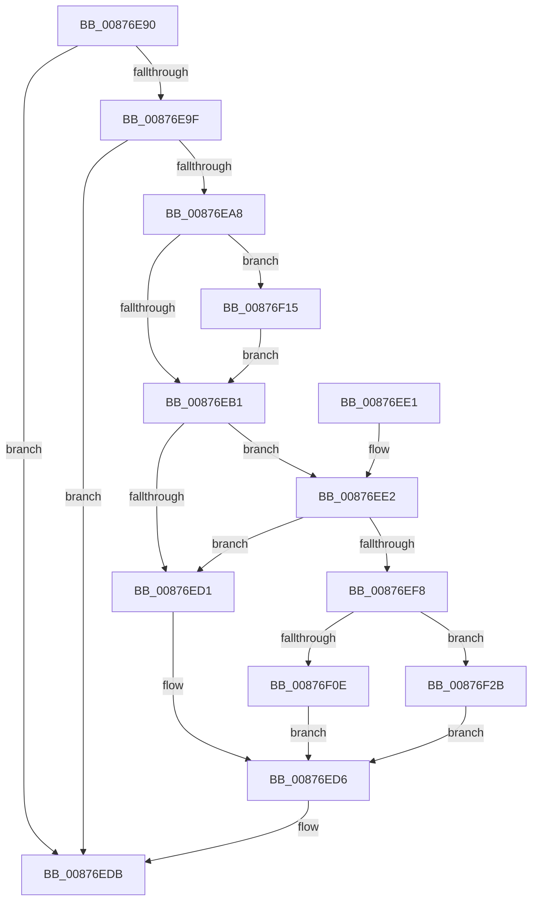

# ObDeleteCapturedInsertInfo

- RVA: `0x00876E90`–`0x00876F32` (길이 `162` bytes)
- VA: `0x0000000140876E90`
- 실행 섹션: `PAGE`
- PDB 이름 있음: `예`; PDB Function 태그: `아니요`
- unwind 정보 RVA: `0x0006CB1C`
- 디코드: `46`개 명령, `162/162` bytes 표시
- 미해석 바이트: `0` (있으면 어셈블리에 `.byte`로 보존)

> 이 문서는 커널 이미지의 기계어와 PDB 기호를 분석해 생성했습니다. 4번과 5번은 함수 원형과 자료형을 바이너리 사용 방식에서 추정한 C 해석이며 원본 소스 복구 결과는 아닙니다.

## 1. Dependencies

- 직접 호출 지점: **4**; 고유 호출 대상: **4**
- 직접 호출자로 확인된 함수: **3**
- RIP 상대 이미지 참조: **1**

### Outgoing calls
- `0x00876ED1` → [ExpInterlockedPushEntrySList](../../text/6B/ExpInterlockedPushEntrySList_function_006BA5B0.md) (function, `0x006BA5B0`)
- `0x00876F0E` → [ExFreePool](../../poolcode/B8/ExFreePool_function_00B82850.md) (function, `0x00B82850`)
- `0x00876F1B` → [SeReleaseSecurityDescriptor](../97/SeReleaseSecurityDescriptor_function_00975190.md) (function, `0x00975190`)
- `0x00876F2B` → [guard_dispatch_icall](../../text/6B/guard_dispatch_icall_function_006BAAD0.md) (function, `0x006BAAD0`)

### Direct callers
- [CcInitializeCacheMapInternal](../../text/3C/CcInitializeCacheMapInternal_function_003CC720.md) at `0x003CC87E`
- [ExCreateDpcEvent](../../text/65/ExCreateDpcEvent_function_00659520.md) at `0x006595D6`
- [CmLoadDifferencingKey](CmLoadDifferencingKey_function_00875670.md) at `0x00875DDC`

### Static image references
- `0x00876EFF` → RVA `0x00B82850` (`ExFreePool`; read)

## 2. Other-region calls and transfers

- 다른 실행 섹션으로 향하는 call: **3**
  - `0x00876ED1` → [ExpInterlockedPushEntrySList](../../text/6B/ExpInterlockedPushEntrySList_function_006BA5B0.md) (`PAGE` → `.text`)
  - `0x00876F0E` → [ExFreePool](../../poolcode/B8/ExFreePool_function_00B82850.md) (`PAGE` → `POOLCODE`)
  - `0x00876F2B` → [guard_dispatch_icall](../../text/6B/guard_dispatch_icall_function_006BAAD0.md) (`PAGE` → `.text`)
- 별도 외부 분기/꼬리 이동을 확인하지 못했습니다.

## 3. Assembly (complete function range)

```asm
00876E90  40 53                           push rbx
00876E92  48 83 EC 20                     sub rsp, 0x20
00876E96  F6 41 EB 01                     test byte ptr [rcx - 0x15], 1
00876E9A  48 8B D9                        mov rbx, rcx
00876E9D  74 3C                           je 0x140876edb
00876E9F  48 8B 51 F0                     mov rdx, qword ptr [rcx - 0x10]
00876EA3  48 85 D2                        test rdx, rdx
00876EA6  74 33                           je 0x140876edb
00876EA8  48 8B 4A 20                     mov rcx, qword ptr [rdx + 0x20]
00876EAC  48 85 C9                        test rcx, rcx
00876EAF  75 64                           jne 0x140876f15
00876EB1  65 4C 8B 04 25 20 00 00 00      mov r8, qword ptr gs:[0x20]
00876EBA  48 8B 53 F0                     mov rdx, qword ptr [rbx - 0x10]
00876EBE  49 8B 88 40 08 00 00            mov rcx, qword ptr [r8 + 0x840]
00876EC5  FF 41 1C                        inc dword ptr [rcx + 0x1c]
00876EC8  0F B7 41 10                     movzx eax, word ptr [rcx + 0x10]
00876ECC  66 39 01                        cmp word ptr [rcx], ax
00876ECF  73 11                           jae 0x140876ee2
00876ED1  E8 DA 36 E4 FF                  call 0x1406ba5b0
00876ED6  48 83 63 F0 00                  and qword ptr [rbx - 0x10], 0
00876EDB  48 83 C4 20                     add rsp, 0x20
00876EDF  5B                              pop rbx
00876EE0  C3                              ret
00876EE1  CC                              int3
00876EE2  FF 41 20                        inc dword ptr [rcx + 0x20]
00876EE5  49 8B 88 48 08 00 00            mov rcx, qword ptr [r8 + 0x848]
00876EEC  FF 41 1C                        inc dword ptr [rcx + 0x1c]
00876EEF  0F B7 41 10                     movzx eax, word ptr [rcx + 0x10]
00876EF3  66 39 01                        cmp word ptr [rcx], ax
00876EF6  72 D9                           jb 0x140876ed1
00876EF8  FF 41 20                        inc dword ptr [rcx + 0x20]
00876EFB  48 8B 41 38                     mov rax, qword ptr [rcx + 0x38]
00876EFF  48 8D 0D 4A B9 30 00            lea rcx, [rip + 0x30b94a]
00876F06  48 3B C1                        cmp rax, rcx
00876F09  48 8B CA                        mov rcx, rdx
00876F0C  75 1D                           jne 0x140876f2b
00876F0E  E8 3D B9 30 00                  call 0x140b82850
00876F13  EB C1                           jmp 0x140876ed6
00876F15  8A 52 10                        mov dl, byte ptr [rdx + 0x10]
00876F18  41 B0 01                        mov r8b, 1
00876F1B  E8 70 E2 0F 00                  call 0x140975190
00876F20  48 8B 43 F0                     mov rax, qword ptr [rbx - 0x10]
00876F24  48 83 60 20 00                  and qword ptr [rax + 0x20], 0
00876F29  EB 86                           jmp 0x140876eb1
00876F2B  E8 A0 3B E4 FF                  call 0x1406baad0
00876F30  EB A4                           jmp 0x140876ed6
```

## 4. C-style interpretation (structured pseudocode)

```c
__int64 __fastcall ObDeleteCapturedInsertInfo(__int64 a1)
{
    __int64 result;
    __int64 v_rsp;

    v_rsp = (v_rsp) - (32);
    if (((*(unsigned __int8 *)(a1 - 21)) & (1)) == 0) goto loc_00876EDB;
    if (*(unsigned __int64 *)(a1 - 16) == 0) goto loc_00876EDB;
    if (*(unsigned __int64 *)(*(unsigned __int64 *)(a1 - 16) + 32) != 0) goto loc_00876F15;
loc_00876EB1:
    if ((*(unsigned __int16 *)(*(unsigned __int64 *)(*(unsigned __int64 *)(gs_base + (0 + 32)) + 2112))) >= ((unsigned __int16)(*(unsigned __int16 *)(*(unsigned __int64 *)(*(unsigned __int64 *)(gs_base + (0 + 32)) + 2112) + 16)))) goto loc_00876EE2;
loc_00876ED1:
    result = ExpInterlockedPushEntrySList(*(unsigned __int64 *)(*(unsigned __int64 *)(gs_base + (0 + 32)) + 2112), *(unsigned __int64 *)(a1 - 16), *(unsigned __int64 *)(gs_base + (0 + 32)), a4);
loc_00876ED6:
loc_00876EDB:
    v_rsp = (v_rsp) + (32);
    return result;
loc_00876EE2:
    if ((*(unsigned __int16 *)(*(unsigned __int64 *)(*(unsigned __int64 *)(gs_base + (0 + 32)) + 2120))) < ((unsigned __int16)(*(unsigned __int16 *)(*(unsigned __int64 *)(*(unsigned __int64 *)(gs_base + (0 + 32)) + 2120) + 16)))) goto loc_00876ED1;
    if ((*(unsigned __int64 *)(*(unsigned __int64 *)(*(unsigned __int64 *)(gs_base + (0 + 32)) + 2120) + 56)) != (v_rip + 3193162)) goto loc_00876F2B;
    result = ExFreePool(*(unsigned __int64 *)(a1 - 16), *(unsigned __int64 *)(a1 - 16), *(unsigned __int64 *)(gs_base + (0 + 32)), a4);
    goto loc_00876ED6;
loc_00876F15:
    result = SeReleaseSecurityDescriptor(*(unsigned __int64 *)(a1 - 16), *(unsigned __int8 *)(*(unsigned __int64 *)(a1 - 16) + 16), 1, a4);
    goto loc_00876EB1;
loc_00876F2B:
    result = guard_dispatch_icall(*(unsigned __int64 *)(a1 - 16), *(unsigned __int8 *)(*(unsigned __int64 *)(a1 - 16) + 16), 1, a4);
    goto loc_00876ED6;
}
```

## 5. (Beta) C Style

```c
int64_t ObDeleteCapturedInsertInfo(void *Arg1)
{
    uint8_t *arg1 = (uint8_t *)Arg1;

    int64_t result;
    int64_t local_rsp;

    local_rsp = (local_rsp) - (32);
    if (((*(uint8_t *)(arg1 - 0x15)) & (1)) == 0) goto loc_00876EDB;
    if (*(uint64_t *)(arg1 - 0x10) == 0) goto loc_00876EDB;
    if (*(uint64_t *)(*(uint64_t *)(arg1 - 0x10) + 0x20) != 0) goto loc_00876F15;
loc_00876EB1:
    if ((*(uint16_t *)(*(uint64_t *)(*(uint64_t *)(gs_base + (0 + 0x20)) + 0x840))) >= ((uint16_t)(*(uint16_t *)(*(uint64_t *)(*(uint64_t *)(gs_base + (0 + 0x20)) + 0x840) + 0x10)))) goto loc_00876EE2;
loc_00876ED1:
    result = ExpInterlockedPushEntrySList(*(uint64_t *)(*(uint64_t *)(gs_base + (0 + 0x20)) + 0x840), *(uint64_t *)(arg1 - 0x10), *(uint64_t *)(gs_base + (0 + 0x20)), a4);
loc_00876ED6:
loc_00876EDB:
    local_rsp = (local_rsp) + (32);
    return result;
loc_00876EE2:
    if ((*(uint16_t *)(*(uint64_t *)(*(uint64_t *)(gs_base + (0 + 0x20)) + 0x848))) < ((uint16_t)(*(uint16_t *)(*(uint64_t *)(*(uint64_t *)(gs_base + (0 + 0x20)) + 0x848) + 0x10)))) goto loc_00876ED1;
    if ((*(uint64_t *)(*(uint64_t *)(*(uint64_t *)(gs_base + (0 + 0x20)) + 0x848) + 0x38)) != (v_rip + 3193162)) goto loc_00876F2B;
    result = ExFreePool(*(uint64_t *)(arg1 - 0x10), *(uint64_t *)(arg1 - 0x10), *(uint64_t *)(gs_base + (0 + 0x20)), a4);
    goto loc_00876ED6;
loc_00876F15:
    result = SeReleaseSecurityDescriptor(*(uint64_t *)(arg1 - 0x10), *(uint8_t *)(*(uint64_t *)(arg1 - 0x10) + 0x10), 1, a4);
    goto loc_00876EB1;
loc_00876F2B:
    result = guard_dispatch_icall(*(uint64_t *)(arg1 - 0x10), *(uint8_t *)(*(uint64_t *)(arg1 - 0x10) + 0x10), 1, a4);
    goto loc_00876ED6;
}
```

### 관측된 메모리 오프셋

구조체 형식이 확인되지 않은 접근은 인자 기준의 오프셋으로만 기록했습니다.

| 기준 인자 | 오프셋 표현 | 폭 (bit) | 접근 |
|---|---:|---:|---|
| `Arg1` | `- 0x15` | `8` | `R` |
| `Arg1` | `- 0x10` | `64` | `R` |
| `Arg1` | `- 0x10` | `64` | `R/W` |

## 6. Execution-region graph

[열기: 2D/3D 그래프와 함수 탐색 컨트롤 패널](../../../control-panel.html?section=page&rva=0x00876E90&view=graph)

- 2D 그래프는 위에서 아래로 흐르고, 3D 그래프는 빈 공간을 드래그해 회전합니다. Shift+드래그는 이동, 휠은 확대·축소, 함수 노드 선택은 대상 보고서 이동입니다.

### Static fallback


