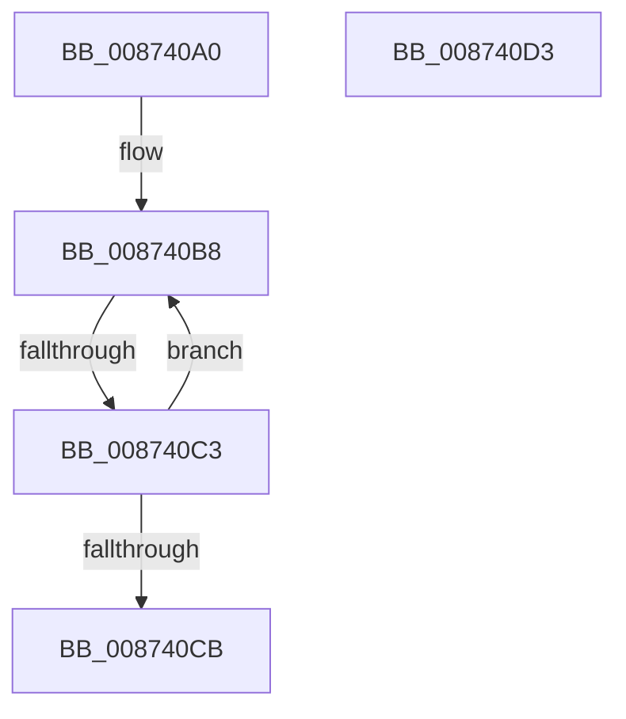

# ObDereferenceSecurityDescriptor

- RVA: `0x008740A0`–`0x008740D4` (길이 `52` bytes)
- VA: `0x00000001408740A0`
- 실행 섹션: `PAGE`
- PDB 이름 있음: `예`; PDB Function 태그: `아니요`
- unwind 정보 RVA: `0x0006C7B0`
- 디코드: `21`개 명령, `52/52` bytes 표시
- 미해석 바이트: `0` (있으면 어셈블리에 `.byte`로 보존)

> 이 문서는 커널 이미지의 기계어와 PDB 기호를 분석해 생성했습니다. 4번과 5번은 함수 원형과 자료형을 바이너리 사용 방식에서 추정한 C 해석이며 원본 소스 복구 결과는 아닙니다.

## 1. Dependencies

- 직접 호출 지점: **0**; 고유 호출 대상: **0**
- 직접 호출자로 확인된 함수: **24**
- RIP 상대 이미지 참조: **0**

### Outgoing calls
- 직접 디코드된 call 명령이 없습니다.

### Direct callers
- [IopCompleteUnloadOrDelete](../../text/27/IopCompleteUnloadOrDelete_function_00270BC8.md) at `0x00270D4D`
- [ObpCreateHandle](../86/ObpCreateHandle_function_0086B950.md) at `0x0086CFF8`
- [ObpCreateHandle](../86/ObpCreateHandle_function_0086B950.md) at `0x0086D1C0`
- [ObpCreateHandle](../86/ObpCreateHandle_function_0086B950.md) at `0x0086D1F8`
- [ObpGrantAccess](../86/ObpGrantAccess_function_0086F250.md) at `0x0086F81E`
- [ObpGrantAccess](../86/ObpGrantAccess_function_0086F250.md) at `0x0086F847`
- [ObCheckObjectAccess](ObCheckObjectAccess_function_00872260.md) at `0x008726A6`
- [ObQuerySecurityDescriptorInfo](ObQuerySecurityDescriptorInfo_function_00873624.md) at `0x008736AB`
- [IopGetSetSecurityObject](IopGetSetSecurityObject_function_00873A80.md) at `0x00873E04`
- [ObpAdjustCreatorAccessState](ObpAdjustCreatorAccessState_function_00874650.md) at `0x008747FD`
- [ObpReferenceSecurityDescriptorSlow](ObpReferenceSecurityDescriptorSlow_function_0087484C.md) at `0x00874963`
- [sub_008BAC72](../8B/Unknown_function_008BAC72.md) at `0x008BACA6`
- [sub_008BAC72](../8B/Unknown_function_008BAC72.md) at `0x008BACEF`
- [ObSetSecurityDescriptorInfo](../8B/ObSetSecurityDescriptorInfo_function_008BAE20.md) at `0x008BB4D8`
- [ExpWnfCreateNameInstance](../8B/ExpWnfCreateNameInstance_function_008BF590.md) at `0x008BF848`
- [EtwpCheckLoggerControlAccess](../8C/EtwpCheckLoggerControlAccess_function_008C0AE0.md) at `0x008C0BC4`
- [EtwpFreeGuidEntry](../8C/EtwpFreeGuidEntry_function_008C42E4.md) at `0x008C4318`
- [ObpCheckObjectReference](../8C/ObpCheckObjectReference_function_008C6084.md) at `0x008C6309`
- [ObCheckCreateObjectAccess](../8C/ObCheckCreateObjectAccess_function_008C6340.md) at `0x008C649A`
- [ObReleaseObjectSecurityEx](../8C/ObReleaseObjectSecurityEx_function_008C6E30.md) at `0x008C6E7C`
- [ExpWnfDeleteNameInstance](../90/ExpWnfDeleteNameInstance_function_009088C8.md) at `0x00908B9A`
- [ObpInsertOrLocateNamedObject](../99/ObpInsertOrLocateNamedObject_function_0099F2C0.md) at `0x0099F82B`
- [EtwpFreeLoggerContext](../9C/EtwpFreeLoggerContext_function_009C1688.md) at `0x009C1810`
- [EtwpDereferenceLoggerSecurityDescriptor](../A3/EtwpDereferenceLoggerSecurityDescriptor_function_00A34D94.md) at `0x00A34DD2`
- [IopSetDeviceSecurityDescriptor](../A7/IopSetDeviceSecurityDescriptor_function_00A7199C.md) at `0x00A71AA0`
- [IopSetDeviceSecurityDescriptor](../A7/IopSetDeviceSecurityDescriptor_function_00A7199C.md) at `0x00A71B2D`
- [IopSetDeviceSecurityDescriptor](../A7/IopSetDeviceSecurityDescriptor_function_00A7199C.md) at `0x00A71B3C`
- [EtwpUpdateLoggerSecurityDescriptor](../AA/EtwpUpdateLoggerSecurityDescriptor_function_00AA9F64.md) at `0x00AAA011`
- [sub_00B1ADD2](../B1/Unknown_function_00B1ADD2.md) at `0x00B1ADE3`
- [sub_00B1AEE4](../B1/Unknown_function_00B1AEE4.md) at `0x00B1AF26`

### Static image references
- 디코드된 RIP-relative 메모리 참조가 없습니다.

## 2. Other-region calls and transfers

- 다른 실행 섹션으로 향하는 call: **0**
- call이 아닌 외부 분기/꼬리 이동: **1**
  - `0x008740C1` → [sub_008740D4](Unknown_function_008740D4.md) (`tail-transfer`)

## 3. Assembly (complete function range)

```asm
008740A0  40 53                           push rbx
008740A2  56                              push rsi
008740A3  57                              push rdi
008740A4  48 83 EC 20                     sub rsp, 0x20
008740A8  8B F2                           mov esi, edx
008740AA  48 8D 59 E0                     lea rbx, [rcx - 0x20]
008740AE  0F 0D 4B 08                     prefetchw byte ptr [rbx + 8]
008740B2  48 8B 43 08                     mov rax, qword ptr [rbx + 8]
008740B6  8B FA                           mov edi, edx
008740B8  48 8B C8                        mov rcx, rax
008740BB  48 2B CF                        sub rcx, rdi
008740BE  48 85 C9                        test rcx, rcx
008740C1  7E 11                           jle 0x1408740d4
008740C3  F0 48 0F B1 4B 08               lock cmpxchg qword ptr [rbx + 8], rcx
008740C9  75 ED                           jne 0x1408740b8
008740CB  48 83 C4 20                     add rsp, 0x20
008740CF  5F                              pop rdi
008740D0  5E                              pop rsi
008740D1  5B                              pop rbx
008740D2  C3                              ret
008740D3  CC                              int3
```

## 4. C-style interpretation (structured pseudocode)

```c
__int64 __fastcall ObDereferenceSecurityDescriptor(__int64 a1, int a2)
{
    __int64 v_rsp;

    v_rsp = (v_rsp) - (32);
loc_008740B8:
    a1 = (*(unsigned __int64 *)(a1 - 32 + 8)) - ((unsigned int)(a2));
    if (a1 != 0) goto loc_008740B8;
    v_rsp = (v_rsp) + (32);
    return *(unsigned __int64 *)(a1 - 32 + 8);
}
```

## 5. (Beta) C Style

```c
int64_t ObDereferenceSecurityDescriptor(void *Arg1, int32_t Arg2)
{
    uint8_t *arg1 = (uint8_t *)Arg1;

    int64_t local_rsp;

    local_rsp = (local_rsp) - (32);
loc_008740B8:
    Arg1 = (*(uint64_t *)(arg1 - 0x20 + 0x8)) - ((uint32_t)(Arg2));
    if (Arg1 != NULL) goto loc_008740B8;
    local_rsp = (local_rsp) + (32);
    return *(uint64_t *)(arg1 - 0x20 + 0x8);
}
```

### 관측된 메모리 오프셋

구조체 형식이 확인되지 않은 접근은 인자 기준의 오프셋으로만 기록했습니다.

| 기준 인자 | 오프셋 표현 | 폭 (bit) | 접근 |
|---|---:|---:|---|
| `Arg1` | `- 0x20` | `64` | `R` |
| `Arg1` | `+ 0x8` | `8` | `R` |
| `Arg1` | `+ 0x8` | `64` | `R` |

## 6. Execution-region graph

[열기: 2D/3D 그래프와 함수 탐색 컨트롤 패널](../../../control-panel.html?section=page&rva=0x008740A0&view=graph)

- 2D 그래프는 위에서 아래로 흐르고, 3D 그래프는 빈 공간을 드래그해 회전합니다. Shift+드래그는 이동, 휠은 확대·축소, 함수 노드 선택은 대상 보고서 이동입니다.

### Static fallback


