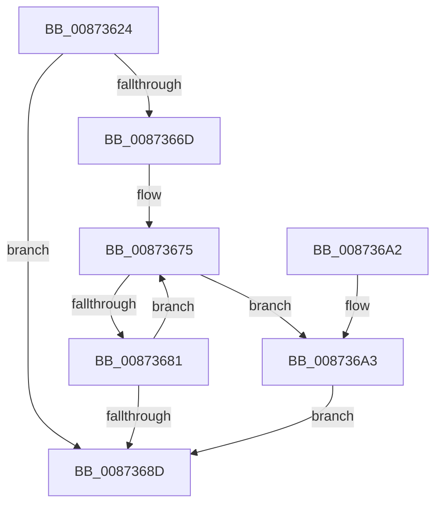

# ObQuerySecurityDescriptorInfo

- RVA: `0x00873624`–`0x008736B2` (길이 `142` bytes)
- VA: `0x0000000140873624`
- 실행 섹션: `PAGE`
- PDB 이름 있음: `예`; PDB Function 태그: `아니요`
- unwind 정보 RVA: `0x0006C6FC`
- 디코드: `44`개 명령, `142/142` bytes 표시
- 미해석 바이트: `0` (있으면 어셈블리에 `.byte`로 보존)

> 이 문서는 커널 이미지의 기계어와 PDB 기호를 분석해 생성했습니다. 4번과 5번은 함수 원형과 자료형을 바이너리 사용 방식에서 추정한 C 해석이며 원본 소스 복구 결과는 아닙니다.

## 1. Dependencies

- 직접 호출 지점: **3**; 고유 호출 대상: **3**
- 직접 호출자로 확인된 함수: **2**
- RIP 상대 이미지 참조: **0**

### Outgoing calls
- `0x00873646` → [ObpReferenceSecurityDescriptor](../8B/ObpReferenceSecurityDescriptor_function_008B6D90.md) (function, `0x008B6D90`)
- `0x00873661` → [SeQuerySecurityDescriptorInfo](SeQuerySecurityDescriptorInfo_function_00872820.md) (function, `0x00872820`)
- `0x008736AB` → [ObDereferenceSecurityDescriptor](ObDereferenceSecurityDescriptor_function_008740A0.md) (function, `0x008740A0`)

### Direct callers
- [WmipSecurityMethod](../9A/WmipSecurityMethod_function_009A71F0.md) at `0x009A727E`
- [sub_00B2D638](../B2/Unknown_function_00B2D638.md) at `0x00B2D669`

### Static image references
- 디코드된 RIP-relative 메모리 참조가 없습니다.

## 2. Other-region calls and transfers

- 다른 실행 섹션으로 향하는 call: **0**
- 별도 외부 분기/꼬리 이동을 확인하지 못했습니다.

## 3. Assembly (complete function range)

```asm
00873624  48 89 5C 24 10                  mov qword ptr [rsp + 0x10], rbx
00873629  48 89 6C 24 18                  mov qword ptr [rsp + 0x18], rbp
0087362E  56                              push rsi
0087362F  57                              push rdi
00873630  41 56                           push r14
00873632  48 83 EC 20                     sub rsp, 0x20
00873636  48 8D 69 D0                     lea rbp, [rcx - 0x30]
0087363A  49 8B D9                        mov rbx, r9
0087363D  48 8B CD                        mov rcx, rbp
00873640  49 8B F8                        mov rdi, r8
00873643  48 8B F2                        mov rsi, rdx
00873646  E8 45 37 04 00                  call 0x1408b6d90
0087364B  4C 8D 4C 24 40                  lea r9, [rsp + 0x40]
00873650  48 89 44 24 40                  mov qword ptr [rsp + 0x40], rax
00873655  4C 8B C3                        mov r8, rbx
00873658  48 8B D7                        mov rdx, rdi
0087365B  48 8B CE                        mov rcx, rsi
0087365E  4C 8B F0                        mov r14, rax
00873661  E8 BA F1 FF FF                  call 0x140872820
00873666  8B D8                           mov ebx, eax
00873668  4D 85 F6                        test r14, r14
0087366B  74 20                           je 0x14087368d
0087366D  0F 0D 4D 28                     prefetchw byte ptr [rbp + 0x28]
00873671  48 8B 45 28                     mov rax, qword ptr [rbp + 0x28]
00873675  49 8B CE                        mov rcx, r14
00873678  48 33 C8                        xor rcx, rax
0087367B  48 83 F9 0F                     cmp rcx, 0xf
0087367F  73 22                           jae 0x1408736a3
00873681  48 8D 48 01                     lea rcx, [rax + 1]
00873685  F0 48 0F B1 4D 28               lock cmpxchg qword ptr [rbp + 0x28], rcx
0087368B  75 E8                           jne 0x140873675
0087368D  48 8B 6C 24 50                  mov rbp, qword ptr [rsp + 0x50]
00873692  8B C3                           mov eax, ebx
00873694  48 8B 5C 24 48                  mov rbx, qword ptr [rsp + 0x48]
00873699  48 83 C4 20                     add rsp, 0x20
0087369D  41 5E                           pop r14
0087369F  5F                              pop rdi
008736A0  5E                              pop rsi
008736A1  C3                              ret
008736A2  CC                              int3
008736A3  BA 01 00 00 00                  mov edx, 1
008736A8  49 8B CE                        mov rcx, r14
008736AB  E8 F0 09 00 00                  call 0x1408740a0
008736B0  EB DB                           jmp 0x14087368d
```

## 4. C-style interpretation (structured pseudocode)

```c
__int64 __fastcall ObQuerySecurityDescriptorInfo(__int64 a1, __int64 a2, __int64 a3, __int64 a4)
{
    __int64 result;
    __int64 v_rsp;
    unsigned __int64 v_stack_p10;
    unsigned __int64 v_stack_p18;
    unsigned __int64 v_stack_p8;

    v_stack_p10 = v_rbx;
    v_stack_p18 = v_rbp;
    v_rsp = (v_rsp) - (32);
    result = ObpReferenceSecurityDescriptor(a1 - 48, a2, a3, a4);
    v_stack_p8 = result;
    result = SeQuerySecurityDescriptorInfo(a2, a3, a4, v_stack_p8);
    if (result == 0) goto loc_0087368D;
loc_00873675:
    a1 = (result) ^ (*(unsigned __int64 *)(a1 - 48 + 40));
    if (a1 >= 15) goto loc_008736A3;
    if (a1 != 15) goto loc_00873675;
loc_0087368D:
    v_rsp = (v_rsp) + (32);
    return (unsigned int)((unsigned int)((unsigned int)((unsigned int)(result))));
loc_008736A3:
    result = ObDereferenceSecurityDescriptor(result, 1, a4, v_stack_p8);
    goto loc_0087368D;
}
```

## 5. (Beta) C Style

```c
int64_t ObQuerySecurityDescriptorInfo(void *Arg1, int64_t Arg2, int64_t Arg3, int64_t Arg4)
{
    uint8_t *arg1 = (uint8_t *)Arg1;

    int64_t result;
    int64_t local_rsp;
    uint64_t v_stack_p10;
    uint64_t v_stack_p18;
    uint64_t v_stack_p8;

    v_stack_p10 = local_rbx;
    v_stack_p18 = local_rbp;
    local_rsp = (local_rsp) - (32);
    result = ObpReferenceSecurityDescriptor(Arg1 - 48, Arg2, Arg3, Arg4);
    v_stack_p8 = result;
    result = SeQuerySecurityDescriptorInfo(Arg2, Arg3, Arg4, v_stack_p8);
    if (result == 0) goto loc_0087368D;
loc_00873675:
    Arg1 = (result) ^ (*(uint64_t *)(arg1 - 0x30 + 0x28));
    if (Arg1 >= 15) goto loc_008736A3;
    if (Arg1 != 15) goto loc_00873675;
loc_0087368D:
    local_rsp = (local_rsp) + (32);
    return (uint32_t)((uint32_t)((uint32_t)((uint32_t)(result))));
loc_008736A3:
    result = ObDereferenceSecurityDescriptor(result, 1, Arg4, v_stack_p8);
    goto loc_0087368D;
}
```

### 관측된 메모리 오프셋

구조체 형식이 확인되지 않은 접근은 인자 기준의 오프셋으로만 기록했습니다.

| 기준 인자 | 오프셋 표현 | 폭 (bit) | 접근 |
|---|---:|---:|---|
| `Arg1` | `- 0x30` | `64` | `R` |
| `Arg1` | `+ 0x28` | `8` | `R` |
| `Arg1` | `+ 0x28` | `64` | `R` |

## 6. Execution-region graph

[열기: 2D/3D 그래프와 함수 탐색 컨트롤 패널](../../../control-panel.html?section=page&rva=0x00873624&view=graph)

- 2D 그래프는 위에서 아래로 흐르고, 3D 그래프는 빈 공간을 드래그해 회전합니다. Shift+드래그는 이동, 휠은 확대·축소, 함수 노드 선택은 대상 보고서 이동입니다.

### Static fallback


