# ObpAdjustCreatorAccessState

- RVA: `0x00874650`–`0x00874843` (길이 `499` bytes)
- VA: `0x0000000140874650`
- 실행 섹션: `PAGE`
- PDB 이름 있음: `예`; PDB Function 태그: `아니요`
- unwind 정보 RVA: `0x0006C888`
- 디코드: `136`개 명령, `499/499` bytes 표시
- 미해석 바이트: `0` (있으면 어셈블리에 `.byte`로 보존)

> 이 문서는 커널 이미지의 기계어와 PDB 기호를 분석해 생성했습니다. 4번과 5번은 함수 원형과 자료형을 바이너리 사용 방식에서 추정한 C 해석이며 원본 소스 복구 결과는 아닙니다.

## 1. Dependencies

- 직접 호출 지점: **7**; 고유 호출 대상: **7**
- 직접 호출자로 확인된 함수: **1**
- RIP 상대 이미지 참조: **2**

### Outgoing calls
- `0x00874732` → [SeComputeCreatorDeniedRights](../../text/3A/SeComputeCreatorDeniedRights_function_003A6080.md) (function, `0x003A6080`)
- `0x00874774` → [_security_check_cookie](../../text/6A/_security_check_cookie_function_006AC640.md) (function, `0x006AC640`)
- `0x008747CF` → [SepPrivilegeCheck](../../text/40/SepPrivilegeCheck_function_0040B6B0.md) (function, `0x0040B6B0`)
- `0x008747E6` → [SePrivilegedServiceAuditAlarm](SePrivilegedServiceAuditAlarm_function_00871CB0.md) (function, `0x00871CB0`)
- `0x008747FD` → [ObDereferenceSecurityDescriptor](ObDereferenceSecurityDescriptor_function_008740A0.md) (function, `0x008740A0`)
- `0x0087480E` → [ObpReferenceSecurityDescriptorSlow](ObpReferenceSecurityDescriptorSlow_function_0087484C.md) (function, `0x0087484C`)
- `0x00874839` → [SeAppendPrivileges](../9D/SeAppendPrivileges_function_009D7980.md) (function, `0x009D7980`)

### Direct callers
- [ObInsertObjectEx](../8B/ObInsertObjectEx_function_008B97A0.md) at `0x008B9E9C`

### Static image references
- `0x0087465D` → RVA `0x00E0A740` (`.data`; read)
- `0x0087478B` → RVA `0x00FD9B00` (`PAGEDATA`; read)

## 2. Other-region calls and transfers

- 다른 실행 섹션으로 향하는 call: **3**
  - `0x00874732` → [SeComputeCreatorDeniedRights](../../text/3A/SeComputeCreatorDeniedRights_function_003A6080.md) (`PAGE` → `.text`)
  - `0x00874774` → [_security_check_cookie](../../text/6A/_security_check_cookie_function_006AC640.md) (`PAGE` → `.text`)
  - `0x008747CF` → [SepPrivilegeCheck](../../text/40/SepPrivilegeCheck_function_0040B6B0.md) (`PAGE` → `.text`)
- 별도 외부 분기/꼬리 이동을 확인하지 못했습니다.

## 3. Assembly (complete function range)

```asm
00874650  48 89 5C 24 18                  mov qword ptr [rsp + 0x18], rbx
00874655  55                              push rbp
00874656  56                              push rsi
00874657  41 56                           push r14
00874659  48 83 EC 50                     sub rsp, 0x50
0087465D  48 8B 05 DC 60 59 00            mov rax, qword ptr [rip + 0x5960dc]
00874664  48 33 C4                        xor rax, rsp
00874667  48 89 44 24 48                  mov qword ptr [rsp + 0x48], rax
0087466C  8B 41 10                        mov eax, dword ptr [rcx + 0x10]
0087466F  49 8B E9                        mov rbp, r9
00874672  49 8B D8                        mov rbx, r8
00874675  48 8B F1                        mov rsi, rcx
00874678  0F BA E0 19                     bt eax, 0x19
0087467C  73 0B                           jae 0x140874689
0087467E  0F BA F0 19                     btr eax, 0x19
00874682  0F BA E8 1C                     bts eax, 0x1c
00874686  89 41 10                        mov dword ptr [rcx + 0x10], eax
00874689  A9 00 00 00 F0                  test eax, 0xf0000000
0087468E  74 2E                           je 0x1408746be
00874690  85 C0                           test eax, eax
00874692  79 04                           jns 0x140874698
00874694  41 0B 40 4C                     or eax, dword ptr [r8 + 0x4c]
00874698  0F BA E0 1E                     bt eax, 0x1e
0087469C  73 04                           jae 0x1408746a2
0087469E  41 0B 40 50                     or eax, dword ptr [r8 + 0x50]
008746A2  0F BA E0 1D                     bt eax, 0x1d
008746A6  73 04                           jae 0x1408746ac
008746A8  41 0B 40 54                     or eax, dword ptr [r8 + 0x54]
008746AC  0F BA E0 1C                     bt eax, 0x1c
008746B0  73 04                           jae 0x1408746b6
008746B2  41 0B 40 58                     or eax, dword ptr [r8 + 0x58]
008746B6  25 FF FF FF 0F                  and eax, 0xfffffff
008746BB  89 41 10                        mov dword ptr [rcx + 0x10], eax
008746BE  45 33 F6                        xor r14d, r14d
008746C1  48 89 7C 24 78                  mov qword ptr [rsp + 0x78], rdi
008746C6  0F BA E0 18                     bt eax, 0x18
008746CA  0F 82 BB 00 00 00               jb 0x14087478b
008746D0  8B 4E 10                        mov ecx, dword ptr [rsi + 0x10]
008746D3  0B 4E 14                        or ecx, dword ptr [rsi + 0x14]
008746D6  89 4E 14                        mov dword ptr [rsi + 0x14], ecx
008746D9  44 89 76 10                     mov dword ptr [rsi + 0x10], r14d
008746DD  8B 43 5C                        mov eax, dword ptr [rbx + 0x5c]
008746E0  0F BA E8 18                     bts eax, 0x18
008746E4  23 C1                           and eax, ecx
008746E6  89 46 14                        mov dword ptr [rsi + 0x14], eax
008746E9  0F 0D 4D F8                     prefetchw byte ptr [rbp - 8]
008746ED  48 8B 55 F8                     mov rdx, qword ptr [rbp - 8]
008746F1  F6 C2 0F                        test dl, 0xf
008746F4  74 16                           je 0x14087470c
008746F6  48 8D 4A FF                     lea rcx, [rdx - 1]
008746FA  48 8B C2                        mov rax, rdx
008746FD  F0 48 0F B1 4D F8               lock cmpxchg qword ptr [rbp - 8], rcx
00874703  74 07                           je 0x14087470c
00874705  48 8B D0                        mov rdx, rax
00874708  A8 0F                           test al, 0xf
0087470A  75 EA                           jne 0x1408746f6
0087470C  48 8B FA                        mov rdi, rdx
0087470F  83 E2 0F                        and edx, 0xf
00874712  48 83 E7 F0                     and rdi, 0xfffffffffffffff0
00874716  83 FA 01                        cmp edx, 1
00874719  77 09                           ja 0x140874724
0087471B  48 85 FF                        test rdi, rdi
0087471E  0F 85 E3 00 00 00               jne 0x140874807
00874724  44 8B 46 14                     mov r8d, dword ptr [rsi + 0x14]
00874728  48 8D 4E 20                     lea rcx, [rsi + 0x20]
0087472C  4C 8B CF                        mov r9, rdi
0087472F  48 8B D6                        mov rdx, rsi
00874732  E8 49 19 B3 FF                  call 0x1403a6080
00874737  F7 D0                           not eax
00874739  21 46 14                        and dword ptr [rsi + 0x14], eax
0087473C  48 85 FF                        test rdi, rdi
0087473F  74 24                           je 0x140874765
00874741  0F 0D 4D F8                     prefetchw byte ptr [rbp - 8]
00874745  48 8B 45 F8                     mov rax, qword ptr [rbp - 8]
00874749  48 8B C8                        mov rcx, rax
0087474C  48 33 CF                        xor rcx, rdi
0087474F  48 83 F9 0F                     cmp rcx, 0xf
00874753  0F 83 9C 00 00 00               jae 0x1408747f5
00874759  48 8D 48 01                     lea rcx, [rax + 1]
0087475D  F0 48 0F B1 4D F8               lock cmpxchg qword ptr [rbp - 8], rcx
00874763  75 E4                           jne 0x140874749
00874765  33 C0                           xor eax, eax
00874767  48 8B 7C 24 78                  mov rdi, qword ptr [rsp + 0x78]
0087476C  48 8B 4C 24 48                  mov rcx, qword ptr [rsp + 0x48]
00874771  48 33 CC                        xor rcx, rsp
00874774  E8 C7 7E E3 FF                  call 0x1406ac640
00874779  48 8B 9C 24 80 00 00 00         mov rbx, qword ptr [rsp + 0x80]
00874781  48 83 C4 50                     add rsp, 0x50
00874785  41 5E                           pop r14
00874787  5E                              pop rsi
00874788  5D                              pop rbp
00874789  C3                              ret
0087478A  CC                              int3
0087478B  48 8B 05 6E 53 76 00            mov rax, qword ptr [rip + 0x76536e]
00874792  48 89 44 24 38                  mov qword ptr [rsp + 0x38], rax
00874797  C7 44 24 30 01 00 00 00         mov dword ptr [rsp + 0x30], 1
0087479F  C7 44 24 34 01 00 00 00         mov dword ptr [rsp + 0x34], 1
008747A7  44 89 74 24 40                  mov dword ptr [rsp + 0x40], r14d
008747AC  84 D2                           test dl, dl
008747AE  74 73                           je 0x140874823
008747B0  48 8B 49 20                     mov rcx, qword ptr [rcx + 0x20]
008747B4  48 85 C9                        test rcx, rcx
008747B7  75 62                           jne 0x14087481b
008747B9  48 8B 4E 30                     mov rcx, qword ptr [rsi + 0x30]
008747BD  41 B9 01 00 00 00               mov r9d, 1
008747C3  88 54 24 20                     mov byte ptr [rsp + 0x20], dl
008747C7  45 8B C1                        mov r8d, r9d
008747CA  48 8D 54 24 38                  lea rdx, [rsp + 0x38]
008747CF  E8 DC 6E B9 FF                  call 0x14040b6b0
008747D4  84 C0                           test al, al
008747D6  75 4B                           jne 0x140874823
008747D8  45 33 C9                        xor r9d, r9d
008747DB  4C 8D 44 24 30                  lea r8, [rsp + 0x30]
008747E0  48 8D 56 20                     lea rdx, [rsi + 0x20]
008747E4  33 C9                           xor ecx, ecx
008747E6  E8 C5 D4 FF FF                  call 0x140871cb0
008747EB  B8 61 00 00 C0                  mov eax, 0xc0000061
008747F0  E9 72 FF FF FF                  jmp 0x140874767
008747F5  BA 01 00 00 00                  mov edx, 1
008747FA  48 8B CF                        mov rcx, rdi
008747FD  E8 9E F8 FF FF                  call 0x1408740a0
00874802  E9 5E FF FF FF                  jmp 0x140874765
00874807  4C 8B C7                        mov r8, rdi
0087480A  48 8D 4D D0                     lea rcx, [rbp - 0x30]
0087480E  E8 39 00 00 00                  call 0x14087484c
00874813  48 8B F8                        mov rdi, rax
00874816  E9 09 FF FF FF                  jmp 0x140874724
0087481B  83 7E 28 02                     cmp dword ptr [rsi + 0x28], 2
0087481F  7D 9C                           jge 0x1408747bd
00874821  EB B5                           jmp 0x1408747d8
00874823  81 66 10 FF FF FF FE            and dword ptr [rsi + 0x10], 0xfeffffff
0087482A  48 8D 54 24 30                  lea rdx, [rsp + 0x30]
0087482F  81 4E 14 00 00 00 01            or dword ptr [rsi + 0x14], 0x1000000
00874836  48 8B CE                        mov rcx, rsi
00874839  E8 42 31 16 00                  call 0x1409d7980
0087483E  E9 8D FE FF FF                  jmp 0x1408746d0
```

## 4. C-style interpretation (structured pseudocode)

```c
__int64 __fastcall ObpAdjustCreatorAccessState(__int64 a1, __int64 a2, __int64 a3, __int64 a4)
{
    __int64 result;
    __int64 v_r14;
    __int64 v_rdi;
    __int64 v_rsp;
    unsigned __int64 v_stack_m20;
    unsigned __int64 v_stack_p10;
    unsigned __int64 v_stack_p18;
    unsigned __int8 v_stack_p20;
    unsigned int v_stack_p30;
    unsigned int v_stack_p34;
    unsigned __int64 v_stack_p38;
    unsigned int v_stack_p40;

    v_stack_p18 = v_rbx;
    v_rsp = (v_rsp) - (80);
    result = (*(unsigned __int64 *)(v_rip + 5857500)) ^ (v_rsp);
    v_stack_m20 = result;
    if (!(condition_is_above_or_equal)) {
        *(unsigned int *)(a1 + 16) = (unsigned int)((unsigned int)(*(unsigned int *)(a1 + 16)));
    }
    if ((((unsigned int)((unsigned int)(*(unsigned int *)(a1 + 16)))) & (0xF0000000ULL)) == 0) goto loc_008746BE;
    result = (unsigned int)(*(unsigned int *)(a1 + 16));
    if (sign_flag) {
        result = (unsigned int)(((unsigned int)(*(unsigned int *)(a1 + 16))) | (*(unsigned int *)(a3 + 76)));
    }
    if (!(condition_is_above_or_equal)) {
        result = (unsigned int)((result) | (*(unsigned int *)(a3 + 80)));
    }
    if (!(condition_is_above_or_equal)) {
        result = (unsigned int)((result) | (*(unsigned int *)(a3 + 84)));
    }
    if (!(condition_is_above_or_equal)) {
        result = (unsigned int)((result) | (*(unsigned int *)(a3 + 88)));
    }
    result = (unsigned int)((result) & (0xFFFFFFFULL));
    *(unsigned int *)(a1 + 16) = (unsigned int)(result);
loc_008746BE:
    v_r14 = 0;
    v_stack_p10 = v_rdi;
    if (condition_is_below) goto loc_0087478B;
loc_008746D0:
    a1 = (unsigned int)(((unsigned int)(*(unsigned int *)(a1 + 16))) | (*(unsigned int *)(a1 + 20)));
    *(unsigned int *)(a1 + 20) = (unsigned int)(a1);
    *(unsigned int *)(a1 + 16) = 0;
    result = (unsigned int)(((unsigned int)(*(unsigned int *)(a3 + 92))) & ((unsigned int)(a1)));
    *(unsigned int *)(a1 + 20) = (unsigned int)(result);
    if ((((unsigned __int8)(*(unsigned __int64 *)(a4 - 8))) & (15)) == 0) goto loc_0087470C;
loc_008746F6:
    if ((((unsigned __int8)(*(unsigned __int64 *)(a4 - 8))) & (15)) == 0) goto loc_0087470C;
    if ((((unsigned __int8)(*(unsigned __int64 *)(a4 - 8))) & (15)) != 0) goto loc_008746F6;
loc_0087470C:
    a2 = (unsigned int)((*(unsigned __int64 *)(a4 - 8)) & (15));
    v_rdi = (*(unsigned __int64 *)(a4 - 8)) & (-16);
    if (((unsigned int)(a2)) > 1) goto loc_00874724;
    if (v_rdi != 0) goto loc_00874807;
loc_00874724:
    result = SeComputeCreatorDeniedRights(a1 + 32, a1, (unsigned int)(*(unsigned int *)(a1 + 20)), v_rdi);
    result = (unsigned int)(~(result));
    if (v_rdi == 0) goto loc_00874765;
loc_00874749:
    a1 = (*(unsigned __int64 *)(a4 - 8)) ^ (v_rdi);
    if (a1 >= 15) goto loc_008747F5;
    if (a1 != 15) goto loc_00874749;
loc_00874765:
    result = 0;
loc_00874767:
    a1 = (v_stack_m20) ^ (v_rsp);
    result = _security_check_cookie(a1, a1, (unsigned int)(*(unsigned int *)(a1 + 20)), v_rdi);
    v_rsp = (v_rsp) + (80);
    return result;
loc_0087478B:
    v_stack_p38 = *(unsigned __int64 *)(v_rip + 7754606);
    v_stack_p30 = 1;
    v_stack_p34 = 1;
    v_stack_p40 = 0;
    if ((unsigned __int8)(a1) == 0) goto loc_00874823;
    if (*(unsigned __int64 *)(a1 + 32) != 0) goto loc_0087481B;
loc_008747BD:
    v_stack_p20 = (unsigned __int8)(a1);
    result = SepPrivilegeCheck(*(unsigned __int64 *)(a1 + 48), v_stack_p38, 1, 1);
    if ((unsigned __int8)(result) != 0) goto loc_00874823;
loc_008747D8:
    a4 = 0;
    a1 = 0;
    result = SePrivilegedServiceAuditAlarm(a1, a1 + 32, v_stack_p30, a4);
    goto loc_00874767;
loc_008747F5:
    result = ObDereferenceSecurityDescriptor(v_stack_p10, 1, v_stack_p30, a4);
    goto loc_00874765;
loc_00874807:
    result = ObpReferenceSecurityDescriptorSlow(a4 - 48, 1, v_stack_p10, a4);
    goto loc_00874724;
loc_0087481B:
    if ((*(unsigned int *)(a1 + 40)) >= 2) goto loc_008747BD;
    goto loc_008747D8;
loc_00874823:
    result = SeAppendPrivileges(0, v_stack_p30, v_stack_p10, a4);
    goto loc_008746D0;
}
```

## 5. (Beta) C Style

```c
int64_t ObpAdjustCreatorAccessState(void *Arg1, int64_t Arg2, void *Arg3, void *Arg4)
{
    uint8_t *arg1 = (uint8_t *)Arg1;
    uint8_t *arg3 = (uint8_t *)Arg3;
    uint8_t *arg4 = (uint8_t *)Arg4;

    int64_t result;
    int64_t local_r14;
    int64_t local_rdi;
    int64_t local_rsp;
    uint64_t v_stack_m20;
    uint64_t v_stack_p10;
    uint64_t v_stack_p18;
    uint8_t v_stack_p20;
    uint32_t v_stack_p30;
    uint32_t v_stack_p34;
    uint64_t v_stack_p38;
    uint32_t v_stack_p40;

    v_stack_p18 = local_rbx;
    local_rsp = (local_rsp) - (80);
    result = (*(uint64_t *)(v_rip + 0x5960DC)) ^ (local_rsp);
    v_stack_m20 = result;
    if (!(condition_is_above_or_equal)) {
        *(uint32_t *)(arg1 + 0x10) = (uint32_t)((uint32_t)(*(uint32_t *)(arg1 + 0x10)));
    }
    if ((((uint32_t)((uint32_t)(*(uint32_t *)(arg1 + 0x10)))) & (0xF0000000ULL)) == 0) goto loc_008746BE;
    result = (uint32_t)(*(uint32_t *)(arg1 + 0x10));
    if (sign_flag) {
        result = (uint32_t)(((uint32_t)(*(uint32_t *)(arg1 + 0x10))) | (*(uint32_t *)(arg3 + 0x4C)));
    }
    if (!(condition_is_above_or_equal)) {
        result = (uint32_t)((result) | (*(uint32_t *)(arg3 + 0x50)));
    }
    if (!(condition_is_above_or_equal)) {
        result = (uint32_t)((result) | (*(uint32_t *)(arg3 + 0x54)));
    }
    if (!(condition_is_above_or_equal)) {
        result = (uint32_t)((result) | (*(uint32_t *)(arg3 + 0x58)));
    }
    result = (uint32_t)((result) & (0xFFFFFFFULL));
    *(uint32_t *)(arg1 + 0x10) = (uint32_t)(result);
loc_008746BE:
    local_r14 = 0;
    v_stack_p10 = local_rdi;
    if (condition_is_below) goto loc_0087478B;
loc_008746D0:
    Arg1 = (uint32_t)(((uint32_t)(*(uint32_t *)(arg1 + 0x10))) | (*(uint32_t *)(arg1 + 0x14)));
    *(uint32_t *)(arg1 + 0x14) = (uint32_t)(Arg1);
    *(uint32_t *)(arg1 + 0x10) = 0;
    result = (uint32_t)(((uint32_t)(*(uint32_t *)(arg3 + 0x5C))) & ((uint32_t)(Arg1)));
    *(uint32_t *)(arg1 + 0x14) = (uint32_t)(result);
    if ((((uint8_t)(*(uint64_t *)(arg4 - 0x8))) & (15)) == 0) goto loc_0087470C;
loc_008746F6:
    if ((((uint8_t)(*(uint64_t *)(arg4 - 0x8))) & (15)) == 0) goto loc_0087470C;
    if ((((uint8_t)(*(uint64_t *)(arg4 - 0x8))) & (15)) != 0) goto loc_008746F6;
loc_0087470C:
    Arg2 = (uint32_t)((*(uint64_t *)(arg4 - 0x8)) & (15));
    local_rdi = (*(uint64_t *)(arg4 - 0x8)) & (-16);
    if (((uint32_t)(Arg2)) > 1) goto loc_00874724;
    if (local_rdi != 0) goto loc_00874807;
loc_00874724:
    result = SeComputeCreatorDeniedRights(Arg1 + 32, Arg1, (uint32_t)(*(uint32_t *)(arg1 + 0x14)), local_rdi);
    result = (uint32_t)(~(result));
    if (local_rdi == 0) goto loc_00874765;
loc_00874749:
    Arg1 = (*(uint64_t *)(arg4 - 0x8)) ^ (local_rdi);
    if (Arg1 >= 15) goto loc_008747F5;
    if (Arg1 != 15) goto loc_00874749;
loc_00874765:
    result = 0;
loc_00874767:
    Arg1 = (v_stack_m20) ^ (local_rsp);
    result = _security_check_cookie(Arg1, Arg1, (uint32_t)(*(uint32_t *)(arg1 + 0x14)), local_rdi);
    local_rsp = (local_rsp) + (80);
    return result;
loc_0087478B:
    v_stack_p38 = *(uint64_t *)(v_rip + 0x76536E);
    v_stack_p30 = 1;
    v_stack_p34 = 1;
    v_stack_p40 = 0;
    if ((uint8_t)(Arg1) == 0) goto loc_00874823;
    if (*(uint64_t *)(arg1 + 0x20) != 0) goto loc_0087481B;
loc_008747BD:
    v_stack_p20 = (uint8_t)(Arg1);
    result = SepPrivilegeCheck(*(uint64_t *)(arg1 + 0x30), v_stack_p38, 1, 1);
    if ((uint8_t)(result) != 0) goto loc_00874823;
loc_008747D8:
    Arg4 = 0;
    Arg1 = 0;
    result = SePrivilegedServiceAuditAlarm(Arg1, Arg1 + 32, v_stack_p30, Arg4);
    goto loc_00874767;
loc_008747F5:
    result = ObDereferenceSecurityDescriptor(v_stack_p10, 1, v_stack_p30, Arg4);
    goto loc_00874765;
loc_00874807:
    result = ObpReferenceSecurityDescriptorSlow(Arg4 - 48, 1, v_stack_p10, Arg4);
    goto loc_00874724;
loc_0087481B:
    if ((*(uint32_t *)(arg1 + 0x28)) >= 2) goto loc_008747BD;
    goto loc_008747D8;
loc_00874823:
    result = SeAppendPrivileges(0, v_stack_p30, v_stack_p10, Arg4);
    goto loc_008746D0;
}
```

### 관측된 메모리 오프셋

구조체 형식이 확인되지 않은 접근은 인자 기준의 오프셋으로만 기록했습니다.

| 기준 인자 | 오프셋 표현 | 폭 (bit) | 접근 |
|---|---:|---:|---|
| `Arg1` | `+ 0x10` | `32` | `R` |
| `Arg1` | `+ 0x10` | `32` | `R/W` |
| `Arg1` | `+ 0x10` | `32` | `W` |
| `Arg1` | `+ 0x14` | `32` | `R` |
| `Arg1` | `+ 0x14` | `32` | `R/W` |
| `Arg1` | `+ 0x14` | `32` | `W` |
| `Arg1` | `+ 0x20` | `64` | `R` |
| `Arg1` | `+ 0x28` | `32` | `R` |
| `Arg1` | `+ 0x30` | `64` | `R` |
| `Arg3` | `+ 0x4C` | `32` | `R` |
| `Arg3` | `+ 0x50` | `32` | `R` |
| `Arg3` | `+ 0x54` | `32` | `R` |
| `Arg3` | `+ 0x58` | `32` | `R` |
| `Arg3` | `+ 0x5C` | `32` | `R` |
| `Arg4` | `- 0x30` | `64` | `R` |
| `Arg4` | `- 0x8` | `8` | `R` |
| `Arg4` | `- 0x8` | `64` | `R` |

## 6. Execution-region graph

[열기: 2D/3D 그래프와 함수 탐색 컨트롤 패널](../../../control-panel.html?section=page&rva=0x00874650&view=graph)

- 2D 그래프는 위에서 아래로 흐르고, 3D 그래프는 빈 공간을 드래그해 회전합니다. Shift+드래그는 이동, 휠은 확대·축소, 함수 노드 선택은 대상 보고서 이동입니다.

### Static fallback

```mermaid
flowchart TD
  bb_00874650[BB_00874650]
  bb_0087467E[BB_0087467E]
  bb_00874689[BB_00874689]
  bb_00874690[BB_00874690]
  bb_00874694[BB_00874694]
  bb_00874698[BB_00874698]
  bb_0087469E[BB_0087469E]
  bb_008746A2[BB_008746A2]
  bb_008746A8[BB_008746A8]
  bb_008746AC[BB_008746AC]
  bb_008746B2[BB_008746B2]
  bb_008746B6[BB_008746B6]
  bb_008746BE[BB_008746BE]
  bb_008746D0[BB_008746D0]
  bb_008746F6[BB_008746F6]
  bb_00874705[BB_00874705]
  bb_0087470C[BB_0087470C]
  bb_0087471B[BB_0087471B]
  bb_00874724[BB_00874724]
  bb_00874741[BB_00874741]
  bb_00874749[BB_00874749]
  bb_00874759[BB_00874759]
  bb_00874765[BB_00874765]
  bb_00874767[BB_00874767]
  bb_0087478A[BB_0087478A]
  bb_0087478B[BB_0087478B]
  bb_008747B0[BB_008747B0]
  bb_008747B9[BB_008747B9]
  bb_008747BD[BB_008747BD]
  bb_008747D8[BB_008747D8]
  bb_008747F5[BB_008747F5]
  bb_00874807[BB_00874807]
  bb_0087481B[BB_0087481B]
  bb_00874821[BB_00874821]
  bb_00874823[BB_00874823]
  bb_00874650 -->|branch| bb_00874689
  bb_00874650 -->|fallthrough| bb_0087467E
  bb_0087467E -->|flow| bb_00874689
  bb_00874689 -->|branch| bb_008746BE
  bb_00874689 -->|fallthrough| bb_00874690
  bb_00874690 -->|branch| bb_00874698
  bb_00874690 -->|fallthrough| bb_00874694
  bb_00874694 -->|flow| bb_00874698
  bb_00874698 -->|branch| bb_008746A2
  bb_00874698 -->|fallthrough| bb_0087469E
  bb_0087469E -->|flow| bb_008746A2
  bb_008746A2 -->|branch| bb_008746AC
  bb_008746A2 -->|fallthrough| bb_008746A8
  bb_008746A8 -->|flow| bb_008746AC
  bb_008746AC -->|branch| bb_008746B6
  bb_008746AC -->|fallthrough| bb_008746B2
  bb_008746B2 -->|flow| bb_008746B6
  bb_008746B6 -->|flow| bb_008746BE
  bb_008746BE -->|branch| bb_0087478B
  bb_008746BE -->|fallthrough| bb_008746D0
  bb_008746D0 -->|branch| bb_0087470C
  bb_008746D0 -->|fallthrough| bb_008746F6
  bb_008746F6 -->|branch| bb_0087470C
  bb_008746F6 -->|fallthrough| bb_00874705
  bb_00874705 -->|branch| bb_008746F6
  bb_00874705 -->|fallthrough| bb_0087470C
  bb_0087470C -->|branch| bb_00874724
  bb_0087470C -->|fallthrough| bb_0087471B
  bb_0087471B -->|branch| bb_00874807
  bb_0087471B -->|fallthrough| bb_00874724
  bb_00874724 -->|branch| bb_00874765
  bb_00874724 -->|fallthrough| bb_00874741
  bb_00874741 -->|flow| bb_00874749
  bb_00874749 -->|branch| bb_008747F5
  bb_00874749 -->|fallthrough| bb_00874759
  bb_00874759 -->|branch| bb_00874749
  bb_00874759 -->|fallthrough| bb_00874765
  bb_00874765 -->|flow| bb_00874767
  bb_0087478A -->|flow| bb_0087478B
  bb_0087478B -->|branch| bb_00874823
  bb_0087478B -->|fallthrough| bb_008747B0
  bb_008747B0 -->|branch| bb_0087481B
  bb_008747B0 -->|fallthrough| bb_008747B9
  bb_008747B9 -->|flow| bb_008747BD
  bb_008747BD -->|branch| bb_00874823
  bb_008747BD -->|fallthrough| bb_008747D8
  bb_008747D8 -->|branch| bb_00874767
  bb_008747F5 -->|branch| bb_00874765
  bb_00874807 -->|branch| bb_00874724
  bb_0087481B -->|branch| bb_008747BD
  bb_0087481B -->|fallthrough| bb_00874821
  bb_00874821 -->|branch| bb_008747D8
  bb_00874823 -->|branch| bb_008746D0
```


