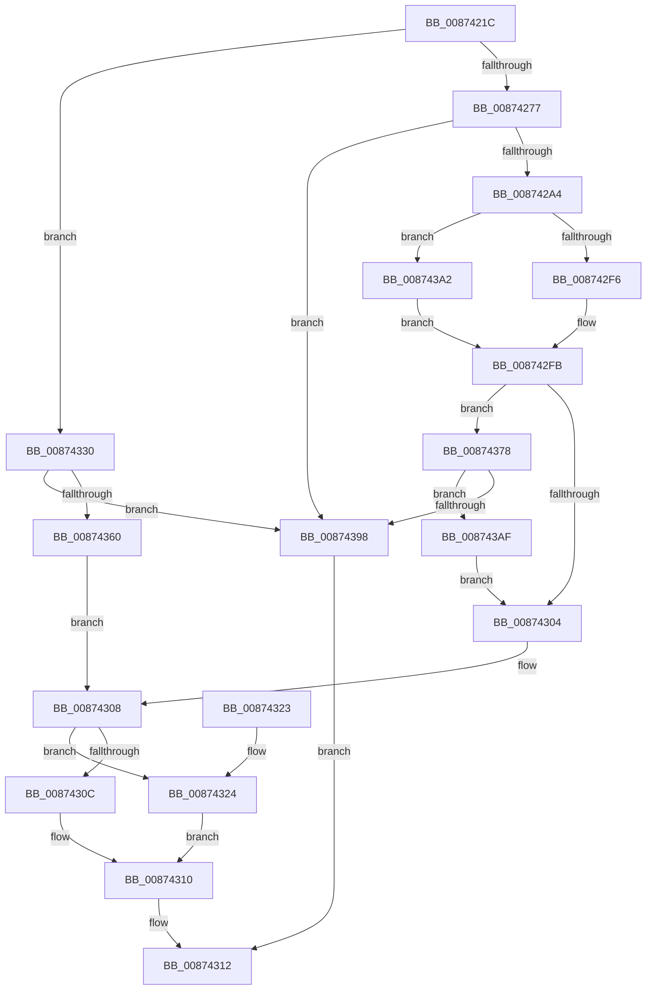

# ObpAllocateAndQuerySecurityDescriptorInfo

- RVA: `0x0087421C`–`0x008743F5` (길이 `473` bytes)
- VA: `0x000000014087421C`
- 실행 섹션: `PAGE`
- PDB 이름 있음: `예`; PDB Function 태그: `아니요`
- unwind 정보 RVA: `0x0006C83C`
- 디코드: `132`개 명령, `473/473` bytes 표시
- 미해석 바이트: `0` (있으면 어셈블리에 `.byte`로 보존)

> 이 문서는 커널 이미지의 기계어와 PDB 기호를 분석해 생성했습니다. 4번과 5번은 함수 원형과 자료형을 바이너리 사용 방식에서 추정한 C 해석이며 원본 소스 복구 결과는 아닙니다.

## 1. Dependencies

- 직접 호출 지점: **10**; 고유 호출 대상: **5**
- 직접 호출자로 확인된 함수: **2**
- RIP 상대 이미지 참조: **4**

### Outgoing calls
- `0x00874293` → [ExAllocatePool2](../../poolcode/B8/ExAllocatePool2_function_00B820F0.md) (function, `0x00B820F0`)
- `0x008742F6` → [IopGetSetSecurityObject](IopGetSetSecurityObject_function_00873A80.md) (function, `0x00873A80`)
- `0x00874329` → [ExFreePoolWithTag](../../poolcode/B8/ExFreePoolWithTag_function_00B82870.md) (function, `0x00B82870`)
- `0x0087433E` → [SeQuerySecurityDescriptorInfo](SeQuerySecurityDescriptorInfo_function_00872820.md) (function, `0x00872820`)
- `0x00874353` → [ExAllocatePool2](../../poolcode/B8/ExAllocatePool2_function_00B820F0.md) (function, `0x00B820F0`)
- `0x0087436F` → [SeQuerySecurityDescriptorInfo](SeQuerySecurityDescriptorInfo_function_00872820.md) (function, `0x00872820`)
- `0x0087437D` → [ExFreePoolWithTag](../../poolcode/B8/ExFreePoolWithTag_function_00B82870.md) (function, `0x00B82870`)
- `0x0087438B` → [ExAllocatePool2](../../poolcode/B8/ExAllocatePool2_function_00B820F0.md) (function, `0x00B820F0`)
- `0x008743A5` → [guard_dispatch_icall](../../text/6B/guard_dispatch_icall_function_006BAAD0.md) (function, `0x006BAAD0`)
- `0x008743E9` → [guard_dispatch_icall](../../text/6B/guard_dispatch_icall_function_006BAAD0.md) (function, `0x006BAAD0`)

### Direct callers
- [ObpCreateHandle](../86/ObpCreateHandle_function_0086B950.md) at `0x0086CFAB`
- [NtSetSecurityObject](../AD/NtSetSecurityObject_function_00ADE2B0.md) at `0x00ADE44E`
- [NtSetSecurityObject](../AD/NtSetSecurityObject_function_00ADE2B0.md) at `0x00ADE507`
- [NtSetSecurityObject](../AD/NtSetSecurityObject_function_00ADE2B0.md) at `0x00ADE557`
- [NtSetSecurityObject](../AD/NtSetSecurityObject_function_00ADE2B0.md) at `0x00ADE5A7`

### Static image references
- `0x00874249` → RVA `0x00FC7800` (`ALMOSTRO`; read)
- `0x00874260` → RVA `0x00FC6E4C` (`ALMOSTRO`; read)
- `0x00874277` → RVA `0x00E0B38C` (`.data`; read)
- `0x008742BC` → RVA `0x00873A80` (`IopGetSetSecurityObject`; read)

## 2. Other-region calls and transfers

- 다른 실행 섹션으로 향하는 call: **7**
  - `0x00874293` → [ExAllocatePool2](../../poolcode/B8/ExAllocatePool2_function_00B820F0.md) (`PAGE` → `POOLCODE`)
  - `0x00874329` → [ExFreePoolWithTag](../../poolcode/B8/ExFreePoolWithTag_function_00B82870.md) (`PAGE` → `POOLCODE`)
  - `0x00874353` → [ExAllocatePool2](../../poolcode/B8/ExAllocatePool2_function_00B820F0.md) (`PAGE` → `POOLCODE`)
  - `0x0087437D` → [ExFreePoolWithTag](../../poolcode/B8/ExFreePoolWithTag_function_00B82870.md) (`PAGE` → `POOLCODE`)
  - `0x0087438B` → [ExAllocatePool2](../../poolcode/B8/ExAllocatePool2_function_00B820F0.md) (`PAGE` → `POOLCODE`)
  - `0x008743A5` → [guard_dispatch_icall](../../text/6B/guard_dispatch_icall_function_006BAAD0.md) (`PAGE` → `.text`)
  - `0x008743E9` → [guard_dispatch_icall](../../text/6B/guard_dispatch_icall_function_006BAAD0.md) (`PAGE` → `.text`)
- 별도 외부 분기/꼬리 이동을 확인하지 못했습니다.

## 3. Assembly (complete function range)

```asm
0087421C  4C 89 4C 24 20                  mov qword ptr [rsp + 0x20], r9
00874221  4C 89 44 24 18                  mov qword ptr [rsp + 0x18], r8
00874226  89 54 24 10                     mov dword ptr [rsp + 0x10], edx
0087422A  55                              push rbp
0087422B  53                              push rbx
0087422C  56                              push rsi
0087422D  57                              push rdi
0087422E  41 54                           push r12
00874230  41 55                           push r13
00874232  41 56                           push r14
00874234  41 57                           push r15
00874236  48 8B EC                        mov rbp, rsp
00874239  48 83 EC 58                     sub rsp, 0x58
0087423D  83 65 48 00                     and dword ptr [rbp + 0x48], 0
00874241  48 8D 41 D0                     lea rax, [rcx - 0x30]
00874245  48 C1 E8 08                     shr rax, 8
00874249  4C 8D 3D B0 35 75 00            lea r15, [rip + 0x7535b0]
00874250  0F B6 D0                        movzx edx, al
00874253  4D 8B E1                        mov r12, r9
00874256  0F B6 41 E8                     movzx eax, byte ptr [rcx - 0x18]
0087425A  4C 8B E9                        mov r13, rcx
0087425D  48 33 D0                        xor rdx, rax
00874260  0F B6 05 E5 2B 75 00            movzx eax, byte ptr [rip + 0x752be5]
00874267  48 33 D0                        xor rdx, rax
0087426A  4D 8B 3C D7                     mov r15, qword ptr [r15 + rdx*8]
0087426E  4D 85 C0                        test r8, r8
00874271  0F 85 B9 00 00 00               jne 0x140874330
00874277  8B 05 0F 71 59 00               mov eax, dword ptr [rip + 0x59710f]
0087427D  BE 4F 62 53 71                  mov esi, 0x7153624f
00874282  41 BE 00 01 00 00               mov r14d, 0x100
00874288  89 45 48                        mov dword ptr [rbp + 0x48], eax
0087428B  8B D0                           mov edx, eax
0087428D  44 8B C6                        mov r8d, esi
00874290  41 8B CE                        mov ecx, r14d
00874293  E8 58 DE 30 00                  call 0x140b820f0
00874298  48 8B D8                        mov rbx, rax
0087429B  48 85 C0                        test rax, rax
0087429E  0F 84 F4 00 00 00               je 0x140874398
008742A4  41 8B 57 64                     mov edx, dword ptr [r15 + 0x64]
008742A8  49 8D 4D F8                     lea rcx, [r13 - 8]
008742AC  4D 8B A7 98 00 00 00            mov r12, qword ptr [r15 + 0x98]
008742B3  49 8D 47 4C                     lea rax, [r15 + 0x4c]
008742B7  C6 44 24 40 00                  mov byte ptr [rsp + 0x40], 0
008742BC  4C 8D 05 BD F7 FF FF            lea r8, [rip - 0x843]
008742C3  48 89 44 24 38                  mov qword ptr [rsp + 0x38], rax
008742C8  4D 3B E0                        cmp r12, r8
008742CB  89 54 24 30                     mov dword ptr [rsp + 0x30], edx
008742CF  48 8D 45 48                     lea rax, [rbp + 0x48]
008742D3  48 89 4C 24 28                  mov qword ptr [rsp + 0x28], rcx
008742D8  4C 8D 45 50                     lea r8, [rbp + 0x50]
008742DC  48 89 4D 58                     mov qword ptr [rbp + 0x58], rcx
008742E0  4C 8B CB                        mov r9, rbx
008742E3  48 89 44 24 20                  mov qword ptr [rsp + 0x20], rax
008742E8  49 8B CD                        mov rcx, r13
008742EB  BA 01 00 00 00                  mov edx, 1
008742F0  0F 85 AC 00 00 00               jne 0x1408743a2
008742F6  E8 85 F7 FF FF                  call 0x140873a80
008742FB  8B F8                           mov edi, eax
008742FD  3D 23 00 00 C0                  cmp eax, 0xc0000023
00874302  74 74                           je 0x140874378
00874304  4C 8B 65 60                     mov r12, qword ptr [rbp + 0x60]
00874308  85 FF                           test edi, edi
0087430A  78 18                           js 0x140874324
0087430C  49 89 1C 24                     mov qword ptr [r12], rbx
00874310  8B C7                           mov eax, edi
00874312  48 83 C4 58                     add rsp, 0x58
00874316  41 5F                           pop r15
00874318  41 5E                           pop r14
0087431A  41 5D                           pop r13
0087431C  41 5C                           pop r12
0087431E  5F                              pop rdi
0087431F  5E                              pop rsi
00874320  5B                              pop rbx
00874321  5D                              pop rbp
00874322  C3                              ret
00874323  CC                              int3
00874324  8B D6                           mov edx, esi
00874326  48 8B CB                        mov rcx, rbx
00874329  E8 42 E5 30 00                  call 0x140b82870
0087432E  EB E0                           jmp 0x140874310
00874330  4C 8D 4D 58                     lea r9, [rbp + 0x58]
00874334  33 D2                           xor edx, edx
00874336  4C 8D 45 48                     lea r8, [rbp + 0x48]
0087433A  48 8D 4D 50                     lea rcx, [rbp + 0x50]
0087433E  E8 DD E4 FF FF                  call 0x140872820
00874343  8B 55 48                        mov edx, dword ptr [rbp + 0x48]
00874346  BE 4F 62 53 71                  mov esi, 0x7153624f
0087434B  44 8B C6                        mov r8d, esi
0087434E  B9 00 01 00 00                  mov ecx, 0x100
00874353  E8 98 DD 30 00                  call 0x140b820f0
00874358  48 8B D8                        mov rbx, rax
0087435B  48 85 C0                        test rax, rax
0087435E  74 38                           je 0x140874398
00874360  4C 8D 4D 58                     lea r9, [rbp + 0x58]
00874364  48 8B D0                        mov rdx, rax
00874367  4C 8D 45 48                     lea r8, [rbp + 0x48]
0087436B  48 8D 4D 50                     lea rcx, [rbp + 0x50]
0087436F  E8 AC E4 FF FF                  call 0x140872820
00874374  8B F8                           mov edi, eax
00874376  EB 90                           jmp 0x140874308
00874378  8B D6                           mov edx, esi
0087437A  48 8B CB                        mov rcx, rbx
0087437D  E8 EE E4 30 00                  call 0x140b82870
00874382  8B 55 48                        mov edx, dword ptr [rbp + 0x48]
00874385  44 8B C6                        mov r8d, esi
00874388  49 8B CE                        mov rcx, r14
0087438B  E8 60 DD 30 00                  call 0x140b820f0
00874390  48 8B D8                        mov rbx, rax
00874393  48 85 C0                        test rax, rax
00874396  75 17                           jne 0x1408743af
00874398  B8 9A 00 00 C0                  mov eax, 0xc000009a
0087439D  E9 70 FF FF FF                  jmp 0x140874312
008743A2  49 8B C4                        mov rax, r12
008743A5  E8 26 67 E4 FF                  call 0x1406baad0
008743AA  E9 4C FF FF FF                  jmp 0x1408742fb
008743AF  C6 44 24 40 00                  mov byte ptr [rsp + 0x40], 0
008743B4  49 8D 47 4C                     lea rax, [r15 + 0x4c]
008743B8  48 89 44 24 38                  mov qword ptr [rsp + 0x38], rax
008743BD  4C 8D 45 50                     lea r8, [rbp + 0x50]
008743C1  41 8B 47 64                     mov eax, dword ptr [r15 + 0x64]
008743C5  4C 8B CB                        mov r9, rbx
008743C8  89 44 24 30                     mov dword ptr [rsp + 0x30], eax
008743CC  BA 01 00 00 00                  mov edx, 1
008743D1  48 8B 45 58                     mov rax, qword ptr [rbp + 0x58]
008743D5  49 8B CD                        mov rcx, r13
008743D8  48 89 44 24 28                  mov qword ptr [rsp + 0x28], rax
008743DD  48 8D 45 48                     lea rax, [rbp + 0x48]
008743E1  48 89 44 24 20                  mov qword ptr [rsp + 0x20], rax
008743E6  49 8B C4                        mov rax, r12
008743E9  E8 E2 66 E4 FF                  call 0x1406baad0
008743EE  8B F8                           mov edi, eax
008743F0  E9 0F FF FF FF                  jmp 0x140874304
```

## 4. C-style interpretation (structured pseudocode)

```c
__int64 __fastcall ObpAllocateAndQuerySecurityDescriptorInfo(__int64 a1, int a2, __int64 a3, __int64 a4)
{
    __int64 result;
    __int64 v_rsp;
    unsigned __int8 v_stack_m58;
    unsigned __int64 v_stack_m60;
    unsigned int v_stack_m68;
    unsigned __int64 v_stack_m70;
    unsigned __int64 v_stack_m78;
    unsigned int v_stack_p10;
    unsigned __int64 v_stack_p18;
    unsigned __int64 v_stack_p20;
    unsigned __int64 v_stack_p28;
    unsigned int v_stack_p30;
    unsigned __int64 v_stack_p38;
    unsigned __int8 v_stack_p40;
    unsigned int v_stack_p8;

    v_stack_p20 = a4;
    v_stack_p18 = a3;
    v_stack_p10 = a2;
    v_rsp = (v_rsp) - (88);
    result = (a1 - 48) >> (8);
    a2 = ((unsigned __int8)(result)) ^ (*(unsigned __int8 *)(a1 - 24));
    a2 = (a2) ^ (*(unsigned __int8 *)(v_rip + 7678949));
    if (a3 != 0) goto loc_00874330;
    v_stack_p8 = (unsigned int)((unsigned int)(*(unsigned int *)(v_rip + 5861647)));
    result = ExAllocatePool2(256, (unsigned int)((unsigned int)((unsigned int)(*(unsigned int *)(v_rip + 5861647)))), (unsigned int)((unsigned int)((unsigned int)(0x7153624FULL))), a4);
    if (result == 0) goto loc_00874398;
    v_stack_m58 = 0;
    v_stack_m60 = *(unsigned __int64 *)(v_rip + 7681456 + a2 * 8) + 76;
    v_stack_m68 = (unsigned int)((unsigned int)(*(unsigned int *)(*(unsigned __int64 *)(v_rip + 7681456 + a2 * 8) + 100)));
    v_stack_m70 = a1 - 8;
    v_stack_p18 = a1 - 8;
    v_stack_m78 = v_stack_p8;
    if ((*(unsigned __int64 *)(*(unsigned __int64 *)(v_rip + 7681456 + a2 * 8) + 152)) != (v_rip - 2115)) goto loc_008743A2;
    result = IopGetSetSecurityObject(a1, 1, v_stack_p10, result);
loc_008742FB:
    if (((unsigned int)(result)) == 0xC0000023ULL) goto loc_00874378;
loc_00874304:
loc_00874308:
    if (sign_flag) goto loc_00874324;
    *(unsigned __int64 *)(v_stack_p20) = result;
loc_00874310:
loc_00874312:
    v_rsp = (v_rsp) + (88);
    return (unsigned int)((unsigned int)((unsigned int)((unsigned int)(result))));
loc_00874324:
    result = ExFreePoolWithTag(result, (unsigned int)((unsigned int)((unsigned int)(0x7153624FULL))), v_stack_p10, result);
    goto loc_00874310;
loc_00874330:
    a2 = 0;
    result = SeQuerySecurityDescriptorInfo(v_stack_p10, a2, v_stack_p8, v_stack_p18);
    result = ExAllocatePool2(256, (unsigned int)(v_stack_p8), (unsigned int)((unsigned int)((unsigned int)(0x7153624FULL))), v_stack_p18);
    if (result == 0) goto loc_00874398;
    result = SeQuerySecurityDescriptorInfo(v_stack_p10, result, v_stack_p8, v_stack_p18);
    goto loc_00874308;
loc_00874378:
    result = ExFreePoolWithTag(result, (unsigned int)((unsigned int)((unsigned int)(0x7153624FULL))), v_stack_p8, v_stack_p18);
    result = ExAllocatePool2(256, (unsigned int)(v_stack_p8), (unsigned int)((unsigned int)((unsigned int)(0x7153624FULL))), v_stack_p18);
    if (result != 0) goto loc_008743AF;
loc_00874398:
    goto loc_00874312;
loc_008743A2:
    result = guard_dispatch_icall(256, (unsigned int)(v_stack_p8), (unsigned int)((unsigned int)((unsigned int)(0x7153624FULL))), v_stack_p18);
    goto loc_008742FB;
loc_008743AF:
    v_stack_p40 = 0;
    v_stack_p38 = *(unsigned __int64 *)(v_rip + 7681456 + a2 * 8) + 76;
    v_stack_p30 = (unsigned int)((unsigned int)(*(unsigned int *)(*(unsigned __int64 *)(v_rip + 7681456 + a2 * 8) + 100)));
    v_stack_p28 = v_stack_p18;
    v_stack_p20 = v_stack_p8;
    result = guard_dispatch_icall(a1, 1, v_stack_p10, result);
    goto loc_00874304;
}
```

## 5. (Beta) C Style

```c
int64_t ObpAllocateAndQuerySecurityDescriptorInfo(void *Arg1, int32_t Arg2, int64_t Arg3, int64_t Arg4)
{
    uint8_t *arg1 = (uint8_t *)Arg1;

    int64_t result;
    int64_t local_rsp;
    uint8_t v_stack_m58;
    uint64_t v_stack_m60;
    uint32_t v_stack_m68;
    uint64_t v_stack_m70;
    uint64_t v_stack_m78;
    uint32_t v_stack_p10;
    uint64_t v_stack_p18;
    uint64_t v_stack_p20;
    uint64_t v_stack_p28;
    uint32_t v_stack_p30;
    uint64_t v_stack_p38;
    uint8_t v_stack_p40;
    uint32_t v_stack_p8;

    v_stack_p20 = Arg4;
    v_stack_p18 = Arg3;
    v_stack_p10 = Arg2;
    local_rsp = (local_rsp) - (88);
    result = (Arg1 - 48) >> (8);
    Arg2 = ((uint8_t)(result)) ^ (*(uint8_t *)(arg1 - 0x18));
    Arg2 = (Arg2) ^ (*(uint8_t *)(v_rip + 0x752BE5));
    if (Arg3 != 0) goto loc_00874330;
    v_stack_p8 = (uint32_t)((uint32_t)(*(uint32_t *)(v_rip + 0x59710F)));
    result = ExAllocatePool2(256, (uint32_t)((uint32_t)((uint32_t)(*(uint32_t *)(v_rip + 0x59710F)))), (uint32_t)((uint32_t)((uint32_t)(0x7153624FULL))), Arg4);
    if (result == 0) goto loc_00874398;
    v_stack_m58 = 0;
    v_stack_m60 = *(uint64_t *)(v_rip + 0x7535B0 + Arg2 * 8) + 76;
    v_stack_m68 = (uint32_t)((uint32_t)(*(uint32_t *)(*(uint64_t *)(v_rip + 0x7535B0 + Arg2 * 8) + 0x64)));
    v_stack_m70 = Arg1 - 8;
    v_stack_p18 = Arg1 - 8;
    v_stack_m78 = v_stack_p8;
    if ((*(uint64_t *)(*(uint64_t *)(v_rip + 0x7535B0 + Arg2 * 8) + 0x98)) != (v_rip - 2115)) goto loc_008743A2;
    result = IopGetSetSecurityObject(Arg1, 1, v_stack_p10, result);
loc_008742FB:
    if (((uint32_t)(result)) == 0xC0000023ULL) goto loc_00874378;
loc_00874304:
loc_00874308:
    if (sign_flag) goto loc_00874324;
    *(uint64_t *)(v_stack_p20) = result;
loc_00874310:
loc_00874312:
    local_rsp = (local_rsp) + (88);
    return (uint32_t)((uint32_t)((uint32_t)((uint32_t)(result))));
loc_00874324:
    result = ExFreePoolWithTag(result, (uint32_t)((uint32_t)((uint32_t)(0x7153624FULL))), v_stack_p10, result);
    goto loc_00874310;
loc_00874330:
    Arg2 = 0;
    result = SeQuerySecurityDescriptorInfo(v_stack_p10, Arg2, v_stack_p8, v_stack_p18);
    result = ExAllocatePool2(256, (uint32_t)(v_stack_p8), (uint32_t)((uint32_t)((uint32_t)(0x7153624FULL))), v_stack_p18);
    if (result == 0) goto loc_00874398;
    result = SeQuerySecurityDescriptorInfo(v_stack_p10, result, v_stack_p8, v_stack_p18);
    goto loc_00874308;
loc_00874378:
    result = ExFreePoolWithTag(result, (uint32_t)((uint32_t)((uint32_t)(0x7153624FULL))), v_stack_p8, v_stack_p18);
    result = ExAllocatePool2(256, (uint32_t)(v_stack_p8), (uint32_t)((uint32_t)((uint32_t)(0x7153624FULL))), v_stack_p18);
    if (result != 0) goto loc_008743AF;
loc_00874398:
    goto loc_00874312;
loc_008743A2:
    result = guard_dispatch_icall(256, (uint32_t)(v_stack_p8), (uint32_t)((uint32_t)((uint32_t)(0x7153624FULL))), v_stack_p18);
    goto loc_008742FB;
loc_008743AF:
    v_stack_p40 = 0;
    v_stack_p38 = *(uint64_t *)(v_rip + 0x7535B0 + Arg2 * 8) + 76;
    v_stack_p30 = (uint32_t)((uint32_t)(*(uint32_t *)(*(uint64_t *)(v_rip + 0x7535B0 + Arg2 * 8) + 0x64)));
    v_stack_p28 = v_stack_p18;
    v_stack_p20 = v_stack_p8;
    result = guard_dispatch_icall(Arg1, 1, v_stack_p10, result);
    goto loc_00874304;
}
```

### 관측된 메모리 오프셋

구조체 형식이 확인되지 않은 접근은 인자 기준의 오프셋으로만 기록했습니다.

| 기준 인자 | 오프셋 표현 | 폭 (bit) | 접근 |
|---|---:|---:|---|
| `Arg1` | `- 0x30` | `64` | `R` |
| `Arg1` | `- 0x18` | `8` | `R` |
| `Arg1` | `- 0x8` | `64` | `R` |

## 6. Execution-region graph

[열기: 2D/3D 그래프와 함수 탐색 컨트롤 패널](../../../control-panel.html?section=page&rva=0x0087421C&view=graph)

- 2D 그래프는 위에서 아래로 흐르고, 3D 그래프는 빈 공간을 드래그해 회전합니다. Shift+드래그는 이동, 휠은 확대·축소, 함수 노드 선택은 대상 보고서 이동입니다.

### Static fallback


