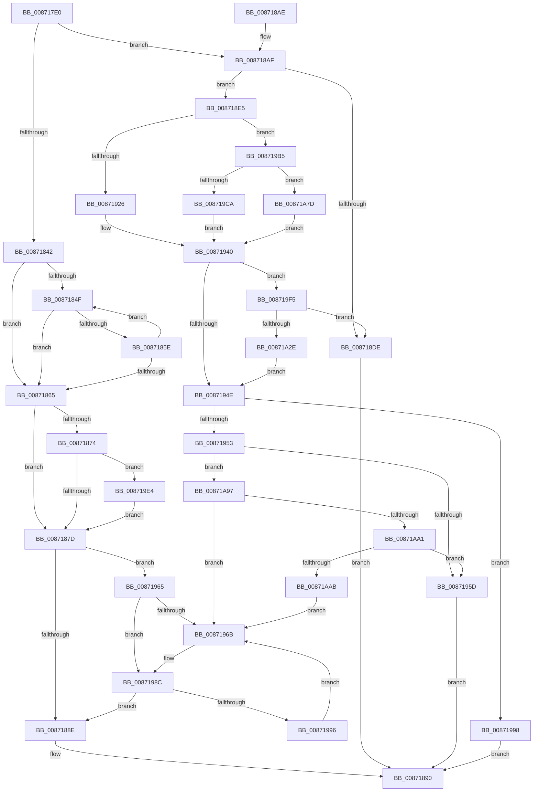

# ObpGetObjectSecurity

- RVA: `0x008717E0`–`0x00871AB0` (길이 `720` bytes)
- VA: `0x00000001408717E0`
- 실행 섹션: `PAGE`
- PDB 이름 있음: `예`; PDB Function 태그: `아니요`
- unwind 정보 RVA: `0x0006C3DC`
- 디코드: `172`개 명령, `720/720` bytes 표시
- 미해석 바이트: `0` (있으면 어셈블리에 `.byte`로 보존)

> 이 문서는 커널 이미지의 기계어와 PDB 기호를 분석해 생성했습니다. 4번과 5번은 함수 원형과 자료형을 바이너리 사용 방식에서 추정한 C 해석이며 원본 소스 복구 결과는 아닙니다.

## 1. Dependencies

- 직접 호출 지점: **10**; 고유 호출 대상: **7**
- 직접 호출자로 확인된 함수: **9**
- RIP 상대 이미지 참조: **7**

### Outgoing calls
- `0x008718D1` → [ExAllocatePool2](../../poolcode/B8/ExAllocatePool2_function_00B820F0.md) (function, `0x00B820F0`)
- `0x0087193B` → [CmpSecurityMethod](CmpSecurityMethod_function_00870CC0.md) (function, `0x00870CC0`)
- `0x00871986` → [KeBugCheckEx](../../text/4F/KeBugCheckEx_function_004FD660.md) (function, `0x004FD660`)
- `0x0087199D` → [ExFreePoolWithTag](../../poolcode/B8/ExFreePoolWithTag_function_00B82870.md) (function, `0x00B82870`)
- `0x008719DA` → [IopGetSetSecurityObject](IopGetSetSecurityObject_function_00873A80.md) (function, `0x00873A80`)
- `0x008719EB` → [ObpReferenceSecurityDescriptorSlow](ObpReferenceSecurityDescriptorSlow_function_0087484C.md) (function, `0x0087484C`)
- `0x008719FA` → [ExFreePoolWithTag](../../poolcode/B8/ExFreePoolWithTag_function_00B82870.md) (function, `0x00B82870`)
- `0x00871A1D` → [ExAllocatePool2](../../poolcode/B8/ExAllocatePool2_function_00B820F0.md) (function, `0x00B820F0`)
- `0x00871A70` → [guard_dispatch_icall](../../text/6B/guard_dispatch_icall_function_006BAAD0.md) (function, `0x006BAAD0`)
- `0x00871A8D` → [guard_dispatch_icall](../../text/6B/guard_dispatch_icall_function_006BAAD0.md) (function, `0x006BAAD0`)

### Direct callers
- [PspCheckJobAccessState](../78/PspCheckJobAccessState_function_00784D94.md) at `0x00784DDA`
- [ObpCheckObjectReference](../8C/ObpCheckObjectReference_function_008C6084.md) at `0x008C60E8`
- [ObCheckCreateObjectAccess](../8C/ObCheckCreateObjectAccess_function_008C6340.md) at `0x008C63AD`
- [ObpCheckTraverseAccess](../8C/ObpCheckTraverseAccess_function_008C6CE4.md) at `0x008C6D50`
- [MiAllowImageMap](../8C/MiAllowImageMap_function_008C8B10.md) at `0x008C8C5D`
- [PspAllocateAndQueryNotificationChannel](../91/PspAllocateAndQueryNotificationChannel_function_00917EE4.md) at `0x0091807E`
- [ObpInsertOrLocateNamedObject](../99/ObpInsertOrLocateNamedObject_function_0099F2C0.md) at `0x0099F435`
- [EtwpCheckCurrentUserProcessAccess](../9E/EtwpCheckCurrentUserProcessAccess_function_009EB530.md) at `0x009EB553`
- [PopBootStatAccessCheck](../AC/PopBootStatAccessCheck_function_00AC0814.md) at `0x00AC0882`

### Static image references
- `0x00871808` → RVA `0x00FC7800` (`ALMOSTRO`; read)
- `0x00871823` → RVA `0x00FC6E4C` (`ALMOSTRO`; read)
- `0x0087182D` → RVA `0x008BA2B0` (`SeDefaultObjectMethod`; read)
- `0x008718AF` → RVA `0x00E0B38C` (`.data`; read)
- `0x008718FB` → RVA `0x00870CC0` (`CmpSecurityMethod`; read)
- `0x008719B5` → RVA `0x00873A80` (`IopGetSetSecurityObject`; read)
- `0x00871A17` → RVA `0x00E0B38C` (`.data`; write)

## 2. Other-region calls and transfers

- 다른 실행 섹션으로 향하는 call: **7**
  - `0x008718D1` → [ExAllocatePool2](../../poolcode/B8/ExAllocatePool2_function_00B820F0.md) (`PAGE` → `POOLCODE`)
  - `0x00871986` → [KeBugCheckEx](../../text/4F/KeBugCheckEx_function_004FD660.md) (`PAGE` → `.text`)
  - `0x0087199D` → [ExFreePoolWithTag](../../poolcode/B8/ExFreePoolWithTag_function_00B82870.md) (`PAGE` → `POOLCODE`)
  - `0x008719FA` → [ExFreePoolWithTag](../../poolcode/B8/ExFreePoolWithTag_function_00B82870.md) (`PAGE` → `POOLCODE`)
  - `0x00871A1D` → [ExAllocatePool2](../../poolcode/B8/ExAllocatePool2_function_00B820F0.md) (`PAGE` → `POOLCODE`)
  - `0x00871A70` → [guard_dispatch_icall](../../text/6B/guard_dispatch_icall_function_006BAAD0.md) (`PAGE` → `.text`)
  - `0x00871A8D` → [guard_dispatch_icall](../../text/6B/guard_dispatch_icall_function_006BAAD0.md) (`PAGE` → `.text`)
- 별도 외부 분기/꼬리 이동을 확인하지 못했습니다.

## 3. Assembly (complete function range)

```asm
008717E0  48 89 5C 24 10                  mov qword ptr [rsp + 0x10], rbx
008717E5  48 89 6C 24 18                  mov qword ptr [rsp + 0x18], rbp
008717EA  48 89 74 24 20                  mov qword ptr [rsp + 0x20], rsi
008717EF  57                              push rdi
008717F0  41 54                           push r12
008717F2  41 55                           push r13
008717F4  41 56                           push r14
008717F6  41 57                           push r15
008717F8  48 83 EC 60                     sub rsp, 0x60
008717FC  48 8D 41 D0                     lea rax, [rcx - 0x30]
00871800  45 0F B6 F9                     movzx r15d, r9b
00871804  48 C1 E8 08                     shr rax, 8
00871808  48 8D 2D F1 5F 75 00            lea rbp, [rip + 0x755ff1]
0087180F  44 0F B6 D0                     movzx r10d, al
00871813  4D 8B F0                        mov r14, r8
00871816  0F B6 41 E8                     movzx eax, byte ptr [rcx - 0x18]
0087181A  48 8B FA                        mov rdi, rdx
0087181D  4C 33 D0                        xor r10, rax
00871820  48 8B F1                        mov rsi, rcx
00871823  0F B6 05 22 56 75 00            movzx eax, byte ptr [rip + 0x755622]
0087182A  4C 33 D0                        xor r10, rax
0087182D  48 8D 05 7C 8A 04 00            lea rax, [rip + 0x48a7c]
00871834  4A 8B 6C D5 00                  mov rbp, qword ptr [rbp + r10*8]
00871839  48 39 85 98 00 00 00            cmp qword ptr [rbp + 0x98], rax
00871840  75 6D                           jne 0x1408718af
00871842  0F 0D 49 F8                     prefetchw byte ptr [rcx - 8]
00871846  48 8B 51 F8                     mov rdx, qword ptr [rcx - 8]
0087184A  F6 C2 0F                        test dl, 0xf
0087184D  74 16                           je 0x140871865
0087184F  48 8D 4A FF                     lea rcx, [rdx - 1]
00871853  48 8B C2                        mov rax, rdx
00871856  F0 48 0F B1 4E F8               lock cmpxchg qword ptr [rsi - 8], rcx
0087185C  74 07                           je 0x140871865
0087185E  48 8B D0                        mov rdx, rax
00871861  A8 0F                           test al, 0xf
00871863  75 EA                           jne 0x14087184f
00871865  48 8B C2                        mov rax, rdx
00871868  83 E2 0F                        and edx, 0xf
0087186B  48 83 E0 F0                     and rax, 0xfffffffffffffff0
0087186F  83 FA 01                        cmp edx, 1
00871872  77 09                           ja 0x14087187d
00871874  48 85 C0                        test rax, rax
00871877  0F 85 67 01 00 00               jne 0x1408719e4
0087187D  48 89 07                        mov qword ptr [rdi], rax
00871880  41 C6 06 00                     mov byte ptr [r14], 0
00871884  48 83 3F 00                     cmp qword ptr [rdi], 0
00871888  0F 84 D7 00 00 00               je 0x140871965
0087188E  33 C0                           xor eax, eax
00871890  4C 8D 5C 24 60                  lea r11, [rsp + 0x60]
00871895  49 8B 5B 38                     mov rbx, qword ptr [r11 + 0x38]
00871899  49 8B 6B 40                     mov rbp, qword ptr [r11 + 0x40]
0087189D  49 8B 73 48                     mov rsi, qword ptr [r11 + 0x48]
008718A1  49 8B E3                        mov rsp, r11
008718A4  41 5F                           pop r15
008718A6  41 5E                           pop r14
008718A8  41 5D                           pop r13
008718AA  41 5C                           pop r12
008718AC  5F                              pop rdi
008718AD  C3                              ret
008718AE  CC                              int3
008718AF  8B 05 D7 9A 59 00               mov eax, dword ptr [rip + 0x599ad7]
008718B5  B9 00 01 00 00                  mov ecx, 0x100
008718BA  8B D0                           mov edx, eax
008718BC  C7 44 24 50 BF 01 00 00         mov dword ptr [rsp + 0x50], 0x1bf
008718C4  41 B8 4F 62 53 71               mov r8d, 0x7153624f
008718CA  89 84 24 90 00 00 00            mov dword ptr [rsp + 0x90], eax
008718D1  E8 1A 08 31 00                  call 0x140b820f0
008718D6  48 89 07                        mov qword ptr [rdi], rax
008718D9  48 85 C0                        test rax, rax
008718DC  75 07                           jne 0x1408718e5
008718DE  B8 9A 00 00 C0                  mov eax, 0xc000009a
008718E3  EB AB                           jmp 0x140871890
008718E5  41 C6 06 01                     mov byte ptr [r14], 1
008718E9  48 8D 56 F8                     lea rdx, [rsi - 8]
008718ED  8B 4D 64                        mov ecx, dword ptr [rbp + 0x64]
008718F0  4C 8D 6D 4C                     lea r13, [rbp + 0x4c]
008718F4  48 8B 85 98 00 00 00            mov rax, qword ptr [rbp + 0x98]
008718FB  4C 8D 05 BE F3 FF FF            lea r8, [rip - 0xc42]
00871902  4C 8B 0F                        mov r9, qword ptr [rdi]
00871905  44 88 7C 24 40                  mov byte ptr [rsp + 0x40], r15b
0087190A  4C 89 6C 24 38                  mov qword ptr [rsp + 0x38], r13
0087190F  89 4C 24 30                     mov dword ptr [rsp + 0x30], ecx
00871913  48 89 54 24 28                  mov qword ptr [rsp + 0x28], rdx
00871918  BA 01 00 00 00                  mov edx, 1
0087191D  49 3B C0                        cmp rax, r8
00871920  0F 85 8F 00 00 00               jne 0x1408719b5
00871926  48 8D 84 24 90 00 00 00         lea rax, [rsp + 0x90]
0087192E  48 8B CE                        mov rcx, rsi
00871931  4C 8D 44 24 50                  lea r8, [rsp + 0x50]
00871936  48 89 44 24 20                  mov qword ptr [rsp + 0x20], rax
0087193B  E8 80 F3 FF FF                  call 0x140870cc0
00871940  44 8B E0                        mov r12d, eax
00871943  3D 23 00 00 C0                  cmp eax, 0xc0000023
00871948  0F 84 A7 00 00 00               je 0x1408719f5
0087194E  45 85 E4                        test r12d, r12d
00871951  78 45                           js 0x140871998
00871953  48 83 3F 00                     cmp qword ptr [rdi], 0
00871957  0F 84 3A 01 00 00               je 0x140871a97
0087195D  41 8B C4                        mov eax, r12d
00871960  E9 2B FF FF FF                  jmp 0x140871890
00871965  F6 45 42 08                     test byte ptr [rbp + 0x42], 8
00871969  74 21                           je 0x14087198c
0087196B  41 B9 01 00 00 00               mov r9d, 1
00871971  48 C7 44 24 20 00 00 00 00      mov qword ptr [rsp + 0x20], 0
0087197A  4C 8B C5                        mov r8, rbp
0087197D  48 8D 56 D0                     lea rdx, [rsi - 0x30]
00871981  B9 89 01 00 00                  mov ecx, 0x189
00871986  E8 D5 BC C8 FF                  call 0x1404fd660
0087198B  CC                              int3
0087198C  F6 46 EA 02                     test byte ptr [rsi - 0x16], 2
00871990  0F 84 F8 FE FF FF               je 0x14087188e
00871996  EB D3                           jmp 0x14087196b
00871998  48 8B 0F                        mov rcx, qword ptr [rdi]
0087199B  33 D2                           xor edx, edx
0087199D  E8 CE 0E 31 00                  call 0x140b82870
008719A2  48 C7 07 00 00 00 00            mov qword ptr [rdi], 0
008719A9  41 8B C4                        mov eax, r12d
008719AC  41 C6 06 00                     mov byte ptr [r14], 0
008719B0  E9 DB FE FF FF                  jmp 0x140871890
008719B5  4C 8D 05 C4 20 00 00            lea r8, [rip + 0x20c4]
008719BC  49 3B C0                        cmp rax, r8
008719BF  4C 8D 44 24 50                  lea r8, [rsp + 0x50]
008719C4  0F 85 B3 00 00 00               jne 0x140871a7d
008719CA  48 8D 84 24 90 00 00 00         lea rax, [rsp + 0x90]
008719D2  48 8B CE                        mov rcx, rsi
008719D5  48 89 44 24 20                  mov qword ptr [rsp + 0x20], rax
008719DA  E8 A1 20 00 00                  call 0x140873a80
008719DF  E9 5C FF FF FF                  jmp 0x140871940
008719E4  4C 8B C0                        mov r8, rax
008719E7  48 8D 4E D0                     lea rcx, [rsi - 0x30]
008719EB  E8 5C 2E 00 00                  call 0x14087484c
008719F0  E9 88 FE FF FF                  jmp 0x14087187d
008719F5  48 8B 0F                        mov rcx, qword ptr [rdi]
008719F8  33 D2                           xor edx, edx
008719FA  E8 71 0E 31 00                  call 0x140b82870
008719FF  8B 84 24 90 00 00 00            mov eax, dword ptr [rsp + 0x90]
00871A06  B9 00 01 00 00                  mov ecx, 0x100
00871A0B  8B D0                           mov edx, eax
00871A0D  41 C6 06 00                     mov byte ptr [r14], 0
00871A11  41 B8 4F 62 53 71               mov r8d, 0x7153624f
00871A17  89 05 6F 99 59 00               mov dword ptr [rip + 0x59996f], eax
00871A1D  E8 CE 06 31 00                  call 0x140b820f0
00871A22  48 89 07                        mov qword ptr [rdi], rax
00871A25  48 85 C0                        test rax, rax
00871A28  0F 84 B0 FE FF FF               je 0x1408718de
00871A2E  41 C6 06 01                     mov byte ptr [r14], 1
00871A32  4C 8D 44 24 50                  lea r8, [rsp + 0x50]
00871A37  8B 4D 64                        mov ecx, dword ptr [rbp + 0x64]
00871A3A  BA 01 00 00 00                  mov edx, 1
00871A3F  48 8B 85 98 00 00 00            mov rax, qword ptr [rbp + 0x98]
00871A46  4C 8B 0F                        mov r9, qword ptr [rdi]
00871A49  44 88 7C 24 40                  mov byte ptr [rsp + 0x40], r15b
00871A4E  4C 89 6C 24 38                  mov qword ptr [rsp + 0x38], r13
00871A53  89 4C 24 30                     mov dword ptr [rsp + 0x30], ecx
00871A57  48 8D 4E F8                     lea rcx, [rsi - 8]
00871A5B  48 89 4C 24 28                  mov qword ptr [rsp + 0x28], rcx
00871A60  48 8D 8C 24 90 00 00 00         lea rcx, [rsp + 0x90]
00871A68  48 89 4C 24 20                  mov qword ptr [rsp + 0x20], rcx
00871A6D  48 8B CE                        mov rcx, rsi
00871A70  E8 5B 90 E4 FF                  call 0x1406baad0
00871A75  44 8B E0                        mov r12d, eax
00871A78  E9 D1 FE FF FF                  jmp 0x14087194e
00871A7D  48 8D 8C 24 90 00 00 00         lea rcx, [rsp + 0x90]
00871A85  48 89 4C 24 20                  mov qword ptr [rsp + 0x20], rcx
00871A8A  48 8B CE                        mov rcx, rsi
00871A8D  E8 3E 90 E4 FF                  call 0x1406baad0
00871A92  E9 A9 FE FF FF                  jmp 0x140871940
00871A97  F6 45 42 08                     test byte ptr [rbp + 0x42], 8
00871A9B  0F 85 CA FE FF FF               jne 0x14087196b
00871AA1  F6 46 EA 02                     test byte ptr [rsi - 0x16], 2
00871AA5  0F 84 B2 FE FF FF               je 0x14087195d
00871AAB  E9 BB FE FF FF                  jmp 0x14087196b
```

## 4. C-style interpretation (structured pseudocode)

```c
__int64 __fastcall ObpGetObjectSecurity(__int64 a1, __int64 a2, __int64 a3, unsigned __int8 a4)
{
    __int64 result;
    __int64 v_r10;
    __int64 v_rsp;
    unsigned int v_stack_m10;
    unsigned __int8 v_stack_m20;
    unsigned __int64 v_stack_m28;
    unsigned int v_stack_m30;
    unsigned __int64 v_stack_m38;
    unsigned __int64 v_stack_m40;
    unsigned __int64 v_stack_p10;
    unsigned __int64 v_stack_p18;
    unsigned __int64 v_stack_p20;
    unsigned int v_stack_p30;

    v_stack_p10 = v_rbx;
    v_stack_p18 = v_rbp;
    v_stack_p20 = v_rsi;
    v_rsp = (v_rsp) - (96);
    result = (a1 - 48) >> (8);
    v_r10 = ((unsigned __int8)(result)) ^ (*(unsigned __int8 *)(a1 - 24));
    v_r10 = (v_r10) ^ (*(unsigned __int8 *)(v_rip + 7689762));
    if ((*(unsigned __int64 *)(*(unsigned __int64 *)(v_rip + 7692273 + v_r10 * 8) + 152)) != (v_rip + 297596)) goto loc_008718AF;
    if ((((unsigned __int8)(*(unsigned __int64 *)(a1 - 8))) & (15)) == 0) goto loc_00871865;
loc_0087184F:
    if ((((unsigned __int8)(*(unsigned __int64 *)(a1 - 8))) & (15)) == 0) goto loc_00871865;
    if ((((unsigned __int8)(*(unsigned __int64 *)(a1 - 8))) & (15)) != 0) goto loc_0087184F;
loc_00871865:
    a2 = (unsigned int)((*(unsigned __int64 *)(a1 - 8)) & (15));
    result = (*(unsigned __int64 *)(a1 - 8)) & (-16);
    if (((unsigned int)(a2)) > 1) goto loc_0087187D;
    if (result != 0) goto loc_008719E4;
loc_0087187D:
    *(unsigned __int64 *)(a2) = result;
    *(unsigned __int8 *)(a3) = 0;
    if ((*(unsigned __int64 *)(a2)) == 0) goto loc_00871965;
loc_0087188E:
    result = 0;
loc_00871890:
    return result;
loc_008718AF:
    v_stack_m10 = 447;
    v_stack_p30 = (unsigned int)((unsigned int)(*(unsigned int *)(v_rip + 5872343)));
    result = ExAllocatePool2(256, (unsigned int)((unsigned int)((unsigned int)(*(unsigned int *)(v_rip + 5872343)))), (unsigned int)(0x7153624FULL), a4);
    *(unsigned __int64 *)(a2) = result;
    if (result != 0) goto loc_008718E5;
loc_008718DE:
    goto loc_00871890;
loc_008718E5:
    *(unsigned __int8 *)(a3) = 1;
    v_stack_m20 = a4;
    v_stack_m28 = *(unsigned __int64 *)(v_stack_m28 + 64) + 76;
    v_stack_m30 = (unsigned int)((unsigned int)(*(unsigned int *)(*(unsigned __int64 *)(v_stack_m28 + 64) + 100)));
    v_stack_m38 = *(unsigned __int64 *)(v_stack_m28 + 72) - 8;
    if ((*(unsigned __int64 *)(*(unsigned __int64 *)(v_stack_m28 + 64) + 152)) != (v_rip - 3138)) goto loc_008719B5;
    v_stack_m40 = v_stack_p30;
    result = CmpSecurityMethod(*(unsigned __int64 *)(v_stack_m28 + 72), 1, v_stack_m10, *(unsigned __int64 *)(a2));
loc_00871940:
    if (((unsigned int)(result)) == 0xC0000023ULL) goto loc_008719F5;
loc_0087194E:
    if (sign_flag) goto loc_00871998;
    if ((*(unsigned __int64 *)(a2)) == 0) goto loc_00871A97;
loc_0087195D:
    goto loc_00871890;
loc_00871965:
    result = (unsigned int)((unsigned int)((unsigned int)((unsigned int)(result))));
    if (((*(unsigned __int8 *)(*(unsigned __int64 *)(v_stack_m28 + 64) + 66)) & (8)) != 0) {
        a4 = 1;
        v_stack_m40 = 0;
        a3 = *(unsigned __int64 *)(v_stack_m28 + 64);
        a2 = *(unsigned __int64 *)(v_stack_m28 + 72) - 48;
        a1 = 393;
        result = KeBugCheckEx(a1, a2, a3, a4);
    }
    if (((*(unsigned __int8 *)(*(unsigned __int64 *)(v_stack_m28 + 72) - 22)) & (2)) == 0) goto loc_0087188E;
    goto loc_0087196B;
loc_00871998:
    a2 = 0;
    result = ExFreePoolWithTag(*(unsigned __int64 *)(a2), a2, a3, a4);
    *(unsigned __int64 *)(a2) = 0;
    *(unsigned __int8 *)(a3) = 0;
    goto loc_00871890;
loc_008719B5:
    if (((unsigned int)((unsigned int)((unsigned int)((unsigned int)(result))))) != (v_rip + 8388)) goto loc_00871A7D;
    v_stack_m40 = v_stack_p30;
    result = IopGetSetSecurityObject(*(unsigned __int64 *)(v_stack_m28 + 72), a2, v_stack_m10, a4);
    goto loc_00871940;
loc_008719E4:
    result = ObpReferenceSecurityDescriptorSlow(*(unsigned __int64 *)(v_stack_m28 + 72) - 48, a2, result, a4);
    goto loc_0087187D;
loc_008719F5:
    a2 = 0;
    result = ExFreePoolWithTag(*(unsigned __int64 *)(a2), a2, result, a4);
    *(unsigned __int8 *)(a3) = 0;
    *(unsigned int *)(v_rip + 5871983) = (unsigned int)((unsigned int)(v_stack_p30));
    result = ExAllocatePool2(256, (unsigned int)((unsigned int)((unsigned int)(v_stack_p30))), (unsigned int)(0x7153624FULL), a4);
    *(unsigned __int64 *)(a2) = result;
    if (result == 0) goto loc_008718DE;
    *(unsigned __int8 *)(a3) = 1;
    v_stack_m20 = a4;
    v_stack_m28 = *(unsigned __int64 *)(v_stack_m28 + 64) + 76;
    v_stack_m30 = (unsigned int)((unsigned int)(*(unsigned int *)(*(unsigned __int64 *)(v_stack_m28 + 64) + 100)));
    v_stack_m38 = *(unsigned __int64 *)(v_stack_m28 + 72) - 8;
    v_stack_m40 = v_stack_p30;
    result = guard_dispatch_icall(*(unsigned __int64 *)(v_stack_m28 + 72), 1, v_stack_m10, *(unsigned __int64 *)(a2));
    goto loc_0087194E;
loc_00871A7D:
    v_stack_m40 = v_stack_p30;
    result = guard_dispatch_icall(*(unsigned __int64 *)(v_stack_m28 + 72), 1, v_stack_m10, *(unsigned __int64 *)(a2));
    goto loc_00871940;
loc_00871A97:
    if (((*(unsigned __int8 *)(*(unsigned __int64 *)(v_stack_m28 + 64) + 66)) & (8)) != 0) goto loc_0087196B;
    if (((*(unsigned __int8 *)(*(unsigned __int64 *)(v_stack_m28 + 72) - 22)) & (2)) == 0) goto loc_0087195D;
    goto loc_0087196B;
}
```

## 5. (Beta) C Style

```c
int64_t ObpGetObjectSecurity(void *Arg1, void *Arg2, void *Arg3, uint8_t Arg4)
{
    uint8_t *arg1 = (uint8_t *)Arg1;
    uint8_t *arg2 = (uint8_t *)Arg2;
    uint8_t *arg3 = (uint8_t *)Arg3;

    int64_t result;
    int64_t local_r10;
    int64_t local_rsp;
    uint32_t v_stack_m10;
    uint8_t v_stack_m20;
    uint64_t v_stack_m28;
    uint32_t v_stack_m30;
    uint64_t v_stack_m38;
    uint64_t v_stack_m40;
    uint64_t v_stack_p10;
    uint64_t v_stack_p18;
    uint64_t v_stack_p20;
    uint32_t v_stack_p30;

    v_stack_p10 = local_rbx;
    v_stack_p18 = local_rbp;
    v_stack_p20 = local_rsi;
    local_rsp = (local_rsp) - (96);
    result = (Arg1 - 48) >> (8);
    local_r10 = ((uint8_t)(result)) ^ (*(uint8_t *)(arg1 - 0x18));
    local_r10 = (local_r10) ^ (*(uint8_t *)(v_rip + 0x755622));
    if ((*(uint64_t *)(*(uint64_t *)(v_rip + 0x755FF1 + local_r10 * 8) + 0x98)) != (v_rip + 297596)) goto loc_008718AF;
    if ((((uint8_t)(*(uint64_t *)(arg1 - 0x8))) & (15)) == 0) goto loc_00871865;
loc_0087184F:
    if ((((uint8_t)(*(uint64_t *)(arg1 - 0x8))) & (15)) == 0) goto loc_00871865;
    if ((((uint8_t)(*(uint64_t *)(arg1 - 0x8))) & (15)) != 0) goto loc_0087184F;
loc_00871865:
    Arg2 = (uint32_t)((*(uint64_t *)(arg1 - 0x8)) & (15));
    result = (*(uint64_t *)(arg1 - 0x8)) & (-16);
    if (((uint32_t)(Arg2)) > 1) goto loc_0087187D;
    if (result != 0) goto loc_008719E4;
loc_0087187D:
    *(uint64_t *)(arg2) = result;
    *(uint8_t *)(arg3) = 0;
    if ((*(uint64_t *)(arg2)) == 0) goto loc_00871965;
loc_0087188E:
    result = 0;
loc_00871890:
    return result;
loc_008718AF:
    v_stack_m10 = 447;
    v_stack_p30 = (uint32_t)((uint32_t)(*(uint32_t *)(v_rip + 0x599AD7)));
    result = ExAllocatePool2(256, (uint32_t)((uint32_t)((uint32_t)(*(uint32_t *)(v_rip + 0x599AD7)))), (uint32_t)(0x7153624FULL), Arg4);
    *(uint64_t *)(arg2) = result;
    if (result != 0) goto loc_008718E5;
loc_008718DE:
    goto loc_00871890;
loc_008718E5:
    *(uint8_t *)(arg3) = 1;
    v_stack_m20 = Arg4;
    v_stack_m28 = *(uint64_t *)(v_stack_m28 + 0x40) + 76;
    v_stack_m30 = (uint32_t)((uint32_t)(*(uint32_t *)(*(uint64_t *)(v_stack_m28 + 0x40) + 0x64)));
    v_stack_m38 = *(uint64_t *)(v_stack_m28 + 0x48) - 8;
    if ((*(uint64_t *)(*(uint64_t *)(v_stack_m28 + 0x40) + 0x98)) != (v_rip - 3138)) goto loc_008719B5;
    v_stack_m40 = v_stack_p30;
    result = CmpSecurityMethod(*(uint64_t *)(v_stack_m28 + 0x48), 1, v_stack_m10, *(uint64_t *)(arg2));
loc_00871940:
    if (((uint32_t)(result)) == 0xC0000023ULL) goto loc_008719F5;
loc_0087194E:
    if (sign_flag) goto loc_00871998;
    if ((*(uint64_t *)(arg2)) == 0) goto loc_00871A97;
loc_0087195D:
    goto loc_00871890;
loc_00871965:
    result = (uint32_t)((uint32_t)((uint32_t)((uint32_t)(result))));
    if (((*(uint8_t *)(*(uint64_t *)(v_stack_m28 + 0x40) + 0x42)) & (8)) != 0) {
        Arg4 = 1;
        v_stack_m40 = 0;
        Arg3 = *(uint64_t *)(v_stack_m28 + 0x40);
        Arg2 = *(uint64_t *)(v_stack_m28 + 0x48) - 48;
        Arg1 = 393;
        result = KeBugCheckEx(Arg1, Arg2, Arg3, Arg4);
    }
    if (((*(uint8_t *)(*(uint64_t *)(v_stack_m28 + 0x48) - 0x16)) & (2)) == 0) goto loc_0087188E;
    goto loc_0087196B;
loc_00871998:
    Arg2 = 0;
    result = ExFreePoolWithTag(*(uint64_t *)(arg2), Arg2, Arg3, Arg4);
    *(uint64_t *)(arg2) = 0;
    *(uint8_t *)(arg3) = 0;
    goto loc_00871890;
loc_008719B5:
    if (((uint32_t)((uint32_t)((uint32_t)((uint32_t)(result))))) != (v_rip + 8388)) goto loc_00871A7D;
    v_stack_m40 = v_stack_p30;
    result = IopGetSetSecurityObject(*(uint64_t *)(v_stack_m28 + 0x48), Arg2, v_stack_m10, Arg4);
    goto loc_00871940;
loc_008719E4:
    result = ObpReferenceSecurityDescriptorSlow(*(uint64_t *)(v_stack_m28 + 0x48) - 48, Arg2, result, Arg4);
    goto loc_0087187D;
loc_008719F5:
    Arg2 = 0;
    result = ExFreePoolWithTag(*(uint64_t *)(arg2), Arg2, result, Arg4);
    *(uint8_t *)(arg3) = 0;
    *(uint32_t *)(v_rip + 0x59996F) = (uint32_t)((uint32_t)(v_stack_p30));
    result = ExAllocatePool2(256, (uint32_t)((uint32_t)((uint32_t)(v_stack_p30))), (uint32_t)(0x7153624FULL), Arg4);
    *(uint64_t *)(arg2) = result;
    if (result == 0) goto loc_008718DE;
    *(uint8_t *)(arg3) = 1;
    v_stack_m20 = Arg4;
    v_stack_m28 = *(uint64_t *)(v_stack_m28 + 0x40) + 76;
    v_stack_m30 = (uint32_t)((uint32_t)(*(uint32_t *)(*(uint64_t *)(v_stack_m28 + 0x40) + 0x64)));
    v_stack_m38 = *(uint64_t *)(v_stack_m28 + 0x48) - 8;
    v_stack_m40 = v_stack_p30;
    result = guard_dispatch_icall(*(uint64_t *)(v_stack_m28 + 0x48), 1, v_stack_m10, *(uint64_t *)(arg2));
    goto loc_0087194E;
loc_00871A7D:
    v_stack_m40 = v_stack_p30;
    result = guard_dispatch_icall(*(uint64_t *)(v_stack_m28 + 0x48), 1, v_stack_m10, *(uint64_t *)(arg2));
    goto loc_00871940;
loc_00871A97:
    if (((*(uint8_t *)(*(uint64_t *)(v_stack_m28 + 0x40) + 0x42)) & (8)) != 0) goto loc_0087196B;
    if (((*(uint8_t *)(*(uint64_t *)(v_stack_m28 + 0x48) - 0x16)) & (2)) == 0) goto loc_0087195D;
    goto loc_0087196B;
}
```

### 관측된 메모리 오프셋

구조체 형식이 확인되지 않은 접근은 인자 기준의 오프셋으로만 기록했습니다.

| 기준 인자 | 오프셋 표현 | 폭 (bit) | 접근 |
|---|---:|---:|---|
| `Arg1` | `- 0x30` | `64` | `R` |
| `Arg1` | `- 0x18` | `8` | `R` |
| `Arg1` | `- 0x16` | `8` | `R` |
| `Arg1` | `- 0x8` | `8` | `R` |
| `Arg1` | `- 0x8` | `64` | `R` |
| `Arg2` | `+ 0x0` | `64` | `R` |
| `Arg2` | `+ 0x0` | `64` | `W` |
| `Arg3` | `+ 0x0` | `8` | `W` |

## 6. Execution-region graph

[열기: 2D/3D 그래프와 함수 탐색 컨트롤 패널](../../../control-panel.html?section=page&rva=0x008717E0&view=graph)

- 2D 그래프는 위에서 아래로 흐르고, 3D 그래프는 빈 공간을 드래그해 회전합니다. Shift+드래그는 이동, 휠은 확대·축소, 함수 노드 선택은 대상 보고서 이동입니다.

### Static fallback


