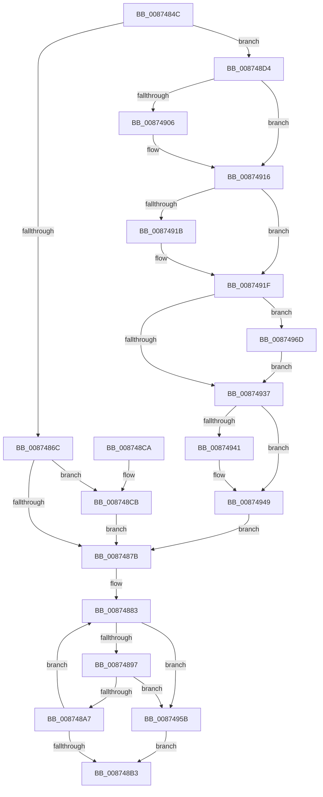

# ObpReferenceSecurityDescriptorSlow

- RVA: `0x0087484C`–`0x00874976` (길이 `298` bytes)
- VA: `0x000000014087484C`
- 실행 섹션: `PAGE`
- PDB 이름 있음: `예`; PDB Function 태그: `아니요`
- unwind 정보 RVA: `0x0006C8A8`
- 디코드: `84`개 명령, `298/298` bytes 표시
- 미해석 바이트: `0` (있으면 어셈블리에 `.byte`로 보존)

> 이 문서는 커널 이미지의 기계어와 PDB 기호를 분석해 생성했습니다. 4번과 5번은 함수 원형과 자료형을 바이너리 사용 방식에서 추정한 C 해석이며 원본 소스 복구 결과는 아닙니다.

## 1. Dependencies

- 직접 호출 지점: **6**; 고유 호출 대상: **6**
- 직접 호출자로 확인된 함수: **7**
- RIP 상대 이미지 참조: **0**

### Outgoing calls
- `0x008748F1` → [KeAbPreAcquire](../../text/21/KeAbPreAcquire_function_00210230.md) (function, `0x00210230`)
- `0x00874911` → [ExfAcquirePushLockSharedEx](../../text/21/ExfAcquirePushLockSharedEx_function_0021044C.md) (function, `0x0021044C`)
- `0x00874944` → [ExfReleasePushLockShared](../../text/26/ExfReleasePushLockShared_function_00263440.md) (function, `0x00263440`)
- `0x0087494C` → [KeAbPostRelease](../../text/2E/KeAbPostRelease_function_002E1600.md) (function, `0x002E1600`)
- `0x00874951` → [KeLeaveCriticalRegion](../../text/25/KeLeaveCriticalRegion_function_0025D8B0.md) (function, `0x0025D8B0`)
- `0x00874963` → [ObDereferenceSecurityDescriptor](ObDereferenceSecurityDescriptor_function_008740A0.md) (function, `0x008740A0`)

### Direct callers
- [ObpCreateHandle](../86/ObpCreateHandle_function_0086B950.md) at `0x0086D050`
- [ObpCreateHandle](../86/ObpCreateHandle_function_0086B950.md) at `0x0086D1E3`
- [ObpCreateHandle](../86/ObpCreateHandle_function_0086B950.md) at `0x0086D20A`
- [ObpGrantAccess](../86/ObpGrantAccess_function_0086F250.md) at `0x0086F82F`
- [ObpGrantAccess](../86/ObpGrantAccess_function_0086F250.md) at `0x0086F858`
- [ObpGetObjectSecurity](ObpGetObjectSecurity_function_008717E0.md) at `0x008719EB`
- [ObCheckObjectAccess](ObCheckObjectAccess_function_00872260.md) at `0x008726B7`
- [ObpAdjustCreatorAccessState](ObpAdjustCreatorAccessState_function_00874650.md) at `0x0087480E`
- [ObpReferenceSecurityDescriptor](../8B/ObpReferenceSecurityDescriptor_function_008B6D90.md) at `0x008B6DDA`
- [ObGetObjectSecurity](../9D/ObGetObjectSecurity_function_009D45F0.md) at `0x009D47E8`

### Static image references
- 디코드된 RIP-relative 메모리 참조가 없습니다.

## 2. Other-region calls and transfers

- 다른 실행 섹션으로 향하는 call: **5**
  - `0x008748F1` → [KeAbPreAcquire](../../text/21/KeAbPreAcquire_function_00210230.md) (`PAGE` → `.text`)
  - `0x00874911` → [ExfAcquirePushLockSharedEx](../../text/21/ExfAcquirePushLockSharedEx_function_0021044C.md) (`PAGE` → `.text`)
  - `0x00874944` → [ExfReleasePushLockShared](../../text/26/ExfReleasePushLockShared_function_00263440.md) (`PAGE` → `.text`)
  - `0x0087494C` → [KeAbPostRelease](../../text/2E/KeAbPostRelease_function_002E1600.md) (`PAGE` → `.text`)
  - `0x00874951` → [KeLeaveCriticalRegion](../../text/25/KeLeaveCriticalRegion_function_0025D8B0.md) (`PAGE` → `.text`)
- 별도 외부 분기/꼬리 이동을 확인하지 못했습니다.

## 3. Assembly (complete function range)

```asm
0087484C  48 89 5C 24 10                  mov qword ptr [rsp + 0x10], rbx
00874851  48 89 74 24 18                  mov qword ptr [rsp + 0x18], rsi
00874856  57                              push rdi
00874857  41 56                           push r14
00874859  41 57                           push r15
0087485B  48 83 EC 20                     sub rsp, 0x20
0087485F  45 33 F6                        xor r14d, r14d
00874862  49 8B D8                        mov rbx, r8
00874865  48 8B F1                        mov rsi, rcx
00874868  85 D2                           test edx, edx
0087486A  74 68                           je 0x1408748d4
0087486C  41 8D 46 0F                     lea eax, [r14 + 0xf]
00874870  F0 49 0F C1 40 E8               lock xadd qword ptr [r8 - 0x18], rax
00874876  48 85 C0                        test rax, rax
00874879  7E 50                           jle 0x1408748cb
0087487B  0F 0D 4E 28                     prefetchw byte ptr [rsi + 0x28]
0087487F  48 8B 46 28                     mov rax, qword ptr [rsi + 0x28]
00874883  48 8B C8                        mov rcx, rax
00874886  83 E1 0F                        and ecx, 0xf
00874889  48 83 C1 0F                     add rcx, 0xf
0087488D  48 83 F9 0F                     cmp rcx, 0xf
00874891  0F 87 C4 00 00 00               ja 0x14087495b
00874897  48 8B C8                        mov rcx, rax
0087489A  48 83 E1 F0                     and rcx, 0xfffffffffffffff0
0087489E  48 3B D9                        cmp rbx, rcx
008748A1  0F 85 B4 00 00 00               jne 0x14087495b
008748A7  48 8D 48 0F                     lea rcx, [rax + 0xf]
008748AB  F0 48 0F B1 4E 28               lock cmpxchg qword ptr [rsi + 0x28], rcx
008748B1  75 D0                           jne 0x140874883
008748B3  48 8B 74 24 50                  mov rsi, qword ptr [rsp + 0x50]
008748B8  48 8B C3                        mov rax, rbx
008748BB  48 8B 5C 24 48                  mov rbx, qword ptr [rsp + 0x48]
008748C0  48 83 C4 20                     add rsp, 0x20
008748C4  41 5F                           pop r15
008748C6  41 5E                           pop r14
008748C8  5F                              pop rdi
008748C9  C3                              ret
008748CA  CC                              int3
008748CB  B9 0E 00 00 00                  mov ecx, 0xe
008748D0  CD 29                           int 0x29
008748D2  EB A7                           jmp 0x14087487b
008748D4  65 48 8B 04 25 88 01 00 00      mov rax, qword ptr gs:[0x188]
008748DD  48 8D 79 10                     lea rdi, [rcx + 0x10]
008748E1  45 33 C0                        xor r8d, r8d
008748E4  33 D2                           xor edx, edx
008748E6  48 8B CF                        mov rcx, rdi
008748E9  66 FF 88 E4 01 00 00            dec word ptr [rax + 0x1e4]
008748F0  90                              nop
008748F1  E8 3A B9 99 FF                  call 0x140210230
008748F6  48 8B D8                        mov rbx, rax
008748F9  33 C0                           xor eax, eax
008748FB  44 8D 78 11                     lea r15d, [rax + 0x11]
008748FF  F0 4C 0F B1 3F                  lock cmpxchg qword ptr [rdi], r15
00874904  74 10                           je 0x140874916
00874906  4C 8B CF                        mov r9, rdi
00874909  4C 8B C3                        mov r8, rbx
0087490C  33 D2                           xor edx, edx
0087490E  48 8B CF                        mov rcx, rdi
00874911  E8 36 BB 99 FF                  call 0x14021044c
00874916  48 85 DB                        test rbx, rbx
00874919  74 04                           je 0x14087491f
0087491B  C6 43 0A 01                     mov byte ptr [rbx + 0xa], 1
0087491F  48 8B 5E 28                     mov rbx, qword ptr [rsi + 0x28]
00874923  B9 10 00 00 00                  mov ecx, 0x10
00874928  48 83 E3 F0                     and rbx, 0xfffffffffffffff0
0087492C  F0 48 0F C1 4B E8               lock xadd qword ptr [rbx - 0x18], rcx
00874932  48 85 C9                        test rcx, rcx
00874935  7E 36                           jle 0x14087496d
00874937  49 8B C7                        mov rax, r15
0087493A  F0 4C 0F B1 37                  lock cmpxchg qword ptr [rdi], r14
0087493F  74 08                           je 0x140874949
00874941  48 8B CF                        mov rcx, rdi
00874944  E8 F7 EA 9E FF                  call 0x140263440
00874949  48 8B CF                        mov rcx, rdi
0087494C  E8 AF CC A6 FF                  call 0x1402e1600
00874951  E8 5A 8F 9E FF                  call 0x14025d8b0
00874956  E9 20 FF FF FF                  jmp 0x14087487b
0087495B  BA 0F 00 00 00                  mov edx, 0xf
00874960  48 8B CB                        mov rcx, rbx
00874963  E8 38 F7 FF FF                  call 0x1408740a0
00874968  E9 46 FF FF FF                  jmp 0x1408748b3
0087496D  B9 0E 00 00 00                  mov ecx, 0xe
00874972  CD 29                           int 0x29
00874974  EB C1                           jmp 0x140874937
```

## 4. C-style interpretation (structured pseudocode)

```c
__int64 __fastcall ObpReferenceSecurityDescriptorSlow(__int64 a1, int a2, __int64 a3)
{
    __int64 result;
    __int64 v_r14;
    __int64 v_rbx;
    __int64 v_rsp;
    unsigned __int64 v_stack_p10;
    unsigned __int64 v_stack_p18;

    v_stack_p10 = v_rbx;
    v_stack_p18 = v_rsi;
    v_rsp = (v_rsp) - (32);
    v_r14 = 0;
    if (a2 == 0) goto loc_008748D4;
    if (condition_is_less_or_equal) goto loc_008748CB;
loc_0087487B:
loc_00874883:
    a1 = (unsigned int)((*(unsigned __int64 *)(a1 + 40)) & (15));
    a1 = (a1) + (15);
    if (a1 > 15) goto loc_0087495B;
    a1 = (*(unsigned __int64 *)(a1 + 40)) & (-16);
    if (a3 != a1) goto loc_0087495B;
    if (a3 != a1) goto loc_00874883;
loc_008748B3:
    v_rsp = (v_rsp) + (32);
    return a3;
loc_008748CB:
    goto loc_0087487B;
loc_008748D4:
    a3 = 0;
    a2 = 0;
    result = KeAbPreAcquire(14 + 16, a2, a3, a4);
    result = 0;
    if (!(condition_is_equal)) {
        a4 = 14 + 16;
        a3 = 0;
        a2 = 0;
        a1 = 14 + 16;
        result = ExfAcquirePushLockSharedEx(a1, a2, a3, a4);
    }
    if (result != 0) {
        *(unsigned __int8 *)(result + 10) = 1;
    }
    v_rbx = (*(unsigned __int64 *)(v_stack_p18 + 40)) & (-16);
    if (condition_is_less_or_equal) goto loc_0087496D;
loc_00874937:
    result = result + 17;
    if (16 != 0) {
        a1 = 14 + 16;
        result = ExfReleasePushLockShared(a1, a2, a3, a4);
    }
    result = KeAbPostRelease(14 + 16, a2, a3, a4);
    result = KeLeaveCriticalRegion(14 + 16, a2, a3, a4);
    goto loc_0087487B;
loc_0087495B:
    result = ObDereferenceSecurityDescriptor(v_rbx, 15, a3, a4);
    goto loc_008748B3;
loc_0087496D:
    goto loc_00874937;
}
```

## 5. (Beta) C Style

```c
void *ObpReferenceSecurityDescriptorSlow(void *Arg1, int32_t Arg2, void *Arg3)
{
    uint8_t *arg1 = (uint8_t *)Arg1;
    uint8_t *arg3 = (uint8_t *)Arg3;

    int64_t result;
    int64_t local_r14;
    int64_t local_rbx;
    int64_t local_rsp;
    uint64_t v_stack_p10;
    uint64_t v_stack_p18;

    v_stack_p10 = local_rbx;
    v_stack_p18 = local_rsi;
    local_rsp = (local_rsp) - (32);
    local_r14 = 0;
    if (Arg2 == 0) goto loc_008748D4;
    if (condition_is_less_or_equal) goto loc_008748CB;
loc_0087487B:
loc_00874883:
    Arg1 = (uint32_t)((*(uint64_t *)(arg1 + 0x28)) & (15));
    Arg1 = (Arg1) + (15);
    if (Arg1 > 15) goto loc_0087495B;
    Arg1 = (*(uint64_t *)(arg1 + 0x28)) & (-16);
    if (Arg3 != Arg1) goto loc_0087495B;
    if (Arg3 != Arg1) goto loc_00874883;
loc_008748B3:
    local_rsp = (local_rsp) + (32);
    return Arg3;
loc_008748CB:
    goto loc_0087487B;
loc_008748D4:
    Arg3 = 0;
    Arg2 = 0;
    result = KeAbPreAcquire(14 + 16, Arg2, Arg3, a4);
    result = 0;
    if (!(condition_is_equal)) {
        a4 = 14 + 16;
        Arg3 = 0;
        Arg2 = 0;
        Arg1 = 14 + 16;
        result = ExfAcquirePushLockSharedEx(Arg1, Arg2, Arg3, a4);
    }
    if (result != 0) {
        *(uint8_t *)(result + 0xA) = 1;
    }
    local_rbx = (*(uint64_t *)(v_stack_p18 + 0x28)) & (-16);
    if (condition_is_less_or_equal) goto loc_0087496D;
loc_00874937:
    result = result + 17;
    if (16 != 0) {
        Arg1 = 14 + 16;
        result = ExfReleasePushLockShared(Arg1, Arg2, Arg3, a4);
    }
    result = KeAbPostRelease(14 + 16, Arg2, Arg3, a4);
    result = KeLeaveCriticalRegion(14 + 16, Arg2, Arg3, a4);
    goto loc_0087487B;
loc_0087495B:
    result = ObDereferenceSecurityDescriptor(local_rbx, 15, Arg3, a4);
    goto loc_008748B3;
loc_0087496D:
    goto loc_00874937;
}
```

### 관측된 메모리 오프셋

구조체 형식이 확인되지 않은 접근은 인자 기준의 오프셋으로만 기록했습니다.

| 기준 인자 | 오프셋 표현 | 폭 (bit) | 접근 |
|---|---:|---:|---|
| `Arg1` | `+ 0x0` | `64` | `R` |
| `Arg1` | `+ 0x10` | `64` | `R` |
| `Arg1` | `+ 0x28` | `8` | `R` |
| `Arg1` | `+ 0x28` | `64` | `R` |
| `Arg3` | `- 0x18` | `64` | `R/W` |

## 6. Execution-region graph

[열기: 2D/3D 그래프와 함수 탐색 컨트롤 패널](../../../control-panel.html?section=page&rva=0x0087484C&view=graph)

- 2D 그래프는 위에서 아래로 흐르고, 3D 그래프는 빈 공간을 드래그해 회전합니다. Shift+드래그는 이동, 휠은 확대·축소, 함수 노드 선택은 대상 보고서 이동입니다.

### Static fallback


