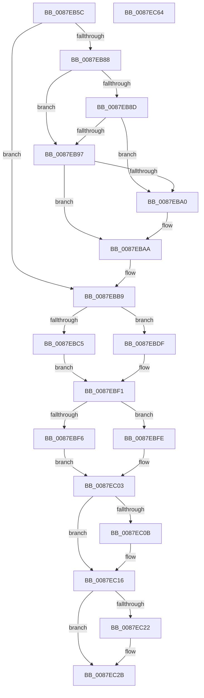

# PspApplyJobChainLimitsToProcess

- RVA: `0x0087EB5C`–`0x0087EC65` (길이 `265` bytes)
- VA: `0x000000014087EB5C`
- 실행 섹션: `PAGE`
- PDB 이름 있음: `예`; PDB Function 태그: `아니요`
- unwind 정보 RVA: `0x00060BC4`
- 디코드: `67`개 명령, `265/265` bytes 표시
- 미해석 바이트: `0` (있으면 어셈블리에 `.byte`로 보존)

> 이 문서는 커널 이미지의 기계어와 PDB 기호를 분석해 생성했습니다. 4번과 5번은 함수 원형과 자료형을 바이너리 사용 방식에서 추정한 C 해석이며 원본 소스 복구 결과는 아닙니다.

## 1. Dependencies

- 직접 호출 지점: **11**; 고유 호출 대상: **9**
- 직접 호출자로 확인된 함수: **2**
- RIP 상대 이미지 참조: **1**

### Outgoing calls
- `0x0087EB79` → [PspApplyJobLimitsToProcess](../A5/PspApplyJobLimitsToProcess_function_00A57274.md) (function, `0x00A57274`)
- `0x0087EBA5` → [PspSetProcessSchedulingGroup](../A6/PspSetProcessSchedulingGroup_function_00A66D08.md) (function, `0x00A66D08`)
- `0x0087EBB4` → [PspSetProcessSchedulingGroup](../A6/PspSetProcessSchedulingGroup_function_00A66D08.md) (function, `0x00A66D08`)
- `0x0087EBB9` → [Feature_ProcesDirectSwap__private_IsEnabledDeviceUsageNoInline](../../text/5E/Feature_ProcesDirectSwap__private_IsEnabledDeviceUsageNoInline_function_005E3264.md) (function, `0x005E3264`)
- `0x0087EBC5` → [PspComputeExecutionState](../AA/PspComputeExecutionState_function_00AA008C.md) (function, `0x00AA008C`)
- `0x0087EBD8` → [PspRequestProcessExecutionState](../AE/PspRequestProcessExecutionState_function_00AEC7EC.md) (function, `0x00AEC7EC`)
- `0x0087EBDF` → [PspComputeExecutionState](../AA/PspComputeExecutionState_function_00AA008C.md) (function, `0x00AA008C`)
- `0x0087EBEC` → [PspRequestProcessExecutionStateLegacy](../../text/5E/PspRequestProcessExecutionStateLegacy_function_005E42D8.md) (function, `0x005E42D8`)
- `0x0087EC11` → [PspNotifyProcessEffectiveIoLimitChanged](../../text/3E/PspNotifyProcessEffectiveIoLimitChanged_function_003EC9C0.md) (function, `0x003EC9C0`)
- `0x0087EC3A` → [PsUpdateComponentPower](../../text/43/PsUpdateComponentPower_function_00434CF0.md) (function, `0x00434CF0`)
- `0x0087EC4F` → [RtlInterlockedSetClearBits](../../text/49/RtlInterlockedSetClearBits_function_00497378.md) (function, `0x00497378`)

### Direct callers
- [PspImplicitAssignProcessToJob](PspImplicitAssignProcessToJob_function_0087D584.md) at `0x0087D686`
- [PspAssignProcessToJob](../A2/PspAssignProcessToJob_function_00A23370.md) at `0x00A2375D`

### Static image references
- `0x0087EB97` → RVA `0x00FC6ABE` (`ALMOSTRO`; read)

## 2. Other-region calls and transfers

- 다른 실행 섹션으로 향하는 call: **5**
  - `0x0087EBB9` → [Feature_ProcesDirectSwap__private_IsEnabledDeviceUsageNoInline](../../text/5E/Feature_ProcesDirectSwap__private_IsEnabledDeviceUsageNoInline_function_005E3264.md) (`PAGE` → `.text`)
  - `0x0087EBEC` → [PspRequestProcessExecutionStateLegacy](../../text/5E/PspRequestProcessExecutionStateLegacy_function_005E42D8.md) (`PAGE` → `.text`)
  - `0x0087EC11` → [PspNotifyProcessEffectiveIoLimitChanged](../../text/3E/PspNotifyProcessEffectiveIoLimitChanged_function_003EC9C0.md) (`PAGE` → `.text`)
  - `0x0087EC3A` → [PsUpdateComponentPower](../../text/43/PsUpdateComponentPower_function_00434CF0.md) (`PAGE` → `.text`)
  - `0x0087EC4F` → [RtlInterlockedSetClearBits](../../text/49/RtlInterlockedSetClearBits_function_00497378.md) (`PAGE` → `.text`)
- 별도 외부 분기/꼬리 이동을 확인하지 못했습니다.

## 3. Assembly (complete function range)

```asm
0087EB5C  48 89 5C 24 08                  mov qword ptr [rsp + 8], rbx
0087EB61  48 89 74 24 10                  mov qword ptr [rsp + 0x10], rsi
0087EB66  57                              push rdi
0087EB67  48 83 EC 20                     sub rsp, 0x20
0087EB6B  48 8B F2                        mov rsi, rdx
0087EB6E  48 8B F9                        mov rdi, rcx
0087EB71  33 D2                           xor edx, edx
0087EB73  49 8B C8                        mov rcx, r8
0087EB76  49 8B D8                        mov rbx, r8
0087EB79  E8 F6 86 1D 00                  call 0x140a57274
0087EB7E  48 83 BF E0 04 00 00 00         cmp qword ptr [rdi + 0x4e0], 0
0087EB86  74 31                           je 0x14087ebb9
0087EB88  48 85 F6                        test rsi, rsi
0087EB8B  74 0A                           je 0x14087eb97
0087EB8D  48 83 BE E0 04 00 00 00         cmp qword ptr [rsi + 0x4e0], 0
0087EB95  75 09                           jne 0x14087eba0
0087EB97  80 3D 20 7F 74 00 00            cmp byte ptr [rip + 0x747f20], 0
0087EB9E  74 0A                           je 0x14087ebaa
0087EBA0  33 D2                           xor edx, edx
0087EBA2  48 8B CB                        mov rcx, rbx
0087EBA5  E8 5E 81 1E 00                  call 0x140a66d08
0087EBAA  48 8B 97 E0 04 00 00            mov rdx, qword ptr [rdi + 0x4e0]
0087EBB1  48 8B CB                        mov rcx, rbx
0087EBB4  E8 4F 81 1E 00                  call 0x140a66d08
0087EBB9  E8 A6 46 D6 FF                  call 0x1405e3264
0087EBBE  48 8B CF                        mov rcx, rdi
0087EBC1  85 C0                           test eax, eax
0087EBC3  74 1A                           je 0x14087ebdf
0087EBC5  E8 C2 14 22 00                  call 0x140aa008c
0087EBCA  8A D0                           mov dl, al
0087EBCC  45 33 C0                        xor r8d, r8d
0087EBCF  48 8B CB                        mov rcx, rbx
0087EBD2  41 B9 07 00 00 00               mov r9d, 7
0087EBD8  E8 0F DC 26 00                  call 0x140aec7ec
0087EBDD  EB 12                           jmp 0x14087ebf1
0087EBDF  E8 A8 14 22 00                  call 0x140aa008c
0087EBE4  8A D0                           mov dl, al
0087EBE6  45 33 C0                        xor r8d, r8d
0087EBE9  48 8B CB                        mov rcx, rbx
0087EBEC  E8 E7 56 D6 FF                  call 0x1405e42d8
0087EBF1  48 85 F6                        test rsi, rsi
0087EBF4  74 08                           je 0x14087ebfe
0087EBF6  8B 96 3C 04 00 00               mov edx, dword ptr [rsi + 0x43c]
0087EBFC  EB 05                           jmp 0x14087ec03
0087EBFE  BA 05 00 00 00                  mov edx, 5
0087EC03  3B 97 3C 04 00 00               cmp edx, dword ptr [rdi + 0x43c]
0087EC09  74 0B                           je 0x14087ec16
0087EC0B  45 33 C0                        xor r8d, r8d
0087EC0E  48 8B CB                        mov rcx, rbx
0087EC11  E8 AA DD B6 FF                  call 0x1403ec9c0
0087EC16  F7 87 10 06 00 00 00 00 04 00   test dword ptr [rdi + 0x610], 0x40000
0087EC20  74 09                           je 0x14087ec2b
0087EC22  F0 0F BA AB 88 00 00 00 04      lock bts dword ptr [rbx + 0x88], 4
0087EC2B  4C 8B 87 10 07 00 00            mov r8, qword ptr [rdi + 0x710]
0087EC32  BA 08 00 00 00                  mov edx, 8
0087EC37  48 8B CB                        mov rcx, rbx
0087EC3A  E8 B1 60 BB FF                  call 0x140434cf0
0087EC3F  BA 04 00 00 00                  mov edx, 4
0087EC44  48 8D 8B F0 01 00 00            lea rcx, [rbx + 0x1f0]
0087EC4B  44 8D 42 1C                     lea r8d, [rdx + 0x1c]
0087EC4F  E8 24 87 C1 FF                  call 0x140497378
0087EC54  48 8B 5C 24 30                  mov rbx, qword ptr [rsp + 0x30]
0087EC59  48 8B 74 24 38                  mov rsi, qword ptr [rsp + 0x38]
0087EC5E  48 83 C4 20                     add rsp, 0x20
0087EC62  5F                              pop rdi
0087EC63  C3                              ret
0087EC64  CC                              int3
```

## 4. C-style interpretation (structured pseudocode)

```c
__int64 __fastcall PspApplyJobChainLimitsToProcess(__int64 a1, __int64 a2, __int64 a3)
{
    __int64 result;
    __int64 v_rsp;
    unsigned __int64 v_stack_p10;
    unsigned __int64 v_stack_p8;

    v_stack_p8 = v_rbx;
    v_stack_p10 = v_rsi;
    v_rsp = (v_rsp) - (32);
    a2 = 0;
    result = PspApplyJobLimitsToProcess(a3, a2, a3, a4);
    if ((*(unsigned __int64 *)(a1 + 1248)) == 0) goto loc_0087EBB9;
    if (0 == 0) goto loc_0087EB97;
    if ((*(unsigned __int64 *)(a2 + 1248)) != 0) goto loc_0087EBA0;
loc_0087EB97:
    if ((*(unsigned __int8 *)(v_rip + 7634720)) != 0) {
        a2 = 0;
        a1 = a3;
        result = PspSetProcessSchedulingGroup(a1, a2, a3, a4);
    }
    result = PspSetProcessSchedulingGroup(a3, *(unsigned __int64 *)(a1 + 1248), a3, a4);
loc_0087EBB9:
    result = Feature_ProcesDirectSwap__private_IsEnabledDeviceUsageNoInline(a3, *(unsigned __int64 *)(a1 + 1248), a3, a4);
    if ((unsigned int)(result) == 0) goto loc_0087EBDF;
    result = PspComputeExecutionState(a1, *(unsigned __int64 *)(a1 + 1248), a3, a4);
    a3 = 0;
    result = PspRequestProcessExecutionState(0, (unsigned __int8)(result), a3, 7);
    goto loc_0087EBF1;
loc_0087EBDF:
    result = PspComputeExecutionState(0, (unsigned __int8)(result), a3, 7);
    a3 = 0;
    result = PspRequestProcessExecutionStateLegacy(0, (unsigned __int8)(result), a3, 7);
loc_0087EBF1:
    if (0 == 0) goto loc_0087EBFE;
    goto loc_0087EC03;
loc_0087EBFE:
loc_0087EC03:
    if (5 != (*(unsigned int *)(a1 + 1084))) {
        a3 = 0;
        a1 = 0;
        result = PspNotifyProcessEffectiveIoLimitChanged(a1, 5, a3, 7);
    }
    if (((*(unsigned int *)(a1 + 1552)) & (0x40000ULL)) != 0) {
    }
    result = PsUpdateComponentPower(0, 8, *(unsigned __int64 *)(a1 + 1808), 7);
    result = RtlInterlockedSetClearBits(a3 + 496, 4, 4 + 28, 7);
    v_rsp = (v_rsp) + (32);
    return result;
}
```

## 5. (Beta) C Style

```c
int64_t PspApplyJobChainLimitsToProcess(void *Arg1, int64_t Arg2, void *Arg3)
{
    uint8_t *arg1 = (uint8_t *)Arg1;
    uint8_t *arg3 = (uint8_t *)Arg3;

    int64_t result;
    int64_t local_rsp;
    uint64_t v_stack_p10;
    uint64_t v_stack_p8;

    v_stack_p8 = local_rbx;
    v_stack_p10 = local_rsi;
    local_rsp = (local_rsp) - (32);
    Arg2 = 0;
    result = PspApplyJobLimitsToProcess(Arg3, Arg2, Arg3, a4);
    if ((*(uint64_t *)(arg1 + 0x4E0)) == 0) goto loc_0087EBB9;
    if (0 == 0) goto loc_0087EB97;
    if ((*(uint64_t *)(Arg2 + 0x4E0)) != 0) goto loc_0087EBA0;
loc_0087EB97:
    if ((*(uint8_t *)(v_rip + 0x747F20)) != 0) {
        Arg2 = 0;
        Arg1 = Arg3;
        result = PspSetProcessSchedulingGroup(Arg1, Arg2, Arg3, a4);
    }
    result = PspSetProcessSchedulingGroup(Arg3, *(uint64_t *)(arg1 + 0x4E0), Arg3, a4);
loc_0087EBB9:
    result = Feature_ProcesDirectSwap__private_IsEnabledDeviceUsageNoInline(Arg3, *(uint64_t *)(arg1 + 0x4E0), Arg3, a4);
    if ((uint32_t)(result) == 0) goto loc_0087EBDF;
    result = PspComputeExecutionState(Arg1, *(uint64_t *)(arg1 + 0x4E0), Arg3, a4);
    Arg3 = 0;
    result = PspRequestProcessExecutionState(0, (uint8_t)(result), Arg3, 7);
    goto loc_0087EBF1;
loc_0087EBDF:
    result = PspComputeExecutionState(0, (uint8_t)(result), Arg3, 7);
    Arg3 = 0;
    result = PspRequestProcessExecutionStateLegacy(0, (uint8_t)(result), Arg3, 7);
loc_0087EBF1:
    if (0 == 0) goto loc_0087EBFE;
    goto loc_0087EC03;
loc_0087EBFE:
loc_0087EC03:
    if (5 != (*(uint32_t *)(arg1 + 0x43C))) {
        Arg3 = 0;
        Arg1 = 0;
        result = PspNotifyProcessEffectiveIoLimitChanged(Arg1, 5, Arg3, 7);
    }
    if (((*(uint32_t *)(arg1 + 0x610)) & (0x40000ULL)) != 0) {
    }
    result = PsUpdateComponentPower(0, 8, *(uint64_t *)(arg1 + 0x710), 7);
    result = RtlInterlockedSetClearBits(Arg3 + 496, 4, 4 + 28, 7);
    local_rsp = (local_rsp) + (32);
    return result;
}
```

### 관측된 메모리 오프셋

구조체 형식이 확인되지 않은 접근은 인자 기준의 오프셋으로만 기록했습니다.

| 기준 인자 | 오프셋 표현 | 폭 (bit) | 접근 |
|---|---:|---:|---|
| `Arg1` | `+ 0x43C` | `32` | `R` |
| `Arg1` | `+ 0x4E0` | `64` | `R` |
| `Arg1` | `+ 0x610` | `32` | `R` |
| `Arg1` | `+ 0x710` | `64` | `R` |
| `Arg3` | `+ 0x88` | `32` | `R/W` |
| `Arg3` | `+ 0x1F0` | `64` | `R` |

## 6. Execution-region graph

[열기: 2D/3D 그래프와 함수 탐색 컨트롤 패널](../../../control-panel.html?section=page&rva=0x0087EB5C&view=graph)

- 2D 그래프는 위에서 아래로 흐르고, 3D 그래프는 빈 공간을 드래그해 회전합니다. Shift+드래그는 이동, 휠은 확대·축소, 함수 노드 선택은 대상 보고서 이동입니다.

### Static fallback


