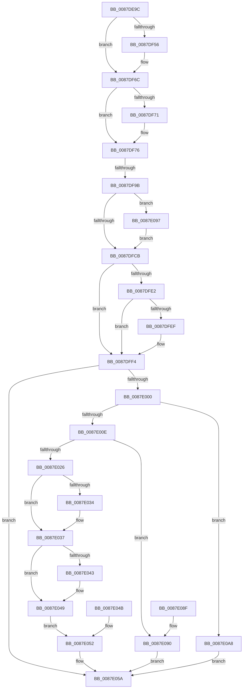

# PspApplyWorkingSetLimitsToProcess

- RVA: `0x0087DE9C`–`0x0087E0AC` (길이 `528` bytes)
- VA: `0x000000014087DE9C`
- 실행 섹션: `PAGE`
- PDB 이름 있음: `예`; PDB Function 태그: `예`
- unwind 정보 RVA: `0x0007BFBC`
- 디코드: `126`개 명령, `528/528` bytes 표시
- 미해석 바이트: `0` (있으면 어셈블리에 `.byte`로 보존)

> 이 문서는 커널 이미지의 기계어와 PDB 기호를 분석해 생성했습니다. 4번과 5번은 함수 원형과 자료형을 바이너리 사용 방식에서 추정한 C 해석이며 원본 소스 복구 결과는 아닙니다.

## 1. Dependencies

- 직접 호출 지점: **13**; 고유 호출 대상: **13**
- 직접 호출자로 확인된 함수: **2**
- RIP 상대 이미지 참조: **3**

### Outgoing calls
- `0x0087DEF0` → [KiStackAttachProcess](../../text/21/KiStackAttachProcess_function_00216820.md) (function, `0x00216820`)
- `0x0087DF09` → [ExAcquireResourceExclusiveLite](../../text/21/ExAcquireResourceExclusiveLite_function_00214E20.md) (function, `0x00214E20`)
- `0x0087DF42` → [KeAbPreAcquire](../../text/21/KeAbPreAcquire_function_00210230.md) (function, `0x00210230`)
- `0x0087DF67` → [ExfAcquirePushLockExclusiveEx](../../text/20/ExfAcquirePushLockExclusiveEx_function_0020FC90.md) (function, `0x0020FC90`)
- `0x0087DF86` → [ExReleaseResourceLite](../../text/25/ExReleaseResourceLite_function_0025FA10.md) (function, `0x0025FA10`)
- `0x0087DFA1` → [MmEnforceWorkingSetLimit](../../text/48/MmEnforceWorkingSetLimit_function_004881E0.md) (function, `0x004881E0`)
- `0x0087DFD2` → [KeAbPostRelease](../../text/2E/KeAbPostRelease_function_002E1600.md) (function, `0x002E1600`)
- `0x0087DFEF` → [KiCheckForKernelApcDelivery](../../text/2E/KiCheckForKernelApcDelivery_function_002E2C80.md) (function, `0x002E2C80`)
- `0x0087E01D` → [ExAcquireRundownProtection](../../text/21/ExAcquireRundownProtection_function_00216620.md) (function, `0x00216620`)
- `0x0087E055` → [ExReleaseRundownProtection](../../text/34/ExReleaseRundownProtection_function_00349E80.md) (function, `0x00349E80`)
- `0x0087E061` → [KiUnstackDetachProcess](../../text/21/KiUnstackDetachProcess_function_00217D30.md) (function, `0x00217D30`)
- `0x0087E070` → [_security_check_cookie](../../text/6A/_security_check_cookie_function_006AC640.md) (function, `0x006AC640`)
- `0x0087E09E` → [ExfTryToWakePushLock](../../text/26/ExfTryToWakePushLock_function_00265DD0.md) (function, `0x00265DD0`)

### Direct callers
- [PspImplicitAssignProcessToJob](PspImplicitAssignProcessToJob_function_0087D584.md) at `0x0087D6C9`
- [PspAssignProcessToJob](../A2/PspAssignProcessToJob_function_00A23370.md) at `0x00A237B7`

### Static image references
- `0x0087DEB3` → RVA `0x00E0A740` (`.data`; read)
- `0x0087DF3B` → RVA `0x00FC70B0` (`ALMOSTRO`; read)
- `0x0087DF4A` → RVA `0x00FC70B0` (`ALMOSTRO`; read/write)

## 2. Other-region calls and transfers

- 다른 실행 섹션으로 향하는 call: **13**
  - `0x0087DEF0` → [KiStackAttachProcess](../../text/21/KiStackAttachProcess_function_00216820.md) (`PAGE` → `.text`)
  - `0x0087DF09` → [ExAcquireResourceExclusiveLite](../../text/21/ExAcquireResourceExclusiveLite_function_00214E20.md) (`PAGE` → `.text`)
  - `0x0087DF42` → [KeAbPreAcquire](../../text/21/KeAbPreAcquire_function_00210230.md) (`PAGE` → `.text`)
  - `0x0087DF67` → [ExfAcquirePushLockExclusiveEx](../../text/20/ExfAcquirePushLockExclusiveEx_function_0020FC90.md) (`PAGE` → `.text`)
  - `0x0087DF86` → [ExReleaseResourceLite](../../text/25/ExReleaseResourceLite_function_0025FA10.md) (`PAGE` → `.text`)
  - `0x0087DFA1` → [MmEnforceWorkingSetLimit](../../text/48/MmEnforceWorkingSetLimit_function_004881E0.md) (`PAGE` → `.text`)
  - `0x0087DFD2` → [KeAbPostRelease](../../text/2E/KeAbPostRelease_function_002E1600.md) (`PAGE` → `.text`)
  - `0x0087DFEF` → [KiCheckForKernelApcDelivery](../../text/2E/KiCheckForKernelApcDelivery_function_002E2C80.md) (`PAGE` → `.text`)
  - `0x0087E01D` → [ExAcquireRundownProtection](../../text/21/ExAcquireRundownProtection_function_00216620.md) (`PAGE` → `.text`)
  - `0x0087E055` → [ExReleaseRundownProtection](../../text/34/ExReleaseRundownProtection_function_00349E80.md) (`PAGE` → `.text`)
  - `0x0087E061` → [KiUnstackDetachProcess](../../text/21/KiUnstackDetachProcess_function_00217D30.md) (`PAGE` → `.text`)
  - `0x0087E070` → [_security_check_cookie](../../text/6A/_security_check_cookie_function_006AC640.md) (`PAGE` → `.text`)
  - `0x0087E09E` → [ExfTryToWakePushLock](../../text/26/ExfTryToWakePushLock_function_00265DD0.md) (`PAGE` → `.text`)
- call이 아닌 외부 분기/꼬리 이동: **1**
  - `0x0087DF95` → [sub_00B18A2E](../B1/Unknown_function_00B18A2E.md) (`tail-transfer`)

## 3. Assembly (complete function range)

```asm
0087DE9C  48 89 5C 24 10                  mov qword ptr [rsp + 0x10], rbx
0087DEA1  48 89 74 24 18                  mov qword ptr [rsp + 0x18], rsi
0087DEA6  57                              push rdi
0087DEA7  41 54                           push r12
0087DEA9  41 55                           push r13
0087DEAB  41 56                           push r14
0087DEAD  41 57                           push r15
0087DEAF  48 83 EC 70                     sub rsp, 0x70
0087DEB3  48 8B 05 86 C8 58 00            mov rax, qword ptr [rip + 0x58c886]
0087DEBA  48 33 C4                        xor rax, rsp
0087DEBD  48 89 44 24 60                  mov qword ptr [rsp + 0x60], rax
0087DEC2  48 8B F1                        mov rsi, rcx
0087DEC5  0F 57 C0                        xorps xmm0, xmm0
0087DEC8  0F 11 44 24 30                  movups xmmword ptr [rsp + 0x30], xmm0
0087DECD  0F 11 44 24 40                  movups xmmword ptr [rsp + 0x40], xmm0
0087DED2  0F 11 44 24 50                  movups xmmword ptr [rsp + 0x50], xmm0
0087DED7  65 48 8B 1C 25 88 01 00 00      mov rbx, qword ptr gs:[0x188]
0087DEE0  4C 8B B1 A0 02 00 00            mov r14, qword ptr [rcx + 0x2a0]
0087DEE7  33 FF                           xor edi, edi
0087DEE9  4C 8D 44 24 30                  lea r8, [rsp + 0x30]
0087DEEE  33 D2                           xor edx, edx
0087DEF0  E8 2B 89 99 FF                  call 0x140216820
0087DEF5  44 8D 7F 01                     lea r15d, [rdi + 1]
0087DEF9  66 44 29 BB E6 01 00 00         sub word ptr [rbx + 0x1e6], r15w
0087DF01  90                              nop
0087DF02  41 8A D7                        mov dl, r15b
0087DF05  49 8D 4E 38                     lea rcx, [r14 + 0x38]
0087DF09  E8 12 6F 99 FF                  call 0x140214e20
0087DF0E  49 8B 86 E8 03 00 00            mov rax, qword ptr [r14 + 0x3e8]
0087DF15  48 89 44 24 20                  mov qword ptr [rsp + 0x20], rax
0087DF1A  49 8B 86 F0 03 00 00            mov rax, qword ptr [r14 + 0x3f0]
0087DF21  48 89 44 24 28                  mov qword ptr [rsp + 0x28], rax
0087DF26  45 8B A6 20 04 00 00            mov r12d, dword ptr [r14 + 0x420]
0087DF2D  41 F7 D4                        not r12d
0087DF30  45 23 E7                        and r12d, r15d
0087DF33  45 03 E7                        add r12d, r15d
0087DF36  45 33 C0                        xor r8d, r8d
0087DF39  33 D2                           xor edx, edx
0087DF3B  48 8D 0D 6E 91 74 00            lea rcx, [rip + 0x74916e]
0087DF42  E8 E9 22 99 FF                  call 0x140210230
0087DF47  4C 8B F8                        mov r15, rax
0087DF4A  F0 48 0F BA 2D 5C 91 74 00 00   lock bts qword ptr [rip + 0x74915c], 0
0087DF54  73 16                           jae 0x14087df6c
0087DF56  4C 8D 05 53 91 74 00            lea r8, [rip + 0x749153]
0087DF5D  48 8B D0                        mov rdx, rax
0087DF60  48 8D 0D 49 91 74 00            lea rcx, [rip + 0x749149]
0087DF67  E8 24 1D 99 FF                  call 0x14020fc90
0087DF6C  4D 85 FF                        test r15, r15
0087DF6F  74 05                           je 0x14087df76
0087DF71  41 C6 47 0A 01                  mov byte ptr [r15 + 0xa], 1
0087DF76  F0 41 81 8E 10 06 00 00 00 01 00 00  lock or dword ptr [r14 + 0x610], 0x100
0087DF82  49 8D 4E 38                     lea rcx, [r14 + 0x38]
0087DF86  E8 85 1A 9E FF                  call 0x14025fa10
0087DF8B  41 BF 01 00 00 00               mov r15d, 1
0087DF91  41 83 FC 02                     cmp r12d, 2
0087DF95  0F 85 93 AA 29 00               jne 0x140b18a2e
0087DF9B  41 8B D4                        mov edx, r12d
0087DF9E  48 8B CE                        mov rcx, rsi
0087DFA1  E8 3A A2 C0 FF                  call 0x1404881e0
0087DFA6  F0 41 81 A6 10 06 00 00 FF FE FF FF  lock and dword ptr [r14 + 0x610], 0xfffffeff
0087DFB2  48 83 CA FF                     or rdx, 0xffffffffffffffff
0087DFB6  F0 48 0F C1 15 F1 90 74 00      lock xadd qword ptr [rip + 0x7490f1], rdx
0087DFBF  80 E2 06                        and dl, 6
0087DFC2  80 FA 02                        cmp dl, 2
0087DFC5  0F 84 CC 00 00 00               je 0x14087e097
0087DFCB  48 8D 0D DE 90 74 00            lea rcx, [rip + 0x7490de]
0087DFD2  E8 29 36 A6 FF                  call 0x1402e1600
0087DFD7  90                              nop
0087DFD8  66 44 01 BB E6 01 00 00         add word ptr [rbx + 0x1e6], r15w
0087DFE0  75 12                           jne 0x14087dff4
0087DFE2  90                              nop
0087DFE3  48 8D 83 98 00 00 00            lea rax, [rbx + 0x98]
0087DFEA  48 39 00                        cmp qword ptr [rax], rax
0087DFED  74 05                           je 0x14087dff4
0087DFEF  E8 8C 4C A6 FF                  call 0x1402e2c80
0087DFF4  4C 8B B6 E0 02 00 00            mov r14, qword ptr [rsi + 0x2e0]
0087DFFB  4D 85 F6                        test r14, r14
0087DFFE  74 5A                           je 0x14087e05a
0087E000  8B 86 F4 01 00 00               mov eax, dword ptr [rsi + 0x1f4]
0087E006  A8 08                           test al, 8
0087E008  0F 85 9A 00 00 00               jne 0x14087e0a8
0087E00E  48 8D 9E E8 01 00 00            lea rbx, [rsi + 0x1e8]
0087E015  48 89 5C 24 20                  mov qword ptr [rsp + 0x20], rbx
0087E01A  48 8B CB                        mov rcx, rbx
0087E01D  E8 FE 85 99 FF                  call 0x140216620
0087E022  84 C0                           test al, al
0087E024  74 6A                           je 0x14087e090
0087E026  33 C0                           xor eax, eax
0087E028  48 8B 8E 10 03 00 00            mov rcx, qword ptr [rsi + 0x310]
0087E02F  48 85 C9                        test rcx, rcx
0087E032  74 03                           je 0x14087e037
0087E034  48 8B 01                        mov rax, qword ptr [rcx]
0087E037  F0 41 0F BA 6E 50 00            lock bts dword ptr [r14 + 0x50], 0
0087E03E  48 85 C0                        test rax, rax
0087E041  74 06                           je 0x14087e049
0087E043  F0 0F BA 68 28 00               lock bts dword ptr [rax + 0x28], 0
0087E049  EB 07                           jmp 0x14087e052
0087E04B  8B F8                           mov edi, eax
0087E04D  48 8B 5C 24 20                  mov rbx, qword ptr [rsp + 0x20]
0087E052  48 8B CB                        mov rcx, rbx
0087E055  E8 26 BE AC FF                  call 0x140349e80
0087E05A  33 D2                           xor edx, edx
0087E05C  48 8D 4C 24 30                  lea rcx, [rsp + 0x30]
0087E061  E8 CA 9C 99 FF                  call 0x140217d30
0087E066  8B C7                           mov eax, edi
0087E068  48 8B 4C 24 60                  mov rcx, qword ptr [rsp + 0x60]
0087E06D  48 33 CC                        xor rcx, rsp
0087E070  E8 CB E5 E2 FF                  call 0x1406ac640
0087E075  4C 8D 5C 24 70                  lea r11, [rsp + 0x70]
0087E07A  49 8B 5B 38                     mov rbx, qword ptr [r11 + 0x38]
0087E07E  49 8B 73 40                     mov rsi, qword ptr [r11 + 0x40]
0087E082  49 8B E3                        mov rsp, r11
0087E085  41 5F                           pop r15
0087E087  41 5E                           pop r14
0087E089  41 5D                           pop r13
0087E08B  41 5C                           pop r12
0087E08D  5F                              pop rdi
0087E08E  C3                              ret
0087E08F  CC                              int3
0087E090  BF 0A 01 00 C0                  mov edi, 0xc000010a
0087E095  EB C3                           jmp 0x14087e05a
0087E097  48 8D 0D 12 90 74 00            lea rcx, [rip + 0x749012]
0087E09E  E8 2D 7D 9E FF                  call 0x140265dd0
0087E0A3  E9 23 FF FF FF                  jmp 0x14087dfcb
0087E0A8  33 FF                           xor edi, edi
0087E0AA  EB AE                           jmp 0x14087e05a
```

## 4. C-style interpretation (structured pseudocode)

```c
__int64 __fastcall PspApplyWorkingSetLimitsToProcess(__int64 a1, int a2)
{
    __int64 result;
    __int64 v_r12;
    __int64 v_rdi;
    __int64 v_rsp;
    unsigned __int64 v_stack_m28;
    unsigned __int64 v_stack_m38;
    unsigned __int64 v_stack_m48;
    unsigned __int64 v_stack_m58;
    unsigned __int64 v_stack_m68;
    unsigned __int64 v_stack_m70;
    unsigned __int64 v_stack_m78;
    unsigned __int64 v_stack_p10;
    unsigned __int64 v_stack_p18;

    v_stack_p10 = v_rbx;
    v_stack_p18 = v_rsi;
    v_rsp = (v_rsp) - (112);
    result = (*(unsigned __int64 *)(v_rip + 5818502)) ^ (v_rsp);
    v_stack_m38 = result;
    v_stack_m68 = v_xmm0;
    v_stack_m58 = v_xmm0;
    v_stack_m48 = v_xmm0;
    v_rdi = 0;
    a2 = 0;
    result = KiStackAttachProcess(a1, a2, v_stack_m68, a4);
    result = ExAcquireResourceExclusiveLite(*(unsigned __int64 *)(a1 + 672) + 56, (unsigned __int8)(v_rdi + 1), v_stack_m68, a4);
    v_stack_m78 = *(unsigned __int64 *)(*(unsigned __int64 *)(a1 + 672) + 1000);
    v_stack_m70 = *(unsigned __int64 *)(*(unsigned __int64 *)(a1 + 672) + 1008);
    v_r12 = (unsigned int)(~((unsigned int)(*(unsigned int *)(*(unsigned __int64 *)(a1 + 672) + 1056))));
    v_r12 = (unsigned int)((v_r12) & ((unsigned int)(v_rdi + 1)));
    v_r12 = (unsigned int)((v_r12) + ((unsigned int)(v_rdi + 1)));
    a3 = 0;
    a2 = 0;
    result = KeAbPreAcquire(v_rip + 7639406, a2, a3, a4);
    if (!(condition_is_above_or_equal)) {
        a3 = v_rip + 7639379;
        a2 = result;
        a1 = v_rip + 7639369;
        result = ExfAcquirePushLockExclusiveEx(a1, a2, a3, a4);
    }
    if (result != 0) {
        *(unsigned __int8 *)(result + 10) = 1;
    }
    result = ExReleaseResourceLite(*(unsigned __int64 *)(a1 + 672) + 56, a2, a3, a4);
    result = MmEnforceWorkingSetLimit(a1, (unsigned int)((unsigned int)(v_r12)), a3, a4);
    a2 = ((unsigned int)((unsigned int)(v_r12))) | (-1);
    a2 = (unsigned __int8)((a2) & (6));
    if (((unsigned __int8)(a2)) == 2) goto loc_0087E097;
loc_0087DFCB:
    result = KeAbPostRelease(v_rip + 7639262, a2, a3, a4);
    if (((unsigned __int8)(a2)) != 2) goto loc_0087DFF4;
    result = *(unsigned __int64 *)(gs_base + (0 + 392)) + 152;
    if ((*(unsigned __int64 *)(*(unsigned __int64 *)(gs_base + (0 + 392)) + 152)) != (*(unsigned __int64 *)(gs_base + (0 + 392)) + 152)) {
        result = KiCheckForKernelApcDelivery(v_rip + 7639262, a2, a3, a4);
    }
    if (*(unsigned __int64 *)(a1 + 736) == 0) goto loc_0087E05A;
    if ((((unsigned __int8)((unsigned int)(*(unsigned int *)(a1 + 500)))) & (8)) != 0) goto loc_0087E0A8;
    v_stack_m78 = a1 + 488;
    result = ExAcquireRundownProtection(a1 + 488, a2, a3, a4);
    if ((unsigned __int8)(result) == 0) goto loc_0087E090;
    result = 0;
    if (*(unsigned __int64 *)(a1 + 784) != 0) {
        result = *(unsigned __int64 *)(*(unsigned __int64 *)(a1 + 784));
    }
    if (result != 0) {
    }
    goto loc_0087E052;
loc_0087E052:
    result = ExReleaseRundownProtection(a1 + 488, a2, a3, a4);
loc_0087E05A:
    a2 = 0;
    result = KiUnstackDetachProcess(v_stack_m68, a2, a3, a4);
    a1 = (v_stack_m38) ^ (v_rsp);
    result = _security_check_cookie(a1, a2, a3, a4);
    return result;
loc_0087E090:
    goto loc_0087E05A;
loc_0087E097:
    result = ExfTryToWakePushLock(v_rip + 7639058, a2, a3, a4);
    goto loc_0087DFCB;
loc_0087E0A8:
    v_rdi = 0;
    goto loc_0087E05A;
}
```

## 5. (Beta) C Style

```c
int64_t PspApplyWorkingSetLimitsToProcess(void *Arg1, int32_t Arg2)
{
    uint8_t *arg1 = (uint8_t *)Arg1;

    int64_t result;
    int64_t local_r12;
    int64_t local_rdi;
    int64_t local_rsp;
    uint64_t v_stack_m28;
    uint64_t v_stack_m38;
    uint64_t v_stack_m48;
    uint64_t v_stack_m58;
    uint64_t v_stack_m68;
    uint64_t v_stack_m70;
    uint64_t v_stack_m78;
    uint64_t v_stack_p10;
    uint64_t v_stack_p18;

    v_stack_p10 = local_rbx;
    v_stack_p18 = local_rsi;
    local_rsp = (local_rsp) - (112);
    result = (*(uint64_t *)(v_rip + 0x58C886)) ^ (local_rsp);
    v_stack_m38 = result;
    v_stack_m68 = v_xmm0;
    v_stack_m58 = v_xmm0;
    v_stack_m48 = v_xmm0;
    local_rdi = 0;
    Arg2 = 0;
    result = KiStackAttachProcess(Arg1, Arg2, v_stack_m68, a4);
    result = ExAcquireResourceExclusiveLite(*(uint64_t *)(arg1 + 0x2A0) + 56, (uint8_t)(local_rdi + 1), v_stack_m68, a4);
    v_stack_m78 = *(uint64_t *)(*(uint64_t *)(arg1 + 0x2A0) + 0x3E8);
    v_stack_m70 = *(uint64_t *)(*(uint64_t *)(arg1 + 0x2A0) + 0x3F0);
    local_r12 = (uint32_t)(~((uint32_t)(*(uint32_t *)(*(uint64_t *)(arg1 + 0x2A0) + 0x420))));
    local_r12 = (uint32_t)((local_r12) & ((uint32_t)(local_rdi + 1)));
    local_r12 = (uint32_t)((local_r12) + ((uint32_t)(local_rdi + 1)));
    a3 = 0;
    Arg2 = 0;
    result = KeAbPreAcquire(v_rip + 7639406, Arg2, a3, a4);
    if (!(condition_is_above_or_equal)) {
        a3 = v_rip + 7639379;
        Arg2 = result;
        Arg1 = v_rip + 7639369;
        result = ExfAcquirePushLockExclusiveEx(Arg1, Arg2, a3, a4);
    }
    if (result != 0) {
        *(uint8_t *)(result + 0xA) = 1;
    }
    result = ExReleaseResourceLite(*(uint64_t *)(arg1 + 0x2A0) + 56, Arg2, a3, a4);
    result = MmEnforceWorkingSetLimit(Arg1, (uint32_t)((uint32_t)(local_r12)), a3, a4);
    Arg2 = ((uint32_t)((uint32_t)(local_r12))) | (-1);
    Arg2 = (uint8_t)((Arg2) & (6));
    if (((uint8_t)(Arg2)) == 2) goto loc_0087E097;
loc_0087DFCB:
    result = KeAbPostRelease(v_rip + 7639262, Arg2, a3, a4);
    if (((uint8_t)(Arg2)) != 2) goto loc_0087DFF4;
    result = *(uint64_t *)(gs_base + (0 + 0x188)) + 152;
    if ((*(uint64_t *)(*(uint64_t *)(gs_base + (0 + 0x188)) + 0x98)) != (*(uint64_t *)(gs_base + (0 + 0x188)) + 152)) {
        result = KiCheckForKernelApcDelivery(v_rip + 7639262, Arg2, a3, a4);
    }
    if (*(uint64_t *)(arg1 + 0x2E0) == 0) goto loc_0087E05A;
    if ((((uint8_t)((uint32_t)(*(uint32_t *)(arg1 + 0x1F4)))) & (8)) != 0) goto loc_0087E0A8;
    v_stack_m78 = Arg1 + 488;
    result = ExAcquireRundownProtection(Arg1 + 488, Arg2, a3, a4);
    if ((uint8_t)(result) == 0) goto loc_0087E090;
    result = 0;
    if (*(uint64_t *)(arg1 + 0x310) != 0) {
        result = *(uint64_t *)(*(uint64_t *)(arg1 + 0x310));
    }
    if (result != 0) {
    }
    goto loc_0087E052;
loc_0087E052:
    result = ExReleaseRundownProtection(Arg1 + 488, Arg2, a3, a4);
loc_0087E05A:
    Arg2 = 0;
    result = KiUnstackDetachProcess(v_stack_m68, Arg2, a3, a4);
    Arg1 = (v_stack_m38) ^ (local_rsp);
    result = _security_check_cookie(Arg1, Arg2, a3, a4);
    return result;
loc_0087E090:
    goto loc_0087E05A;
loc_0087E097:
    result = ExfTryToWakePushLock(v_rip + 7639058, Arg2, a3, a4);
    goto loc_0087DFCB;
loc_0087E0A8:
    local_rdi = 0;
    goto loc_0087E05A;
}
```

### 관측된 메모리 오프셋

구조체 형식이 확인되지 않은 접근은 인자 기준의 오프셋으로만 기록했습니다.

| 기준 인자 | 오프셋 표현 | 폭 (bit) | 접근 |
|---|---:|---:|---|
| `Arg1` | `+ 0x1E8` | `64` | `R` |
| `Arg1` | `+ 0x1F4` | `32` | `R` |
| `Arg1` | `+ 0x2A0` | `64` | `R` |
| `Arg1` | `+ 0x2E0` | `64` | `R` |
| `Arg1` | `+ 0x310` | `64` | `R` |

## 6. Execution-region graph

[열기: 2D/3D 그래프와 함수 탐색 컨트롤 패널](../../../control-panel.html?section=page&rva=0x0087DE9C&view=graph)

- 2D 그래프는 위에서 아래로 흐르고, 3D 그래프는 빈 공간을 드래그해 회전합니다. Shift+드래그는 이동, 휠은 확대·축소, 함수 노드 선택은 대상 보고서 이동입니다.

### Static fallback


