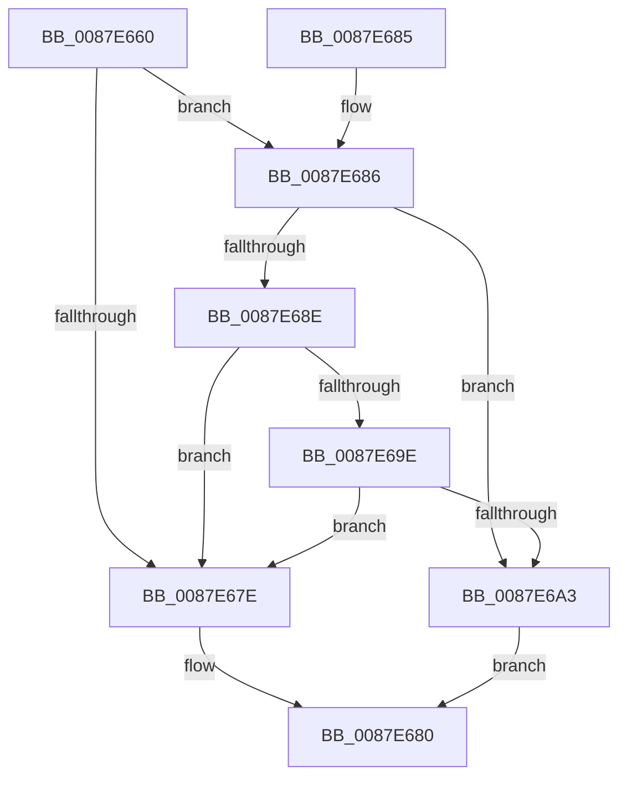

# PspBindProcessSessionToJob

- RVA: `0x0087E660`–`0x0087E6AF` (길이 `79` bytes)
- VA: `0x000000014087E660`
- 실행 섹션: `PAGE`
- PDB 이름 있음: `예`; PDB Function 태그: `아니요`
- unwind 정보 RVA: `0x0007C048`
- 디코드: `25`개 명령, `79/79` bytes 표시
- 미해석 바이트: `0` (있으면 어셈블리에 `.byte`로 보존)

> 이 문서는 커널 이미지의 기계어와 PDB 기호를 분석해 생성했습니다. 4번과 5번은 함수 원형과 자료형을 바이너리 사용 방식에서 추정한 C 해석이며 원본 소스 복구 결과는 아닙니다.

## 1. Dependencies

- 직접 호출 지점: **2**; 고유 호출 대상: **2**
- 직접 호출자로 확인된 함수: **2**
- RIP 상대 이미지 참조: **0**

### Outgoing calls
- `0x0087E671` → [PsGetProcessSessionId](../../text/22/PsGetProcessSessionId_function_002233A0.md) (function, `0x002233A0`)
- `0x0087E6A8` → [PspConvertJobToMixed](../70/PspConvertJobToMixed_function_0070449C.md) (function, `0x0070449C`)

### Direct callers
- [PspSetUILimitJobObject](../6F/PspSetUILimitJobObject_function_006FD218.md) at `0x006FD2C0`
- [PspEstablishJobHierarchy](PspEstablishJobHierarchy_function_0087E17C.md) at `0x0087E1BE`
- [PspEstablishJobHierarchy](PspEstablishJobHierarchy_function_0087E17C.md) at `0x0087E2D6`

### Static image references
- 디코드된 RIP-relative 메모리 참조가 없습니다.

## 2. Other-region calls and transfers

- 다른 실행 섹션으로 향하는 call: **1**
  - `0x0087E671` → [PsGetProcessSessionId](../../text/22/PsGetProcessSessionId_function_002233A0.md) (`PAGE` → `.text`)
- 별도 외부 분기/꼬리 이동을 확인하지 못했습니다.

## 3. Assembly (complete function range)

```asm
0087E660  48 83 EC 28                     sub rsp, 0x28
0087E664  44 8B 91 40 02 00 00            mov r10d, dword ptr [rcx + 0x240]
0087E66B  4C 8B C1                        mov r8, rcx
0087E66E  48 8B CA                        mov rcx, rdx
0087E671  E8 2A 4D 9A FF                  call 0x1402233a0
0087E676  44 8B C8                        mov r9d, eax
0087E679  44 3B D0                        cmp r10d, eax
0087E67C  75 08                           jne 0x14087e686
0087E67E  33 C0                           xor eax, eax
0087E680  48 83 C4 28                     add rsp, 0x28
0087E684  C3                              ret
0087E685  CC                              int3
0087E686  83 C9 FF                        or ecx, 0xffffffff
0087E689  44 3B D1                        cmp r10d, ecx
0087E68C  75 15                           jne 0x14087e6a3
0087E68E  83 C8 FF                        or eax, 0xffffffff
0087E691  F0 45 0F B1 88 40 02 00 00      lock cmpxchg dword ptr [r8 + 0x240], r9d
0087E69A  3B C1                           cmp eax, ecx
0087E69C  74 E0                           je 0x14087e67e
0087E69E  41 3B C1                        cmp eax, r9d
0087E6A1  74 DB                           je 0x14087e67e
0087E6A3  33 D2                           xor edx, edx
0087E6A5  49 8B C8                        mov rcx, r8
0087E6A8  E8 EF 5D E8 FF                  call 0x14070449c
0087E6AD  EB D1                           jmp 0x14087e680
```

## 4. C-style interpretation (structured pseudocode)

```c
__int64 __fastcall PspBindProcessSessionToJob(__int64 a1, __int64 a2)
{
    __int64 result;
    __int64 v_rsp;

    v_rsp = (v_rsp) - (40);
    result = PsGetProcessSessionId(a2, a2, a1, a4);
    if (((unsigned int)((unsigned int)(*(unsigned int *)(a1 + 576)))) != ((unsigned int)(result))) goto loc_0087E686;
loc_0087E67E:
    result = 0;
loc_0087E680:
    v_rsp = (v_rsp) + (40);
    return result;
loc_0087E686:
    a1 = (unsigned int)((a2) | (0xFFFFFFFFULL));
    if (((unsigned int)((unsigned int)(*(unsigned int *)(a1 + 576)))) != ((unsigned int)(a1))) goto loc_0087E6A3;
    result = (unsigned int)((result) | (0xFFFFFFFFULL));
    if (((unsigned int)(result)) == ((unsigned int)(a1))) goto loc_0087E67E;
    if (((unsigned int)(result)) == ((unsigned int)((unsigned int)((unsigned int)(result))))) goto loc_0087E67E;
loc_0087E6A3:
    a2 = 0;
    result = PspConvertJobToMixed(a1, a2, a1, (unsigned int)((unsigned int)(result)));
    goto loc_0087E680;
}
```

## 5. (Beta) C Style

```c
int64_t PspBindProcessSessionToJob(void *Arg1, int64_t Arg2)
{
    uint8_t *arg1 = (uint8_t *)Arg1;

    int64_t result;
    int64_t local_rsp;

    local_rsp = (local_rsp) - (40);
    result = PsGetProcessSessionId(Arg2, Arg2, Arg1, a4);
    if (((uint32_t)((uint32_t)(*(uint32_t *)(arg1 + 0x240)))) != ((uint32_t)(result))) goto loc_0087E686;
loc_0087E67E:
    result = 0;
loc_0087E680:
    local_rsp = (local_rsp) + (40);
    return result;
loc_0087E686:
    Arg1 = (uint32_t)((Arg2) | (0xFFFFFFFFULL));
    if (((uint32_t)((uint32_t)(*(uint32_t *)(arg1 + 0x240)))) != ((uint32_t)(Arg1))) goto loc_0087E6A3;
    result = (uint32_t)((result) | (0xFFFFFFFFULL));
    if (((uint32_t)(result)) == ((uint32_t)(Arg1))) goto loc_0087E67E;
    if (((uint32_t)(result)) == ((uint32_t)((uint32_t)((uint32_t)(result))))) goto loc_0087E67E;
loc_0087E6A3:
    Arg2 = 0;
    result = PspConvertJobToMixed(Arg1, Arg2, Arg1, (uint32_t)((uint32_t)(result)));
    goto loc_0087E680;
}
```

### 관측된 메모리 오프셋

구조체 형식이 확인되지 않은 접근은 인자 기준의 오프셋으로만 기록했습니다.

| 기준 인자 | 오프셋 표현 | 폭 (bit) | 접근 |
|---|---:|---:|---|
| `Arg1` | `+ 0x240` | `32` | `R` |

## 6. Execution-region graph

[열기: 2D/3D 그래프와 함수 탐색 컨트롤 패널](../../../control-panel.html?section=page&rva=0x0087E660&view=graph)

- 2D 그래프는 위에서 아래로 흐르고, 3D 그래프는 빈 공간을 드래그해 회전합니다. Shift+드래그는 이동, 휠은 확대·축소, 함수 노드 선택은 대상 보고서 이동입니다.

### Static fallback


