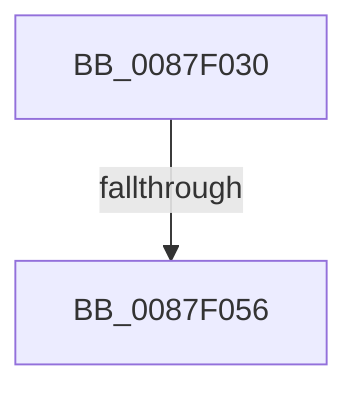

# PspChangeJobMemoryUsageByProcess

- RVA: `0x0087F030`–`0x0087F066` (길이 `54` bytes)
- VA: `0x000000014087F030`
- 실행 섹션: `PAGE`
- PDB 이름 있음: `예`; PDB Function 태그: `아니요`
- unwind 정보 RVA: `0x0007C0EC`
- 디코드: `14`개 명령, `54/54` bytes 표시
- 미해석 바이트: `0` (있으면 어셈블리에 `.byte`로 보존)

> 이 문서는 커널 이미지의 기계어와 PDB 기호를 분석해 생성했습니다. 4번과 5번은 함수 원형과 자료형을 바이너리 사용 방식에서 추정한 C 해석이며 원본 소스 복구 결과는 아닙니다.

## 1. Dependencies

- 직접 호출 지점: **0**; 고유 호출 대상: **0**
- 직접 호출자로 확인된 함수: **4**
- RIP 상대 이미지 참조: **0**

### Outgoing calls
- 직접 디코드된 call 명령이 없습니다.

### Direct callers
- [MiReturnFullProcessCharges](../../text/2C/MiReturnFullProcessCharges_function_002C2E70.md) at `0x002C2EA2`
- [MmAssignProcessToJob](MmAssignProcessToJob_function_0087EEF8.md) at `0x0087EFA9`
- [MiChargeFullProcessCommitment](../88/MiChargeFullProcessCommitment_function_00887630.md) at `0x008876A3`
- [MiChargeFullProcessCommitment](../88/MiChargeFullProcessCommitment_function_00887630.md) at `0x00887729`
- [MmDeleteProcessAddressSpace](../AC/MmDeleteProcessAddressSpace_function_00AC804C.md) at `0x00AC81EA`

### Static image references
- 디코드된 RIP-relative 메모리 참조가 없습니다.

## 2. Other-region calls and transfers

- 다른 실행 섹션으로 향하는 call: **0**
- call이 아닌 외부 분기/꼬리 이동: **2**
  - `0x0087F050` → [sub_0087F47C](Unknown_function_0087F47C.md) (`tail-transfer`)
  - `0x0087F060` → [sub_0087F47C](Unknown_function_0087F47C.md) (`tail-transfer`)

## 3. Assembly (complete function range)

```asm
0087F030  4C 8B DC                        mov r11, rsp
0087F033  4D 89 4B 20                     mov qword ptr [r11 + 0x20], r9
0087F037  49 89 53 10                     mov qword ptr [r11 + 0x10], rdx
0087F03B  89 4C 24 08                     mov dword ptr [rsp + 8], ecx
0087F03F  41 54                           push r12
0087F041  41 57                           push r15
0087F043  48 83 EC 78                     sub rsp, 0x78
0087F047  4D 8B E0                        mov r12, r8
0087F04A  44 8B F9                        mov r15d, ecx
0087F04D  F6 C1 02                        test cl, 2
0087F050  0F 84 26 04 00 00               je 0x14087f47c
0087F056  49 8B 80 A0 02 00 00            mov rax, qword ptr [r8 + 0x2a0]
0087F05D  48 85 C0                        test rax, rax
0087F060  0F 84 16 04 00 00               je 0x14087f47c
```

## 4. C-style interpretation (structured pseudocode)

```c
__int64 __fastcall PspChangeJobMemoryUsageByProcess(int a1, __int64 a2, __int64 a3, __int64 a4)
{
    __int64 v_rsp;
    unsigned int v_stack_p8;

    *(unsigned __int64 *)(v_rsp + 32) = a4;
    *(unsigned __int64 *)(v_rsp + 16) = a2;
    v_stack_p8 = a1;
    v_rsp = (v_rsp) - (120);
}
```

## 5. (Beta) C Style

```c
int64_t PspChangeJobMemoryUsageByProcess(int32_t Arg1, int64_t Arg2, void *Arg3, int64_t Arg4)
{
    uint8_t *arg3 = (uint8_t *)Arg3;

    int64_t local_rsp;
    uint32_t v_stack_p8;

    *(uint64_t *)(local_rsp + 0x20) = Arg4;
    *(uint64_t *)(local_rsp + 0x10) = Arg2;
    v_stack_p8 = Arg1;
    local_rsp = (local_rsp) - (120);
}
```

### 관측된 메모리 오프셋

구조체 형식이 확인되지 않은 접근은 인자 기준의 오프셋으로만 기록했습니다.

| 기준 인자 | 오프셋 표현 | 폭 (bit) | 접근 |
|---|---:|---:|---|
| `Arg3` | `+ 0x2A0` | `64` | `R` |

## 6. Execution-region graph

[열기: 2D/3D 그래프와 함수 탐색 컨트롤 패널](../../../control-panel.html?section=page&rva=0x0087F030&view=graph)

- 2D 그래프는 위에서 아래로 흐르고, 3D 그래프는 빈 공간을 드래그해 회전합니다. Shift+드래그는 이동, 휠은 확대·축소, 함수 노드 선택은 대상 보고서 이동입니다.

### Static fallback


