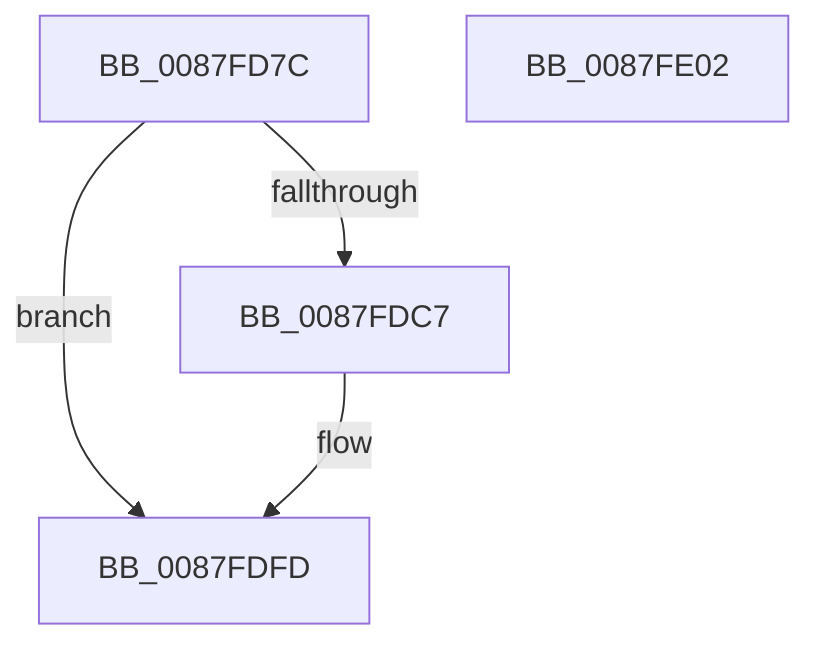

# PspFreeCurrentThreadUserShadowStack

- RVA: `0x0087FD7C`–`0x0087FE03` (길이 `135` bytes)
- VA: `0x000000014087FD7C`
- 실행 섹션: `PAGE`
- PDB 이름 있음: `예`; PDB Function 태그: `아니요`
- unwind 정보 RVA: `0x0006E590`
- 디코드: `30`개 명령, `135/135` bytes 표시
- 미해석 바이트: `0` (있으면 어셈블리에 `.byte`로 보존)

> 이 문서는 커널 이미지의 기계어와 PDB 기호를 분석해 생성했습니다. 4번과 5번은 함수 원형과 자료형을 바이너리 사용 방식에서 추정한 C 해석이며 원본 소스 복구 결과는 아닙니다.

## 1. Dependencies

- 직접 호출 지점: **2**; 고유 호출 대상: **2**
- 직접 호출자로 확인된 함수: **1**
- RIP 상대 이미지 참조: **0**

### Outgoing calls
- `0x0087FDBE` → [ZwQueryVirtualMemory](../../text/6A/ZwQueryVirtualMemory_function_006AD530.md) (function, `0x006AD530`)
- `0x0087FDF8` → [MmFreeVirtualMemory](MmFreeVirtualMemory_function_0087FED0.md) (function, `0x0087FED0`)

### Direct callers
- [PspExitThread](../90/PspExitThread_function_00905F60.md) at `0x009065B4`

### Static image references
- 디코드된 RIP-relative 메모리 참조가 없습니다.

## 2. Other-region calls and transfers

- 다른 실행 섹션으로 향하는 call: **1**
  - `0x0087FDBE` → [ZwQueryVirtualMemory](../../text/6A/ZwQueryVirtualMemory_function_006AD530.md) (`PAGE` → `.text`)
- 별도 외부 분기/꼬리 이동을 확인하지 못했습니다.

## 3. Assembly (complete function range)

```asm
0087FD7C  48 83 EC 68                     sub rsp, 0x68
0087FD80  0F 57 C0                        xorps xmm0, xmm0
0087FD83  B9 A7 06 00 00                  mov ecx, 0x6a7
0087FD88  0F 11 44 24 30                  movups xmmword ptr [rsp + 0x30], xmm0
0087FD8D  0F 11 44 24 40                  movups xmmword ptr [rsp + 0x40], xmm0
0087FD92  0F 11 44 24 50                  movups xmmword ptr [rsp + 0x50], xmm0
0087FD97  0F 32                           rdmsr
0087FD99  48 83 64 24 28 00               and qword ptr [rsp + 0x28], 0
0087FD9F  4C 8D 4C 24 30                  lea r9, [rsp + 0x30]
0087FDA4  48 C1 E2 20                     shl rdx, 0x20
0087FDA8  41 B8 03 00 00 00               mov r8d, 3
0087FDAE  48 0B D0                        or rdx, rax
0087FDB1  48 C7 44 24 20 30 00 00 00      mov qword ptr [rsp + 0x20], 0x30
0087FDBA  48 83 C9 FF                     or rcx, 0xffffffffffffffff
0087FDBE  E8 6D D7 E2 FF                  call 0x1406ad530
0087FDC3  85 C0                           test eax, eax
0087FDC5  78 36                           js 0x14087fdfd
0087FDC7  48 8B 44 24 30                  mov rax, qword ptr [rsp + 0x30]
0087FDCC  4C 8D 44 24 70                  lea r8, [rsp + 0x70]
0087FDD1  48 83 64 24 70 00               and qword ptr [rsp + 0x70], 0
0087FDD7  48 8D 54 24 78                  lea rdx, [rsp + 0x78]
0087FDDC  C7 44 24 28 00 00 00 40         mov dword ptr [rsp + 0x28], 0x40000000
0087FDE4  41 B9 00 80 00 00               mov r9d, 0x8000
0087FDEA  48 83 C9 FF                     or rcx, 0xffffffffffffffff
0087FDEE  48 89 44 24 78                  mov qword ptr [rsp + 0x78], rax
0087FDF3  C6 44 24 20 00                  mov byte ptr [rsp + 0x20], 0
0087FDF8  E8 D3 00 00 00                  call 0x14087fed0
0087FDFD  48 83 C4 68                     add rsp, 0x68
0087FE01  C3                              ret
0087FE02  CC                              int3
```

## 4. C-style interpretation (structured pseudocode)

```c
__int64 __fastcall PspFreeCurrentThreadUserShadowStack(__int64 a1, __int64 a2)
{
    __int64 result;
    __int64 v_rsp;
    unsigned __int64 v_stack_m18;
    unsigned __int64 v_stack_m28;
    unsigned __int64 v_stack_m38;
    unsigned __int64 v_stack_m40;
    unsigned __int64 v_stack_m48;
    unsigned __int64 v_stack_p10;
    unsigned __int64 v_stack_p8;

    v_rsp = (v_rsp) - (104);
    v_stack_m38 = v_xmm0;
    v_stack_m28 = v_xmm0;
    v_stack_m18 = v_xmm0;
    a2 = (a2) << (32);
    a2 = (a2) | (result);
    v_stack_m48 = 48;
    a1 = ((unsigned int)(0x6A7ULL)) | (-1);
    result = ZwQueryVirtualMemory(a1, a2, 3, v_stack_m38);
    if (!(sign_flag)) {
        result = v_stack_m38;
        a3 = v_stack_p8;
        a2 = v_stack_p10;
        v_stack_m40 = 0x40000000ULL;
        a4 = 0x8000ULL;
        a1 = (a1) | (-1);
        v_stack_p10 = result;
        v_stack_m48 = 0;
        result = MmFreeVirtualMemory(a1, a2, a3, a4);
    }
    v_rsp = (v_rsp) + (104);
    return result;
}
```

## 5. (Beta) C Style

```c
int64_t PspFreeCurrentThreadUserShadowStack(int64_t Arg1, int64_t Arg2)
{
    int64_t result;
    int64_t local_rsp;
    uint64_t v_stack_m18;
    uint64_t v_stack_m28;
    uint64_t v_stack_m38;
    uint64_t v_stack_m40;
    uint64_t v_stack_m48;
    uint64_t v_stack_p10;
    uint64_t v_stack_p8;

    local_rsp = (local_rsp) - (104);
    v_stack_m38 = v_xmm0;
    v_stack_m28 = v_xmm0;
    v_stack_m18 = v_xmm0;
    Arg2 = (Arg2) << (32);
    Arg2 = (Arg2) | (result);
    v_stack_m48 = 48;
    Arg1 = ((uint32_t)(0x6A7ULL)) | (-1);
    result = ZwQueryVirtualMemory(Arg1, Arg2, 3, v_stack_m38);
    if (!(sign_flag)) {
        result = v_stack_m38;
        a3 = v_stack_p8;
        Arg2 = v_stack_p10;
        v_stack_m40 = 0x40000000ULL;
        a4 = 0x8000ULL;
        Arg1 = (Arg1) | (-1);
        v_stack_p10 = result;
        v_stack_m48 = 0;
        result = MmFreeVirtualMemory(Arg1, Arg2, a3, a4);
    }
    local_rsp = (local_rsp) + (104);
    return result;
}
```

## 6. Execution-region graph

[열기: 2D/3D 그래프와 함수 탐색 컨트롤 패널](../../../control-panel.html?section=page&rva=0x0087FD7C&view=graph)

- 2D 그래프는 위에서 아래로 흐르고, 3D 그래프는 빈 공간을 드래그해 회전합니다. Shift+드래그는 이동, 휠은 확대·축소, 함수 노드 선택은 대상 보고서 이동입니다.

### Static fallback


