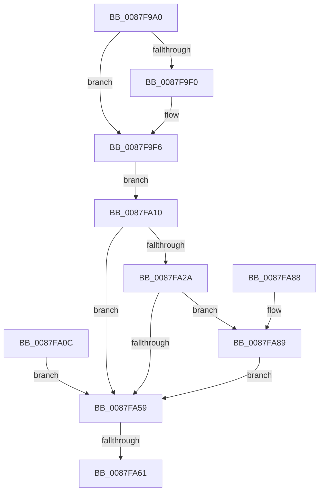

# PspFreeUserFiberShadowStack

- RVA: `0x0087F9A0`–`0x0087FAB8` (길이 `280` bytes)
- VA: `0x000000014087F9A0`
- 실행 섹션: `PAGE`
- PDB 이름 있음: `예`; PDB Function 태그: `예`
- unwind 정보 RVA: `0x0007C2F4`
- 디코드: `70`개 명령, `280/280` bytes 표시
- 미해석 바이트: `0` (있으면 어셈블리에 `.byte`로 보존)

> 이 문서는 커널 이미지의 기계어와 PDB 기호를 분석해 생성했습니다. 4번과 5번은 함수 원형과 자료형을 바이너리 사용 방식에서 추정한 C 해석이며 원본 소스 복구 결과는 아닙니다.

## 1. Dependencies

- 직접 호출 지점: **6**; 고유 호출 대상: **6**
- 직접 호출자로 확인된 함수: **1**
- RIP 상대 이미지 참조: **1**

### Outgoing calls
- `0x0087F9D4` → [memset](../../text/6C/memset_function_006C6C40.md) (function, `0x006C6C40`)
- `0x0087F9F0` → [ExRaiseDatatypeMisalignment](../89/ExRaiseDatatypeMisalignment_function_00899FD0.md) (function, `0x00899FD0`)
- `0x0087FA1F` → [MmUpdateUserShadowStackValue](../../text/49/MmUpdateUserShadowStackValue_function_004935D8.md) (function, `0x004935D8`)
- `0x0087FA4E` → [ZwQueryVirtualMemory](../../text/6A/ZwQueryVirtualMemory_function_006AD530.md) (function, `0x006AD530`)
- `0x0087FA6E` → [_security_check_cookie](../../text/6A/_security_check_cookie_function_006AC640.md) (function, `0x006AC640`)
- `0x0087FAAF` → [MmFreeVirtualMemory](MmFreeVirtualMemory_function_0087FED0.md) (function, `0x0087FED0`)

### Direct callers
- [NtSetInformationProcess](../AE/NtSetInformationProcess_function_00AE5370.md) at `0x00AE7833`

### Static image references
- `0x0087F9B2` → RVA `0x00E0A740` (`.data`; read)

## 2. Other-region calls and transfers

- 다른 실행 섹션으로 향하는 call: **4**
  - `0x0087F9D4` → [memset](../../text/6C/memset_function_006C6C40.md) (`PAGE` → `.text`)
  - `0x0087FA1F` → [MmUpdateUserShadowStackValue](../../text/49/MmUpdateUserShadowStackValue_function_004935D8.md) (`PAGE` → `.text`)
  - `0x0087FA4E` → [ZwQueryVirtualMemory](../../text/6A/ZwQueryVirtualMemory_function_006AD530.md) (`PAGE` → `.text`)
  - `0x0087FA6E` → [_security_check_cookie](../../text/6A/_security_check_cookie_function_006AC640.md) (`PAGE` → `.text`)
- call이 아닌 외부 분기/꼬리 이동: **1**
  - `0x0087FA5B` → [sub_00B18BDE](../B1/Unknown_function_00B18BDE.md) (`tail-transfer`)

## 3. Assembly (complete function range)

```asm
0087F9A0  48 89 5C 24 10                  mov qword ptr [rsp + 0x10], rbx
0087F9A5  48 89 74 24 18                  mov qword ptr [rsp + 0x18], rsi
0087F9AA  57                              push rdi
0087F9AB  48 81 EC 20 01 00 00            sub rsp, 0x120
0087F9B2  48 8B 05 87 AD 58 00            mov rax, qword ptr [rip + 0x58ad87]
0087F9B9  48 33 C4                        xor rax, rsp
0087F9BC  48 89 84 24 10 01 00 00         mov qword ptr [rsp + 0x110], rax
0087F9C4  48 8B D9                        mov rbx, rcx
0087F9C7  33 D2                           xor edx, edx
0087F9C9  41 B8 98 00 00 00               mov r8d, 0x98
0087F9CF  48 8D 4C 24 70                  lea rcx, [rsp + 0x70]
0087F9D4  E8 67 72 E4 FF                  call 0x1406c6c40
0087F9D9  0F 57 C0                        xorps xmm0, xmm0
0087F9DC  0F 11 44 24 38                  movups xmmword ptr [rsp + 0x38], xmm0
0087F9E1  0F 11 44 24 48                  movups xmmword ptr [rsp + 0x48], xmm0
0087F9E6  0F 11 44 24 58                  movups xmmword ptr [rsp + 0x58], xmm0
0087F9EB  F6 C3 07                        test bl, 7
0087F9EE  74 06                           je 0x14087f9f6
0087F9F0  E8 DB A5 01 00                  call 0x140899fd0
0087F9F5  CC                              int3
0087F9F6  48 B8 00 00 FF FF FF 7F 00 00   movabs rax, 0x7fffffff0000
0087FA00  48 3B D8                        cmp rbx, rax
0087FA03  48 0F 42 C3                     cmovb rax, rbx
0087FA07  90                              nop
0087FA08  8A 00                           mov al, byte ptr [rax]
0087FA0A  EB 04                           jmp 0x14087fa10
0087FA0C  8B F0                           mov esi, eax
0087FA0E  EB 49                           jmp 0x14087fa59
0087FA10  48 8D 53 08                     lea rdx, [rbx + 8]
0087FA14  48 83 E2 FD                     and rdx, 0xfffffffffffffffd
0087FA18  48 83 CA 01                     or rdx, 1
0087FA1C  48 8B CB                        mov rcx, rbx
0087FA1F  E8 B4 3B C1 FF                  call 0x1404935d8
0087FA24  8B F0                           mov esi, eax
0087FA26  85 C0                           test eax, eax
0087FA28  78 2F                           js 0x14087fa59
0087FA2A  48 83 64 24 28 00               and qword ptr [rsp + 0x28], 0
0087FA30  48 C7 44 24 20 30 00 00 00      mov qword ptr [rsp + 0x20], 0x30
0087FA39  4C 8D 4C 24 38                  lea r9, [rsp + 0x38]
0087FA3E  41 B8 03 00 00 00               mov r8d, 3
0087FA44  48 8B D3                        mov rdx, rbx
0087FA47  48 83 CB FF                     or rbx, 0xffffffffffffffff
0087FA4B  48 8B CB                        mov rcx, rbx
0087FA4E  E8 DD DA E2 FF                  call 0x1406ad530
0087FA53  8B F0                           mov esi, eax
0087FA55  85 C0                           test eax, eax
0087FA57  79 30                           jns 0x14087fa89
0087FA59  85 F6                           test esi, esi
0087FA5B  0F 88 7D 91 29 00               js 0x140b18bde
0087FA61  8B C6                           mov eax, esi
0087FA63  48 8B 8C 24 10 01 00 00         mov rcx, qword ptr [rsp + 0x110]
0087FA6B  48 33 CC                        xor rcx, rsp
0087FA6E  E8 CD CB E2 FF                  call 0x1406ac640
0087FA73  4C 8D 9C 24 20 01 00 00         lea r11, [rsp + 0x120]
0087FA7B  49 8B 5B 18                     mov rbx, qword ptr [r11 + 0x18]
0087FA7F  49 8B 73 20                     mov rsi, qword ptr [r11 + 0x20]
0087FA83  49 8B E3                        mov rsp, r11
0087FA86  5F                              pop rdi
0087FA87  C3                              ret
0087FA88  CC                              int3
0087FA89  48 83 64 24 30 00               and qword ptr [rsp + 0x30], 0
0087FA8F  C7 44 24 28 00 00 00 40         mov dword ptr [rsp + 0x28], 0x40000000
0087FA97  C6 44 24 20 00                  mov byte ptr [rsp + 0x20], 0
0087FA9C  41 B9 00 80 00 00               mov r9d, 0x8000
0087FAA2  4C 8D 44 24 30                  lea r8, [rsp + 0x30]
0087FAA7  48 8D 54 24 38                  lea rdx, [rsp + 0x38]
0087FAAC  48 8B CB                        mov rcx, rbx
0087FAAF  E8 1C 04 00 00                  call 0x14087fed0
0087FAB4  8B F0                           mov esi, eax
0087FAB6  EB A1                           jmp 0x14087fa59
```

## 4. C-style interpretation (structured pseudocode)

```c
__int64 __fastcall PspFreeUserFiberShadowStack(__int64 a1, int a2)
{
    __int64 result;
    __int64 v_rbx;
    __int64 v_rsp;
    unsigned __int64 v_stack_m100;
    unsigned __int64 v_stack_m108;
    unsigned __int64 v_stack_m18;
    unsigned __int64 v_stack_m8;
    unsigned __int64 v_stack_mB8;
    unsigned __int64 v_stack_mD0;
    unsigned __int64 v_stack_mE0;
    unsigned __int64 v_stack_mE8;
    unsigned __int64 v_stack_mF0;
    unsigned int v_stack_mF8;
    unsigned __int64 v_stack_p10;
    unsigned __int64 v_stack_p18;

    v_stack_p10 = v_rbx;
    v_stack_p18 = v_rsi;
    v_rsp = (v_rsp) - (288);
    result = (*(unsigned __int64 *)(v_rip + 5811591)) ^ (v_rsp);
    v_stack_m18 = result;
    a2 = 0;
    result = memset(v_stack_mB8, a2, 152, a4);
    v_stack_mF0 = v_xmm0;
    v_stack_mE0 = v_xmm0;
    v_stack_mD0 = v_xmm0;
    if ((((unsigned __int8)(a1)) & (7)) != 0) {
        result = ExRaiseDatatypeMisalignment(v_stack_mB8, a2, 152, a4);
    }
    if (a1 < result) { result = a1; }
    goto loc_0087FA10;
loc_0087FA10:
    a2 = (a1 + 8) & (-3);
    a2 = (a2) | (1);
    result = MmUpdateUserShadowStackValue(a1, a2, 152, a4);
    if (sign_flag) goto loc_0087FA59;
    v_stack_m108 = 48;
    v_rbx = (a1) | (-1);
    result = ZwQueryVirtualMemory(v_rbx, a1, 3, v_stack_mF0);
    if (!sign_flag) goto loc_0087FA89;
loc_0087FA59:
    a1 = (v_stack_m18) ^ (v_rsp);
    result = _security_check_cookie(a1, a1, 3, v_stack_mF0);
    return result;
loc_0087FA89:
    v_stack_mF8 = 0x40000000ULL;
    v_stack_m100 = 0;
    result = MmFreeVirtualMemory(*(unsigned __int64 *)(v_stack_m8 + 24), v_stack_mE8, v_stack_mF0, (unsigned int)(0x8000ULL));
    goto loc_0087FA59;
}
```

## 5. (Beta) C Style

```c
int64_t PspFreeUserFiberShadowStack(int64_t Arg1, int32_t Arg2)
{
    int64_t result;
    int64_t local_rbx;
    int64_t local_rsp;
    uint64_t v_stack_m100;
    uint64_t v_stack_m108;
    uint64_t v_stack_m18;
    uint64_t v_stack_m8;
    uint64_t v_stack_mB8;
    uint64_t v_stack_mD0;
    uint64_t v_stack_mE0;
    uint64_t v_stack_mE8;
    uint64_t v_stack_mF0;
    uint32_t v_stack_mF8;
    uint64_t v_stack_p10;
    uint64_t v_stack_p18;

    v_stack_p10 = local_rbx;
    v_stack_p18 = local_rsi;
    local_rsp = (local_rsp) - (288);
    result = (*(uint64_t *)(v_rip + 0x58AD87)) ^ (local_rsp);
    v_stack_m18 = result;
    Arg2 = 0;
    result = memset(v_stack_mB8, Arg2, 152, a4);
    v_stack_mF0 = v_xmm0;
    v_stack_mE0 = v_xmm0;
    v_stack_mD0 = v_xmm0;
    if ((((uint8_t)(Arg1)) & (7)) != 0) {
        result = ExRaiseDatatypeMisalignment(v_stack_mB8, Arg2, 152, a4);
    }
    if (Arg1 < result) { result = Arg1; }
    goto loc_0087FA10;
loc_0087FA10:
    Arg2 = (Arg1 + 8) & (-3);
    Arg2 = (Arg2) | (1);
    result = MmUpdateUserShadowStackValue(Arg1, Arg2, 152, a4);
    if (sign_flag) goto loc_0087FA59;
    v_stack_m108 = 48;
    local_rbx = (Arg1) | (-1);
    result = ZwQueryVirtualMemory(local_rbx, Arg1, 3, v_stack_mF0);
    if (!sign_flag) goto loc_0087FA89;
loc_0087FA59:
    Arg1 = (v_stack_m18) ^ (local_rsp);
    result = _security_check_cookie(Arg1, Arg1, 3, v_stack_mF0);
    return result;
loc_0087FA89:
    v_stack_mF8 = 0x40000000ULL;
    v_stack_m100 = 0;
    result = MmFreeVirtualMemory(*(uint64_t *)(v_stack_m8 + 0x18), v_stack_mE8, v_stack_mF0, (uint32_t)(0x8000ULL));
    goto loc_0087FA59;
}
```

## 6. Execution-region graph

[열기: 2D/3D 그래프와 함수 탐색 컨트롤 패널](../../../control-panel.html?section=page&rva=0x0087F9A0&view=graph)

- 2D 그래프는 위에서 아래로 흐르고, 3D 그래프는 빈 공간을 드래그해 회전합니다. Shift+드래그는 이동, 휠은 확대·축소, 함수 노드 선택은 대상 보고서 이동입니다.

### Static fallback


