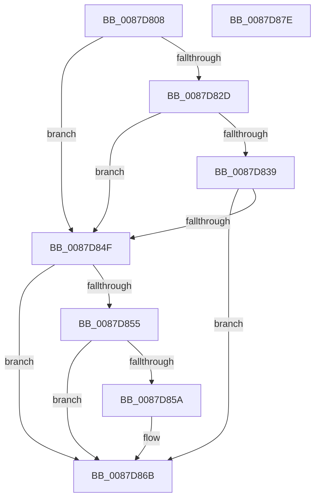

# PspGetMemoryPartitionContext

- RVA: `0x0087D808`–`0x0087D87F` (길이 `119` bytes)
- VA: `0x000000014087D808`
- 실행 섹션: `PAGE`
- PDB 이름 있음: `예`; PDB Function 태그: `아니요`
- unwind 정보 RVA: `0x00060BC4`
- 디코드: `36`개 명령, `119/119` bytes 표시
- 미해석 바이트: `0` (있으면 어셈블리에 `.byte`로 보존)

> 이 문서는 커널 이미지의 기계어와 PDB 기호를 분석해 생성했습니다. 4번과 5번은 함수 원형과 자료형을 바이너리 사용 방식에서 추정한 C 해석이며 원본 소스 복구 결과는 아닙니다.

## 1. Dependencies

- 직접 호출 지점: **2**; 고유 호출 대상: **2**
- 직접 호출자로 확인된 함수: **2**
- RIP 상대 이미지 참조: **0**

### Outgoing calls
- `0x0087D843` → [PspGetMemoryPartitionImplicit](PspGetMemoryPartitionImplicit_function_0087D888.md) (function, `0x0087D888`)
- `0x0087D863` → [PspGetMemoryPartitionFromJobList](PspGetMemoryPartitionFromJobList_function_0087D988.md) (function, `0x0087D988`)

### Direct callers
- [PsCreateMinimalProcess](../78/PsCreateMinimalProcess_function_00786D14.md) at `0x00786E8B`
- [NtCreateUserProcess](../AE/NtCreateUserProcess_function_00AEA680.md) at `0x00AEAC16`

### Static image references
- 디코드된 RIP-relative 메모리 참조가 없습니다.

## 2. Other-region calls and transfers

- 다른 실행 섹션으로 향하는 call: **0**
- 별도 외부 분기/꼬리 이동을 확인하지 못했습니다.

## 3. Assembly (complete function range)

```asm
0087D808  48 89 5C 24 08                  mov qword ptr [rsp + 8], rbx
0087D80D  48 89 74 24 10                  mov qword ptr [rsp + 0x10], rsi
0087D812  57                              push rdi
0087D813  48 83 EC 20                     sub rsp, 0x20
0087D817  48 8B 5C 24 50                  mov rbx, qword ptr [rsp + 0x50]
0087D81C  45 33 D2                        xor r10d, r10d
0087D81F  49 8B F9                        mov rdi, r9
0087D822  49 8B F0                        mov rsi, r8
0087D825  4C 21 13                        and qword ptr [rbx], r10
0087D828  48 85 C9                        test rcx, rcx
0087D82B  74 22                           je 0x14087d84f
0087D82D  48 8B 81 A0 02 00 00            mov rax, qword ptr [rcx + 0x2a0]
0087D834  48 85 C0                        test rax, rax
0087D837  74 16                           je 0x14087d84f
0087D839  48 8B 89 A0 02 00 00            mov rcx, qword ptr [rcx + 0x2a0]
0087D840  4C 8B C3                        mov r8, rbx
0087D843  E8 40 00 00 00                  call 0x14087d888
0087D848  44 8B D0                        mov r10d, eax
0087D84B  85 C0                           test eax, eax
0087D84D  78 1C                           js 0x14087d86b
0087D84F  48 83 3B 00                     cmp qword ptr [rbx], 0
0087D853  75 16                           jne 0x14087d86b
0087D855  48 85 FF                        test rdi, rdi
0087D858  74 11                           je 0x14087d86b
0087D85A  4C 8B C3                        mov r8, rbx
0087D85D  48 8B D7                        mov rdx, rdi
0087D860  48 8B CE                        mov rcx, rsi
0087D863  E8 20 01 00 00                  call 0x14087d988
0087D868  44 8B D0                        mov r10d, eax
0087D86B  48 8B 5C 24 30                  mov rbx, qword ptr [rsp + 0x30]
0087D870  41 8B C2                        mov eax, r10d
0087D873  48 8B 74 24 38                  mov rsi, qword ptr [rsp + 0x38]
0087D878  48 83 C4 20                     add rsp, 0x20
0087D87C  5F                              pop rdi
0087D87D  C3                              ret
0087D87E  CC                              int3
```

## 4. C-style interpretation (structured pseudocode)

```c
__int64 __fastcall PspGetMemoryPartitionContext(__int64 a1, __int64 a2, __int64 a3, __int64 a4, __int64 a5)
{
    __int64 result;
    __int64 v_r10;
    __int64 v_rsp;
    unsigned __int64 v_stack_p10;
    unsigned __int64 v_stack_p8;

    v_stack_p8 = v_rbx;
    v_stack_p10 = v_rsi;
    v_rsp = (v_rsp) - (32);
    v_r10 = 0;
    if (a1 == 0) goto loc_0087D84F;
    if (*(unsigned __int64 *)(a1 + 672) == 0) goto loc_0087D84F;
    result = PspGetMemoryPartitionImplicit(*(unsigned __int64 *)(a1 + 672), a2, a5, a4);
    if (sign_flag) goto loc_0087D86B;
loc_0087D84F:
    if ((*(unsigned __int64 *)(a5)) != 0) goto loc_0087D86B;
    v_r10 = (unsigned int)((unsigned int)(result));
    if (a4 != 0) {
        a3 = a5;
        a2 = a4;
        a1 = a3;
        result = PspGetMemoryPartitionFromJobList(a1, a2, a3, a4);
        v_r10 = (unsigned int)(result);
    }
    v_rsp = (v_rsp) + (32);
    return (unsigned int)((unsigned int)(v_r10));
}
```

## 5. (Beta) C Style

```c
int64_t PspGetMemoryPartitionContext(int64_t Arg1, int64_t Arg2, int64_t Arg3, int64_t Arg4, void *Arg5)
{
    uint8_t *arg5 = (uint8_t *)Arg5;

    int64_t result;
    int64_t local_r10;
    int64_t local_rsp;
    uint64_t v_stack_p10;
    uint64_t v_stack_p8;

    v_stack_p8 = local_rbx;
    v_stack_p10 = local_rsi;
    local_rsp = (local_rsp) - (32);
    local_r10 = 0;
    if (Arg1 == 0) goto loc_0087D84F;
    if (*(uint64_t *)(Arg1 + 0x2A0) == 0) goto loc_0087D84F;
    result = PspGetMemoryPartitionImplicit(*(uint64_t *)(Arg1 + 0x2A0), Arg2, Arg5, Arg4);
    if (sign_flag) goto loc_0087D86B;
loc_0087D84F:
    if ((*(uint64_t *)(arg5)) != 0) goto loc_0087D86B;
    local_r10 = (uint32_t)((uint32_t)(result));
    if (Arg4 != 0) {
        Arg3 = Arg5;
        Arg2 = Arg4;
        Arg1 = Arg3;
        result = PspGetMemoryPartitionFromJobList(Arg1, Arg2, Arg3, Arg4);
        local_r10 = (uint32_t)(result);
    }
    local_rsp = (local_rsp) + (32);
    return (uint32_t)((uint32_t)(local_r10));
}
```

### 관측된 메모리 오프셋

구조체 형식이 확인되지 않은 접근은 인자 기준의 오프셋으로만 기록했습니다.

| 기준 인자 | 오프셋 표현 | 폭 (bit) | 접근 |
|---|---:|---:|---|
| `Arg5` | `+ 0x0` | `64` | `R` |
| `Arg5` | `+ 0x0` | `64` | `R/W` |

## 6. Execution-region graph

[열기: 2D/3D 그래프와 함수 탐색 컨트롤 패널](../../../control-panel.html?section=page&rva=0x0087D808&view=graph)

- 2D 그래프는 위에서 아래로 흐르고, 3D 그래프는 빈 공간을 드래그해 회전합니다. Shift+드래그는 이동, 휠은 확대·축소, 함수 노드 선택은 대상 보고서 이동입니다.

### Static fallback


