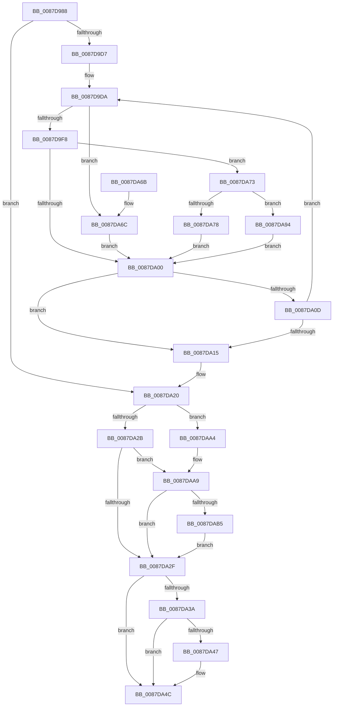

# PspGetMemoryPartitionFromJobList

- RVA: `0x0087D988`–`0x0087DAC8` (길이 `320` bytes)
- VA: `0x000000014087D988`
- 실행 섹션: `PAGE`
- PDB 이름 있음: `예`; PDB Function 태그: `아니요`
- unwind 정보 RVA: `0x0007BF58`
- 디코드: `89`개 명령, `320/320` bytes 표시
- 미해석 바이트: `0` (있으면 어셈블리에 `.byte`로 보존)

> 이 문서는 커널 이미지의 기계어와 PDB 기호를 분석해 생성했습니다. 4번과 5번은 함수 원형과 자료형을 바이너리 사용 방식에서 추정한 C 해석이며 원본 소스 복구 결과는 아닙니다.

## 1. Dependencies

- 직접 호출 지점: **5**; 고유 호출 대상: **5**
- 직접 호출자로 확인된 함수: **1**
- RIP 상대 이미지 참조: **0**

### Outgoing calls
- `0x0087D9E6` → [ExAcquireResourceExclusiveLite](../../text/21/ExAcquireResourceExclusiveLite_function_00214E20.md) (function, `0x00214E20`)
- `0x0087DA04` → [ExReleaseResourceLite](../../text/25/ExReleaseResourceLite_function_0025FA10.md) (function, `0x0025FA10`)
- `0x0087DA47` → [KiCheckForKernelApcDelivery](../../text/2E/KiCheckForKernelApcDelivery_function_002E2C80.md) (function, `0x002E2C80`)
- `0x0087DA80` → [ObfReferenceObjectWithTag](../../text/21/ObfReferenceObjectWithTag_function_00210710.md) (function, `0x00210710`)
- `0x0087DABA` → [ObfDereferenceObjectWithTag](../../text/2F/ObfDereferenceObjectWithTag_function_002F78E0.md) (function, `0x002F78E0`)

### Direct callers
- [PspGetMemoryPartitionContext](PspGetMemoryPartitionContext_function_0087D808.md) at `0x0087D863`

### Static image references
- 디코드된 RIP-relative 메모리 참조가 없습니다.

## 2. Other-region calls and transfers

- 다른 실행 섹션으로 향하는 call: **5**
  - `0x0087D9E6` → [ExAcquireResourceExclusiveLite](../../text/21/ExAcquireResourceExclusiveLite_function_00214E20.md) (`PAGE` → `.text`)
  - `0x0087DA04` → [ExReleaseResourceLite](../../text/25/ExReleaseResourceLite_function_0025FA10.md) (`PAGE` → `.text`)
  - `0x0087DA47` → [KiCheckForKernelApcDelivery](../../text/2E/KiCheckForKernelApcDelivery_function_002E2C80.md) (`PAGE` → `.text`)
  - `0x0087DA80` → [ObfReferenceObjectWithTag](../../text/21/ObfReferenceObjectWithTag_function_00210710.md) (`PAGE` → `.text`)
  - `0x0087DABA` → [ObfDereferenceObjectWithTag](../../text/2F/ObfDereferenceObjectWithTag_function_002F78E0.md) (`PAGE` → `.text`)
- 별도 외부 분기/꼬리 이동을 확인하지 못했습니다.

## 3. Assembly (complete function range)

```asm
0087D988  48 89 5C 24 08                  mov qword ptr [rsp + 8], rbx
0087D98D  48 89 6C 24 18                  mov qword ptr [rsp + 0x18], rbp
0087D992  48 89 74 24 20                  mov qword ptr [rsp + 0x20], rsi
0087D997  57                              push rdi
0087D998  41 54                           push r12
0087D99A  41 55                           push r13
0087D99C  41 56                           push r14
0087D99E  41 57                           push r15
0087D9A0  48 83 EC 20                     sub rsp, 0x20
0087D9A4  49 83 20 00                     and qword ptr [r8], 0
0087D9A8  41 BE 01 00 00 00               mov r14d, 1
0087D9AE  65 48 8B 3C 25 88 01 00 00      mov rdi, qword ptr gs:[0x188]
0087D9B7  33 DB                           xor ebx, ebx
0087D9B9  33 ED                           xor ebp, ebp
0087D9BB  48 89 7C 24 58                  mov qword ptr [rsp + 0x58], rdi
0087D9C0  49 8B F0                        mov rsi, r8
0087D9C3  4C 8B FA                        mov r15, rdx
0087D9C6  4C 8B E9                        mov r13, rcx
0087D9C9  66 44 29 B7 E6 01 00 00         sub word ptr [rdi + 0x1e6], r14w
0087D9D1  90                              nop
0087D9D2  48 85 D2                        test rdx, rdx
0087D9D5  74 49                           je 0x14087da20
0087D9D7  41 8B FE                        mov edi, r14d
0087D9DA  4D 8B 74 ED 00                  mov r14, qword ptr [r13 + rbp*8]
0087D9DF  40 8A D7                        mov dl, dil
0087D9E2  49 8D 4E 38                     lea rcx, [r14 + 0x38]
0087D9E6  E8 35 74 99 FF                  call 0x140214e20
0087D9EB  49 8B 86 00 07 00 00            mov rax, qword ptr [r14 + 0x700]
0087D9F2  48 83 F8 FF                     cmp rax, -1
0087D9F6  74 74                           je 0x14087da6c
0087D9F8  48 8B 0E                        mov rcx, qword ptr [rsi]
0087D9FB  48 85 C0                        test rax, rax
0087D9FE  75 73                           jne 0x14087da73
0087DA00  49 8D 4E 38                     lea rcx, [r14 + 0x38]
0087DA04  E8 07 20 9E FF                  call 0x14025fa10
0087DA09  85 DB                           test ebx, ebx
0087DA0B  78 08                           js 0x14087da15
0087DA0D  48 03 EF                        add rbp, rdi
0087DA10  49 3B EF                        cmp rbp, r15
0087DA13  72 C5                           jb 0x14087d9da
0087DA15  48 8B 7C 24 58                  mov rdi, qword ptr [rsp + 0x58]
0087DA1A  41 BE 01 00 00 00               mov r14d, 1
0087DA20  8B 87 A0 05 00 00               mov eax, dword ptr [rdi + 0x5a0]
0087DA26  41 84 C6                        test r14b, al
0087DA29  75 79                           jne 0x14087daa4
0087DA2B  85 DB                           test ebx, ebx
0087DA2D  78 7A                           js 0x14087daa9
0087DA2F  90                              nop
0087DA30  66 44 01 B7 E6 01 00 00         add word ptr [rdi + 0x1e6], r14w
0087DA38  75 12                           jne 0x14087da4c
0087DA3A  48 8D 8F 98 00 00 00            lea rcx, [rdi + 0x98]
0087DA41  90                              nop
0087DA42  48 39 09                        cmp qword ptr [rcx], rcx
0087DA45  74 05                           je 0x14087da4c
0087DA47  E8 34 52 A6 FF                  call 0x1402e2c80
0087DA4C  48 8B 6C 24 60                  mov rbp, qword ptr [rsp + 0x60]
0087DA51  8B C3                           mov eax, ebx
0087DA53  48 8B 5C 24 50                  mov rbx, qword ptr [rsp + 0x50]
0087DA58  48 8B 74 24 68                  mov rsi, qword ptr [rsp + 0x68]
0087DA5D  48 83 C4 20                     add rsp, 0x20
0087DA61  41 5F                           pop r15
0087DA63  41 5E                           pop r14
0087DA65  41 5D                           pop r13
0087DA67  41 5C                           pop r12
0087DA69  5F                              pop rdi
0087DA6A  C3                              ret
0087DA6B  CC                              int3
0087DA6C  BB 76 04 00 C0                  mov ebx, 0xc0000476
0087DA71  EB 8D                           jmp 0x14087da00
0087DA73  48 85 C9                        test rcx, rcx
0087DA76  75 1C                           jne 0x14087da94
0087DA78  BA 50 73 4A 62                  mov edx, 0x624a7350
0087DA7D  48 8B C8                        mov rcx, rax
0087DA80  E8 8B 2C 99 FF                  call 0x140210710
0087DA85  49 8B 86 00 07 00 00            mov rax, qword ptr [r14 + 0x700]
0087DA8C  48 89 06                        mov qword ptr [rsi], rax
0087DA8F  E9 6C FF FF FF                  jmp 0x14087da00
0087DA94  48 3B C1                        cmp rax, rcx
0087DA97  BA BB 00 00 C0                  mov edx, 0xc00000bb
0087DA9C  0F 45 DA                        cmovne ebx, edx
0087DA9F  E9 5C FF FF FF                  jmp 0x14087da00
0087DAA4  BB 4B 00 00 C0                  mov ebx, 0xc000004b
0087DAA9  48 8B 0E                        mov rcx, qword ptr [rsi]
0087DAAC  48 85 C9                        test rcx, rcx
0087DAAF  0F 84 7A FF FF FF               je 0x14087da2f
0087DAB5  BA 50 73 4A 62                  mov edx, 0x624a7350
0087DABA  E8 21 9E A7 FF                  call 0x1402f78e0
0087DABF  48 83 26 00                     and qword ptr [rsi], 0
0087DAC3  E9 67 FF FF FF                  jmp 0x14087da2f
```

## 4. C-style interpretation (structured pseudocode)

```c
__int64 __fastcall PspGetMemoryPartitionFromJobList(__int64 a1, __int64 a2, __int64 a3)
{
    __int64 result;
    __int64 v_rbp;
    __int64 v_rbx;
    __int64 v_rsp;
    unsigned __int64 v_stack_p10;
    unsigned __int64 v_stack_p18;
    unsigned __int64 v_stack_p20;
    unsigned __int64 v_stack_p8;

    v_stack_p8 = v_rbx;
    v_stack_p18 = v_rbp;
    v_stack_p20 = v_rsi;
    v_rsp = (v_rsp) - (32);
    v_rbx = 0;
    v_rbp = 0;
    v_stack_p10 = *(unsigned __int64 *)(gs_base + (0 + 392));
    if (a2 == 0) goto loc_0087DA20;
loc_0087D9DA:
    result = ExAcquireResourceExclusiveLite(*(unsigned __int64 *)(a1 + v_rbp * 8) + 56, 1, a3, a4);
    if ((*(unsigned __int64 *)(*(unsigned __int64 *)(a1 + v_rbp * 8) + 1792)) == -1) goto loc_0087DA6C;
    if (*(unsigned __int64 *)(*(unsigned __int64 *)(a1 + v_rbp * 8) + 1792) != 0) goto loc_0087DA73;
loc_0087DA00:
    result = ExReleaseResourceLite(*(unsigned __int64 *)(a1 + v_rbp * 8) + 56, 1, a3, a4);
    if (sign_flag) goto loc_0087DA15;
    v_rbp = (v_rbp) + (1);
    if (v_rbp < a2) goto loc_0087D9DA;
loc_0087DA15:
loc_0087DA20:
    if (((1) & ((unsigned __int8)((unsigned int)(*(unsigned int *)(v_stack_p10 + 1440))))) != 0) goto loc_0087DAA4;
    if (sign_flag) goto loc_0087DAA9;
loc_0087DA2F:
    if (0 != 0) goto loc_0087DA4C;
    result = (unsigned int)(*(unsigned int *)(v_stack_p10 + 1440));
    if ((*(unsigned __int64 *)(v_stack_p10 + 152)) != (v_stack_p10 + 152)) {
        result = KiCheckForKernelApcDelivery(v_stack_p10 + 152, 1, a3, a4);
    }
    v_rsp = (v_rsp) + (32);
    return 0;
loc_0087DA6C:
    goto loc_0087DA00;
loc_0087DA73:
    if (v_stack_p10 + 152 != 0) goto loc_0087DA94;
    result = ObfReferenceObjectWithTag(0, (unsigned int)(0x624A7350ULL), a3, a4);
    *(unsigned __int64 *)(v_stack_p20) = *(unsigned __int64 *)(1 + 1792);
    goto loc_0087DA00;
loc_0087DA94:
    v_rbx = (unsigned int)(0xC0000476ULL);
    if ((*(unsigned __int64 *)(1 + 1792)) != 0) { v_rbx = (unsigned int)((unsigned int)(0xC00000BBULL)); }
    goto loc_0087DA00;
loc_0087DAA4:
loc_0087DAA9:
    if (*(unsigned __int64 *)(v_stack_p20) == 0) goto loc_0087DA2F;
    result = ObfDereferenceObjectWithTag(*(unsigned __int64 *)(v_stack_p20), (unsigned int)(0x624A7350ULL), a3, a4);
    goto loc_0087DA2F;
}
```

## 5. (Beta) C Style

```c
int64_t PspGetMemoryPartitionFromJobList(void *Arg1, int64_t Arg2, void *Arg3)
{
    uint8_t *arg1 = (uint8_t *)Arg1;
    uint8_t *arg3 = (uint8_t *)Arg3;

    int64_t result;
    int64_t local_rbp;
    int64_t local_rbx;
    int64_t local_rsp;
    uint64_t v_stack_p10;
    uint64_t v_stack_p18;
    uint64_t v_stack_p20;
    uint64_t v_stack_p8;

    v_stack_p8 = local_rbx;
    v_stack_p18 = local_rbp;
    v_stack_p20 = local_rsi;
    local_rsp = (local_rsp) - (32);
    local_rbx = 0;
    local_rbp = 0;
    v_stack_p10 = *(uint64_t *)(gs_base + (0 + 0x188));
    if (Arg2 == 0) goto loc_0087DA20;
loc_0087D9DA:
    result = ExAcquireResourceExclusiveLite(*(uint64_t *)(arg1 + local_rbp * 8) + 56, 1, Arg3, a4);
    if ((*(uint64_t *)(*(uint64_t *)(arg1 + local_rbp * 8) + 0x700)) == -1) goto loc_0087DA6C;
    if (*(uint64_t *)(*(uint64_t *)(arg1 + local_rbp * 8) + 0x700) != 0) goto loc_0087DA73;
loc_0087DA00:
    result = ExReleaseResourceLite(*(uint64_t *)(arg1 + local_rbp * 8) + 56, 1, Arg3, a4);
    if (sign_flag) goto loc_0087DA15;
    local_rbp = (local_rbp) + (1);
    if (local_rbp < Arg2) goto loc_0087D9DA;
loc_0087DA15:
loc_0087DA20:
    if (((1) & ((uint8_t)((uint32_t)(*(uint32_t *)(v_stack_p10 + 0x5A0))))) != 0) goto loc_0087DAA4;
    if (sign_flag) goto loc_0087DAA9;
loc_0087DA2F:
    if (0 != 0) goto loc_0087DA4C;
    result = (uint32_t)(*(uint32_t *)(v_stack_p10 + 0x5A0));
    if ((*(uint64_t *)(v_stack_p10 + 0x98)) != (v_stack_p10 + 152)) {
        result = KiCheckForKernelApcDelivery(v_stack_p10 + 152, 1, Arg3, a4);
    }
    local_rsp = (local_rsp) + (32);
    return 0;
loc_0087DA6C:
    goto loc_0087DA00;
loc_0087DA73:
    if (v_stack_p10 + 152 != 0) goto loc_0087DA94;
    result = ObfReferenceObjectWithTag(0, (uint32_t)(0x624A7350ULL), Arg3, a4);
    *(uint64_t *)(v_stack_p20) = *(uint64_t *)(1 + 0x700);
    goto loc_0087DA00;
loc_0087DA94:
    local_rbx = (uint32_t)(0xC0000476ULL);
    if ((*(uint64_t *)(1 + 0x700)) != 0) { local_rbx = (uint32_t)((uint32_t)(0xC00000BBULL)); }
    goto loc_0087DA00;
loc_0087DAA4:
loc_0087DAA9:
    if (*(uint64_t *)(v_stack_p20) == 0) goto loc_0087DA2F;
    result = ObfDereferenceObjectWithTag(*(uint64_t *)(v_stack_p20), (uint32_t)(0x624A7350ULL), Arg3, a4);
    goto loc_0087DA2F;
}
```

### 관측된 메모리 오프셋

구조체 형식이 확인되지 않은 접근은 인자 기준의 오프셋으로만 기록했습니다.

| 기준 인자 | 오프셋 표현 | 폭 (bit) | 접근 |
|---|---:|---:|---|
| `Arg1` | `+ 0x0 + rbp*8` | `64` | `R` |
| `Arg3` | `+ 0x0` | `64` | `R` |
| `Arg3` | `+ 0x0` | `64` | `R/W` |
| `Arg3` | `+ 0x0` | `64` | `W` |

## 6. Execution-region graph

[열기: 2D/3D 그래프와 함수 탐색 컨트롤 패널](../../../control-panel.html?section=page&rva=0x0087D988&view=graph)

- 2D 그래프는 위에서 아래로 흐르고, 3D 그래프는 빈 공간을 드래그해 회전합니다. Shift+드래그는 이동, 휠은 확대·축소, 함수 노드 선택은 대상 보고서 이동입니다.

### Static fallback


