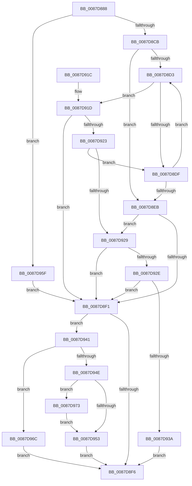

# PspGetMemoryPartitionImplicit

- RVA: `0x0087D888`–`0x0087D97F` (길이 `247` bytes)
- VA: `0x000000014087D888`
- 실행 섹션: `PAGE`
- PDB 이름 있음: `예`; PDB Function 태그: `아니요`
- unwind 정보 RVA: `0x0007BF3C`
- 디코드: `71`개 명령, `247/247` bytes 표시
- 미해석 바이트: `0` (있으면 어셈블리에 `.byte`로 보존)

> 이 문서는 커널 이미지의 기계어와 PDB 기호를 분석해 생성했습니다. 4번과 5번은 함수 원형과 자료형을 바이너리 사용 방식에서 추정한 C 해석이며 원본 소스 복구 결과는 아닙니다.

## 1. Dependencies

- 직접 호출 지점: **4**; 고유 호출 대상: **4**
- 직접 호출자로 확인된 함수: **1**
- RIP 상대 이미지 참조: **0**

### Outgoing calls
- `0x0087D8BC` → [PspLockJobChain](PspLockJobChain_function_0087DAD0.md) (function, `0x0087DAD0`)
- `0x0087D8FC` → [PspUnlockJobChain](PspUnlockJobChain_function_0087DC78.md) (function, `0x0087DC78`)
- `0x0087D962` → [PsGetEffectiveServerSilo](../../text/22/PsGetEffectiveServerSilo_function_002257F0.md) (function, `0x002257F0`)
- `0x0087D978` → [ObfReferenceObjectWithTag](../../text/21/ObfReferenceObjectWithTag_function_00210710.md) (function, `0x00210710`)

### Direct callers
- [PspGetMemoryPartitionContext](PspGetMemoryPartitionContext_function_0087D808.md) at `0x0087D843`

### Static image references
- 디코드된 RIP-relative 메모리 참조가 없습니다.

## 2. Other-region calls and transfers

- 다른 실행 섹션으로 향하는 call: **2**
  - `0x0087D962` → [PsGetEffectiveServerSilo](../../text/22/PsGetEffectiveServerSilo_function_002257F0.md) (`PAGE` → `.text`)
  - `0x0087D978` → [ObfReferenceObjectWithTag](../../text/21/ObfReferenceObjectWithTag_function_00210710.md) (`PAGE` → `.text`)
- 별도 외부 분기/꼬리 이동을 확인하지 못했습니다.

## 3. Assembly (complete function range)

```asm
0087D888  48 89 5C 24 08                  mov qword ptr [rsp + 8], rbx
0087D88D  48 89 6C 24 10                  mov qword ptr [rsp + 0x10], rbp
0087D892  48 89 74 24 18                  mov qword ptr [rsp + 0x18], rsi
0087D897  57                              push rdi
0087D898  41 56                           push r14
0087D89A  41 57                           push r15
0087D89C  48 83 EC 20                     sub rsp, 0x20
0087D8A0  4D 8B F0                        mov r14, r8
0087D8A3  8B EA                           mov ebp, edx
0087D8A5  33 FF                           xor edi, edi
0087D8A7  48 8B F1                        mov rsi, rcx
0087D8AA  49 89 38                        mov qword ptr [r8], rdi
0087D8AD  45 33 C0                        xor r8d, r8d
0087D8B0  65 4C 8B 3C 25 88 01 00 00      mov r15, qword ptr gs:[0x188]
0087D8B9  49 8B D7                        mov rdx, r15
0087D8BC  E8 0F 02 00 00                  call 0x14087dad0
0087D8C1  0F BA E5 0A                     bt ebp, 0xa
0087D8C5  0F 82 94 00 00 00               jb 0x14087d95f
0087D8CB  48 8B DE                        mov rbx, rsi
0087D8CE  48 85 F6                        test rsi, rsi
0087D8D1  74 18                           je 0x14087d8eb
0087D8D3  8B 83 00 01 00 00               mov eax, dword ptr [rbx + 0x100]
0087D8D9  0F BA E0 0C                     bt eax, 0xc
0087D8DD  73 3E                           jae 0x14087d91d
0087D8DF  48 8B 9B 18 05 00 00            mov rbx, qword ptr [rbx + 0x518]
0087D8E6  48 85 DB                        test rbx, rbx
0087D8E9  75 E8                           jne 0x14087d8d3
0087D8EB  40 F6 C5 01                     test bpl, 1
0087D8EF  75 38                           jne 0x14087d929
0087D8F1  48 85 DB                        test rbx, rbx
0087D8F4  75 4B                           jne 0x14087d941
0087D8F6  49 8B D7                        mov rdx, r15
0087D8F9  48 8B CE                        mov rcx, rsi
0087D8FC  E8 77 03 00 00                  call 0x14087dc78
0087D901  48 8B 5C 24 40                  mov rbx, qword ptr [rsp + 0x40]
0087D906  8B C7                           mov eax, edi
0087D908  48 8B 6C 24 48                  mov rbp, qword ptr [rsp + 0x48]
0087D90D  48 8B 74 24 50                  mov rsi, qword ptr [rsp + 0x50]
0087D912  48 83 C4 20                     add rsp, 0x20
0087D916  41 5F                           pop r15
0087D918  41 5E                           pop r14
0087D91A  5F                              pop rdi
0087D91B  C3                              ret
0087D91C  CC                              int3
0087D91D  40 F6 C5 01                     test bpl, 1
0087D921  74 CE                           je 0x14087d8f1
0087D923  0F BA E0 0B                     bt eax, 0xb
0087D927  72 B6                           jb 0x14087d8df
0087D929  48 3B DE                        cmp rbx, rsi
0087D92C  75 C3                           jne 0x14087d8f1
0087D92E  F7 83 10 06 00 00 00 00 00 40   test dword ptr [rbx + 0x610], 0x40000000
0087D938  75 B7                           jne 0x14087d8f1
0087D93A  BF 22 00 00 C0                  mov edi, 0xc0000022
0087D93F  EB B5                           jmp 0x14087d8f6
0087D941  48 8B 8B 00 07 00 00            mov rcx, qword ptr [rbx + 0x700]
0087D948  48 83 F9 FF                     cmp rcx, -1
0087D94C  74 1E                           je 0x14087d96c
0087D94E  48 85 C9                        test rcx, rcx
0087D951  75 20                           jne 0x14087d973
0087D953  48 8B 8B 00 07 00 00            mov rcx, qword ptr [rbx + 0x700]
0087D95A  49 89 0E                        mov qword ptr [r14], rcx
0087D95D  EB 97                           jmp 0x14087d8f6
0087D95F  48 8B CE                        mov rcx, rsi
0087D962  E8 89 7E 9A FF                  call 0x1402257f0
0087D967  48 8B D8                        mov rbx, rax
0087D96A  EB 85                           jmp 0x14087d8f1
0087D96C  BF 76 04 00 C0                  mov edi, 0xc0000476
0087D971  EB 83                           jmp 0x14087d8f6
0087D973  BA 50 73 4A 62                  mov edx, 0x624a7350
0087D978  E8 93 2D 99 FF                  call 0x140210710
0087D97D  EB D4                           jmp 0x14087d953
```

## 4. C-style interpretation (structured pseudocode)

```c
__int64 __fastcall PspGetMemoryPartitionImplicit(__int64 a1, int a2, __int64 a3)
{
    __int64 result;
    __int64 v_rdi;
    __int64 v_rsp;
    unsigned __int64 v_stack_p10;
    unsigned __int64 v_stack_p18;
    unsigned __int64 v_stack_p8;

    v_stack_p8 = v_rbx;
    v_stack_p10 = v_rbp;
    v_stack_p18 = v_rsi;
    v_rsp = (v_rsp) - (32);
    v_rdi = 0;
    *(unsigned __int64 *)(a3) = 0;
    a3 = 0;
    result = PspLockJobChain(a1, *(unsigned __int64 *)(gs_base + (0 + 392)), a3, a4);
    if (condition_is_below) goto loc_0087D95F;
    if (a1 == 0) goto loc_0087D8EB;
loc_0087D8D3:
    if (condition_is_above_or_equal) goto loc_0087D91D;
loc_0087D8DF:
    if (*(unsigned __int64 *)(a1 + 1304) != 0) goto loc_0087D8D3;
loc_0087D8EB:
    if ((((unsigned __int8)((unsigned int)(a2))) & (1)) != 0) goto loc_0087D929;
loc_0087D8F1:
    if (*(unsigned __int64 *)(a1 + 1304) != 0) goto loc_0087D941;
loc_0087D8F6:
    result = PspUnlockJobChain(a1, *(unsigned __int64 *)(gs_base + (0 + 392)), a3, a4);
    v_rsp = (v_rsp) + (32);
    return 0;
loc_0087D91D:
    if ((((unsigned __int8)(v_stack_p10)) & (1)) == 0) goto loc_0087D8F1;
    if (condition_is_below) goto loc_0087D8DF;
loc_0087D929:
    if (v_stack_p8 != v_stack_p18) goto loc_0087D8F1;
    if (((*(unsigned int *)(v_stack_p8 + 1552)) & (0x40000000ULL)) != 0) goto loc_0087D8F1;
    goto loc_0087D8F6;
loc_0087D941:
    if ((*(unsigned __int64 *)(v_stack_p8 + 1792)) == -1) goto loc_0087D96C;
    if (*(unsigned __int64 *)(v_stack_p8 + 1792) != 0) goto loc_0087D973;
loc_0087D953:
    *(unsigned __int64 *)(a3) = *(unsigned __int64 *)(v_stack_p8 + 1792);
    goto loc_0087D8F6;
loc_0087D95F:
    result = PsGetEffectiveServerSilo(v_stack_p18, *(unsigned __int64 *)(gs_base + (0 + 392)), a3, a4);
    goto loc_0087D8F1;
loc_0087D96C:
    goto loc_0087D8F6;
loc_0087D973:
    result = ObfReferenceObjectWithTag(v_stack_p18, (unsigned int)(0x624A7350ULL), a3, a4);
    goto loc_0087D953;
}
```

## 5. (Beta) C Style

```c
int64_t PspGetMemoryPartitionImplicit(int64_t Arg1, int32_t Arg2, void *Arg3)
{
    uint8_t *arg3 = (uint8_t *)Arg3;

    int64_t result;
    int64_t local_rdi;
    int64_t local_rsp;
    uint64_t v_stack_p10;
    uint64_t v_stack_p18;
    uint64_t v_stack_p8;

    v_stack_p8 = local_rbx;
    v_stack_p10 = local_rbp;
    v_stack_p18 = local_rsi;
    local_rsp = (local_rsp) - (32);
    local_rdi = 0;
    *(uint64_t *)(arg3) = 0;
    Arg3 = 0;
    result = PspLockJobChain(Arg1, *(uint64_t *)(gs_base + (0 + 0x188)), Arg3, a4);
    if (condition_is_below) goto loc_0087D95F;
    if (Arg1 == 0) goto loc_0087D8EB;
loc_0087D8D3:
    if (condition_is_above_or_equal) goto loc_0087D91D;
loc_0087D8DF:
    if (*(uint64_t *)(Arg1 + 0x518) != 0) goto loc_0087D8D3;
loc_0087D8EB:
    if ((((uint8_t)((uint32_t)(Arg2))) & (1)) != 0) goto loc_0087D929;
loc_0087D8F1:
    if (*(uint64_t *)(Arg1 + 0x518) != 0) goto loc_0087D941;
loc_0087D8F6:
    result = PspUnlockJobChain(Arg1, *(uint64_t *)(gs_base + (0 + 0x188)), Arg3, a4);
    local_rsp = (local_rsp) + (32);
    return 0;
loc_0087D91D:
    if ((((uint8_t)(v_stack_p10)) & (1)) == 0) goto loc_0087D8F1;
    if (condition_is_below) goto loc_0087D8DF;
loc_0087D929:
    if (v_stack_p8 != v_stack_p18) goto loc_0087D8F1;
    if (((*(uint32_t *)(v_stack_p8 + 0x610)) & (0x40000000ULL)) != 0) goto loc_0087D8F1;
    goto loc_0087D8F6;
loc_0087D941:
    if ((*(uint64_t *)(v_stack_p8 + 0x700)) == -1) goto loc_0087D96C;
    if (*(uint64_t *)(v_stack_p8 + 0x700) != 0) goto loc_0087D973;
loc_0087D953:
    *(uint64_t *)(arg3) = *(uint64_t *)(v_stack_p8 + 0x700);
    goto loc_0087D8F6;
loc_0087D95F:
    result = PsGetEffectiveServerSilo(v_stack_p18, *(uint64_t *)(gs_base + (0 + 0x188)), Arg3, a4);
    goto loc_0087D8F1;
loc_0087D96C:
    goto loc_0087D8F6;
loc_0087D973:
    result = ObfReferenceObjectWithTag(v_stack_p18, (uint32_t)(0x624A7350ULL), Arg3, a4);
    goto loc_0087D953;
}
```

### 관측된 메모리 오프셋

구조체 형식이 확인되지 않은 접근은 인자 기준의 오프셋으로만 기록했습니다.

| 기준 인자 | 오프셋 표현 | 폭 (bit) | 접근 |
|---|---:|---:|---|
| `Arg3` | `+ 0x0` | `64` | `W` |

## 6. Execution-region graph

[열기: 2D/3D 그래프와 함수 탐색 컨트롤 패널](../../../control-panel.html?section=page&rva=0x0087D888&view=graph)

- 2D 그래프는 위에서 아래로 흐르고, 3D 그래프는 빈 공간을 드래그해 회전합니다. Shift+드래그는 이동, 휠은 확대·축소, 함수 노드 선택은 대상 보고서 이동입니다.

### Static fallback


