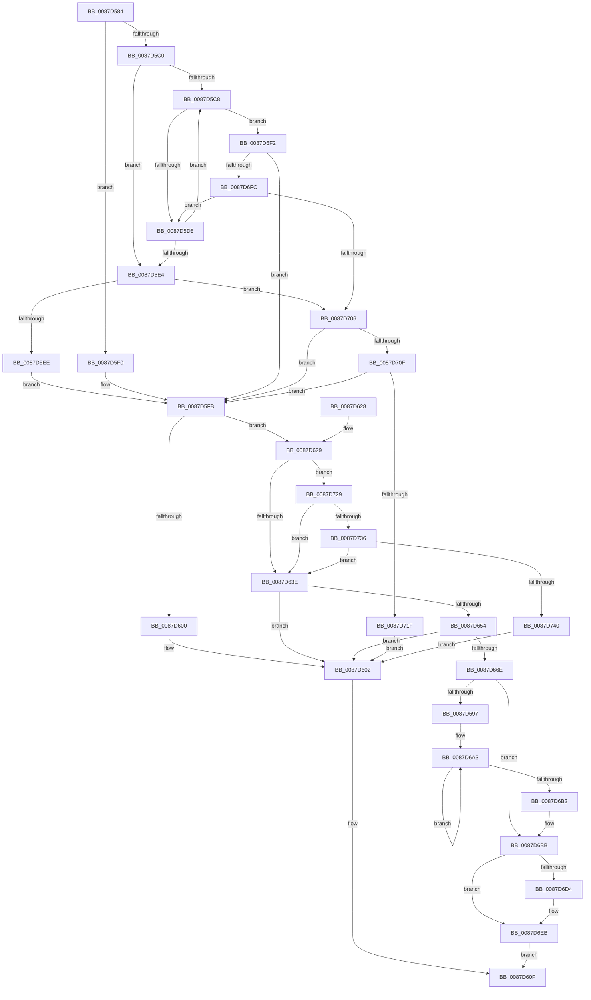

# PspImplicitAssignProcessToJob

- RVA: `0x0087D584`–`0x0087D74A` (길이 `454` bytes)
- VA: `0x000000014087D584`
- 실행 섹션: `PAGE`
- PDB 이름 있음: `예`; PDB Function 태그: `아니요`
- unwind 정보 RVA: `0x0007BEF8`
- 디코드: `118`개 명령, `454/454` bytes 표시
- 미해석 바이트: `0` (있으면 어셈블리에 `.byte`로 보존)

> 이 문서는 커널 이미지의 기계어와 PDB 기호를 분석해 생성했습니다. 4번과 5번은 함수 원형과 자료형을 바이너리 사용 방식에서 추정한 C 해석이며 원본 소스 복구 결과는 아닙니다.

## 1. Dependencies

- 직접 호출 지점: **10**; 고유 호출 대상: **9**
- 직접 호출자로 확인된 함수: **1**
- RIP 상대 이미지 참조: **0**

### Outgoing calls
- `0x0087D5B4` → [PspLockJobChain](PspLockJobChain_function_0087DAD0.md) (function, `0x0087DAD0`)
- `0x0087D5F3` → [PsGetEffectiveServerSilo](../../text/22/PsGetEffectiveServerSilo_function_002257F0.md) (function, `0x002257F0`)
- `0x0087D608` → [PspUnlockJobChain](PspUnlockJobChain_function_0087DC78.md) (function, `0x0087DC78`)
- `0x0087D649` → [PspValidateJobChainLimits](PspValidateJobChainLimits_function_0087DD40.md) (function, `0x0087DD40`)
- `0x0087D663` → [PspEstablishJobHierarchy](PspEstablishJobHierarchy_function_0087E17C.md) (function, `0x0087E17C`)
- `0x0087D679` → [PspIncrementJobChainProcessCounts](PspIncrementJobChainProcessCounts_function_0087E0B4.md) (function, `0x0087E0B4`)
- `0x0087D686` → [PspApplyJobChainLimitsToProcess](PspApplyJobChainLimitsToProcess_function_0087EB5C.md) (function, `0x0087EB5C`)
- `0x0087D6C1` → [PspUnlockJobChain](PspUnlockJobChain_function_0087DC78.md) (function, `0x0087DC78`)
- `0x0087D6C9` → [PspApplyWorkingSetLimitsToProcess](PspApplyWorkingSetLimitsToProcess_function_0087DE9C.md) (function, `0x0087DE9C`)
- `0x0087D6DC` → [MmAssignProcessToJob](MmAssignProcessToJob_function_0087EEF8.md) (function, `0x0087EEF8`)

### Direct callers
- [PspInsertProcess](../94/PspInsertProcess_function_009472CC.md) at `0x009473A0`

### Static image references
- 디코드된 RIP-relative 메모리 참조가 없습니다.

## 2. Other-region calls and transfers

- 다른 실행 섹션으로 향하는 call: **1**
  - `0x0087D5F3` → [PsGetEffectiveServerSilo](../../text/22/PsGetEffectiveServerSilo_function_002257F0.md) (`PAGE` → `.text`)
- 별도 외부 분기/꼬리 이동을 확인하지 못했습니다.

## 3. Assembly (complete function range)

```asm
0087D584  48 89 5C 24 08                  mov qword ptr [rsp + 8], rbx
0087D589  48 89 6C 24 10                  mov qword ptr [rsp + 0x10], rbp
0087D58E  48 89 74 24 18                  mov qword ptr [rsp + 0x18], rsi
0087D593  57                              push rdi
0087D594  41 56                           push r14
0087D596  41 57                           push r15
0087D598  48 83 EC 20                     sub rsp, 0x20
0087D59C  65 4C 8B 3C 25 88 01 00 00      mov r15, qword ptr gs:[0x188]
0087D5A5  45 8B F0                        mov r14d, r8d
0087D5A8  48 8B FA                        mov rdi, rdx
0087D5AB  45 33 C0                        xor r8d, r8d
0087D5AE  49 8B D7                        mov rdx, r15
0087D5B1  48 8B E9                        mov rbp, rcx
0087D5B4  E8 17 05 00 00                  call 0x14087dad0
0087D5B9  41 0F BA E6 0A                  bt r14d, 0xa
0087D5BE  72 30                           jb 0x14087d5f0
0087D5C0  48 8B DD                        mov rbx, rbp
0087D5C3  48 85 ED                        test rbp, rbp
0087D5C6  74 1C                           je 0x14087d5e4
0087D5C8  8B 83 00 01 00 00               mov eax, dword ptr [rbx + 0x100]
0087D5CE  0F BA E0 0C                     bt eax, 0xc
0087D5D2  0F 83 1A 01 00 00               jae 0x14087d6f2
0087D5D8  48 8B 9B 18 05 00 00            mov rbx, qword ptr [rbx + 0x518]
0087D5DF  48 85 DB                        test rbx, rbx
0087D5E2  75 E4                           jne 0x14087d5c8
0087D5E4  41 F6 C6 01                     test r14b, 1
0087D5E8  0F 85 18 01 00 00               jne 0x14087d706
0087D5EE  EB 0B                           jmp 0x14087d5fb
0087D5F0  48 8B CD                        mov rcx, rbp
0087D5F3  E8 F8 81 9A FF                  call 0x1402257f0
0087D5F8  48 8B D8                        mov rbx, rax
0087D5FB  48 85 DB                        test rbx, rbx
0087D5FE  75 29                           jne 0x14087d629
0087D600  33 F6                           xor esi, esi
0087D602  49 8B D7                        mov rdx, r15
0087D605  48 8B CD                        mov rcx, rbp
0087D608  E8 6B 06 00 00                  call 0x14087dc78
0087D60D  8B C6                           mov eax, esi
0087D60F  48 8B 5C 24 40                  mov rbx, qword ptr [rsp + 0x40]
0087D614  48 8B 6C 24 48                  mov rbp, qword ptr [rsp + 0x48]
0087D619  48 8B 74 24 50                  mov rsi, qword ptr [rsp + 0x50]
0087D61E  48 83 C4 20                     add rsp, 0x20
0087D622  41 5F                           pop r15
0087D624  41 5E                           pop r14
0087D626  5F                              pop rdi
0087D627  C3                              ret
0087D628  CC                              int3
0087D629  48 8B 8B 00 07 00 00            mov rcx, qword ptr [rbx + 0x700]
0087D630  48 8D 41 FF                     lea rax, [rcx - 1]
0087D634  48 83 F8 FD                     cmp rax, -3
0087D638  0F 86 EB 00 00 00               jbe 0x14087d729
0087D63E  45 8B CE                        mov r9d, r14d
0087D641  4C 8B C7                        mov r8, rdi
0087D644  33 D2                           xor edx, edx
0087D646  48 8B CB                        mov rcx, rbx
0087D649  E8 F2 06 00 00                  call 0x14087dd40
0087D64E  8B F0                           mov esi, eax
0087D650  85 C0                           test eax, eax
0087D652  78 AE                           js 0x14087d602
0087D654  41 B9 01 00 00 00               mov r9d, 1
0087D65A  45 33 C0                        xor r8d, r8d
0087D65D  48 8B D7                        mov rdx, rdi
0087D660  48 8B CB                        mov rcx, rbx
0087D663  E8 14 0B 00 00                  call 0x14087e17c
0087D668  8B F0                           mov esi, eax
0087D66A  85 C0                           test eax, eax
0087D66C  78 94                           js 0x14087d602
0087D66E  45 8B CE                        mov r9d, r14d
0087D671  4C 8B C7                        mov r8, rdi
0087D674  33 D2                           xor edx, edx
0087D676  48 8B CB                        mov rcx, rbx
0087D679  E8 36 0A 00 00                  call 0x14087e0b4
0087D67E  4C 8B C7                        mov r8, rdi
0087D681  33 D2                           xor edx, edx
0087D683  48 8B CB                        mov rcx, rbx
0087D686  E8 D1 14 00 00                  call 0x14087eb5c
0087D68B  F7 83 10 06 00 00 00 10 00 00   test dword ptr [rbx + 0x610], 0x1000
0087D695  74 24                           je 0x14087d6bb
0087D697  48 8D 87 28 07 00 00            lea rax, [rdi + 0x728]
0087D69E  B9 07 00 00 00                  mov ecx, 7
0087D6A3  F0 0F BA 28 1F                  lock bts dword ptr [rax], 0x1f
0087D6A8  48 8D 40 04                     lea rax, [rax + 4]
0087D6AC  48 83 E9 01                     sub rcx, 1
0087D6B0  75 F1                           jne 0x14087d6a3
0087D6B2  F0 0F BA AF 4C 07 00 00 1F      lock bts dword ptr [rdi + 0x74c], 0x1f
0087D6BB  49 8B D7                        mov rdx, r15
0087D6BE  48 8B CD                        mov rcx, rbp
0087D6C1  E8 B2 05 00 00                  call 0x14087dc78
0087D6C6  48 8B CF                        mov rcx, rdi
0087D6C9  E8 CE 07 00 00                  call 0x14087de9c
0087D6CE  8B D8                           mov ebx, eax
0087D6D0  85 C0                           test eax, eax
0087D6D2  78 17                           js 0x14087d6eb
0087D6D4  45 33 C0                        xor r8d, r8d
0087D6D7  33 D2                           xor edx, edx
0087D6D9  48 8B CF                        mov rcx, rdi
0087D6DC  E8 17 18 00 00                  call 0x14087eef8
0087D6E1  85 C0                           test eax, eax
0087D6E3  B9 44 00 00 C0                  mov ecx, 0xc0000044
0087D6E8  0F 44 D9                        cmove ebx, ecx
0087D6EB  8B C3                           mov eax, ebx
0087D6ED  E9 1D FF FF FF                  jmp 0x14087d60f
0087D6F2  41 F6 C6 01                     test r14b, 1
0087D6F6  0F 84 FF FE FF FF               je 0x14087d5fb
0087D6FC  0F BA E0 0B                     bt eax, 0xb
0087D700  0F 82 D2 FE FF FF               jb 0x14087d5d8
0087D706  48 3B DD                        cmp rbx, rbp
0087D709  0F 85 EC FE FF FF               jne 0x14087d5fb
0087D70F  F7 83 10 06 00 00 00 00 00 40   test dword ptr [rbx + 0x610], 0x40000000
0087D719  0F 85 DC FE FF FF               jne 0x14087d5fb
0087D71F  BE 22 00 00 C0                  mov esi, 0xc0000022
0087D724  E9 D9 FE FF FF                  jmp 0x14087d602
0087D729  48 39 8F 58 07 00 00            cmp qword ptr [rdi + 0x758], rcx
0087D730  0F 84 08 FF FF FF               je 0x14087d63e
0087D736  48 3B 79 78                     cmp rdi, qword ptr [rcx + 0x78]
0087D73A  0F 84 FE FE FF FF               je 0x14087d63e
0087D740  BE BB 00 00 C0                  mov esi, 0xc00000bb
0087D745  E9 B8 FE FF FF                  jmp 0x14087d602
```

## 4. C-style interpretation (structured pseudocode)

```c
__int64 __fastcall PspImplicitAssignProcessToJob(__int64 a1, __int64 a2, int a3)
{
    __int64 result;
    __int64 v_rbx;
    __int64 v_rsi;
    __int64 v_rsp;
    unsigned __int64 v_stack_p10;
    unsigned __int64 v_stack_p18;
    unsigned __int64 v_stack_p8;

    v_stack_p8 = v_rbx;
    v_stack_p10 = v_rbp;
    v_stack_p18 = v_rsi;
    v_rsp = (v_rsp) - (32);
    a3 = 0;
    result = PspLockJobChain(a1, *(unsigned __int64 *)(gs_base + (0 + 392)), a3, a4);
    if (condition_is_below) goto loc_0087D5F0;
    if (a1 == 0) goto loc_0087D5E4;
loc_0087D5C8:
    if (condition_is_above_or_equal) goto loc_0087D6F2;
loc_0087D5D8:
    if (*(unsigned __int64 *)(a1 + 1304) != 0) goto loc_0087D5C8;
loc_0087D5E4:
    if ((((unsigned __int8)((unsigned int)(a3))) & (1)) != 0) goto loc_0087D706;
    goto loc_0087D5FB;
loc_0087D5F0:
    result = PsGetEffectiveServerSilo(a1, *(unsigned __int64 *)(gs_base + (0 + 392)), a3, a4);
loc_0087D5FB:
    if (result != 0) goto loc_0087D629;
    v_rsi = 0;
loc_0087D602:
    result = PspUnlockJobChain(a1, *(unsigned __int64 *)(gs_base + (0 + 392)), a3, a4);
loc_0087D60F:
    v_rsp = (v_rsp) + (32);
    return 0;
loc_0087D629:
    if ((*(unsigned __int64 *)(v_stack_p8 + 1792) - 1) <= -3) goto loc_0087D729;
loc_0087D63E:
    a2 = 0;
    result = PspValidateJobChainLimits(v_stack_p8, a2, a2, (unsigned int)((unsigned int)((unsigned int)(a3))));
    if (sign_flag) goto loc_0087D602;
    a3 = 0;
    result = PspEstablishJobHierarchy(v_stack_p8, 0, a3, 1);
    if (sign_flag) goto loc_0087D602;
    a2 = 0;
    result = PspIncrementJobChainProcessCounts(v_stack_p8, a2, 0, (unsigned int)((unsigned int)((unsigned int)(a3))));
    a2 = 0;
    result = PspApplyJobChainLimitsToProcess(v_stack_p8, a2, 0, (unsigned int)((unsigned int)((unsigned int)(a3))));
    if (((*(unsigned int *)(v_stack_p8 + 1552)) & (0x1000ULL)) == 0) goto loc_0087D6BB;
loc_0087D6A3:
    a1 = (7) - (1);
    if (condition_is_not_equal) goto loc_0087D6A3;
loc_0087D6BB:
    result = PspUnlockJobChain(v_stack_p10, *(unsigned __int64 *)(gs_base + (0 + 392)), 0, (unsigned int)((unsigned int)((unsigned int)(a3))));
    result = PspApplyWorkingSetLimitsToProcess(0, *(unsigned __int64 *)(gs_base + (0 + 392)), 0, (unsigned int)((unsigned int)((unsigned int)(a3))));
    v_rbx = (unsigned int)((unsigned int)(result));
    if (!(sign_flag)) {
        a3 = 0;
        a2 = 0;
        a1 = 0;
        result = MmAssignProcessToJob(a1, a2, a3, (unsigned int)((unsigned int)((unsigned int)(a3))));
        a1 = 0xC0000044ULL;
        v_rbx = (unsigned int)((unsigned int)(result));
        if ((unsigned int)(result) == 0) { v_rbx = (unsigned int)(a1); }
    }
    goto loc_0087D60F;
loc_0087D6F2:
    if ((((unsigned __int8)((unsigned int)(a3))) & (1)) == 0) goto loc_0087D5FB;
    if (condition_is_below) goto loc_0087D5D8;
loc_0087D706:
    if (v_rbx != v_stack_p10) goto loc_0087D5FB;
    if (((*(unsigned int *)(v_rbx + 1552)) & (0x40000000ULL)) != 0) goto loc_0087D5FB;
    goto loc_0087D602;
loc_0087D729:
    if ((*(unsigned __int64 *)(a2 + 1880)) == a1) goto loc_0087D63E;
    if (0 == (*(unsigned __int64 *)(a1 + 120))) goto loc_0087D63E;
    goto loc_0087D602;
}
```

## 5. (Beta) C Style

```c
int64_t PspImplicitAssignProcessToJob(int64_t Arg1, void *Arg2, int32_t Arg3)
{
    uint8_t *arg2 = (uint8_t *)Arg2;

    int64_t result;
    int64_t local_rbx;
    int64_t local_rsi;
    int64_t local_rsp;
    uint64_t v_stack_p10;
    uint64_t v_stack_p18;
    uint64_t v_stack_p8;

    v_stack_p8 = local_rbx;
    v_stack_p10 = local_rbp;
    v_stack_p18 = local_rsi;
    local_rsp = (local_rsp) - (32);
    Arg3 = 0;
    result = PspLockJobChain(Arg1, *(uint64_t *)(gs_base + (0 + 0x188)), Arg3, a4);
    if (condition_is_below) goto loc_0087D5F0;
    if (Arg1 == 0) goto loc_0087D5E4;
loc_0087D5C8:
    if (condition_is_above_or_equal) goto loc_0087D6F2;
loc_0087D5D8:
    if (*(uint64_t *)(Arg1 + 0x518) != 0) goto loc_0087D5C8;
loc_0087D5E4:
    if ((((uint8_t)((uint32_t)(Arg3))) & (1)) != 0) goto loc_0087D706;
    goto loc_0087D5FB;
loc_0087D5F0:
    result = PsGetEffectiveServerSilo(Arg1, *(uint64_t *)(gs_base + (0 + 0x188)), Arg3, a4);
loc_0087D5FB:
    if (result != 0) goto loc_0087D629;
    local_rsi = 0;
loc_0087D602:
    result = PspUnlockJobChain(Arg1, *(uint64_t *)(gs_base + (0 + 0x188)), Arg3, a4);
loc_0087D60F:
    local_rsp = (local_rsp) + (32);
    return 0;
loc_0087D629:
    if ((*(uint64_t *)(v_stack_p8 + 0x700) - 1) <= -3) goto loc_0087D729;
loc_0087D63E:
    Arg2 = 0;
    result = PspValidateJobChainLimits(v_stack_p8, Arg2, Arg2, (uint32_t)((uint32_t)((uint32_t)(Arg3))));
    if (sign_flag) goto loc_0087D602;
    Arg3 = 0;
    result = PspEstablishJobHierarchy(v_stack_p8, 0, Arg3, 1);
    if (sign_flag) goto loc_0087D602;
    Arg2 = 0;
    result = PspIncrementJobChainProcessCounts(v_stack_p8, Arg2, 0, (uint32_t)((uint32_t)((uint32_t)(Arg3))));
    Arg2 = 0;
    result = PspApplyJobChainLimitsToProcess(v_stack_p8, Arg2, 0, (uint32_t)((uint32_t)((uint32_t)(Arg3))));
    if (((*(uint32_t *)(v_stack_p8 + 0x610)) & (0x1000ULL)) == 0) goto loc_0087D6BB;
loc_0087D6A3:
    Arg1 = (7) - (1);
    if (condition_is_not_equal) goto loc_0087D6A3;
loc_0087D6BB:
    result = PspUnlockJobChain(v_stack_p10, *(uint64_t *)(gs_base + (0 + 0x188)), 0, (uint32_t)((uint32_t)((uint32_t)(Arg3))));
    result = PspApplyWorkingSetLimitsToProcess(0, *(uint64_t *)(gs_base + (0 + 0x188)), 0, (uint32_t)((uint32_t)((uint32_t)(Arg3))));
    local_rbx = (uint32_t)((uint32_t)(result));
    if (!(sign_flag)) {
        Arg3 = 0;
        Arg2 = 0;
        Arg1 = 0;
        result = MmAssignProcessToJob(Arg1, Arg2, Arg3, (uint32_t)((uint32_t)((uint32_t)(Arg3))));
        Arg1 = 0xC0000044ULL;
        local_rbx = (uint32_t)((uint32_t)(result));
        if ((uint32_t)(result) == 0) { local_rbx = (uint32_t)(Arg1); }
    }
    goto loc_0087D60F;
loc_0087D6F2:
    if ((((uint8_t)((uint32_t)(Arg3))) & (1)) == 0) goto loc_0087D5FB;
    if (condition_is_below) goto loc_0087D5D8;
loc_0087D706:
    if (local_rbx != v_stack_p10) goto loc_0087D5FB;
    if (((*(uint32_t *)(local_rbx + 0x610)) & (0x40000000ULL)) != 0) goto loc_0087D5FB;
    goto loc_0087D602;
loc_0087D729:
    if ((*(uint64_t *)(arg2 + 0x758)) == Arg1) goto loc_0087D63E;
    if (0 == (*(uint64_t *)(Arg1 + 0x78))) goto loc_0087D63E;
    goto loc_0087D602;
}
```

### 관측된 메모리 오프셋

구조체 형식이 확인되지 않은 접근은 인자 기준의 오프셋으로만 기록했습니다.

| 기준 인자 | 오프셋 표현 | 폭 (bit) | 접근 |
|---|---:|---:|---|
| `Arg2` | `+ 0x758` | `64` | `R` |

## 6. Execution-region graph

[열기: 2D/3D 그래프와 함수 탐색 컨트롤 패널](../../../control-panel.html?section=page&rva=0x0087D584&view=graph)

- 2D 그래프는 위에서 아래로 흐르고, 3D 그래프는 빈 공간을 드래그해 회전합니다. Shift+드래그는 이동, 휠은 확대·축소, 함수 노드 선택은 대상 보고서 이동입니다.

### Static fallback


