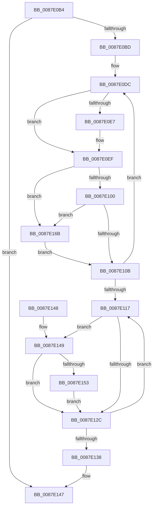

# PspIncrementJobChainProcessCounts

- RVA: `0x0087E0B4`–`0x0087E173` (길이 `191` bytes)
- VA: `0x000000014087E0B4`
- 실행 섹션: `PAGE`
- PDB 이름 있음: `예`; PDB Function 태그: `아니요`
- unwind 정보 RVA: `0x0007C004`
- 디코드: `48`개 명령, `191/191` bytes 표시
- 미해석 바이트: `0` (있으면 어셈블리에 `.byte`로 보존)

> 이 문서는 커널 이미지의 기계어와 PDB 기호를 분석해 생성했습니다. 4번과 5번은 함수 원형과 자료형을 바이너리 사용 방식에서 추정한 C 해석이며 원본 소스 복구 결과는 아닙니다.

## 1. Dependencies

- 직접 호출 지점: **1**; 고유 호출 대상: **1**
- 직접 호출자로 확인된 함수: **2**
- RIP 상대 이미지 참조: **0**

### Outgoing calls
- `0x0087E164` → [PspSendJobNotification](../../text/49/PspSendJobNotification_function_0049EC28.md) (function, `0x0049EC28`)

### Direct callers
- [PspImplicitAssignProcessToJob](PspImplicitAssignProcessToJob_function_0087D584.md) at `0x0087D679`
- [PspAssignProcessToJob](../A2/PspAssignProcessToJob_function_00A23370.md) at `0x00A2374F`

### Static image references
- 디코드된 RIP-relative 메모리 참조가 없습니다.

## 2. Other-region calls and transfers

- 다른 실행 섹션으로 향하는 call: **1**
  - `0x0087E164` → [PspSendJobNotification](../../text/49/PspSendJobNotification_function_0049EC28.md) (`PAGE` → `.text`)
- 별도 외부 분기/꼬리 이동을 확인하지 못했습니다.

## 3. Assembly (complete function range)

```asm
0087E0B4  48 3B CA                        cmp rcx, rdx
0087E0B7  0F 84 8A 00 00 00               je 0x14087e147
0087E0BD  48 89 5C 24 08                  mov qword ptr [rsp + 8], rbx
0087E0C2  48 89 74 24 10                  mov qword ptr [rsp + 0x10], rsi
0087E0C7  57                              push rdi
0087E0C8  48 83 EC 20                     sub rsp, 0x20
0087E0CC  49 8B F0                        mov rsi, r8
0087E0CF  48 8B FA                        mov rdi, rdx
0087E0D2  48 8B D9                        mov rbx, rcx
0087E0D5  41 81 E1 00 80 00 00            and r9d, 0x8000
0087E0DC  8B 81 D4 00 00 00               mov eax, dword ptr [rcx + 0xd4]
0087E0E2  83 F8 FF                        cmp eax, -1
0087E0E5  74 08                           je 0x14087e0ef
0087E0E7  FF C0                           inc eax
0087E0E9  89 81 D4 00 00 00               mov dword ptr [rcx + 0xd4], eax
0087E0EF  FF 81 D8 00 00 00               inc dword ptr [rcx + 0xd8]
0087E0F5  FF 81 B0 05 00 00               inc dword ptr [rcx + 0x5b0]
0087E0FB  45 85 C9                        test r9d, r9d
0087E0FE  75 6B                           jne 0x14087e16b
0087E100  41 8B 80 FC 05 00 00            mov eax, dword ptr [r8 + 0x5fc]
0087E107  A8 20                           test al, 0x20
0087E109  75 60                           jne 0x14087e16b
0087E10B  48 8B 89 18 05 00 00            mov rcx, qword ptr [rcx + 0x518]
0087E112  48 3B CF                        cmp rcx, rdi
0087E115  75 C5                           jne 0x14087e0dc
0087E117  F0 81 A3 10 06 00 00 FF FF DF FF  lock and dword ptr [rbx + 0x610], 0xffdfffff
0087E122  48 83 BB 28 02 00 00 00         cmp qword ptr [rbx + 0x228], 0
0087E12A  75 1D                           jne 0x14087e149
0087E12C  48 8B 9B 18 05 00 00            mov rbx, qword ptr [rbx + 0x518]
0087E133  48 3B DF                        cmp rbx, rdi
0087E136  75 DF                           jne 0x14087e117
0087E138  48 8B 5C 24 30                  mov rbx, qword ptr [rsp + 0x30]
0087E13D  48 8B 74 24 38                  mov rsi, qword ptr [rsp + 0x38]
0087E142  48 83 C4 20                     add rsp, 0x20
0087E146  5F                              pop rdi
0087E147  C3                              ret
0087E148  CC                              int3
0087E149  8B 83 50 04 00 00               mov eax, dword ptr [rbx + 0x450]
0087E14F  A8 40                           test al, 0x40
0087E151  74 D9                           je 0x14087e12c
0087E153  4C 8B 86 D0 01 00 00            mov r8, qword ptr [rsi + 0x1d0]
0087E15A  45 33 C9                        xor r9d, r9d
0087E15D  48 8B CB                        mov rcx, rbx
0087E160  41 8D 51 06                     lea edx, [r9 + 6]
0087E164  E8 BF 0A C2 FF                  call 0x14049ec28
0087E169  EB C1                           jmp 0x14087e12c
0087E16B  FF 81 B4 05 00 00               inc dword ptr [rcx + 0x5b4]
0087E171  EB 98                           jmp 0x14087e10b
```

## 4. C-style interpretation (structured pseudocode)

```c
__int64 __fastcall PspIncrementJobChainProcessCounts(__int64 a1, __int64 a2, __int64 a3, int a4)
{
    __int64 result;
    __int64 v_rsp;
    unsigned __int64 v_stack_p10;
    unsigned __int64 v_stack_p8;

    if (a1 == a2) goto loc_0087E147;
    v_stack_p8 = v_rbx;
    v_stack_p10 = v_rsi;
    v_rsp = (v_rsp) - (32);
    a4 = (unsigned int)((a4) & (0x8000ULL));
loc_0087E0DC:
    result = (unsigned int)(*(unsigned int *)(a1 + 212));
    if (((unsigned int)((unsigned int)(*(unsigned int *)(a1 + 212)))) != -1) {
        result = (unsigned int)(((unsigned int)(*(unsigned int *)(a1 + 212))) + 1);
        *(unsigned int *)(a1 + 212) = (unsigned int)(result);
    }
    if (a4 != 0) goto loc_0087E16B;
    if ((((unsigned __int8)((unsigned int)(*(unsigned int *)(a3 + 1532)))) & (32)) != 0) goto loc_0087E16B;
loc_0087E10B:
    if ((*(unsigned __int64 *)(a1 + 1304)) != a2) goto loc_0087E0DC;
loc_0087E117:
    if ((*(unsigned __int64 *)(a1 + 552)) != 0) goto loc_0087E149;
loc_0087E12C:
    if ((*(unsigned __int64 *)(a1 + 1304)) != a2) goto loc_0087E117;
    v_rsp = (v_rsp) + (32);
loc_0087E147:
    return (unsigned int)(*(unsigned int *)(a3 + 1532));
loc_0087E149:
    if ((((unsigned __int8)((unsigned int)(*(unsigned int *)(v_stack_p8 + 1104)))) & (64)) == 0) goto loc_0087E12C;
    a4 = 0;
    result = PspSendJobNotification(v_stack_p8, a4 + 6, *(unsigned __int64 *)(v_stack_p10 + 464), a4);
    goto loc_0087E12C;
loc_0087E16B:
    goto loc_0087E10B;
}
```

## 5. (Beta) C Style

```c
int64_t PspIncrementJobChainProcessCounts(int64_t Arg1, int64_t Arg2, void *Arg3, int32_t Arg4)
{
    uint8_t *arg3 = (uint8_t *)Arg3;

    int64_t result;
    int64_t local_rsp;
    uint64_t v_stack_p10;
    uint64_t v_stack_p8;

    if (Arg1 == Arg2) goto loc_0087E147;
    v_stack_p8 = local_rbx;
    v_stack_p10 = local_rsi;
    local_rsp = (local_rsp) - (32);
    Arg4 = (uint32_t)((Arg4) & (0x8000ULL));
loc_0087E0DC:
    result = (uint32_t)(*(uint32_t *)(Arg1 + 0xD4));
    if (((uint32_t)((uint32_t)(*(uint32_t *)(Arg1 + 0xD4)))) != -1) {
        result = (uint32_t)(((uint32_t)(*(uint32_t *)(Arg1 + 0xD4))) + 1);
        *(uint32_t *)(Arg1 + 0xD4) = (uint32_t)(result);
    }
    if (Arg4 != 0) goto loc_0087E16B;
    if ((((uint8_t)((uint32_t)(*(uint32_t *)(arg3 + 0x5FC)))) & (32)) != 0) goto loc_0087E16B;
loc_0087E10B:
    if ((*(uint64_t *)(Arg1 + 0x518)) != Arg2) goto loc_0087E0DC;
loc_0087E117:
    if ((*(uint64_t *)(Arg1 + 0x228)) != 0) goto loc_0087E149;
loc_0087E12C:
    if ((*(uint64_t *)(Arg1 + 0x518)) != Arg2) goto loc_0087E117;
    local_rsp = (local_rsp) + (32);
loc_0087E147:
    return (uint32_t)(*(uint32_t *)(arg3 + 0x5FC));
loc_0087E149:
    if ((((uint8_t)((uint32_t)(*(uint32_t *)(v_stack_p8 + 0x450)))) & (64)) == 0) goto loc_0087E12C;
    Arg4 = 0;
    result = PspSendJobNotification(v_stack_p8, Arg4 + 6, *(uint64_t *)(v_stack_p10 + 0x1D0), Arg4);
    goto loc_0087E12C;
loc_0087E16B:
    goto loc_0087E10B;
}
```

### 관측된 메모리 오프셋

구조체 형식이 확인되지 않은 접근은 인자 기준의 오프셋으로만 기록했습니다.

| 기준 인자 | 오프셋 표현 | 폭 (bit) | 접근 |
|---|---:|---:|---|
| `Arg3` | `+ 0x1D0` | `64` | `R` |
| `Arg3` | `+ 0x5FC` | `32` | `R` |

## 6. Execution-region graph

[열기: 2D/3D 그래프와 함수 탐색 컨트롤 패널](../../../control-panel.html?section=page&rva=0x0087E0B4&view=graph)

- 2D 그래프는 위에서 아래로 흐르고, 3D 그래프는 빈 공간을 드래그해 회전합니다. Shift+드래그는 이동, 휠은 확대·축소, 함수 노드 선택은 대상 보고서 이동입니다.

### Static fallback


