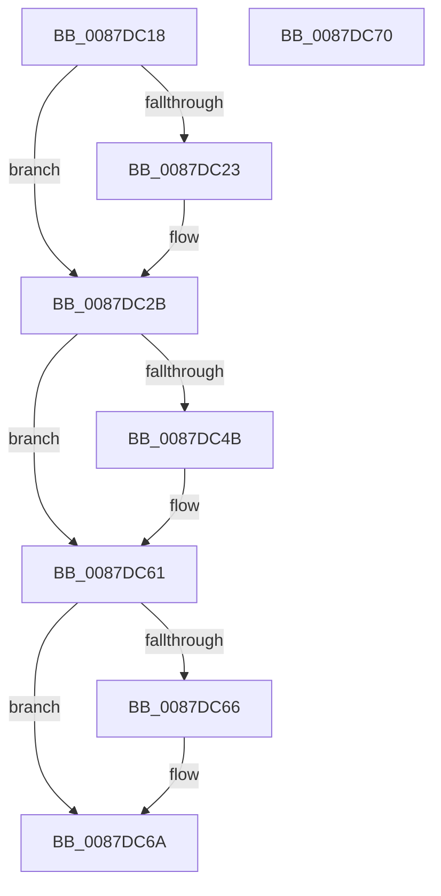

# PspLockJobAssignment

- RVA: `0x0087DC18`–`0x0087DC71` (길이 `89` bytes)
- VA: `0x000000014087DC18`
- 실행 섹션: `PAGE`
- PDB 이름 있음: `예`; PDB Function 태그: `아니요`
- unwind 정보 RVA: `0x0005CF00`
- 디코드: `24`개 명령, `89/89` bytes 표시
- 미해석 바이트: `0` (있으면 어셈블리에 `.byte`로 보존)

> 이 문서는 커널 이미지의 기계어와 PDB 기호를 분석해 생성했습니다. 4번과 5번은 함수 원형과 자료형을 바이너리 사용 방식에서 추정한 C 해석이며 원본 소스 복구 결과는 아닙니다.

## 1. Dependencies

- 직접 호출 지점: **2**; 고유 호출 대상: **2**
- 직접 호출자로 확인된 함수: **3**
- RIP 상대 이미지 참조: **2**

### Outgoing calls
- `0x0087DC37` → [KeAbPreAcquire](../../text/21/KeAbPreAcquire_function_00210230.md) (function, `0x00210230`)
- `0x0087DC5C` → [ExfAcquirePushLockExclusiveEx](../../text/20/ExfAcquirePushLockExclusiveEx_function_0020FC90.md) (function, `0x0020FC90`)

### Direct callers
- [PspGetJobLockHierarchyForDeletion](PspGetJobLockHierarchyForDeletion_function_0087D510.md) at `0x0087D531`
- [PspLockJobChain](PspLockJobChain_function_0087DAD0.md) at `0x0087DB07`
- [PspAssignProcessToJob](../A2/PspAssignProcessToJob_function_00A23370.md) at `0x00A23463`

### Static image references
- `0x0087DC2E` → RVA `0x00FD9E88` (`PAGEDATA`; read)
- `0x0087DC3C` → RVA `0x00FD9E88` (`PAGEDATA`; read/write)

## 2. Other-region calls and transfers

- 다른 실행 섹션으로 향하는 call: **2**
  - `0x0087DC37` → [KeAbPreAcquire](../../text/21/KeAbPreAcquire_function_00210230.md) (`PAGE` → `.text`)
  - `0x0087DC5C` → [ExfAcquirePushLockExclusiveEx](../../text/20/ExfAcquirePushLockExclusiveEx_function_0020FC90.md) (`PAGE` → `.text`)
- 별도 외부 분기/꼬리 이동을 확인하지 못했습니다.

## 3. Assembly (complete function range)

```asm
0087DC18  40 53                           push rbx
0087DC1A  48 83 EC 20                     sub rsp, 0x20
0087DC1E  48 85 C9                        test rcx, rcx
0087DC21  74 08                           je 0x14087dc2b
0087DC23  66 FF 89 E6 01 00 00            dec word ptr [rcx + 0x1e6]
0087DC2A  90                              nop
0087DC2B  45 33 C0                        xor r8d, r8d
0087DC2E  48 8D 0D 53 C2 75 00            lea rcx, [rip + 0x75c253]
0087DC35  33 D2                           xor edx, edx
0087DC37  E8 F4 25 99 FF                  call 0x140210230
0087DC3C  F0 48 0F BA 2D 42 C2 75 00 00   lock bts qword ptr [rip + 0x75c242], 0
0087DC46  48 8B D8                        mov rbx, rax
0087DC49  73 16                           jae 0x14087dc61
0087DC4B  4C 8D 05 36 C2 75 00            lea r8, [rip + 0x75c236]
0087DC52  48 8B D0                        mov rdx, rax
0087DC55  48 8D 0D 2C C2 75 00            lea rcx, [rip + 0x75c22c]
0087DC5C  E8 2F 20 99 FF                  call 0x14020fc90
0087DC61  48 85 DB                        test rbx, rbx
0087DC64  74 04                           je 0x14087dc6a
0087DC66  C6 43 0A 01                     mov byte ptr [rbx + 0xa], 1
0087DC6A  48 83 C4 20                     add rsp, 0x20
0087DC6E  5B                              pop rbx
0087DC6F  C3                              ret
0087DC70  CC                              int3
```

## 4. C-style interpretation (structured pseudocode)

```c
__int64 __fastcall PspLockJobAssignment(__int64 a1, int a2, int a3)
{
    __int64 result;
    __int64 v_rsp;

    v_rsp = (v_rsp) - (32);
    if (a1 != 0) {
    }
    a3 = 0;
    a2 = 0;
    result = KeAbPreAcquire(v_rip + 7717459, a2, a3, a4);
    if (!(condition_is_above_or_equal)) {
        a3 = v_rip + 7717430;
        a2 = result;
        a1 = v_rip + 7717420;
        result = ExfAcquirePushLockExclusiveEx(a1, a2, a3, a4);
    }
    if (result != 0) {
        *(unsigned __int8 *)(result + 10) = 1;
    }
    v_rsp = (v_rsp) + (32);
    return result;
}
```

## 5. (Beta) C Style

```c
int64_t PspLockJobAssignment(int64_t Arg1, int32_t Arg2, int32_t Arg3)
{
    int64_t result;
    int64_t local_rsp;

    local_rsp = (local_rsp) - (32);
    if (Arg1 != 0) {
    }
    Arg3 = 0;
    Arg2 = 0;
    result = KeAbPreAcquire(v_rip + 7717459, Arg2, Arg3, a4);
    if (!(condition_is_above_or_equal)) {
        Arg3 = v_rip + 7717430;
        Arg2 = result;
        Arg1 = v_rip + 7717420;
        result = ExfAcquirePushLockExclusiveEx(Arg1, Arg2, Arg3, a4);
    }
    if (result != 0) {
        *(uint8_t *)(result + 0xA) = 1;
    }
    local_rsp = (local_rsp) + (32);
    return result;
}
```

## 6. Execution-region graph

[열기: 2D/3D 그래프와 함수 탐색 컨트롤 패널](../../../control-panel.html?section=page&rva=0x0087DC18&view=graph)

- 2D 그래프는 위에서 아래로 흐르고, 3D 그래프는 빈 공간을 드래그해 회전합니다. Shift+드래그는 이동, 휠은 확대·축소, 함수 노드 선택은 대상 보고서 이동입니다.

### Static fallback


